# Energy Compass — states and strategies guide

**English** · [Polski](guide.pl.md)

This guide explains what Energy Compass does, every state its entities can report and the
conditions that produce each state, and the six dispatch strategies. It describes release
**0.1.37**. The mathematical contract behind each rule lives in [model and limitations](model.md);
installation and dashboards are in the [installation guide](installation.md).

Energy Compass is **advisory**. It computes a plan and publishes it as Home Assistant entities. It
sends no messages by itself, and it writes inverter settings only when you enable the optional Deye
controller (off by default), which does so through the Solarman integration; notification blueprints
and other controllers decide for themselves whether to act on the plan. See
[Deye inverter controller](#deye-inverter-controller-solarman).

## Contents

1. [How it works](#how-it-works)
2. [Entity overview](#entity-overview)
3. [Optimizer status — calculation lifecycle](#optimizer-status--calculation-lifecycle)
4. [Alert and forecast validity](#alert-and-forecast-validity)
5. [Operating modes — the planned battery state](#operating-modes--the-planned-battery-state)
6. [Consumption levels — BOOST, CHEAP, NORMAL, LIMIT](#consumption-levels--boost-cheap-normal-limit)
7. [Windows and flexible energy depth](#windows-and-flexible-energy-depth)
8. [Dispatch strategies](#dispatch-strategies)
9. [Automatic strategy switching](#automatic-strategy-switching)
10. [Window notifications](#window-notifications)
11. [Cost card](#cost-card)
12. [Deye inverter controller (Solarman)](#deye-inverter-controller-solarman)
13. [Energy Atlas (optional)](#energy-atlas-optional)
14. [Offline replay tool](#offline-replay-tool)
15. [Reason code reference](#reason-code-reference)

## How it works

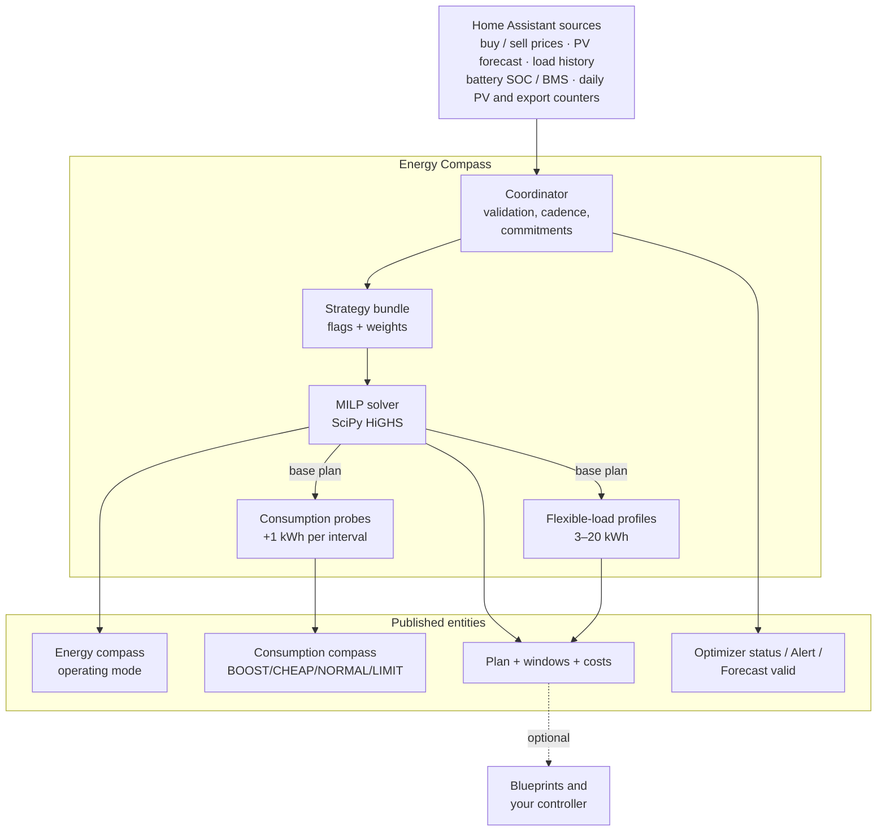

Each calculation proceeds as follows:

1. **Snapshot and validate inputs.** Prices, PV forecast, load forecast (from recorder history),
   battery SOC and daily counters are read and checked for freshness, units and plausibility.
2. **Build the problem.** Native tariff slots (typically 15 min) over the planning horizon (24 h by
   default), hardware limits, SOC bounds, the carried operating-mode commitment and the active
   **strategy** bundle.
3. **Solve the base plan.** A mixed-integer linear program minimizes cost (plus strategy weights)
   under energy balance, battery, grid, mode-duration and export/charge-policy constraints. The
   proven optimum is published; when `solve_time_limit_s` runs out first, the best validated
   solution found so far is published instead and marked `time_limited` with its `mip_gap`.
4. **Probe consumption.** For each display interval, the solver is rerun with 1 kWh of extra load;
   the cost difference is the *incremental cost of one more kWh*, which is classified into a
   consumption level.
5. **Profile flexible loads.** Separate solves for 3, 5, 10, 15 and 20 kWh blocks measure how much
   flexible energy can be scheduled before the price degrades.
6. **Publish.** One coherent generation updates all entities; unchanged entities are not rewritten.

### Recalculation cadence

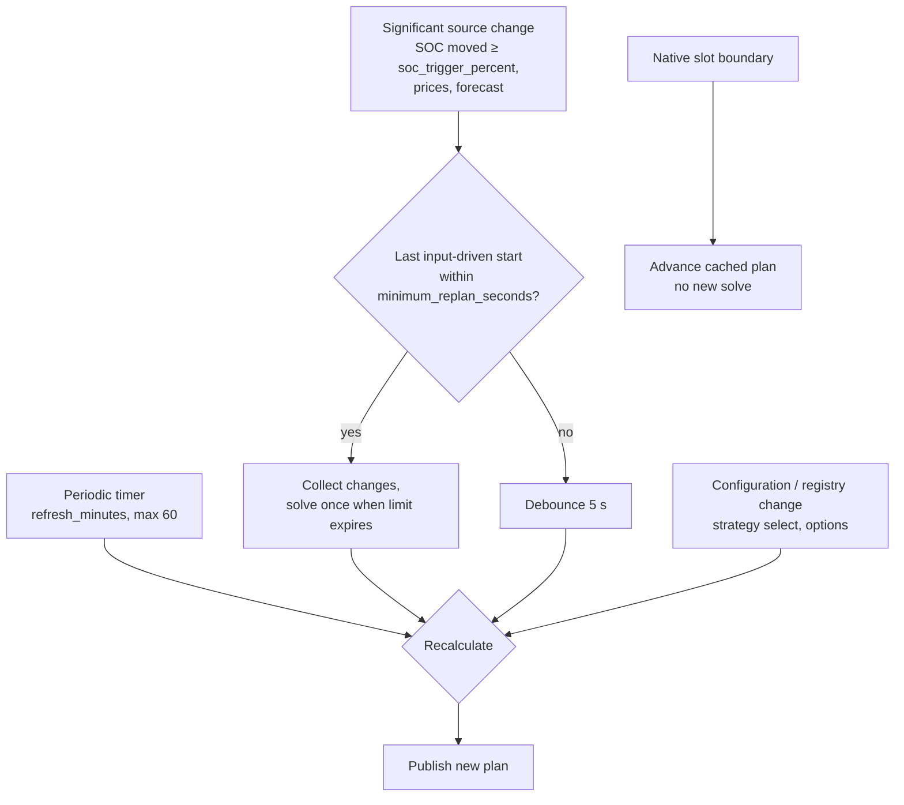

- **Periodic:** `refresh_minutes` (default 15, max 60) aligned to the wall clock; the Deye hybrid
  setup profile pre-fills 60.
- **Input-driven:** at most once per `minimum_replan_seconds` (default 900 s, `0` disables) while a
  valid plan is retained; SOC counts as changed only after moving `soc_trigger_percent` (default
  5 %) from the value that started the last calculation.
- **Boundaries:** at each native settlement boundary the existing plan advances (consumed rows are
  dropped, mode clocks tick) without a solve.
- **Plan lifetime:** a new plan is valid until `generated_at + 2 × refresh_minutes`, capped by
  forecast coverage.

### Setup profiles (new installations)

Three axes on the first (**User**) setup form, **Prosumer settlement**, **Polish distribution
tariff** (`buy_tariff`) and **Inverter**, pre-fill editable tuning for a brand-new installation.
Each axis is chosen once; all default to **Generic** or **None** (no assignments), and picking a
profile applies its assignments to the draft immediately. This is revision 3 of the setup profiles;
an entry created under revision 1 or 2 keeps its record and is never re-resolved. The
pinned values below (0.20, 0.60, 0.13) were measured or backtested on one site — a G12 buy tariff,
net-billing RCE sell and a Deye LFP battery — and are a starting point, not a universal default.

**Settlement axis:**

| Profile | Currency | Pre-fills | Basis |
| --- | --- | --- | --- |
| `generic` | any | none | — |
| `pl_net_billing` | PLN | `import_penalty_per_kwh` 0.20 · `terminal_mode` `value` · `terminal_value_per_kwh` 0.60 · `sell_multiplier` 1.23 *(only with preset `pse`/`pse_solcast` or an RCE market price sell source)* | backtested on one site |
| `pl_net_metering_80` | PLN | `sell_multiplier` 0.8 | net-metering ratio, installations ≤ 10 kWp |
| `pl_net_metering_70` | PLN | `sell_multiplier` 0.7 | net-metering ratio, installations > 10 kWp |

**Polish distribution tariff axis (`buy_tariff`):** the profile only pre-selects **Tariffs → Buy
source → Polish tariff schedule** for the chosen tariff; it assigns no setting and no price, and the
rates stay at 0 until you type them. Every catalog profile requires PLN.

| Profile | Currency | Effect | Basis |
| --- | --- | --- | --- |
| `generic` | any | none; keep a fixed buy rate | — |
| `g11` | PLN | schedule G11, one rate | any operator |
| `pge_g12` | PLN | schedule G12 | PGE Dystrybucja |
| `pge_g12w` | PLN | schedule G12w | PGE Dystrybucja |
| `tauron_g12` | PLN | schedule G12 | Tauron Dystrybucja |
| `tauron_g12w` | PLN | schedule G12w | Tauron Dystrybucja |
| `enea_g12` | PLN | schedule G12 with the Enea default hours | Enea Operator |
| `enea_g12w` | PLN | schedule G12w | Enea Operator |
| `energa_g12` | PLN | schedule G12 | Energa-Operator |
| `energa_g12w` | PLN | schedule G12w | Energa-Operator |
| `stoen_g12` | PLN | schedule G12 | Stoen Operator |
| `stoen_g12w` | PLN | schedule G12w | Stoen Operator |

**Inverter axis:**

| Profile | Pre-fills | Basis |
| --- | --- | --- |
| `generic` | none | — |
| `deye_hybrid` | `idle_drain_kw` 0.13 · `refresh_minutes` 60 | `idle_drain_kw` is site-measured; `refresh_minutes` is a Deye-specific trade-off |

Every pre-filled value stays fully editable and is never re-applied once the entry exists — not by
Configure, not by Reconfigure. While a new installation is still being set up, changing the preset on
the Installation step re-resolves the settlement profile: the 1.23 sell multiplier is added or
dropped to track the preset (or an RCE market price sell source saved in the meantime) unless you
have already edited it. Binding a pre-filled key to a helper
overrides the pre-fill at save time; the Preview lists that key as edited, naming the helper and its
effective value.

Polish settlement and tariff profiles require currency PLN; choosing one with another currency is
rejected, on the field that caused it. Setup profiles never set a tariff price (`buy_rate`,
`buy_off_peak_rate`, `buy_distribution_rate`, `buy_distribution_off_peak_rate`, `sell_rate`, `buy_addition`,
`sell_addition`, `monthly_charge`) and never touch a strategy-owned setting. They never enable the
[deposit model](#net-billing-deposit-value) either: every installation starts with it off.

**Sell only PV** (`limit_export_to_pv`) stays on with every settlement profile — a Polish prosumer may
only sell energy produced by their own PV — and is turned off either by switching to the `max_export`
strategy or by setting `limit_export_to_pv` to off directly; the explicit setting persists across
strategy changes.

The 1.23 deposit multiplier applies together with a raw-RCE preset (`pse`, `pse_solcast`) **or** a
raw-RCE sell source (**Tariffs → Sell source → RCE market price (PSE)**: a forecast with a price
floor and every binding in PLN/MWh). New-entry saves re-evaluate it until the installation is created;
Configure and Reconfigure never do. With
[`examples/rce-sell-price.yaml`](../examples/rce-sell-price.yaml), which already applies the floor and
the 1.23 factor itself, keep the sell multiplier at 1 (see [tariff helper](tariff-helper.md)).

Revision 3 adds one rule to this: when the sell source is a forecast entity that already applies its
own settlement (a `settlement` attribute that names a multiplier, as in the sell template of
[`examples/rce-sell-price.yaml`](../examples/rce-sell-price.yaml)), the 1.23 multiplier is not
assigned, even with preset `pse` or `pse_solcast`, and binding such a source later removes a 1.23
you did not edit. Binding that template through
[Detected sources](#detected-sources-new-installations) also sets the sell multiplier to 1.

Net-metering's `sell_multiplier` is a one-time copy of the ratio, not a link to the buy price: it is
an approximation (the yearly kWh bank and G12 band mismatch are not modelled), and a later edit to
the buy price does not update it.

Preview shows setup-profile provenance for a profiled new entry: which keys each axis pre-filled, the
buy source pre-selected by a `buy_tariff` profile, any value edited after pre-fill (including a
helper-bound key, with the helper's effective value), and settlement notes — Sell only PV off, a sell
source that already applies its own settlement multiplier, raw RCE prices not floored at 0 (with the
RCE market price shortcut as the fix) or floored while the 1.23 multiplier is missing, or a
net-metering sell that no longer tracks buy — shown only for installations that used a setup profile.

The selection, together with the setup-profiles revision that resolved it, is stored on the config
entry (`setup_profiles`) and included in diagnostics.

### Built-in Polish tariffs

For a Polish household, **Tariffs → Buy source → Polish tariff schedule (G11/G12/G12w)** replaces the
tariff helper YAML (the [YAML example](tariff-helper.md) stays the fallback). Pick one of eleven
catalog entries; the zones come from the distributor's 2026 tariff, and **you type the rates**: **Tariffs →
Fixed rates and transformations** holds *Buy rate* (G11, or the peak rate) and *Off-peak buy rate*
(G12/G12w). Both rates must be above zero or the calculation fails closed with a message naming
those fields. The price of a slot is `rate × multiplier × VAT factor + addition`, as for a fixed
rate. The schedule needs no entity and does not limit the planning horizon. It requires currency PLN.

| Key | Operator and group | Weekday off-peak (tariff clock) | Free days | Source |
| --- | --- | --- | --- | --- |
| `g11` | any, G11 | none, one rate | — | — |
| `pge_g12` | PGE Dystrybucja, G12 | Apr–Sep 15–17 and 22–6; Oct–Mar 13–15 and 22–6 | as weekdays | tariff 2026 §2.2.6/2.2.8/2.2.11 |
| `pge_g12w` | PGE Dystrybucja, G12w | as `pge_g12` | all day | same |
| `tauron_g12` | Tauron Dystrybucja, G12 | 13–15 and 22–6 | as weekdays | tariff 2026 §2.2.6/2.2.7/2.2.9 |
| `tauron_g12w` | Tauron Dystrybucja, G12w | 13–15 and 22–6 | all day | same |
| `enea_g12` | Enea Operator, G12 | default 13–15 and 22–6; set per meter by Enea | as weekdays | tariff extract 2026 §2.2.5/2.2.7/2.2.12 |
| `enea_g12w` | Enea Operator, G12w | 21–6 | all day | same |
| `energa_g12` | Energa-Operator, G12 | 13–15 and 22–6 | as weekdays | tariff extract 2026 §3.2.5/3.2.6 |
| `energa_g12w` | Energa-Operator, G12w | 13–15 and 22–6 | all day | same |
| `stoen_g12` | Stoen Operator, G12 | 13–15 and 22–6 | as weekdays | tariff 2026 §2.2.5/2.2.6/2.2.11 |
| `stoen_g12w` | Stoen Operator, G12w | 22–6 only | all day | same |

Free days of G12w are Saturdays, Sundays and statutory holidays (1 and 6 January, Easter Sunday and
Monday, 1 and 3 May, Pentecost, Corpus Christi, 15 August, 1 and 11 November, 24 December from
1 February 2025, 25 and 26 December); there are no substitute days. A meter that was not
reprogrammed can ignore a newly added holiday such as 24 December; the YAML fallback's
`off_peak_dates` covers that.

**Clock.** By default the zones follow **local time** (the Home Assistant time zone): a remote-read
meter billed after hourly balancing uses wall-clock zones, so a day can have 23 or 25 local hours.
An old non-remote meter keeps a fixed internal clock on winter time (the tariff clause in the sources
above); turn on **Old non-remote meter on winter time (fixed UTC+1)** for it. To choose, compare your
invoice's monthly day/night kWh with your hourly import data split by the windows Preview prints; if
the summer months are off by about one hour, enable the winter clock. Season and weekday are
classified on the date of the chosen clock. Preview prints the clock, today's off-peak windows and,
for G12w, the statutory holidays in the horizon.

**Enea G12.** Enea sets the hours per meter: 8 hours within 22–7 (start 22 or 23) and 2 hours within
13–17 (start 13, 14 or 15). The default is 22 and 13 (Enea FAQ); the extra form asks for both, so check
your meter or bill.

**Distribution tariff.** A buy source that is not a tariff schedule (a fixed rate, an entity, or a
dynamic energy price from a forecast) can still take the distributor's zones: **Tariffs → Buy source →
Distribution tariff (zones for the distribution rates)** (currency PLN) offers the same catalog,
winter-clock flag and Enea hours, or *None (single zone)*. The zones apply to the two distribution
rates of the [deposit model](#net-billing-deposit-value) (`buy_distribution_rate`,
`buy_distribution_off_peak_rate`); their band edges become interval boundaries for the planner, as for
a schedule. They do not change the buy source. A schedule source keeps its own zones, so choosing a
tariff schedule drops a stored distribution tariff. Preview shows both parts of the first interval's
buy price, the energy part and the distribution part. The buy row of **Sources → Review and edit
sources** shows the distribution mode, the zones and the rate per zone.

**RCE sell price.** **Tariffs → Sell source → RCE market price (PSE)** saves the sensor of the `rce_pse`
integration (attribute `prices`, value `rce_pln`, end `dtime`, PLN/MWh, 15 minutes) as a forecast source
with a price floor of 0: the raw value is floored at 0 per kWh **before** the multiplier, VAT and
addition (`max(RCE, 0) × 1.23` with the net-billing multiplier). The floor is visible in Preview and
is dropped when the source is switched away from forecast or edited so that it is no longer a raw PLN/MWh RCE source. For a new installation, the PL
net-billing profile then assigns the 1.23 multiplier; in Configure and Reconfigure set the sell
multiplier yourself. Without the `rce_pse` integration use
[`examples/rce-sell-price.yaml`](../examples/rce-sell-price.yaml).

### Detected sources (new installations)

After the first (**User**) form of a **new** installation, **Detected sources** looks for sources
Energy Compass can use, binds the ones you keep and opens Preview: the quick path to a first plan.
It never runs in Configure or Reconfigure, never changes the preset or a setup profile, and never
touches the buy source (the `buy_tariff` profile and **Tariffs** stay the only buy path).
Candidates are recognised by integration identity (the integration, the entity's translation key
and the Energy dashboard preferences), never by entity id or name, so renamed or localized
entities are found too. If nothing is found, or you keep nothing, the main menu opens as before.
Every bound source stays editable in **Sources**.

**Energy dashboard first.** Energy Compass should read the same data as the Energy dashboard. For
every role the dashboard covers (lifetime counters, solar, grid and battery power, battery SOC and
the solar forecast) the dashboard's choice ranks first; the integration signals below are the
fallback. For power it uses the normalized power sensor the dashboard stores. When both exist and
differ, both are offered, the dashboard one is preselected and the line names both. The same entity
found twice is offered once.

**Controls.** A row with one candidate is a single checkbox, ticked (BMS SOC: unticked). A row with
several candidates is a drop-down: the preselected candidate, the others in order of preference and
**Do not bind** last. A tie that cannot be resolved offers **Do not bind** preselected. Among
equally ranked candidates the single Deye Solarman config entry breaks the tie, for example the
dashboard's two grid meters resolve to the inverter's counter.

| Row | Candidates in order of preference |
| --- | --- |
| `pv` | the Energy dashboard solar forecast (`solar_forecast`, all its integrations added together); Solcast `solcast_solar` total sensors for today and tomorrow (`total_kwh_forecast_today`, `total_kwh_forecast_tomorrow`, attribute `detailedForecast`) |
| `sell` | the Energy Compass sell template (`template`: unique id starting `energy_compass_`, a `settlement` attribute naming a multiplier, and `prices`); `rce_pse` for today and tomorrow (`rce_pse_today_price`, `rce_pse_tomorrow_price`) |
| `load` | `solarman` lifetime household consumption (`total_load_consumption`) as a recorder statistic |
| `soc` | the dashboard battery SOC; an external SOC template (`template`, device class battery, unit %); `solarman` `battery` |
| `bms_soc` | `solarman` `battery` attribute `BMS SOC`; the one enabled BMS pack sensor (`battery_N`); never preselected |
| `battery_power` | the dashboard battery power; `battery_power` |
| `pv_power` | the dashboard solar power; `pv_power` |
| `grid_import_power`, `grid_export_power` | the dashboard grid power (sign +1 for import, −1 for export); `grid_power` with the same signs |
| `pv_energy` | the dashboard solar energy; `total_production` |
| `grid_import_energy` | the dashboard grid import; `total_energy_import` |
| `grid_export_energy` | the dashboard grid export; `total_energy_export` |
| `pv_energy_today` | `today_production` |
| `grid_export_energy_today` | `today_energy_export` |

- **Solarman.** Only config entries with at least one device from manufacturer Deye count. The
  inverter and its BMS packs are devices of one config entry. With several Deye entries every
  Solarman row has several candidates and no default. The sign conventions (battery + is discharge,
  grid + is import) were verified on one Deye profile only; the offered value is shown so you can
  check it.
- **Validation.** Each candidate is checked with the parsers Preview uses, on the exact binding
  that would be stored. Forecasts must parse (tomorrow may be unpublished); counters and power need
  a numeric state in W, kW, Wh or kWh; a SOC must be a finite value from 0 to 100 (a state SOC needs
  unit %); a load statistic needs a cumulative state class and kWh or Wh. An unusable candidate is
  not offered; the notes list it with the reason.
- **Sell template.** Binding it sets the sell multiplier to 1, because the template already applies
  its floor and multiplier. Setup profiles revision 3 then does not add 1.23 again (see [Setup
  profiles](#setup-profiles-new-installations)). A stale template is not offered.
- **`rce_pse`.** The sensor must report PLN/MWh (the integration default); the `PLN/kWh` price
  unit option is rejected here and in **Tariffs → Sell source → RCE market price (PSE)**, because it
  would price energy a thousand times too low.
- **Solcast.** `detailedForecast` exists only while the option **Include detailed forecast
  half-hourly** is on. The day 3–7 sensors, the hourly detail and the rooftop-site sensors are never
  used.
- **BMS SOC.** It is offered unticked. With imbalanced battery cells the BMS SOC and the battery SOC
  can differ by more than Battery → Soc disagreement percent (default 5 %), and then every plan is
  blocked. Tick it only if both agree over a full day.
- **Gates.** `sell` appears only with currency PLN. With PV off there are no `pv`, `pv_power` or
  `pv_energy` rows; with the battery off no `soc`, `bms_soc` or `battery_power` rows. The two daily
  counters are never gated.
- **Stored age limits** of the measurements: 3600 s for `battery_power`, `grid_import_power` and
  `grid_export_power`; 86400 s for `pv_power`, the lifetime counters, the battery charge and discharge
  energy counters and the daily counters (a constant 0 W at night never updates the state).
- **Never detected:** `buy`; `throughput_today` (to use `daily_cycles` provide one entity with the
  AC-side charge plus discharge since midnight, see [source requirements](source-requirements.md#daily-battery-throughput));
  `battery_energy`, `battery_charge_power`, `battery_discharge_power`, `battery_charge_energy` and
  `battery_discharge_energy` (the optional [measured calibration](#measured-calibration-optional)
  counters); and helpers.

Preview then shows the usual acknowledgements for a new entry. Its **Back to the main menu**
checkbox leaves Preview without validating or saving anything. The matching reference tables are in
[source requirements](source-requirements.md#automatic-detection).

### Energy dashboard solar forecast

**Sources → Add source → PV → Energy dashboard solar forecast** (mode `solar_forecast`) reads the
same solar forecast as the Energy dashboard, from every integration with an Energy solar-forecast
platform (Solcast, Forecast.Solar, Open-Meteo and others). Pick one or more loaded integrations;
their forecasts are added, as the dashboard adds them. The form defaults to the integrations in the
dashboard's solar settings. Detected sources offers the same mode first when the dashboard has a
forecast.

- **Hourly dashboard rule.** Every value is Wh in the local hour that contains its key; values in one
  hour are summed. The plan sees hourly energy from the current hour to the last hour with a key, up
  to 49 hours ahead; keys older than two days are ignored.
- **Night hours** that the provider omits count as 0 Wh. A gap inside the day is also 0, so a
  provider gap makes the plan more conservative.
- **Provider notes.** Solcast's platform uses the forecast type chosen in its options (`key_estimate`,
  for example the 10th percentile) in 30-minute steps, while the Solcast sensor mode reads
  `pv_estimate`. Forecast.Solar reports irregular keys; Energy Compass reads them as the dashboard
  does.
- **No age check.** `wh_hours` carries no publication time. A forecast update is picked up at the
  next recalculation (scheduled or event-triggered), not by itself.
- **Failures** act like a missing entity: an integration that is missing, not loaded, without a
  platform or without data makes the inputs invalid with a message naming its domain.
- **No mixing.** Entity forecast arrays and Energy dashboard forecasts cannot be combined (both
  typically come from the same provider, so the energy would be counted twice). Saving one removes
  the other. Turning PV off in **Installation** clears both.

Preview adds a line `PV source: Energy dashboard solar forecast …` for this mode.

### Expert settings

The main menu of Setup, Configure and Reconfigure starts with the common groups only: Installation,
Sources, Battery, Hardware, Tariffs, Load forecasting and Notification preferences. **Show expert
settings** adds the four expert groups, **Planning**, **Consumption outlook**, **Performance and
input quality** and **Presentation**, and **Numeric helper bindings**; **Hide expert settings** hides
them again. The view is per flow and is not stored. Hidden settings keep their values and keep
working. A script that drives the options flow over REST must post `show_expert` before it selects a
hidden group, otherwise Home Assistant rejects the step.

### Saving options

Saving **Configure** is applied live. The integration adopts the new settings, sources, helpers and
tariffs without reloading the entry, so no entity becomes `unavailable` and the published plan keeps
running as a retained plan (`plan_retained=true`, `refreshing=true`, optimizer `calculating`) until the
recalculation publishes its replacement. The [Deye controller](#deye-inverter-controller-solarman) keeps
executing that plan and accepts the new one when it is published; it does not fall back to the base
profile. Source and helper bindings are re-subscribed at the same time. The entry still **reloads**,
with the previous plan lost until the first new calculation (the controller keeps executing its accepted
plan meanwhile), when the save changes which entities
exist or how they are named: **Periodic LFP balance charge** (`lfp_balance`), **Enable flexible energy depth**
(`flexible_load_enabled`), **Expose costs** (`expose_costs`), **Expose windows** (`expose_windows`), the
installation name or the currency. A running [Energy Atlas](#energy-atlas-optional) is refreshed in
place (state tracking and site attributes), without a restart of its sink. **Reconfigure** always
reloads.

## Entity overview

`<name>` is the integration entry's title.

| Entity | EN name | PL name | State |
| --- | --- | --- | --- |
| `sensor.<name>_consumption_compass` | Consumption compass | Kompas zużycia | `BOOST` / `CHEAP` / `NORMAL` / `LIMIT` |
| `sensor.<name>_consumption_cost` | Consumption cost | Koszt zużycia | currency/kWh of one more kWh now |
| `sensor.<name>_flexible_energy_depth` | Flexible energy depth | Głębokość elastycznego zużycia | kWh |
| `sensor.<name>_next_change` | Next change | Następna zmiana | timestamp of next level change |
| `sensor.<name>_next_boost_start` | Next boost start | Początek zwiększonego zużycia | timestamp |
| `sensor.<name>_next_cheap_start` | Next cheap start | Początek taniego okresu | timestamp |
| `sensor.<name>_next_limit_start` | Next limit start | Początek ograniczenia | timestamp |
| `sensor.<name>_energy_compass` | Energy compass | Kompas energii | one of six operating modes |
| `sensor.<name>_plan` | Plan | Plan | generation timestamp + full plan attributes |
| `sensor.<name>_expected_net_cost` | Expected net cost | Przewidywany koszt netto | currency over the horizon |
| `sensor.<name>_expected_wear_cost` | Expected wear cost | Przewidywany koszt zużycia baterii | currency over the horizon |
| `sensor.<name>_optimizer_status` | Optimizer status | Stan optymalizatora | calculation status (diagnostic) |
| `sensor.<name>_battery_balance` | Battery balance | Balansowanie baterii | `ok` / `eligible` / `scheduled` / `holding` / `overdue` (diagnostic) |
| `binary_sensor.<name>_forecast_valid` | Forecast valid | Poprawna prognoza | `on` / `off` |
| `binary_sensor.<name>_alert` | Alert | Alert | `on` / `off` (diagnostic, problem) |
| `select.<name>_strategy` | Strategy | Strategia | one of six strategies |
| `sensor.<name>_deye_controller` | Deye controller | Sterownik Deye | timestamp of the next controller run; only with the [Deye controller](#deye-inverter-controller-solarman) enabled |
| `select.<name>_deye_mode` | Deye mode | Tryb sterownika Deye | `Off` / `Simulation` / `Auto`; only with the controller enabled |
| `sensor.<name>_deye_controller_runtime` | Deye controller runtime | Stan pracy sterownika Deye | runtime code; only with the controller enabled |
| `switch.<name>_deye_pause` | Pause inverter writes | Wstrzymaj zapisy do falownika | `on` / `off`; only with the native engine |

Cost sensors can be disabled with **Presentation → Expose costs**, window timestamps with
**Expose windows**, and flexible depth with **Consumption outlook → Enable flexible energy depth**.
Battery balance is disabled by default and enabled with the **LFP balance** setting; its
attributes carry `last_completed`, `next_due`, `days_overdue`, `planned_start`, `planned_end`,
`planned_mode`, `pv_series`, `hold_progress_minutes`, `hold_required_minutes` and `threshold_percent`.

### Availability rule

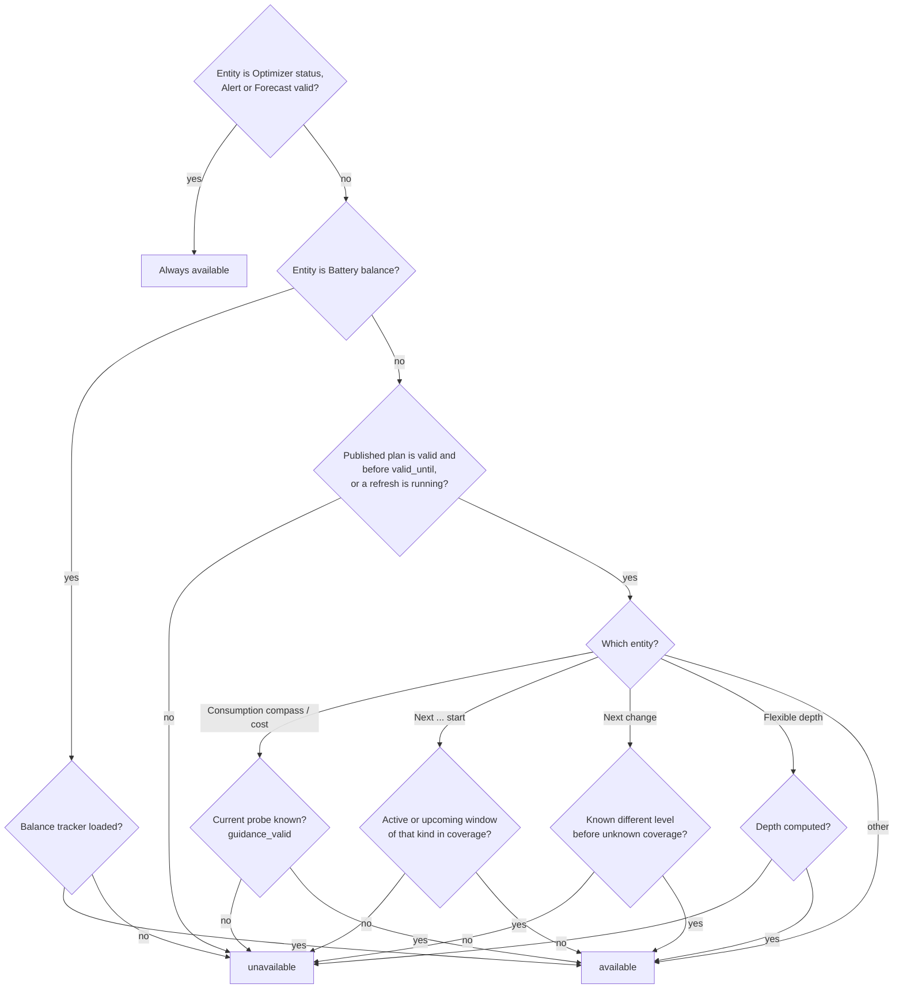

## Optimizer status — calculation lifecycle

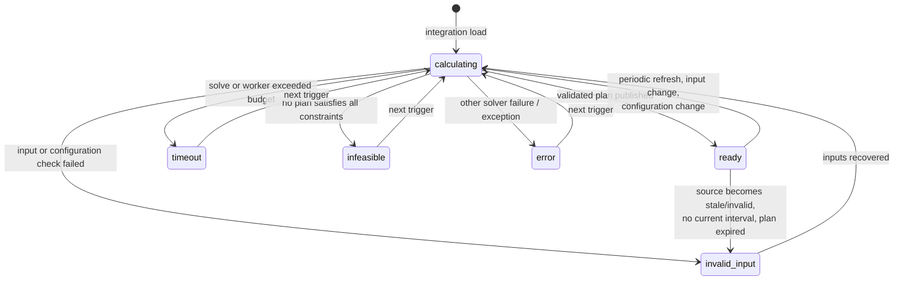

| State | EN / PL label | When it occurs | What stays published |
| --- | --- | --- | --- |
| `ready` | Ready / Gotowy | The last calculation produced a validated base plan and it was published: proven optimal, or the best solution found within `solve_time_limit_s` (`time_limited: true`). | The new plan. `ready` does not guarantee complete reference coverage — check `reason`. |
| `calculating` | Calculating / Obliczanie | A calculation is queued or running. `reason` says why: `inputs_changed`, `interval_boundary` (periodic refresh due), `inputs_recovered`, `calculating` (worker started), `soc_rebase_pending` (upward SOC jump awaiting confirmation). | The previous plan while it covers now, with `refreshing: true`. An existing alert stays on. |
| `invalid_input` | Invalid input / Niepoprawne dane | A required source is missing, unavailable, stale, in wrong units, out of range, SOC disagrees with BMS or jumped, daily counters are from the previous day, settings are invalid; also `no_current_interval` and `expired_inputs` when the retained plan no longer covers now. | The previous plan while it covers now (`plan_retained: true`); otherwise nothing. |
| `timeout` | Timeout / Przekroczony czas | The base solve reached `solve_time_limit_s` (default 10 s) without any feasible solution, or the worker exceeded `total_time_limit_s + 1` (reason `worker_deadline`). | Previous plan within coverage. |
| `infeasible` | Infeasible / Brak rozwiązania | The solver proved no plan satisfies every hard constraint (e.g. SOC reserve, terminal rule, a carried mode commitment, Sell only PV deficit, grid limits). | Previous plan within coverage. |
| `error` | Error / Błąd | Any other solver failure or unexpected exception; `reason` holds the solver reason or exception class. | Previous plan within coverage. |
| `insufficient_data` | Insufficient data / Za mało danych | Reserved in translations; **not emitted** by the current coordinator — missing data reports `invalid_input`. | — |

Attributes: `last_calculation_started_at`, `calculations_since_load`,
`expired_previous_generated_at`, and `measured_calibration` when calibration counters are bound
(see [Measured calibration](#measured-calibration-optional)). Diagnostics add
`calculations_last_hour` and `calculations_last_24h`.

### Measured calibration (optional)

Plans carry `calibration` and `capacity_calibration`, which stay `unvalidated` until you set them and
say nothing about how far the configured values are from reality. Two read-only diagnostics compare
them with your own counters. They never change a plan. A block appears only while its sources are
bound; with none bound, `measured_calibration` is absent from the Optimizer status attributes
(excluded from the recorder) and from the integration diagnostics.

| Block | Sources (Sources → Add source → Measurement) | Reports |
| --- | --- | --- |
| `battery_round_trip` | `battery_charge_energy` and `battery_discharge_energy`: lifetime counters of the energy that passed the battery terminals, kWh or Wh, battery enabled | discharge ÷ charge energy over the last 30 days, next to the configured `eta_charge × eta_discharge` |
| `pv_forecast_accuracy` | `pv_energy`: the lifetime PV counter, PV enabled, an entity (not a recorder statistic) | real ÷ forecast PV energy over the last 14 days, in total and per local hour of the day |

| Field | Meaning |
| --- | --- |
| `status` | `ok`, or `insufficient_data` while the window is too short |
| `window_days`, `covered_hours` | Rolling window (30 / 14 days) and the full hours that had every value they need |
| `minimum_hours` | Covered hours needed before the ratio is shown: 168 for the round trip (and at least 1 kWh charged), 24 for PV |
| `charge_kwh`, `discharge_kwh` | Round trip: summed counter deltas over the covered hours |
| `measured`, `configured`, `difference` | Round trip: measured ratio (null until `ok`), `eta_charge × eta_discharge` and the first minus the second |
| `forecast_kwh`, `measured_kwh`, `ratio` | PV: sums over covered hours and their quotient; `ratio` is null when the forecast sum is below 0.05 kWh or while `status` is `insufficient_data` |
| `by_local_hour` | PV: keys `"00"`–`"23"` (hour of the day in the installation timezone), each with `ratio`, `hours`, `forecast_kwh` and `measured_kwh` |

How it is measured:

- **Hour boundaries.** Each counter reading is stamped with the source's own report time and reduced
  to its value at every full UTC hour by interpolating between consecutive readings. An unchanged
  counter is exact however long the gap; a moving one across a gap longer than 2 hours gives no
  value. Energy of an hour is the difference of its two boundaries.
- **Idle counters.** A counter that writes its state only when it moves (a template, utility meter
  or integration helper) does not report while idle. One that has not changed for more than 2 hours
  is taken to hold its value up to now, as long as its last report is no older than the source's
  maximum age (24 hours by default; with the age check off, no limit), so its idle hours count.
  Only that age tells a frozen source from an idle one: past it the hours drop out. Idle hours
  appear 2 hours late, and a source that holds a steady non-zero rate without writing its state is
  read as idle.
- **Missing hours, resets and glitches.** An hour without both boundaries is skipped, never filled.
  A counter that goes down is a reset or a glitch: neither the step down nor the segment that
  recovers from it yields a boundary, so the hours on both sides drop out of both ratios (a counter
  that restarts after a reset is used again from its second reading). A rise faster than 100 kW
  (plus 1 kWh) between two readings is rejected the same way, as is an hour delta above 101 kWh, so
  a single absurd reading costs a few hours and never skews a ratio.
- **Rebinding.** Stored counter values belong to the entity, attribute, multiplier and unit they
  were read from. Binding the role to something else clears that counter's history (the other
  counter keeps its own) and the ratio fills again from then on.
- **Forecast as used.** Each published plan records its PV forecast for the current hour (scaled up
  from the remainder when the plan was solved mid-hour). The fullest plan of the hour is kept; a plan
  that covers less than half of the hour is not recorded. The current, unfinished hour is not
  compared.
- **Storage.** One small row per hour: about 31 days of counter values and 15 days of forecasts, kept
  in the integration's own store (`energy_compass.<entry_id>.calibration`), saved at each new hour and
  on unload, restored on start. An invalid store is dropped with a warning.

### Superseded results

If inputs change while a solve runs, the finished result is still published when only inputs (not
configuration) changed — it is fresher than the retained plan — and a new solve follows.
Configuration, registry and invalid-input changes discard in-flight results.

## Alert and forecast validity

### Forecast valid (`binary_sensor.<name>_forecast_valid`)

| State | Condition |
| --- | --- |
| `on` | A published plan exists and `now < valid_until`. This holds during retries and while a retained plan still covers now. |
| `off` | No plan, or its coverage/lifetime has ended. Recommendations become unavailable. |

Attribute `current_guidance_valid` is `true` only when the consumption probe for the current
interval produced a known level. Other attributes: `coverage_end`, `requested_end`,
`coverage_complete`, `input_ages`, `missing_sources`, `load_quality`.

### Alert (`binary_sensor.<name>_alert`)

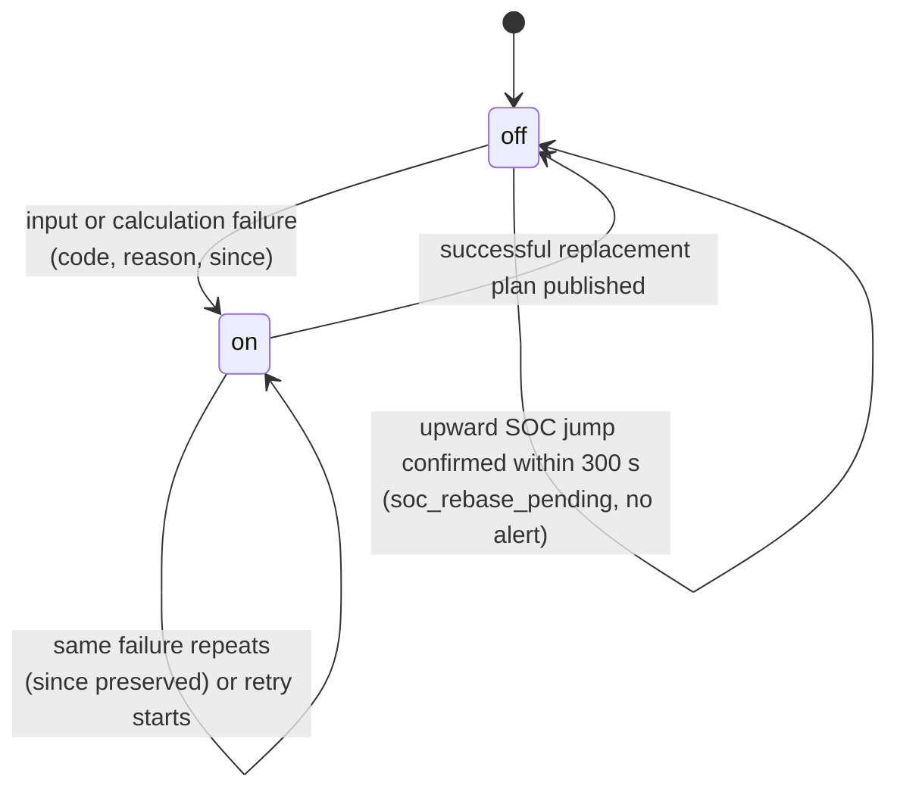

| `code` | EN / PL | Condition |
| --- | --- | --- |
| `invalid_input` | Invalid input / Nieprawidłowe dane wejściowe | Any input validation failure (see optimizer status). |
| `soc_measurement_jump` | SOC measurement jump / Skok wskazania SOC | Between two reports SOC changed by more than battery power × elapsed time + `soc_jump_percent` (default 2 %) of capacity. Downward jumps alert immediately; upward jumps (BMS recalibration near full) first show `calculating`/`soc_rebase_pending` and alert only if not confirmed within 300 s. Recovery needs fresh plausible reports spanning ≥ 60 s. |
| `timeout` | Calculation timeout / Przekroczony czas obliczeń | Solve or worker deadline exceeded. |
| `infeasible` | No feasible plan / Brak wykonalnego planu | No plan satisfies the hard constraints. |
| `error` | Calculation error / Błąd obliczeń | Other failure. |

Attributes: `code`, `reason`, `since`, `plan_retained`, `last_successful_plan_at`. A retry does
not clear the alert; only a successful new plan does.

### Plan retention

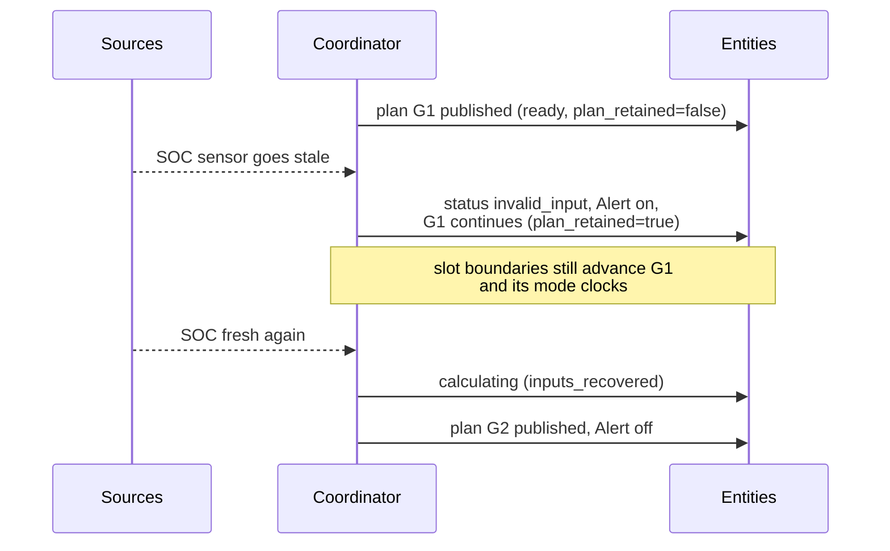

A retained plan is never extended beyond its original coverage and is not carried across an
integration reload or Home Assistant restart. Saving Configure does not reload the integration, so it
does not end the plan: see [Saving options](#saving-options). The [Deye controller](#deye-inverter-controller-solarman)
keeps its own accepted copy of the plan across an entry reload, but drops it at a restart.

## Operating modes — the planned battery state

The **Energy compass** sensor shows the operating mode of the current interval; every row of the
plan's `intervals` attribute carries `dispatch_mode`. There are six modes. Per interval of `h`
hours: `activity = minimum_mode_power_kw × h` (default 0.1 kW) and
`surplus = max(PV − load, 0)`.

| Mode | EN meaning | Occurs when (physical flows) | Allowed only if |
| --- | --- | --- | --- |
| `CHARGE_GRID` | Charge from grid | Battery charge ≥ surplus + activity — more is charged than PV surplus can supply, so the grid feeds the battery. No discharge, no curtailment. | `allow_grid_charge` on; price ≤ grid-charge ceiling when that limit is on. |
| `CHARGE_PV` | Charge from PV | activity ≤ charge ≤ surplus — only solar surplus charges. No discharge, no curtailment. Load-following: grid export only while the charge is at its power limit or the battery is full. | PV surplus exists. |
| `DISCHARGE_GRID` | Discharge with export | Discharge ≥ activity **and** grid export ≥ activity — the battery sells energy. | `allow_battery_export` on; grid export capacity > 0; Sell only PV budget and export-benefit hurdle allow it. |
| `SELF_CONSUME` | Self-consumption | Discharge ≥ activity, no charge, no export, no curtailment — the battery covers the house. Load-following: grid import only while the discharge is at its power limit or the battery is emptied to its reserve. | SOC above operating reserve. |
| `HOLD` | Hold | No charge, no discharge, no curtailment — the battery idles; the grid/PV cover load. | Always available. |
| `CURTAIL` | Curtail PV | Curtailment ≥ activity, no battery activity. | `allow_curtailment` on. |

When mode duration is disabled (`minimum_mode_minutes = 0`), the display state is derived from flows
by precedence: CURTAIL → CHARGE_GRID → CHARGE_PV → DISCHARGE_GRID → SELF_CONSUME → HOLD.

A planned [LFP balance hold](#lfp-balance-charge) does not add a mode: its rows reuse `CHARGE_PV` or
`CHARGE_GRID` and carry `balance_hold: true` in the plan's `intervals` attribute.

### Transitions and minimum duration

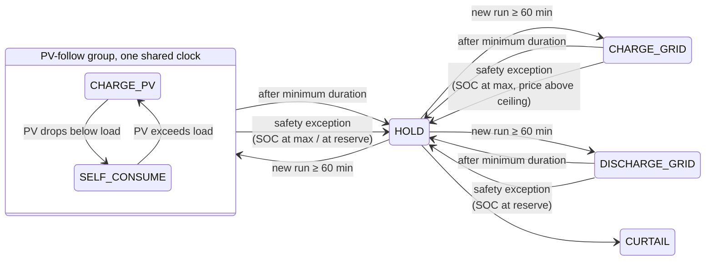

The diagram is simplified with HOLD as a hub: after its minimum duration any mode may be followed
directly by any other available mode.

Rules (defaults: 60 min, 0.1 kW):

- **Every newly started mode — including HOLD and CURTAIL — lasts at least
  `minimum_mode_minutes`.** Only a final passive HOLD/CURTAIL run may be clipped by coverage. The coordinator persists the
  accepted mode and its start; recalculation and restart preserve the clock.
- **`SELF_CONSUME` follows the load.** The inverter discharges whatever the house draws, so the
  plan never pairs a small discharge with grid import: in a `SELF_CONSUME` interval the battery
  covers the whole demand, and import appears only once the discharge is at its interval power
  limit or the battery has been emptied to its reserve. Otherwise the row is `HOLD` with full
  import. The rule also holds with `minimum_mode_minutes = 0`: there are no modes then, and the
  discharge in any interval the flows label `SELF_CONSUME` is bound the same way. A carried
  `CHARGE_PV`/`SELF_CONSUME` commitment is executed the same way. If the battery runs out before
  it ends, the rest of the commitment is `HOLD` with full import (a new `HOLD` clock starts). The
  same happens — from the first interval if need be — when the battery cannot cover the house
  and still keep the inverter standby loss (`idle_drain_kw`) of the later intervals, with no PV
  or grid charge to pay it in time. `HOLD` starts only in an interval without a PV surplus the
  pack could take, in every committed interval: with one, the row stays `CHARGE_PV`. A committed
  interval in which neither mode has anything to follow (net load and PV surplus both below
  `minimum_mode_power_kw × h`, for example a night base load under 100 W) is `HOLD` by
  classification and does not end the commitment: the plan bridges it (no `HOLD` clock starts,
  and the persisted commitment keeps its mode and start) or, when the battery is spent or full,
  starts a real `HOLD` run there as in any other interval
  (`dispatch_policy.carried_idle_starts` lists the bridged intervals). The plan is
  `infeasible` until the commitment ends when the
  terminal rule cannot be met afterwards (`preserve_initial` with no later PV or grid charge to
  refill what the house drew); the rare remaining cases are listed in
  [model and limitations](model.md#operating-mode-duration-and-pv-export-budget).
- **`CHARGE_PV` follows the surplus.** The inverter charges with every watt the house does not
  use, so the plan never pairs a partial charge with grid export: in a `CHARGE_PV` interval the
  battery takes the whole PV surplus, and export appears only once the charge is at its interval
  power limit or the battery has been filled to its upper bound. Otherwise the row is not
  `CHARGE_PV`. Applies while `minimum_mode_minutes` is above 0. A carried
  `CHARGE_PV`/`SELF_CONSUME` commitment is held to the same rule. If the battery is full before it
  ends (the next interval could not take even the minimum activity above the upper bound), the
  rest of the commitment is `HOLD` with the surplus exported (a new `HOLD` clock starts). A first
  committed interval that already has less room than the minimum activity is not covered: the
  plan is `infeasible` until the commitment ends.
- **PV-follow group:** `CHARGE_PV` and `SELF_CONSUME` share one clock — in both the inverter
  charges from surplus and covers a deficit from the battery, so flipping between them is not a
  mode change.
- **Any other change** (source, destination, HOLD or CURTAIL) starts a new clock. Idle HOLD cannot
  fund an active run.
- **Coverage:** a new active mode needs a full duration of forecast coverage remaining.
- **Safety exception (pause, not reset):** during an unexpired active commitment the current row
  shows HOLD when the observed SOC is already at the upper bound (charging modes —
  `observed_soc_maximum`) or at/below the reserve (discharge modes — `observed_soc_minimum`), or
  when a carried `CHARGE_GRID` meets a price above the ceiling before its deadline
  (`grid_charge_price_limit`). The interrupted mode and deadline stay stored; no other mode may
  start before that deadline. Exposed in `dispatch_policy.safety_exception`.
- **Strategy change (reset):** writing a new strategy drops the carried commitment for the next
  plan, which starts unlocked (see [strategy-switch release](#strategy-switch-release)).
- Setting `minimum_mode_minutes = 0` disables duration and minimum-power rules; the
  `SELF_CONSUME` load-following rule stays on.

### Policies that gate modes

| Policy | Default | Effect |
| --- | --- | --- |
| **Sell only PV** (`limit_export_to_pv`) | on | Per local day: exported energy ≤ PV generated (observed since midnight + forecast). Requires `pv_energy_today` and `grid_export_energy_today` counters. |
| **Export limit scope** (`export_limit_scope`) | `local_day` | `local_day` checks the budget once for the whole day; `produced` checks it as a running total so export can never run ahead of PV generated so far that day. See [Sell only PV](model.md#operating-mode-duration-and-pv-export-budget). |
| **Limit grid-charging price** (`limit_grid_charge_price`, `maximum_grid_charge_price`) | off | CHARGE_GRID only at buy price ≤ ceiling for its whole minimum duration. |
| **Minimum export benefit** (`minimum_export_episode_benefit`) | 1 currency unit | Each additional battery-export period must improve full-horizon cost by at least this amount. `0` disables. |
| **Minimum grid-charge episode benefit** (`minimum_grid_charge_episode_benefit`) | 0 (off) | Same hurdle for new grid-charge periods; consolidates charging into fewer episodes. |
| **Import penalty** (`import_penalty_per_kwh`) | 0 | Planning-only shadow price per imported kWh, under every strategy. |
| **Deposit model** (`deposit_model`) | `off` | Values exported energy and the deposit-payable part of imports by what the prosumer deposit will really pay back. Needs the distribution part of the buy price. See [Net-billing deposit value](#net-billing-deposit-value). |
| **Inverter standby loss** (`idle_drain_kw`) | 0 (off) | Constant battery drain modelled per interval. |
| **Battery buffer for expensive periods** (`peak_reserve_margin_kwh`) | 0 (off) | Energy kept above the forecast need when an expensive period starts. See [Peak-period reserve](#peak-period-reserve). |
| **Terminal rule** (`terminal_mode`) | `preserve_initial` | End SOC ≥ start SOC, or `value`: stored energy at the end is credited at `terminal_value_per_kwh`. |

Setup profiles can pre-fill the import penalty, standby loss and terminal rule for new installations;
see [Setup profiles](#setup-profiles-new-installations).

### Net-billing deposit value

Under Polish net billing the value of exported energy is booked on the **prosumer deposit**, and the
deposit pays only what you owe the seller for **energy**; distribution charges are paid in cash.
After 12 months the unused part is refunded, but a month's refund cannot exceed
**ρ × the value exported in that month** (ρ = 30 % with hourly RCE settlement, 20 % with monthly
RCEm); the rest is void. While the deposit is short, or its unused part still fits under the cap,
one currency unit of export or of energy-part import is worth exactly one unit of cash and the
planner needs no correction. Once the cap binds, one more unit of export is worth only ρ and the
energy part of an import costs nothing in cash (it is paid from money that would expire). The
deposit model lets the planner see that. It is **off by default** and then the plan is
byte-identical to a build without it.

**Two parts of the buy price.** The model must know which part of a buy price is energy (payable by
the deposit) and which is distribution (paid in cash). The buy price of an interval is the sum of the
two, and you give the distribution part as rates, never the energy part:

```text
included:  buy = buy source price                  (the source is an all-in price, e.g. a tariff schedule)
added:     buy = buy source price + distribution   (the source is the energy price only)
energy part = clamp(buy − distribution, 0, max(buy, 0))
```

Use `added` for a dynamic energy price (a forecast such as RCE-based tariffs) or a price list typed
as on the invoice. It changes the buy price itself, for the planner **and** for reported costs, and
works with the deposit model off. Example: dynamic energy price 0.25 at midday and 0.95 in the evening
peak plus the G12 distribution rate 0.540 give buy prices 0.79 and 1.49; at night 0.45 + 0.143 give
0.593. When the cap binds the planner sees only the distribution part: 0.540, 0.540 and 0.143. A
negative energy price keeps its real price and has no energy part to waive.

| Setting (Tariffs) | Default | Meaning |
| --- | --- | --- |
| `deposit_model` | `off` | `off`: full prices. `manual`: you state `export_value_factor`. `auto`: Energy Compass derives it from the two yearly sums below. |
| `deposit_refund_percent` | 30 | ρ, the refund cap as a share of a month's export value. 20 for monthly RCEm settlement. |
| `export_value_factor` | 1.0 | `manual` only: what one more unit of export is worth (0–1). |
| `deposit_yearly_value` | 0 | `auto`: deposit you expect to be booked over 12 months (export value at the settlement price, 1.23 included). 0 = unknown. |
| `deposit_yearly_energy_cost` | 0 | `auto`: what the deposit can pay over 12 months: the per-kWh energy charge of the imports, gross. The trade fee, other fixed fees and distribution are not part of it. 0 = unknown. |
| `buy_distribution_mode` | `included` | `included` or `added`, as above. |
| `buy_distribution_rate`, `buy_distribution_off_peak_rate` | 0 | Everything the distributor bills per kWh (network rate, quality, RES and cogeneration fees), typed like the buy rate; the first is the peak or single zone, the second the off-peak zone. VAT applies when `buy_apply_vat` is on; `buy_multiplier`, `buy_addition` and a forecast floor apply to the buy source only. The zones come from the tariff schedule of the buy source or from a [distribution tariff](#built-in-polish-tariffs); with neither, or with G11, the first rate applies all day. With two zones set both rates or neither: exactly one zero rate fails the calculation closed. The monthly fee belongs in `monthly_charge`. |

The cap pressure π (0 = deposit short or within the cap, 1 = cap binding) gives two factors that
exist only inside the optimizer:

```text
export value factor  φx = 1 − π × (1 − ρ)     1 → ρ
import energy factor φe = 1 − π               1 → 0
planning buy  = buy − (1 − φe) × energy part of buy
planning sell = φx × max(sell, 0) + min(sell, 0)
```

- **`auto`**: the unused share of the yearly deposit is `s = 1 − E / D` (`D` = `deposit_yearly_value`,
  `E` = `deposit_yearly_energy_cost`), and π ramps from 0 at `s = ρ/2` to 1 at `s = ρ`. If `D` or `E`
  is 0 the model has no input: π = 0 and `reason` is `inputs_missing`; the plan stays valid and no
  Alert is raised. The balance of the deposit is deliberately not an input — one day's balance says
  nothing without the booking dates behind it.
- **`manual`**: `φx` is your `export_value_factor` as typed, even below ρ. Only π is derived from it,
  `π = clamp((1 − φx) / (1 − ρ), 0, 1)`, so `φe = 1 − π` follows (a value at or below ρ devalues the
  energy part of imports fully). With `deposit_refund_percent` 100 both factors are 1.
- **No distribution part** (the distribution rates are 0): the whole buy
  price would count as deposit-payable and an import would look free. With π above 0 `φe` is
  therefore forced to 1 and `reason` is `split_missing`; `φx` still applies. Set the distribution
  rates to use the model.
- **Hysteresis (`auto`)**: π is evaluated once per local day (the first calculation after local
  midnight) and held for the day in the `settlement` Store, so restarts and reloads do not re-evaluate
  it. A new value replaces the held one only if it differs by at least 0.10, or reaches exactly 0 or 1.
  Changing any of the five deposit settings (`deposit_model`, `deposit_refund_percent`,
  `export_value_factor`, `deposit_yearly_value`, `deposit_yearly_energy_cost`) re-evaluates at once.
- **Negative sell prices** stay whole: the factor scales only the positive part, because a negative
  price is a real charge.
- **Reported costs do not change.** Net cost, `Plan.grid_cost`, the cost sensors, consumption levels and
  the `maximum_grid_charge_price` ceiling all stay at invoice prices; only the planning objective uses
  the factors, under every strategy and before the strategy weights.
- **Battery sale threshold**, worked example (PGE G12 2026 gross prices, round trip 0.89, wear
  0.05 per kWh, ρ = 30 %): selling from the battery and buying the energy back at night pays above
  about 0.73 currency/kWh while the cap is not binding and above about 0.71 when it binds (the cheaper
  night re-buy offsets the lower export value); at ρ = 20 % the threshold rises to about 1.07. What changes with the cap binding is the use of
  surplus PV (worth 0.12 instead of 0.40 at a sell price of 0.40, so it goes to the battery and
  flexible load first) and night grid charging, which stays profitable.

Diagnostics are in the plan attribute `dispatch_policy.settlement`:

| Key | Meaning |
| --- | --- |
| `model` | `off`, `manual` or `auto` |
| `export_value_factor`, `import_energy_factor` | φx and φe the optimizer used |
| `cap_pressure` | π |
| `unused_share` | `s` for `auto`, else `null` |
| `refund_percent`, `yearly_deposit`, `yearly_energy_cost` | the inputs used |
| `distribution_mode` | `included` or `added` |
| `evaluated_on` | local date π was last evaluated |
| `reason` | `ok`, `off`, `inputs_missing`, `split_missing` (π above 0 but no distribution part, `φe` forced to 1) or `held` (today's π was already evaluated) |

Reading `D` and `E` from long-term statistics instead of typing them is not part of this release.

### Peak-period reserve

The load forecast is a mean, so a plan that drains the battery exactly to the reserve by the end of an
expensive period falls short on roughly every second day. `peak_reserve_margin_kwh` asks the solver to
enter each expensive period with that much energy on top of the forecast need. It requires **Limit
grid-charging price**: an expensive period is a run of intervals whose buy price is above
`maximum_grid_charge_price`, i.e. where the battery cannot be refilled from the grid. The target applies
to the end of the cheap interval right before the run:

```text
entry target = min(usable capacity, reserve + peak_reserve_margin_kwh + run deficit / η_discharge)
```

where the deficit sums `max(0, load − PV)` over the run. Intervals inside the run carry no target: the
plan is recalculated during the run, and a target there would make it buy at the expensive price to
rebuild the buffer once the house had used it — the opposite of what the buffer is for. For the same
reason a run that is already in progress when the plan is calculated gets no target, nor does a run
where PV covers the house. The target is **soft**: a shortfall is billed at the median expensive price
minus the ceiling and reported as `peak_reserve_shortfall_kwh`; reported costs never include it. Inside
the run the buffer is ordinary stored energy, so the plan may still export it when selling pays more
than the later purchase. It works in every strategy, next to the autonomy floor. Warnings:
`peak_reserve_requires_grid_charge_ceiling` (setting above 0 while the ceiling is off) and
`peak_reserve_inactive` (no upcoming expensive run with a deficit in the horizon).

Sizing: 0.25–0.75 kWh is a reasonable start. In a backtest on one household with a two-zone tariff,
0.5 kWh halved the mornings that ran out before PV (42 % → 21 %) at roughly neutral cost: the buffer
is not lost, it is used later or valued at the end of the horizon.

## Consumption levels — BOOST, CHEAP, NORMAL, LIMIT

The **Consumption compass** answers "how attractive is using one more kWh in this interval?". For
each display interval (default 60 min over 24 h) the solver reruns with `probe_kwh` (default
1 kWh) of extra load. **Consumption cost** = (probe plan cost − base plan cost) ÷ added kWh. Because
the battery and grid are re-optimized, this is the true marginal cost — it can differ from the
tariff price (e.g. solar that would otherwise be exported costs its lost export value).

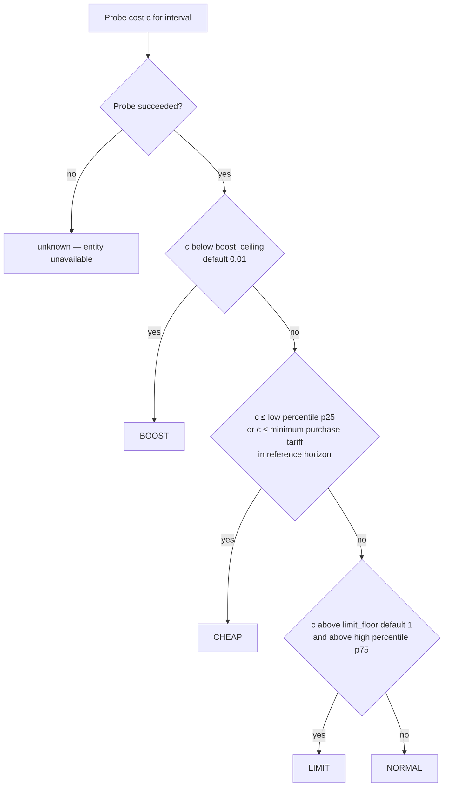

| Level | EN / PL | Condition | Typical situation |
| --- | --- | --- | --- |
| `BOOST` | Boost / Zwiększone zużycie | Cost strictly below `boost_ceiling` (default 0.01 currency/kWh). | Free or negative energy: surplus PV that cannot be stored or exported, negative prices. Run everything you can. |
| `CHEAP` | Cheap / Tanio | Not BOOST, and cost ≤ `cheap_percentile` (default 25th) of reference costs, **or** ≤ the minimum purchase tariff in the reference horizon. | Among the cheapest hours of the reference window. Good time for flexible loads. |
| `LIMIT` | Limit / Ograniczenie | Cost strictly above both `limit_floor` (default 1 currency/kWh) and the `limit_percentile` (default 75th). | Expensive peak — extra use forces costly import or loses valuable export. Postpone. |
| `NORMAL` | Normal / Normalnie | Anything else. | Average conditions. |
| unknown | — | The probe failed or ran out of time, or the interval lies beyond forecast coverage. | Entity unavailable; later windows can still be known. |

Percentiles come from successful probe costs across the reference horizon (default 24 h) using
linear interpolation. If a full reference probe fails, `short_coverage` decides: `absolute_fallback`
(default: keep BOOST/LIMIT absolute rules and the minimum-tariff CHEAP rule) or `unavailable`.

## Windows and flexible energy depth

### Windows

Adjacent intervals of the same level merge into windows. `next_boost_start`, `next_cheap_start`
and `next_limit_start` show the start of the active or next window of that kind; `next_change` shows
the next known different level.

| Attribute `status` | Condition |
| --- | --- |
| `active` | Window start ≤ now < end. |
| `upcoming` | Window starts later within coverage. |
| `none_in_coverage` | No such window in the forecast; the entity is unavailable. |

`start_basis` is `forecast`, or `first_observed` when an already active window keeps its first
observed start across recalculations and restarts. `next_change` stops at unknown coverage rather
than guessing.

### Flexible energy depth

Answers "how much deferrable energy can I use cheaply?". The solver independently places 3, 5, 10,
15 and 20 kWh blocks at up to `flexible_load_max_power_kw` (default 3 kW).

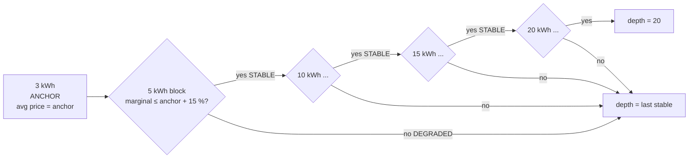

| Profile status | Condition |
| --- | --- |
| `ANCHOR` | The 3 kWh profile; its average incremental cost is the anchor price. |
| `STABLE` | Marginal block cost ≤ anchor + `flexible_price_degradation_percent` (default 15 %) of |anchor|. |
| `DEGRADED` | Marginal block cost above that threshold — stops the published depth. |
| `UNKNOWN` | Not solved: `insufficient_time` (block cannot fit at max power within the horizon), `timeout`, or a solver reason. Stops the depth. |

Groups: `small` (3/5 kWh), `medium` (10/15 kWh), `large` (20 kWh).

## Dispatch strategies

`select.<name>_strategy` chooses which objective bundle the solver uses. Every strategy keeps all
hard physical constraints; strategies change only **planning weights** and a small set of
**policy flags**. Reported costs (`expected_net_cost`, consumption cost) always stay real currency —
strategy penalties never appear in them.

| Strategy | EN / PL label | Goal | Typical use |
| --- | --- | --- | --- |
| `cost_min` | Cost minimisation / Minimalizacja kosztów | Lowest total cost | Default, everyday |
| `self_sufficiency` | Self-sufficiency / Samowystarczalność | Fewest grid kWh | Flat prices, off-grid preference, zero/negative prices |
| `backup_ready` | Backup ready / Gotowość awaryjna | Keep a high reserve | Storm warning, planned outage, winter |
| `pv_swap` | PV swap / Zamiana energii PV | Buy cheap at night, sell own PV later | Small winter PV with an evening sell premium |
| `max_export` | Maximum export / Maksymalny eksport | Unrestricted arbitrage | High sell-price windows |
| `grid_friendly` | Grid friendly / Przyjazna dla sieci | Flatten import/export peaks | Capacity tariffs, weak connection |

### What each strategy changes

The solver minimizes

```text
grid     = Σ ( import_weight × buy × import + import_kwh_weight × import
               − export_weight × (sell − pv_export_margin) × export )
           + battery_export_penalty_per_kwh × battery_export
autonomy = soc_target_weight × Σ (deepest shortfall per window below the autonomy floor)
peak     = peak_import_weight × max(import power)
caps     = cap_violation_weight × Σ (import/export above soft caps)
objective = grid + wear + episode hurdles + autonomy + peak + caps − terminal credit
```

| Strategy | Autonomy floor | Sell only PV | Grid-charge ceiling | Export-benefit hurdle | Weights |
| --- | --- | --- | --- | --- | --- |
| `cost_min` | off | user setting | user setting | user setting | defaults (only `import_penalty_per_kwh`) |
| `self_sufficiency` | **on** | user setting | user setting | user setting | `import_kwh_weight` = max(5.0, max \|buy\| + 0.50, import penalty); battery-export penalty 0.20/kWh |
| `backup_ready` | **on**, floor ≥ 80 % capacity | user setting | user setting | user setting | floor weight ≥ 2.0/kWh |
| `pv_swap` | **on** | **forced on** | **forced off** | user setting | sell price reduced by margin 0.05/kWh |
| `max_export` | **off** | **forced off** | **forced off** | **forced 0** | defaults |
| `grid_friendly` | **off** | user setting | user setting | user setting | peak import 0.50/kW, soft-cap violation 2.0/kWh |

"User setting" means the strategy leaves the option as configured. **Forced** values apply only to
options the user has not set explicitly: any strategy-owned option that deviates from its shipped
default is recorded in `explicit_strategy_fields` and is never overridden by a bundle.

All numbers above are defaults of Planning options:
`self_sufficiency_import_price_per_kwh` (5.0), `self_sufficiency_export_penalty_per_kwh` (0.20),
`backup_target_soc_percent` (80), `backup_shortfall_price_per_kwh` (2.0),
`pv_swap_margin_per_kwh` (0.05), `peak_import_price_per_kw` (0.50),
`cap_violation_price_per_kwh` (2.0), `grid_friendly_import_cap_kw` / `_export_cap_kw` (0 = site
connection limit), `autonomy_margin_per_kwh` (0.10).

### Autonomy floor (used by `self_sufficiency`, `backup_ready`, `pv_swap`)

The floor asks: *will the battery carry the house through the next period where load exceeds
PV?* The horizon is split into windows by cumulative net surplus; within each window the target is

```text
soc_target[t] = min(usable capacity, reserve + (1 / η_discharge) × Σ deficit until window end)
```

The deepest shortfall below the target is billed **once per window** at `soc_target_weight` =
expected night rebuy price (median night buy price) + `autonomy_margin_per_kwh`. The floor looks
48 h ahead on PV/load forecasts even before tomorrow's prices are published. It is **soft**:
violations become `autonomy_shortfall_kwh` on the plan instead of an infeasible solve. It needs a PV
source (`autonomy_floor_requires_pv` otherwise).

### LFP balance charge

LFP packs need a periodic full charge and a short hold at the top so the BMS can
balance cells and re-anchor its SOC. With **Periodic LFP balance charge**
(`lfp_balance`) on, Energy Compass tracks the last completed balance and plans
the next one. The tracker itself keeps observing SOC and advancing its state even
while `lfp_balance` is off; turning the setting on only starts publishing balance
windows and the diagnostic sensor.

| Setting | Default | Meaning |
| --- | --- | --- |
| `balance_interval_days` | 7 | Days between completed balances |
| `balance_hold_minutes` | 60 | Minutes SOC must stay at or above the threshold |
| `balance_soc_threshold` | 99 % | SOC that counts as full |
| `balance_value` | 5.0 | Value of balancing on the due day |

A balance **completes** after SOC stays at or above the threshold for the whole
hold. A reading below the threshold restarts the hold. Only observed time
counts: an unavailable or stale SOC gives no credit, and two full readings more
than `soc_max_age_seconds` apart restart the hold from the later one (a hold
whose last full reading is older than that is neither holding nor complete).
Completion is evaluated lazily — while full readings keep arriving, the hold
completes on the next check without needing a state change. Phases: `ok` →
`eligible` (the earlier of 2 days or half the interval before due) → `due`;
`holding` overlays whichever phase is active while a hold is running. A hold that
starts while the balance is still `ok` (for example SOC back at 100 % the day
after a balance) is tracked and completes, but is not scheduled: the optimizer
gets no hold window and no miss cost for it.

The optimizer may pick one hour-aligned hold window: candidate windows start only
on the whole hour, and while `due`, only within the next 24 h (an `eligible`
balance may look anywhere across the horizon). Inside the chosen window SOC stays
at or above the threshold and the battery does not discharge. Skipping costs 10 %
of `balance_value` while eligible — small, so the planner normally balances only
on cheap or free energy, but it still picks a grid window that costs less than
that — `balance_value × (1 + days overdue)` once due, and 10 × `balance_value`
during a hold that is eligible or due. A window is published as **CHARGE_PV**
only when PV covers load in every one of its slots; otherwise (mixed PV/grid or
pure grid, such as a night window) it is **CHARGE_GRID**, which additionally
requires grid charging to be allowed and the grid-charge price ceiling (if any)
to pass in every slot — with `balance_hold: true` on every row. With an optional
[pessimistic PV source](#pessimistic-pv-for-the-balance-window) the PV test is stricter. From the slot before the earliest candidate
window to the horizon end, the battery's energy may rise up to full capacity
instead of the configured SOC ceiling, so a hold is never blocked by
`soc_ceiling` below 100 %; that lift only matters when the ceiling is below
100 %. Consumption probes keep the chosen window fixed so a probe's extra load
prices the load, not the balance choice.

The **Battery balance** diagnostic sensor (`sensor.<name>_battery_balance`)
reports `ok`, `eligible`, `scheduled`, `holding` or `overdue`, with
`last_completed`, `next_due`, `days_overdue`, `planned_start`, `planned_end`,
`planned_mode`, `pv_series`, `hold_progress_minutes`, `hold_required_minutes`,
`threshold_percent`.

#### Pessimistic PV for the balance window

The balance window is chosen on the median PV forecast, so a low-PV day can leave the pack short of the
threshold and the balance missed again. **Sources → Add source → PV pessimistic (optional)** binds a
second, lower forecast of the same site (for Solcast, `pv_estimate10`; the Solcast presets propose that
field). It takes the same interval-forecast mapping as a PV source; **Review and edit sources** lists,
edits, extends with a continuation and removes it. It needs PV enabled. It can accompany either kind of PV
source; the Energy dashboard solar forecast has no pessimistic series, so bind this one separately.

With it configured, a **CHARGE_PV** window is offered only if both hold on the pessimistic series:

1. Pack: charging from PV surplus alone (`pv − load`, at `eta_charge` and `charge_kw`, no discharge)
   lifts the pack to the balance threshold by the window start.
2. Window: PV covers load in every slot of the window.

Otherwise the start is offered only as **CHARGE_GRID**, subject to the usual grid-charge and price-ceiling
rules, so the solver can pick a cheap grid window instead. The dispatch plan itself keeps using the median
series. Without the source nothing changes.

The solver prices every window on the median series, where PV surplus can pay for a vetoed
**CHARGE_GRID** window, so several starts would cost the same. To avoid a tie-break landing on an
expensive slot, every **CHARGE_GRID** window offered while the pessimistic series is present (also one
that is **CHARGE_GRID** on the median series alone) carries a ranking cost: the energy the pessimistic series leaves to the
grid, that is what the pack still lacks to reach the threshold at the window start plus the load PV does
not cover inside the window, at the window's buy prices. The solver adds 5 % of each window's excess over
the cheapest window the solver can pick to that window's cost, so a window the pessimistic series still supports
(**CHARGE_PV**) beats a vetoed one and, among vetoed ones, the cheapest wins. The addition never exceeds
half the cost of skipping the balance. A start-0 window the pack cannot reach (it starts below the
threshold) is left out of that comparison, so it never shifts the other windows towards a skip; the
ranking can still tip a close call against the balance. It is a preference, not a
strict tie-break: a start that is cheaper on the median series by more than 5 % of the difference in
ranking cost still wins. It is not part of the plan's cost.

Trade-off: the pack test counts PV surplus only. A start the pack would reach only by charging from the
grid before the window is offered as **CHARGE_GRID** alone, and is dropped when the grid-charge price
ceiling blocks a slot of the window, so `balance_no_window_in_horizon` can appear where a window existed
without the source.

The `pv_series` attribute of the Battery balance sensor and the `balance_pv_series` attribute of the plan
sensor say which series decided the candidate windows: `pessimistic` when the source is configured and
usable, `median` otherwise (also without the source); `null` when `lfp_balance` is off or there is no
battery. The source is optional input and never invalidates the plan. If it is unavailable, stale,
malformed, negative or does not cover the horizon, the windows fall back to the median series and the plan carries the
`balance_pessimistic_pv_unavailable` warning. A source going stale raises no state change, so the fallback
takes effect at the next periodic recalculation (`refresh_minutes`) or source change.

### `cost_min` — cost minimisation

- **Goal:** lowest forecast cost: purchases − sales + battery wear − terminal credit.
- **Changes:** nothing; byte-identical to the plain model when `import_penalty_per_kwh = 0`.
- **Behaviour:** charges when energy is cheap (grid or PV), discharges into expensive hours,
  exports only when the spread beats losses, wear and the export-benefit hurdle.
- **Choose when:** everyday operation; the default and the fallback of the switch blueprint.
- **Watch out:** it may leave the battery low before a cheap-looking night if forecasts are
  wrong — no autonomy reserve.

### `self_sufficiency` — self-sufficiency

- **Goal:** minimize **grid kWh**, not currency.
- **Changes:** every imported kWh costs at least `max(5.0, highest |buy price| + 0.50,
  import_penalty_per_kwh)`, so import always dominates price differences; battery export costs an
  extra 0.20/kWh; autonomy floor on.
- **Behaviour:** fills the battery from PV, avoids grid charging and battery export unless needed,
  keeps enough energy for the next deficit window.
- **Choose when:** day/night price spread is small (the blueprint picks it when the spread is
  below 0.15 PLN/kWh), when prices are zero or negative, or when independence matters more than
  cost.
- **Watch out:** reported costs stay real — this strategy can cost more money than `cost_min`.

### `backup_ready` — backup ready

- **Goal:** keep a large reserve for an outage.
- **Changes:** autonomy floor on and raised to at least `backup_target_soc_percent` (80 %) of
  capacity; its weight is at least `backup_shortfall_price_per_kwh` (2.0/kWh).
- **Behaviour:** refills to ~80 % and avoids discharging below it unless the shortfall is worth
  more than 2.0/kWh; the floor stays soft, so a plan always exists.
- **Choose when:** storm or grid-outage warnings, planned maintenance, cold winter nights. The
  blueprint's `alert` rule selects it when your alert entity is on.
- **Watch out:** combining it with a low grid-charge ceiling raises
  `grid_charge_ceiling_below_autonomy_weight` — the floor could be emptied but never refilled.

### `pv_swap` — PV swap

- **Goal:** in low-PV seasons, buy cheap at night and sell the day's real PV output at a later,
  higher price.
- **Changes:** `pv_export_margin` (0.05/kWh) is subtracted from every sell price (the export must
  beat the night buy by at least that margin); **Sell only PV forced on** (daily export ≤ daily PV);
  **grid-charge ceiling forced off** (so night charging is not blocked); autonomy floor on.
- **Behaviour:** grid-charges overnight, lets the day's PV cover the house, then exports up to the
  day's generated PV in the evening peak.
- **Choose when:** tomorrow's PV forecast is below the daily load and `evening sell × round-trip
  efficiency ≥ night buy + margin` (the blueprint's `pv_swap` rule).
- **Watch out:** Sell only PV counts energy, not provenance — exported battery energy is limited in
  total to the day's PV, not traced to its origin.

### `max_export` — maximum export

- **Goal:** pure arbitrage, maximize revenue from exports.
- **Changes:** **export-benefit hurdle forced to 0**, **Sell only PV forced off** (grid-charged
  energy can be resold), **grid-charge ceiling forced off**, autonomy floor off.
- **Behaviour:** charges whenever buy is low, discharges into the grid whenever the spread covers
  losses and wear; may do several export episodes a day.
- **Choose when:** exceptional sell prices, a tariff that rewards export.
- **Watch out:** most battery cycles; check whether your contract allows reselling grid energy.
  Never selected automatically.

### `grid_friendly` — grid friendly

- **Goal:** flatten the grid profile — avoid high import peaks and limit export power.
- **Changes:** peak import term `peak_import_price_per_kw` (0.50/kW of the highest import power);
  soft import/export caps `grid_friendly_import_cap_kw` / `grid_friendly_export_cap_kw` (0 = site
  limit), each kWh above them costs `cap_violation_price_per_kwh` (2.0); autonomy floor off.
- **Behaviour:** spreads grid charging over longer windows, uses the battery to shave import
  peaks, keeps export under the cap.
- **Choose when:** capacity/power-based tariffs, a weak connection or a fuse near its limit.
- **Watch out:** caps are soft; excess is reported in `cap_violation_kwh` instead of failing.
  Never selected automatically.

### Plan attributes for strategies

| Attribute | Meaning |
| --- | --- |
| `strategy` | Strategy that produced this plan (may lag the select while a recalculation runs). |
| `autonomy_shortfall_kwh` | Total shortfall below the autonomy floor; `0` = floor met. |
| `peak_reserve_shortfall_kwh` | Total shortfall below the [peak-period reserve](#peak-period-reserve); `0` = met or off. |
| `time_limited` | `true` when the base solve hit `solve_time_limit_s` and the best validated solution found so far was published instead of a proven optimum. |
| `mip_gap` | Relative MIP gap the solver reported for the published plan: `0` = proven optimal (a proven plan reads `0`, or at most `0.0001` when no episode hurdle is active); for a time-limited plan, the bound on how far its objective may be from the optimum (e.g. `0.017` = 1.7 %). |
| `cap_violation_kwh` | Total energy above `grid_friendly` soft caps; `0` = caps met. |

### Strategy-switch release

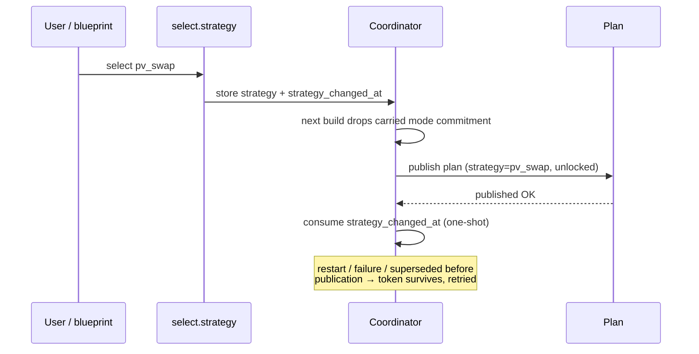

A strategy change is a **reset**: the carried mode commitment is released so the new strategy is
not trapped in the old mode's minimum duration. A current export episode is kept so its hurdle is
not charged twice.

## Automatic strategy switching

The optional blueprint [`strategy_switch.yaml`](../blueprints/automation/energy_compass/strategy_switch.yaml)
picks one strategy per day. It runs at **14:05** (after RCE next-day prices and Solcast), retries
hourly until **20:00** if next-day prices are missing, and reconciles a half-applied write at Home
Assistant start.

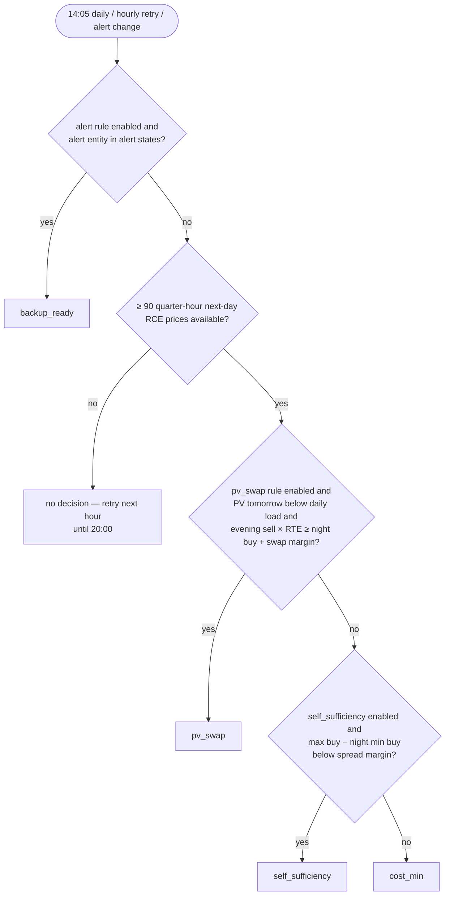

| Input | Default |
| --- | --- |
| Night window | 22:00–06:00 (lowest buy price in plan intervals) |
| Max buy | highest buy price across all plan intervals |
| Evening window | 17:00–21:00 (max sell price from RCE next day) |
| Round-trip efficiency | 0.90 |
| Self-sufficiency spread margin | 0.15 PLN/kWh |
| PV swap margin | 0.05 PLN/kWh |
| Enabled rules | `alert`, `pv_swap`, `self_sufficiency` (`cost_min` is the fallback) |

A **manual** change of the select blocks the economic rules until the next successful scheduled
run; the alert rule is never blocked. `max_export` and `grid_friendly` are manual-only. Setup
details: [installation guide](installation.md#import-the-strategy-switch-blueprint).

## Window notifications

The optional blueprint [`notifications.yaml`](../blueprints/automation/energy_compass/notifications.yaml)
tells the household when extra use is cheap (favorable window) or when an expensive `LIMIT` window
is starting. Energy Compass itself never sends anything; **Notify enabled** in the integration
options is the master switch. Setup: [installation guide](installation.md#opt-in-notifications).

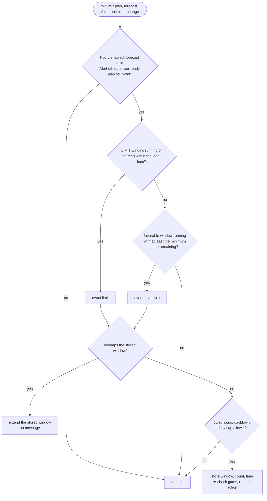

| Message | When |
| --- | --- |
| **Use the cheap energy** / *Wykorzystaj tanią energię* | a favorable window is running and the whole rest of it is `BOOST` |
| **A good time for household appliances** / *Dobry moment na domowe urządzenia* | a favorable window is running, not all `BOOST` |
| **Plan heavy use for later** / *Zaplanuj większe zużycie na później* | a `LIMIT` window starts within the lead time, or is already running |

The message names the window's local times and suggests moving laundry, the dishwasher or car
charging. The action receives `notification_title`, `notification_message` and `event_kind`.

| Input | Meaning |
| --- | --- |
| `compass`, `plan`, `forecast_valid`, `alert`, `optimizer_status` | Consumption compass, Plan, Forecast valid, Alert and Optimizer status of one installation |
| `next_boost`, `next_cheap`, `next_limit` | the three window start sensors (their changes re-run the automation) |
| `last_favorable`, `last_limit` | Text helpers (max 255) holding the last window as `{"s": start, "e": end}` |
| `daily_count`, `daily_date`, `last_sent` | Number helper and two Date/time helpers for the daily cap and cooldown |
| `language` | `en` or `pl` for the title and message |
| `use_blueprint_overrides` | off: use the integration's notification preferences; on: use the inputs below |
| `enabled_events`, `minimum_hours`, `limit_lead_minutes`, `quiet_start`, `quiet_end`, `cooldown_minutes`, `daily_cap` | overrides: events, minimum favorable time remaining, LIMIT lead, quiet hours, cooldown, messages per local day |
| `notification_actions` | the action to run, for example a mobile app notify action |

## Cost card

The optional card `custom:energy-compass-cost-card` ([`cards/cost/`](../cards/cost/)) shows the
purchase cost of grid energy, the value of exported energy (the prosumer deposit in Polish
net-billing) and the balance **purchase − deposit**: today measured and planned to midnight, and
month and year from statistics. Install and full description: [cost card guide](cost-card.md).

| Key | Meaning |
| --- | --- |
| `cost_entity`, `import_entity`, `export_entity` | purchase cost (statistics), grid import and export energy (kWh) — required |
| `plan_entity`, `valid_entity`, `export_prices_entity` | Plan, Forecast valid and the export price forecast (`prices`) — required |
| `import_price_entity` | buy price used to fill a purchase-cost gap after a restart |
| `deposit_entity`, `deposit_backfill` | export value sensor and the backfilled history statistic, for month and year |
| `runtime_entity`, `mode_entity` | Deye controller runtime and mode, to say whether the plan is executed |
| `currency`, `language`, `tariff_label`, `footnote` | presentation |

The month and year deposit comes from the [export value counter blueprint](../blueprints/automation/energy_compass/export_value_counter.yaml):
it adds every increase of the export meter (`export_energy`), valued at the price forecast
(`export_prices`), to a Number helper (`counter`); jumps above `max_step_kwh` are ignored.

## Deye inverter controller (Solarman)

Energy Compass is advisory by default and writes to an inverter only when you enable the optional Deye
controller (**Options → Deye controller**, off by default). The controller executes the plan on a Deye
hybrid inverter through the [Solarman integration](https://github.com/davidrapan/ha-solarman): it writes
three battery currents and the six time-of-use (TOU) programs, and reads every write back from the
holding registers. With the **native engine** it runs inside the integration: no blueprint, automation,
package, helper or `configuration.yaml` edit is needed, the accepted plan survives an entry reload, and
Energy Compass owns the mode, the accepted plan, the session and the revocation, the timing of the next
run and the stored runtime. It needs Energy Compass 0.1.38 or newer. Setup steps are in the
[installation guide](installation.md#deye-inverter-controller). The `deye_hybrid` setup profile
pre-fills `idle_drain_kw` 0.13 and `refresh_minutes` 60 for a new installation; see
[Setup profiles](#setup-profiles-new-installations).

The earlier executor, the blueprint
[`deye_solarman_controller.yaml`](../blueprints/automation/energy_compass/deye_solarman_controller.yaml),
is **deprecated**. It still works in this release as the `blueprint` engine (the value of every entry
created before 0.1.38) and is removed in the release after next, together with its generator
`tools/deye_controller/build.py`, the `energy_compass.controller_runtime` and
`energy_compass.controller_import_package` services and the sections below that describe it. Move to the
native engine as described in [Migrating from the blueprint](#migrating-from-the-blueprint-to-the-native-engine).

### Enabling the controller

Open **Options → Deye controller**, switch **Enable the Deye controller** on and choose the Solarman
inverter device (it is preselected when there is only one). Energy Compass finds the six TOU programs
(time, power, voltage, SOC and charging, 30 entities) on that device by the Solarman translation keys
`program_1_time` … `program_6_charging`, derives the entity ID prefix they share and tracks them. It
refuses the device when a program is missing or disabled, when the entity IDs do not share one
prefix, or when another Energy Compass entry already controls it. Enabling reloads the entry once;
moving the controller to another device applies live. Both are refused while the mode is not `Off` or a restore is pending: select `Off` and wait until `restore_pending` is off first, otherwise nothing could restore the base profile. The step is visible without the expert toggle.

**Engine.** The step has an **Engine** field. `native` (the default for a new enable) lets Energy Compass
execute the plan itself and write the inverter through the Solarman entities and the
`solarman.read_holding_registers` service; no blueprint or automation is needed. `blueprint` (deprecated;
the value of every entry created before 0.1.38) keeps the Deye controller blueprint as the executor. Changing the
engine reloads the entry and is refused while the mode is not `Off` or a restore is pending. The native engine finds
the battery currents, operation mode, SOC, voltage and discharge counter on the same device by the Solarman keys
`battery_max_charging_current`, `battery_max_discharging_current`, `battery_grid_charging_current`,
`battery_operation_mode`, `battery`, `battery_voltage` and `total_battery_discharge`, and names what is missing.
Only high-voltage packs (400–610 V) are supported: a pack measured below 400 V is refused.

**Limits and takeover** (expert settings). The maximum battery power defaults to the smaller of the
charge and discharge power in the Energy Compass settings; the currents default to the entity's own maximum, capped at
that power divided by 400 V. Hold, reached-discharge and balance currents, the grid-charge voltage ceiling, the commissioned
battery modes, the previous automations to wait for, the telemetry entities, the discharge counter and an override for
each entity can be set; an empty field keeps its default. Limits apply on the next run without a reload. When one
blueprint automation exists, its inputs are loaded into these fields for you to review before saving.

An installation that ran the 0.1.36 package, has one Energy Compass entry and exactly one Solarman device
with all six programs gets the controller enabled automatically at the first start of 0.1.37. The mode
starts at `Off`, so nothing is written until you choose one; see
[Migrating from the package](#migrating-from-the-package-0136-and-older).

### Supported hardware

| What | Verified |
| --- | --- |
| Inverter | Deye `SG0*HP3` three-phase high-voltage hybrid inverters; the Solarman `device` sensor reports the type "HV 3-Phase Hybrid Inverter" |
| Protocol version | 1.4 (attribute `Protocol Version` of that sensor) |
| Battery pack | high-voltage lithium (LFP) pack, 400–610 V |
| Integration | [ha-solarman](https://github.com/davidrapan/ha-solarman) 25.08.16; the entities are found by their translation keys and the registers are read with `solarman.read_holding_registers` |
| 48 V (low-voltage) Deye models | **not supported yet**: the options step refuses to enable the native engine below 400 V, and a run outside 400–610 V writes nothing |

The tested unit is a `SG0*HP3` with control board firmware `3002-1095-11408`. Firmware versions are
recorded in the `hardware` attribute but not compared: nothing is known about per-firmware differences.
A device whose type and protocol are not on the list is not blocked. It raises the repair issue
"Deye inverter not verified" (a dismissible warning) and sets `hardware.verified` to `false`; use
Simulation first, as for every installation.

**Layout probe.** Before the first write that forces a profile in a session, the native engine reads
registers 108–177 and compares them with the states of the 27 entities it writes (the three currents and
the 24 TOU values). Numbers and selects must agree; a select whose register holds a value outside the known
map (`Disabled`, `Grid`, `Sell`) says nothing about the layout and is skipped, because the controller
rewrites it anyway. Any other difference, a missing register or an unavailable entity stops the run with the
runtime code `blocked` and the reason `layout_mismatch`, which lists the entities; nothing is written and the
check repeats on the next run, because entities can lag one Solarman poll behind a manual change. The probe
also runs in Simulation, so a wrong layout shows before Auto. A passed probe holds for the session, the
device and the set of entities read: a changed device or an entity override probes again. Restoring the
base profile does not wait for the probe, because it writes through Solarman's own entities and only the
read-back depends on the layout; forcing a profile does.

### Controller entities

Three entities exist only while the controller is enabled, a fourth with the native engine; they sit on
the Energy Compass device. `<name>` is the entry title.

| Key | Entity | Role |
| --- | --- | --- |
| `deye_controller` | `sensor.<name>_deye_controller` (timestamp) | the state is the next instant the executor must run (the earliest row end, `valid_until`, `coverage_end` or TOU program boundary); the attributes are the contract below |
| `deye_mode` | `select.<name>_deye_mode` | **Off** / **Simulation** / **Auto**; the only switch you operate; the options are not translated |
| `deye_runtime` | `sensor.<name>_deye_controller_runtime` | runtime code (below); attribute `runtime` holds state, reason, confirmed values and uncertain registers |
| `deye_pause` | `switch.<name>_pause_inverter_writes` | **Pause inverter writes**; only with the native engine. While on, the controller computes and publishes the decision but sends no write; `restore_pending` and the uncertain registers stay as they are and the runtime code is `paused`. A run in flight stops before its next write; turning the switch off requests a run. Mode `Off` keeps its meaning: with nothing to restore the run reports released even when paused, and with a restore pending the pause wins and the restore waits. The flag is saved at once, survives a reload and is cleared when the engine is switched to `blueprint` |

The IDs depend on the entry name and the language the entities were created in (a Polish instance gets
names such as `…_sterownik_deye`); read them from the device page. The blueprint engine needs only the controller
sensor; it finds the mode entity and the TOU prefix through its attributes.

| Controller attribute | Meaning |
| --- | --- |
| `controller_schema` | `1`; the blueprint refuses a controller with another schema |
| `mode`, `mode_entity` | the mode (mirrored from the select, so a change runs the blueprint) and the select's entity ID |
| `restore_pending` | on from the first write until the base profile is confirmed again |
| `session` | session stamp of this Home Assistant run (a float timestamp) |
| `plan_reason` | whether the accepted plan may be executed: `ok`, `session`, `revoked` or `sources` (below) |
| `status` | optimizer status of the latest publication |
| `retained` | the latest publication is a retained plan (status `calculating`) |
| `generation`, `valid_until`, `coverage_end`, `accepted_at` | the accepted plan: `generated_at`, original deadline, end of the last interval and acceptance time |
| `revoked_generation`, `revoked_at`, `revoked_reason` | the last revocation |
| `capacity_kwh`, `eta_charge`, `eta_discharge`, `charge_kw`, `discharge_kw` | battery parameters of the accepted generation (current settings while nothing is accepted) |
| `device_id`, `program_prefix`, `tou_problem` | the chosen Solarman device, the TOU entity prefix and why resolution failed (`tou_incomplete`, `tou_prefix`) |
| `next_tou` | next local TOU program boundary |
| `accepted` | the accepted plan snapshot (rows, dispatch policy, battery); not recorded |
| `tou` | state of the 30 TOU entities; a change re-runs the blueprint; not recorded |
| `hardware` | the inverter as the Solarman `device` sensor reports it: device type, protocol, control and communication board firmware, rated power, registry model and `verified` (the type and protocol pair is on the [tested list](#supported-hardware)); no serial number |

The runtime sensor carries the recorded attributes `restore_pending`, `reason`, `state`, `requested_mode`,
`confirmed_mode`, `since`, `warning`, `takeover_blocked` and `accepted_generation`, plus `runtime` and
`updated_at`, which are not recorded. It is written at once when its code or one of the recorded attributes
changes and at most once a minute for other changes. Acceptances, revocations, session drops, mode
changes, imports and device changes go to a history of 50 entries in the store and in the integration's
diagnostics (`deye_controller`); no events are fired.

With the native engine the runtime sensor also has `last_run` (not recorded): what triggered the last run, the
decision, the planned commands, each write with its outcome (sent, failed, confirmed or blocked) and how the run
ended. The last 50 runs are kept in memory, not in the store, and appear in the diagnostics as `run_history`. A
logbook entry names the old and new runtime code and confirmed mode whenever either changes.

### Services

| Service | Purpose |
| --- | --- |
| `energy_compass.controller_runtime` | reads or replaces the stored runtime and the restore flag and answers with `runtime`, `restore_pending` and `session`. Used by the blueprint; unknown keys, non-objects and more than 32 768 bytes are rejected |
| `energy_compass.controller_import_package` | administrator only; one-time copy of mode, session, accepted plan and runtime from the 0.1.36 package (see Migrating); refuses with `package_import_refused` once it has run, even before the new blueprint writes, unless `force` is set |

### Modes

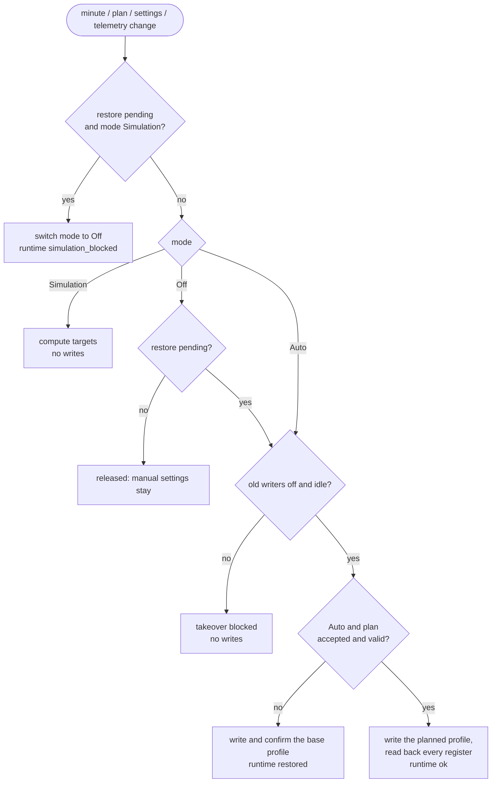

**Auto** writes; **Simulation** computes every target and records it in `runtime` without touching the
inverter; **Off** releases control. Leaving Auto for Off restores the base profile once, confirms it,
then leaves later manual settings alone. Disabling the *automation* skips that restore. A switch to
Simulation while a restore is pending is refused: the mode goes to Off, the base profile is restored,
and Simulation can then be chosen again.

### Plan acceptance

Energy Compass accepts a plan inside the callback that publishes it, so the plan, status, validity and
alert are one atomic view and there is no split publication. A publication is accepted only when all of
these hold: its intervals are contiguous, every row has a known state, a boolean `balance_hold` and
finite non-negative energies (prices may be negative), and one row covers now; the dispatch policy is
present; it was generated after the session start and no later than now, it is newer than the accepted
plan and it was generated after the last revocation; Forecast valid is `on`; there is no Alert; the
status is `ready` with no refresh or retention in progress, or `calculating` while retaining a complete
plan; and `valid_until` is in the future. The mode does not matter: acceptance runs in Off and
Simulation too.

An optimizer status other than `ready`/`calculating` or an Alert revokes the accepted plan at the time
of the publication, so a plan computed before the revocation is never accepted. While the error
persists, each publication revokes again but keeps the time of the first revocation of that plan. An
entry unload or reload is not an error: the accepted plan is kept in the integration's store and
executes while Energy Compass recalculates. After a Home Assistant restart the controller stays on the
base profile until the first plan of the new session, because a plan accepted in an earlier run is
dropped when the session changes. Saving the integration options does not reload the entry in most
cases ([Saving options](#saving-options)), and when it does, the accepted plan is kept.

`plan_reason` summarizes the verdict; the blueprint maps it to its (Polish) reasons in this order:

| `plan_reason` | Meaning |
| --- | --- |
| `session` | nothing is accepted in this session yet (after a restart or before the first plan) |
| `revoked` | the accepted generation was revoked after an error; a new plan is required |
| `sources` | an Alert is on, or the latest publication is neither a retained plan nor the accepted ready plan |
| `ok` | the accepted plan may be executed |

Control also requires fresh telemetry: every entity in `telemetry_entities` numeric and reported within
30 s, battery voltage 400–610 V and SOC 0–100 %. Every automation in `old_writers` must be off and not
running. A snapshot without battery parameters blocks control with the reason `plan: brak parametrów
baterii (pojemność, sprawność) w planie`.

### Profiles

| Plan state | Charge / discharge current | Grid charge current | TOU direction, target |
| --- | --- | --- | --- |
| `CHARGE_PV`, `SELF_CONSUME` | cap / cap | 0 A | all Disabled, SOC 10 % |
| `HOLD`, `CHARGE_PV`, `SELF_CONSUME` at SOC ≥ 100 % in Voltage mode (`HOLD`: kept until SOC ≤ 99 %) | cap / 0 A in `HOLD`, cap otherwise | 0 A | all Disabled, SOC 10 % |
| `CHARGE_GRID` | cap / 0 A | planned grid share, ≤ `max_grid_current` | Grid on the active program, target SOC from the plan; in Voltage mode TOU voltage `voltage_grid_charge_ceiling` |
| `DISCHARGE_GRID` | 0 A / planned, ≤ cap; after the target is reached `reached_discharge_current`, ≤ cap | 0 A | Sell on the active program, target SOC from the plan, power = planned, ≤ `max_power_w`; Disabled after the target is reached |
| `HOLD`, `CURTAIL` | `hold_grid_current` / 0 A | `hold_grid_current` | Grid, target SOC = planned end SOC rounded down |
| base (release, invalid plan) | `relinquish_current` / `relinquish_current` | 0 A | all Disabled, SOC 10 %, 49.6 (496 V), power `max_power_w` |

The cap is `min(max_current, max_power_w / V)` for charging and `min(max_current, max_power_w × eta_discharge / V)`
for discharging. The cap has hysteresis: the current already on the inverter is kept while it still fits
the power cap, and the next ampere step is taken only with 2 % voltage headroom (about 10 V at 530 V), so
a pack voltage crossing a step boundary does not rewrite the ceiling on every sag and rebound. The
power cap is never exceeded. At 100 % SOC the charge current of `CHARGE_PV`, `SELF_CONSUME` and `CHARGE_GRID` becomes 0 A; in battery operation mode `Voltage` only `CHARGE_GRID` does, because the other two follow the full-pack rule at the end of this paragraph. Planned currents convert interval kWh with
`eta_charge` (charging) or `eta_discharge` (discharging) over the full interval. Target SOC uses the accepted plan's `capacity_kwh`; target voltage follows a fixed
high-voltage LFP curve (496–536 V for 10–90 %, 584 V charging or 544 V discharging at 100 %). A reached
target in `CHARGE_GRID`/`DISCHARGE_GRID` is latched for that plan interval. A reached `DISCHARGE_GRID`
interval switches the direction to Disabled but keeps `reached_discharge_current` (1 A, about 530 W at
530 V, never above the cap) on discharge, so the battery covers the house base load without selling and
larger loads come from the grid; 0 A would send the whole house load to the grid at a full battery. An
interval whose planned `discharge_kwh` is below the 0.05 kWh tolerance (export planned from PV) is reached
at once. In an LFP balance row
(`balance_hold: true`) the charge current stays on at 100 %, `CHARGE_GRID` targets 100 % and the grid
current is at least `balance_grid_current`. In `Voltage` mode the inverter ends charging on pack voltage, and a
counter-based SOC source can read 100 % before the pack is full. So at SOC ≥ 100 % in `HOLD`, `CHARGE_PV` and
`SELF_CONSUME` the controller keeps the normal charge current cap (with the same hysteresis, so there are no 0 A
rewrites around the ceiling) instead of 0 A (or the `hold_grid_current` of `HOLD`). The grid current is 0 A,
so PV is the only source, discharge follows the plan row (0 A in `HOLD`), and no SOC target is written and
no "reached" state is latched. In `HOLD` the switch has hysteresis: the full-pack profile starts at SOC ≥ 100 % and
stays through the following `HOLD` runs until SOC is 99 % or lower, so an SOC source that dithers between 99.9 %
and 100 % does not rewrite the profile on every crossing. Each switch is one write transaction that begins with
charge 0 A, and there is at most one per percentage point of SOC movement; without PV the pack drifts down on the
inverter's own draw and `HOLD` tops it up from the grid, a cycle of hours. `CHARGE_PV` and `SELF_CONSUME` need no
hysteresis, because below 100 % they write the same values. `CHARGE_GRID` (it keeps `voltage_grid_charge_ceiling`
and its 0 A charge current at 100 %), `CURTAIL`, the balance hold and `Capacity` mode behave as before. `CURTAIL` runs the `HOLD` profile with a warning, because the
controller cannot limit PV.

Only battery modes listed in `commissioned_battery_modes` are controlled; any other mode (for example
Voltage before its thresholds were proven) keeps the base profile. With Voltage allowed, a target
outside 495–560 V is refused.

In Voltage mode the pack voltage sags under discharge (about 0.7 V at 7 kW) and the LFP curve is flat
(515–528 V spans roughly 30–70 %), so a `DISCHARGE_GRID` voltage target is reached within seconds of
starting. With a numeric `discharge_energy_entity`, a `DISCHARGE_GRID` interval in Voltage mode instead ends once the counter has risen by the planned `discharge_kwh` (0.05 kWh
tolerance) since the controller's first run in that interval (`runtime.slot_energy`); the TOU program
voltage is then 49.6 (496 V), so the inverter only stops on its own at that floor. Solarman reports the counter only when
it changes, so its freshness comes from the `telemetry_entities` heartbeat of the same inverter. Without a
numeric counter the voltage target applies as before. Capacity mode is unchanged.

Charging lifts the pack voltage the other way: about 2 V at 4 A within seconds, and the inverter stops
grid charging as soon as the pack reaches the TOU voltage. A `CHARGE_GRID` target from the curve (51.4 V
for 27 % at a 512 V rest voltage) therefore ended the charge after a few seconds, and a rest voltage
above the curve point latched the interval as reached at once. In Voltage mode `CHARGE_GRID` (outside a
balance row) writes `voltage_grid_charge_ceiling` (55.2 V, 552 V) as the TOU voltage instead; the planned
grid current sets how much each interval charges, and the interval is reached only when the pack reaches
the ceiling. The Solarman charge counter refreshes about every 10 minutes, too slowly to end a 15-minute
interval, so it is not used. Keep the ceiling at or below the BMS charge voltage limit.

### Writes and confirmation

Each change writes one entity through `number.set_value` or `select.select_option`, then reads holding
registers 108–177 from the controller's Solarman device (`device_id`) and compares the raw value. A register that does not confirm
is listed in `runtime.uncertain` and retried; a direction or target change first zeroes the currents,
then sets thresholds, then enables the direction.

| Runtime code | Meaning |
| --- | --- |
| `waiting` | the first run has not published a code yet |
| `ok` | the planned profile is computed (Simulation) or written and confirmed (Auto) |
| `blocked` | no valid plan or a gate failed; `reason` and `reason_code` say which |
| `restored` | the base profile was written and confirmed (release in Off, or no valid plan in Auto) |
| `verification_required` | writes finished but not every register confirmed |
| `write_failed` | a register did not confirm after retries; restore stays pending |
| `simulation_blocked` | Simulation was refused while a restore was pending |
| `paused` | the pause switch is on (native engine): the decision is computed, nothing is written |
| `error` | the run itself failed (native engine): an exception, or Energy Compass or the Solarman entities could not be read; `reason_code` is `run_failed` or `controller_unavailable`. After three failed runs in a row the repair issue "Deye controller runs are failing" appears; the next good run clears both |

`runtime.reason_code` is a stable code and `runtime.reason` its text. The native engine writes the text in
the Home Assistant language (Polish for `pl`, English otherwise); the blueprint engine's texts are Polish.

| `reason_code` | Meaning |
| --- | --- |
| `ok` | nothing blocks the plan |
| `telemetry_stale` | telemetry entities not numeric or older than 30 s, voltage outside 400–610 V or SOC outside 0–100 % |
| `tou_times` | the six TOU start times are not different and rising |
| `session_wait` | no plan accepted yet in this session |
| `plan_revoked` | the accepted generation was revoked after an error |
| `plan_sources` | an Alert is on or the publication is not ready |
| `battery_params` | the accepted plan has no battery parameters |
| `plan_expired` | the original validity ended or no interval covers now |
| `plan_malformed` | an interval has missing or invalid values; a new plan is required |
| `operation_mode` | the inverter battery mode is neither Capacity nor Voltage |
| `mode_not_commissioned` | the battery mode is not in `commissioned_battery_modes` |
| `voltage_range` | a Voltage-mode target outside 495–560 V |
| `settings_range` | an entity range or step is missing, or a target is outside it |
| `takeover_blocked` | an automation in `old_writers` is on or running |
| `blueprint_active` | an automation using the Deye blueprint is on (see below); no write at all (not even the restore), and a repair issue names it |
| `layout_mismatch` | the registers disagree with the entity states (see [Supported hardware](#supported-hardware)) |
| `paused` | the pause switch is on |
| `verification_required` | writes finished but not every register confirmed |
| `write_failed` | a register did not confirm after retries |
| `simulation_blocked` | Simulation refused while a restore was pending |
| `run_failed` | the run raised an exception; details are in the Home Assistant log |
| `controller_unavailable` | Energy Compass or the Solarman entities could not be read; nothing was written |

Every runtime update of the blueprint engine goes through `energy_compass.controller_runtime`; when that call fails, the run stops before the next register is written. The native engine rejects that service, so a blueprint run that slips through stops before its first write.

### Following a run (native engine)

The blueprint left an automation trace per run; the native engine replaces it with:

- the runtime sensor's `reason` and `reason_code`, and its attribute `last_run` (not recorded): trigger,
  decision, planned commands, each write with its outcome (sent, failed, confirmed, blocked) and how the run ended;
- the integration's diagnostics (`deye_controller`): `engine`, `hardware` and `run_history`, the last 50 runs
  (kept in memory, so a restart empties it);
- a logbook entry on the runtime sensor whenever the runtime code or the confirmed mode changes;
- the runtime code `error` and the repair issues "Deye controller runs are failing" and "Deye blueprint
  automation is still on", so a stopped controller is visible without reading logs.

### When Energy Compass is unavailable

Without Energy Compass neither the mode nor the runtime can be read, so no write could be proven safe or
recorded. The blueprint therefore stops at its first step, without any write or service call, when the
controller sensor is missing or unavailable, reports another `controller_schema` or has no
`mode_entity`: the trace says `Energy Compass niedostępny: sterowanie wstrzymane bez zapisów`. The native
engine does the same without a trace: the run ends without a write, the runtime code is `error` with the reason
`controller_unavailable`, and a repair issue appears after three such runs. The
inverter keeps its last profile; a forced TOU direction ends at the next TOU program boundary, while the
battery currents stay as they are. If Energy Compass disappears in the middle of a run, the next runtime
call fails and the run stops before another register is written. Home Assistant reports the failed
entry; repair it or release the inverter by hand.

### Limits and defaults (native engine)

The expert group **Limits and takeover** of the options step sets these; an empty field keeps its default,
and a change applies on the next run without a reload. No household value is built into the code.

| Option | Default |
| --- | --- |
| `max_power_w` | the smaller of the charge and discharge power in the Energy Compass settings, in W |
| `max_current`, `relinquish_current` | the `max` attribute of the charge-current entity, capped at `max_power_w` / 400 V |
| `max_grid_current` | the `max` attribute of the grid-current entity, capped the same way |
| `hold_grid_current`, `reached_discharge_current`, `balance_grid_current` | 1 A, 1 A, 2 A |
| `voltage_grid_charge_ceiling` | 55.2 V |
| `commissioned_battery_modes` | Capacity |
| `old_writers` | none |
| `telemetry_entities` | the SOC and voltage sensors of the device |
| `discharge_energy_entity` | the device's total battery discharge sensor when there is exactly one |
| entity overrides | none; the six entities are found on the device by Solarman translation keys |

When the power or a current limit would come out as zero (for example a charge power of 0 in the battery
settings), the options step does not store it: it shows the group and asks you to enter the limits.
Enabling the native engine also needs a numeric battery voltage reading, because the pack is told from a
48 V one by it.

### Inputs

These are the inputs of the deprecated blueprint, with the blueprint's own defaults; the native engine
takes the values above.

| Input | Default | Meaning |
| --- | --- | --- |
| `controller_entity` | — | the *Deye controller* sensor of one Energy Compass installation (Options → Deye controller) |
| `charge_entity`, `discharge_entity`, `grid_entity` | — | battery max charging (108), max discharging (109) and grid charging (128) current |
| `operation_entity` | — | battery operation mode select (Capacity / Voltage) |
| `soc_entity`, `voltage_entity` | — | battery SOC (%) and pack voltage (V) |
| `telemetry_entities` | — | sensors that must be fresh (reported within 30 s) |
| `max_power_w` | 8000 W | battery power cap and TOU program power |
| `max_current` | 18 A | charge/discharge current cap in forced states |
| `max_grid_current` | 16 A | grid charging current cap |
| `hold_grid_current` | 1 A | charge and grid current in `HOLD` |
| `balance_grid_current` | 2 A | minimum grid current in an LFP balance row |
| `reached_discharge_current` | 1 A | discharge current after a `DISCHARGE_GRID` interval reached its target (direction Disabled, no selling) |
| `relinquish_current` | 18 A | charge/discharge current of the base profile |
| `commissioned_battery_modes` | Capacity | battery modes allowed for physical control |
| `discharge_energy_entity` | none | cumulative battery discharge energy (kWh); in Voltage mode ends `DISCHARGE_GRID` intervals on planned energy |
| `voltage_grid_charge_ceiling` | 55.2 V | TOU voltage for `CHARGE_GRID` in Voltage mode (49.5–56.0 V); the planned grid current carries the energy |
| `old_writers` | none | automations that must be off before any write |

Capacity and the charge and discharge efficiencies are no longer inputs: the blueprint uses the values
the accepted plan was computed with (`capacity_kwh`, `eta_charge`, `eta_discharge`), so a retained plan
never runs with settings saved after it. `max_power_w`, `max_current`, `max_grid_current` and
`relinquish_current` stay hardware caps in the blueprint; keep `max_power_w` consistent with the
Energy Compass charge and discharge power, because the two are not linked.

### Migrating from the package (0.1.36 and older)

Release 0.1.37 removes `packages/energy_compass_deye.yaml`. Energy Compass 0.1.36 and older ignore the
controller options and store, so the controller needs 0.1.37 and the new blueprint together.

1. **Install 0.1.37 and restart.** The controller is enabled automatically when the package helpers exist,
   there is one Energy Compass entry and one usable Solarman device; otherwise enable it in
   **Options → Deye controller**. The old blueprint and package keep controlling until you swap them.
2. **Optional shadow check.** The controller sensor's `generation` should equal the state of the package's
   plan sensor after each acceptance.
3. **Compare efficiency and capacity first.** The old blueprint used its own `eta` (default 0.9747) and `capacity_kwh` (default 25); the new one uses the plan's `eta_charge`, `eta_discharge` and `capacity_kwh`, which come from the Energy Compass battery settings (efficiency 1.0 unless set). Make `eta_charge` and `eta_discharge` equal to the old `eta` before the swap, or the first run rewrites the grid-charge and discharge currents by that ratio; a capacity difference moves only SOC thresholds, as below.
4. **Swap in a quiet window** (a `CHARGE_PV` or `SELF_CONSUME` row, not near a full hour, with no other
   writer running). Turn the old automation off without stopping its actions, call
   `energy_compass.controller_import_package` for the controller sensor and check the answer (the
   package's session, accepted generation, mode and restore flag). It copies the state, adopts the
   package session and drops stale runtime keys. Then replace the blueprint, select the controller sensor
   in the automation, drop the eight removed inputs (`plan_entity`, `optimizer_entity`, `valid_entity`,
   `alert_entity`, `compass_entity`, `solarman_device`, `capacity_kwh`, `eta`) and turn it on. The first
   run changes nothing on the inverter when the capacity is unchanged; a capacity change moves only the
   active program's SOC and voltage threshold in a `HOLD` or grid row.
5. **Repoint** dashboards and your own automations: the mode helper is now a `select`, the restore flag
   and the session are attributes, and the dashboard roles are `deye_controller`, `deye_mode` and
   `deye_runtime`.
6. **Remove the package** include from `configuration.yaml`. It takes effect at the next restart; do not
   reload `template` or the input helpers meanwhile. Afterwards delete the ten orphaned registry entries.

Without the import, swap the blueprint anyway and accept one stretch on the base profile until the next
plan. Rollback before the package is removed: turn the new automation off, restore the old blueprint and
inputs and turn it on; the package helpers were never written by the import. A downgrade to 0.1.36 needs
the old blueprint and the package back first.

### Migrating from the blueprint to the native engine

The two engines never write together. Selecting `native` in **Options → Deye controller → Engine** is
refused until the mode is `Off` and the restore is done. While the engine is `native`:

- the mode select refuses to leave `Off` (the error names the automation) while an automation that uses
  the blueprint is on;
- a run that would write (mode `Auto`, or `Off` with a restore pending) stops when such an automation is on:
  nothing is written, the runtime reason is `blueprint_active` (naming the automation) and a repair issue stays
  until the automation is switched off. Not even the restore to BASE is written meanwhile, so the inverter keeps
  the last profile it was given; once the automation is off, the controller continues (or restores BASE) on its
  next run. Mode `Off` with nothing to restore and `Simulation` run as usual and are not blocked. This also covers
  a reload with mode `Auto` and a blueprint that was never updated;
- `energy_compass.controller_runtime` rejects every call, so a blueprint run that slips through stops
  before its first write.

When exactly one automation uses the blueprint on the same Solarman device (its charge, discharge, grid and
operation entities belong to that device), its limits and entity overrides are loaded into the expert
group for you to review; nothing is applied until you save. An automation on another inverter prefills
nothing.

1. Select the mode `Off` and wait until `restore_pending` is off and the runtime code is `restored` (or the
   run reports released).
2. Turn the blueprint automation off. Do not stop its actions mid-run; wait for them to finish.
3. **Options → Deye controller:** set the engine to `native`, review the prefilled limits and save. The entry reloads.
4. Select `Simulation`, compare `runtime.desired` with what the blueprint wrote for a while, then select `Auto`
   in a `CHARGE_PV` or `SELF_CONSUME` row.
5. After a week delete the automation and the blueprint file.

Rollback: select `Off`, wait for `restored`, set the engine to `blueprint`, turn the automation on, then
choose the mode. A paused flag is cleared when the engine returns to `blueprint`.

### Dashboard examples

Generated by `tools/dashboards/build.py` with placeholder entity IDs:

| Section | What it shows |
| --- | --- |
| `controller_panel.yaml` | the controller at a glance: a **Check control** warning (stale forecast, Alert, runtime not `ok`, no fresh confirmation, unconfirmed writes), battery now with the mode selector and confirmed settings, the Compass decision with the controller's SOC target, the next 24 h of plan states with end SOC, a SOC forecast chart, the household consumption hint and cost, and 24 h history of SOC, power and control |
| `controller_diagnostics.yaml` | optimizer and controller state, reason and reason code, the inverter and whether it is verified, the last run, confirmed mode, last confirmation, plan and forecast validity, active TOU program, unconfirmed writes, session and restore flags, and the read-back of the three current limits |
| `plan_chart.yaml` | 12 h of measured load, grid, PV and SoC with the next 24 h of the plan over plan-state bands; grid-charge and grid-sell bands show the energy-weighted mean price of the block |
| `consumer_compass_chart.yaml` | Consumer Compass levels, 4 h history and 20 h forecast |

The panel uses native cards plus ApexCharts Card for its SOC forecast; the two charts need ApexCharts Card. The [YAML builder](builder.html) fills any of them with your entity IDs, capacity and language.
See the [installation guide](installation.md#dashboard-examples).

The controller examples take four roles: `deye_controller`, `deye_mode`, `deye_runtime` and `deye_pause` (defaults
`sensor.energy_compass_deye_controller`, `select.energy_compass_deye_mode`,
`sensor.energy_compass_deye_controller_runtime` and `switch.energy_compass_pause_inverter_writes`). The panel
shows the pause switch only while the entity exists, that is with the native engine. Pass
`--entity deye_mode=select.my_mode` to the generator or fill
them in the YAML builder when your IDs differ; the session, the restore flag, the next TOU change and the TOU
prefix are read from the controller's attributes.

## Energy Atlas (optional)

Energy Atlas is a separate Datamindz service that aggregates anonymised telemetry across sites for
research and benchmarking. Sending data to it is **opt-in and off by default**: with it off,
Compass behaves and performs exactly as it does without this section — no network calls, no new
background thread, no new files.

Turn it on in **Settings → Devices & services → Energy Compass → Configure → Energy Atlas**:

| Field | Meaning |
| --- | --- |
| Send to Energy Atlas | Off by default. |
| Environment | **staging** (`atlas-api-staging.datamindz.io`, for validating the data flow) or **production** (`atlas-api.datamindz.io`, the live collector). Staging validates the data flow; production is not available in this release yet (no credential baked in for it). |
| PV capacity (kWp) | Installed PV capacity, entered once; not derived from other Compass settings. No default: required when sending is on. |
| Grid connection power (kW) | Optional, 0.1–1000 kW: the site's grid connection limit, one value for import and export. Empty unless you saved one before — never prefilled from the grid import/export limits. Left empty, nothing is sent and the map counts the site as **without max**. Applies live like the rest of the form. |

**No secret to enter.** This release registers with a shared **public** enrollment credential baked
into the integration itself — the same one for every install of this version — so anyone running
Energy Compass can register a site with it; the site is **unverified** until you send **Energy
Atlas: show ownership proof** (below) to the Energy Atlas bot. The credential rotates by release:
each new Compass version may ship a different one, and the old one is eventually revoked (already
registered sites keep working — they authenticate by their own site key, not the enrollment
credential).

Saving the form applies **live**: it does not reload the entry or touch your plan, and it starts or
stops the delivery thread immediately. The form's description shows a **status line** so you can
see it worked from your phone: `off`, or `registered on <environment> · last delivery <time |
never> · waiting <n>` (plus `halted: <kinds>` if delivery is stuck).

**What is sent**, only while enabled and only the entities you have bound in Sources: PV, grid
import/export and battery power, household load power (recorder mode only), battery SOC, and
PV/import/export energy counters (only counters
whose Home Assistant `state_class` is `total`/`total_increasing`); each Compass solve's plan and
its price/PV/load inputs; a handful of installation attributes (PV kWp, grid connection power in kW
if you entered it, battery capacity and usable capacity, SOC floor, the Compass version) and the coarse location of your Home Assistant home zone
as an H3 resolution-6 cell (a hexagon of roughly 36 km², so Atlas can count your site in its
voivodeship). The cell is computed once, when delivery starts, and your exact coordinates are never
stored or sent. Nothing else — no tariff text or inverter model, and the enrollment credential
itself is **never stored**, only the site key issued in exchange for it.

**How values are sent**: powers in W. Bind **Battery power** with + = discharge (as in the
dashboard examples); Atlas receives it as + = charge. Readings outside the collector's ranges are
corrected, not sent as errors: a negative grid import/export power is sent as 0, SOC below 0 % or
above 100 % as 0 %/100 %, and a negative energy counter or a non-numeric reading is not sent.

**Where the key lives**: `.storage/energy_compass_atlas/<entry id>/<environment>/` inside your
Home Assistant config directory, one subdirectory per environment so staging and production never
share a key, a site or a queue. It is included in Home Assistant backups. Removing the integration
deletes it.

**Switching environment**: staging and production are independent — each keeps its own key, site
and queued data. Switching to an environment that was already registered resumes it live (no
reload, no re-registration, no lost queue); switching to one that has never been registered
registers it automatically with the baked-in credential, without asking for anything.

**When the collector is down**: telemetry and solves queue locally (up to 30 days) and are sent
once it is reachable again; Compass's own plan is unaffected — Atlas delivery runs on its own
background thread and never shares the optimizer's schedule. Diagnostics (**Devices & services →
Energy Compass → ⋮ → Download diagnostics**) report the `energy_atlas` section: enabled,
environment, registration status, queue depth and any halted delivery.

**Recovery: forget a site**: if a site's key was revoked or conflicts with another source, check
**Forget site on this environment** on the same Energy Atlas form and save. This deletes the
selected environment's key and queued data on this device only — the site itself is not removed at
the collector, an operator can revoke it separately — so the next save with sending still enabled
registers a new site there automatically, again without asking for anything.

**Show ownership proof**: once a site is enabled and registered, the options menu offers an extra
entry, **Energy Atlas: show ownership proof**. It generates a short-lived signed proof (valid 15
minutes, single use) and displays it to send to the Energy Atlas bot to link the site to your
Datamindz account. The proof is shown only — it is never stored and never appears in options,
diagnostics or logs.

**Backfill history**: the service **Energy Atlas: backfill history**
(`energy_compass.atlas_backfill`, optional field **Days**, 1–3650, default: all available history)
sends past telemetry from Home Assistant's own recorder history for every entity you have bound —
5-minute statistics where the recorder still keeps them, hourly statistics for older history — to
every entry that currently has sending enabled and a registered site, using the same value
corrections as live delivery. It fails with an error if no entry currently qualifies.

## Offline replay tool

`tools/replay.py` answers "what does this setting change do to the real cost?" without Home
Assistant. It imports the optimizer from `custom_components/energy_compass/engine` and replays
recorded days; it needs the same Python and SciPy as the integration (run it in the test image or
any environment where `import scipy` works) and plots nothing. For every day and in total it prints,
in the installation's currency:

| Column | Cost of |
| --- | --- |
| `plan` | the Energy Compass plan **as executed**: re-solved every `refresh_minutes` on the forecast known at plan time, the planned mode and energies applied to the realized PV and load |
| `self_use` | plain self-consumption: the battery follows the load, no grid charging, no battery export |
| `hindsight` | one solve of the same objective on the **realized** PV and load — the best the same settings could have done |

```
python tools/replay.py tools/replay_sample.json --currency PLN
python tools/replay.py tools/replay_sample.json --set allow_grid_charge=false
```

`--set key=value` (repeatable) overrides any planner setting by its key (the keys of Options, as in
`settings.py`; strategy-owned flags set this way are treated as explicit). Run twice and compare the
`plan` column to measure a change. `--json` prints the numbers (with `solve_failures`, the number of
failed plan solves of the day) instead of the table; `--timezone` and `--initial-soc` apply to CSV
input only. A bad file, value or override ends with `error: …` naming the place and exit code 2.

### Input format

One JSON file (or a CSV, below). `tools/replay_sample.json` is a complete two-day synthetic example.

| Key | Meaning |
| --- | --- |
| `timezone` | IANA name, e.g. `Europe/Warsaw` (default `UTC`) |
| `interval_minutes` | interval length, default `15`; all days of a file share it |
| `settings` | optional planner settings (`capacity_kwh`, `charge_kw`, `grid_export_kw`, `strategy`, `refresh_minutes`, …); unset keys take the shipped defaults, so set at least the battery and site limits |
| `days[].start` | ISO timestamp of the first interval (with offset, or local to `timezone`) |
| `days[].date` | label for the table, default the local date of `start` |
| `days[].initial_soc_percent` | battery SOC at `start` (default `initial_soc_percent` of the file, else 50) |
| `days[].intervals[]` | one object per interval, in order and without gaps (below) |

Each interval has six numbers: `buy` and `sell` (currency/kWh, the final tariff prices), `pv_forecast`
and `load_forecast` (kWh in the interval, **as known at plan time**) and `pv` and `load` (kWh actually
produced and consumed). The six values must be finite and the four energies not negative (clip the
small negative values that rounding in statistics can leave, e.g. in `import + PV − export`); an error
names the place, `days[n][i]` (day `n` from 1, interval `i` from 0) or `line n` of a CSV.

An interval may also carry `buy_energy` (CSV column too): the energy part of `buy`, the part the
deposit can pay (the rest of `buy` is distribution), in the same units, not above `buy` and empty or
missing meaning 0. It matters only with the
[deposit model](#net-billing-deposit-value), which you switch on with `--set deposit_model=manual
--set export_value_factor=0.3` (or `auto` with the two yearly values). `buy` stays the invoice
price, so `buy_distribution_mode`, `buy_distribution_rate` and `buy_distribution_off_peak_rate` are
not read — prices come from the file — and a warning says so. Costs are reported at the file's prices
whatever the factors are.

Days are independent: each is planned and measured on its own and ends at its last interval, even
when the file holds consecutive days. The horizon therefore shrinks to the end of the day, so
`horizon_hours` beyond the day and the carry of energy over midnight are not measured.

CSV has one row per interval with the columns `start`, `buy`, `sell`, `pv_forecast`, `load_forecast`,
`pv`, `load` and optionally `buy_energy` and `initial_soc_percent` (read on the first row of a day). Rows are grouped
into days by the local date of `start`; settings come only from `--set`.

### Reading the result

- **Day-end energy is valued**, because a day boundary is arbitrary for a battery. Every solve values
  the final SOC at `terminal_value_per_kwh` when `terminal_mode` is `value`, else at the day's mean buy
  price, so the plan may end a day below its initial SOC. The **reported** cost prices the difference
  between the final and the initial SOC at the day's mean buy price whatever the settings are, so
  `terminal_mode` and `terminal_value_per_kwh` change the plan but not the measuring stick: `self_use`
  is identical in every run, and two runs differing in the terminal value are comparable.
- `wear_per_kwh` is part of the reported cost (half of the charged plus discharged energy), so runs
  with different `wear_per_kwh` are not comparable.
- `hindsight` is the optimum of the **shaped objective** (strategy weights, import penalty and the
  terminal value of the solves included) priced in real currency. For `cost_min` with no import
  penalty and a terminal value equal to the day's mean buy price it is a lower bound of `plan`; for
  other strategies it is the best that strategy could do. With `terminal_mode` `value` and a lower
  value than the mean buy price, `hindsight` may drain the battery and report more than `plan`, which
  is a sign that the terminal value undervalues stored energy.
- The executed plan follows the controller (`tools/deye_controller/build.py`) against realized data.
  `SELF_CONSUME` and `CHARGE_PV` follow the load: all PV surplus charges the battery and a deficit is
  covered from it. In `CHARGE_GRID` only the grid share follows the plan — the planned charge minus the
  surplus the forecast promised. Grid and the realized PV surplus charge together until the row's
  planned end SOC; then the grid stops, as the controller does, and PV keeps charging for the rest of
  the slot. PV above the forecast therefore shrinks the grid import (the SOC may end above plan, by PV
  only), and PV below it charges less — a shortfall is never
  bought from the grid, nor a start SOC below plan caught up. `DISCHARGE_GRID`
  discharges the planned energy, `HOLD` parks the battery. Grid export beyond `grid_export_kw` is
  curtailed, and stored energy is not exported beyond the PV produced so far when **Sell only PV**
  (`limit_export_to_pv`) is on.
- The [peak-period reserve](#peak-period-reserve) (`peak_reserve_margin_kwh`) is replayed as in the integration: it needs
  `limit_grid_charge_price` (its ceiling is the cheap price), else a warning says it has no effect.
- Not replayed: LFP balance windows, the autonomy tail beyond the data, and carried export or
  grid-charge commitments. A warning names the enabled ones. A failed plan solve runs that step as
  self-consumption and is reported under the table and as `solve_failures`; a failed `hindsight`
  solve or inconsistent settings stop the run with `error: <date>: …`.

### Exporting the data from Home Assistant

`buy` and `sell` are the final prices the planner sees: from your tariff, or from the history of the
price entities Energy Compass reads. The realized energy comes from long-term statistics: the
**Energy** dashboard's menu offers **Download data** (CSV, hourly). The same hourly `change` values
the replay needs are returned by the `recorder/statistics_during_period` WebSocket command with
`"period": "hour"` and `"types": ["change"]`
([`tools/export_value_backfill.py`](../tools/export_value_backfill.py) shows the call). Take
`pv` from the PV production statistic and `load` from the home consumption statistic
(energy in = grid import + PV − grid export, when no consumption sensor exists).
`pv_forecast` and `load_forecast` are what your forecast entities said **before** the interval — the
Compass plan attribute `intervals` (or the Solcast/forecast history) recorded at plan time; using
the realized value as the forecast gives an idealised plan with no forecast error.
Use `interval_minutes: 60` for hourly statistics.

## Reason code reference

### Coverage / quality reasons (`reason`, `reasons` attributes)

| Code | Meaning |
| --- | --- |
| `complete` | Full reference coverage, all probes succeeded. |
| `available_reference_horizon` | Source coverage shorter than the requested reference horizon; percentiles use what exists. |
| `reference_horizon_uncovered` | Reserved in translations; not emitted by 0.1.37. |
| `reference_probe_failed` | At least one reference probe failed or timed out. |
| `short_source_coverage` | Price/forecast coverage ends before the requested planning horizon. |
| `current_guidance_unavailable` | Current interval probe unknown; later windows may still be valid. |
| `missing_forecast_continuation` | A configured source (except the optional pessimistic PV source) has not yet published data for part of the requested horizon (e.g. tomorrow's prices before ~14:00). |
| `load_history_fallback` | Part of the load forecast uses the fallback daily load because history is insufficient. |
| `unvalidated_tariff` | Tariff calibration marked `unvalidated`. |
| `unvalidated_capacity` | Battery capacity calibration marked `unvalidated`. |

### Autonomy warnings

| Code | Meaning |
| --- | --- |
| `autonomy_floor_requires_pv` | No PV source — floor skipped. |
| `autonomy_tail_coarsened` | 48 h tail longer than 192 intervals, coarsened to hourly. |
| `autonomy_tail_unavailable` | Tail source failed; floor uses the priced horizon only. |
| `grid_charge_ceiling_below_autonomy_weight` | Grid-charge ceiling below floor weight − margin; floor could never be refilled. |
| `peak_reserve_requires_grid_charge_ceiling` | `peak_reserve_margin_kwh` above 0 but **Limit grid-charging price** off — peak-period reserve skipped. |
| `peak_reserve_inactive` | No upcoming expensive run with a deficit in the horizon — peak-period reserve has nothing to protect. |

### Safety exceptions (`dispatch_policy.safety_exception.reason`)

| Code | Meaning |
| --- | --- |
| `observed_soc_maximum` | Charging commitment active but SOC already at the maximum. |
| `observed_soc_minimum` | Discharge commitment active but SOC at or below the reserve. |
| `grid_charge_price_limit` | Carried CHARGE_GRID would continue above the grid-charge price ceiling. |

### Balance warnings

These are raw codes, not translated.

| Code | Meaning |
| --- | --- |
| `balance_overdue` | The balance phase is `due` but no hold window could be fit into the plan; a balance was missed this horizon. |
| `balance_pessimistic_pv_unavailable` | A pessimistic PV source is configured but unavailable, stale, malformed or negative, or does not cover the horizon; the balance windows were chosen on the median PV series. |
| `balance_no_window_in_horizon` | The balance phase is `eligible` or `due` but no candidate hold window exists in the horizon at all (no aligned start satisfies PV/grid-charge feasibility). |
