# Energy Compass — przewodnik po stanach i strategiach

[English](guide.en.md) · **Polski**

Przewodnik opisuje działanie Energy Compass, wszystkie stany, jakie mogą zgłaszać jego encje,
warunki, w których każdy stan występuje, oraz sześć strategii dyspozycji. Dotyczy wersji
**0.1.43**. Matematyczny kontrakt każdej reguły opisuje [model i ograniczenia](model.md) (EN), a
instalację opisuje sekcja [Instalacja](#instalacja), a dashboardy — [przewodnik instalacji](installation.md) (EN).

Energy Compass jest **doradczy**. Liczy plan i publikuje go jako encje Home Assistant. Sam nie wysyła
powiadomień, a ustawienia falownika zapisuje tylko wtedy, gdy włączysz opcjonalny sterownik Deye
(domyślnie wyłączony), i robi to przez integrację Solarman; blueprinty powiadomień i inne sterowniki same
decydują, czy wykonać plan. Zob. [Sterownik falownika Deye](#sterownik-falownika-deye-solarman).

## Spis treści

1. [Instalacja](#instalacja)
2. [Jak to działa](#jak-to-działa)
3. [Przegląd encji](#przegląd-encji)
4. [Stan optymalizatora — cykl obliczeń](#stan-optymalizatora--cykl-obliczeń)
5. [Alert i poprawność prognozy](#alert-i-poprawność-prognozy)
6. [Tryby pracy — planowany stan baterii](#tryby-pracy--planowany-stan-baterii)
7. [Poziomy zużycia — BOOST, CHEAP, NORMAL, LIMIT](#poziomy-zużycia--boost-cheap-normal-limit)
8. [Okna i głębokość elastycznego zużycia](#okna-i-głębokość-elastycznego-zużycia)
9. [Strategie dyspozycji](#strategie-dyspozycji)
10. [Automatyczne przełączanie strategii](#automatyczne-przełączanie-strategii)
11. [Powiadomienia o oknach](#powiadomienia-o-oknach)
12. [Karta kosztów](#karta-kosztów)
13. [Sterownik falownika Deye (Solarman)](#sterownik-falownika-deye-solarman)
14. [Energy Atlas (opcjonalnie)](#energy-atlas-opcjonalnie)
15. [Narzędzie replay (offline)](#narzędzie-replay-offline)
16. [Słownik kodów powodów](#słownik-kodów-powodów)

## Instalacja

Ta sekcja prowadzi krok po kroku od czystego Home Assistanta do pierwszego planu. Potrzebujesz
działającego Home Assistanta i — by skorzystać w pełni — falownika z baterią; nie musisz znać wcześniej
Energy Compass. Główną ścieżką jest polska instalacja (PLN, taryfa G12, cena sprzedaży RCE,
net-billing); te same kroki dotyczą każdej innej waluty i taryfy.

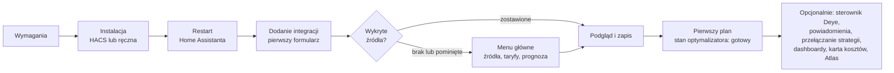

### Wymagania

- Home Assistant **2026.9.1 lub nowszy**.
- `scipy`, solver numeryczny. Integracja instaluje dokładnie przypiętą wersję ze swojego manifestu
  (`scipy==1.18.1`); sam niczego nie instalujesz.
- Raspberry Pi i inne hosty ARM64 działają. Przetestowane połączenie ARM64 Core/Python/solver i
  reprezentatywne wyniki benchmarków opisuje [walidacja środowiska](runtime-validation.md) (EN).

### Instalacja integracji

1. **HACS (zalecane).** W HACS otwórz **Custom repositories** i dodaj
   `https://github.com/datamindzio/ha-energy-compass` jako **Integration**. Pobierz Energy Compass i
   zrestartuj Home Assistanta.
2. **Ręcznie.** Skopiuj katalog `custom_components/energy_compass` z tego repozytorium do katalogu
   `custom_components` w konfiguracji Home Assistanta i zrestartuj.

### Dodanie integracji

Otwórz **Ustawienia → Urządzenia i usługi → Dodaj integrację → Energy Compass**. Konfiguracja to krótki
kreator; nic nie jest zapisywane przed jego ostatnim krokiem.

1. **Pierwszy formularz.** Wpisz **Nazwa**, **Waluta** (bez automatycznej konwersji) i **Strefa
   czasowa**, wybierz **Opcjonalny profil dostawcy** (preset) oraz ustaw
   **Włącz fotowoltaikę** i **Włącz baterię**. Ten sam formularz oferuje trzy opcjonalne profile startowe:
   **Rozliczenie prosumenckie**, **Polska taryfa dystrybucyjna** i **Falownik**. Jednorazowo wypełniają
   edytowalne wartości nowej instalacji i nigdy nie ustawiają ceny; profile polskie wymagają waluty
   PLN. Co wypełnia każdy profil, opisują [Profile startowe](#profile-startowe-nowe-instalacje).
2. **Wykryte źródła.** Energy Compass szuka Solcasta, `rce_pse`, Solarmana (Deye) i źródeł panelu Energia
   po tożsamości integracji, nie po nazwie encji, i proponuje je jako wiersze. Zostaw te, które chcesz,
   i przejdź dalej: zostaną powiązane i otworzy się **Podgląd i zapis**. Gdy nic nie znaleziono albo nic
   nie zostawisz, otworzy się menu główne. Zob. [Wykryte źródła](#wykryte-źródła-nowe-instalacje);
   PV może też korzystać z [prognozy PV z panelu Energia](#prognoza-pv-z-panelu-energia).
3. **Menu główne.** Przejdź przez potrzebne grupy; każdą możesz później otworzyć ponownie w
   **Konfiguruj**.
   - **Taryfy → Źródło ceny zakupu** — cena zakupu. Dla polskich G11/G12/G12w wybierz **Taryfa OSD**,
     która nie wymaga YAML: wskaż operatora i grupę, a następnie wpisz stawkę szczytową (*Cena zakupu*)
     i, dla G12/G12w, *Cena zakupu poza szczytem* w **Taryfy → Stałe stawki i przeliczenia**. Strefy,
     zegar i święta opisują [Wbudowane taryfy OSD](#wbudowane-taryfy-osd).
   - **Taryfy → Źródło ceny sprzedaży** — cena sprzedaży. W Polsce wybierz **Cena rynkowa RCE (PSE)**,
     która używa sensora integracji `rce_pse`.
   - **Prognoza zużycia** — liczby stojące za prognozą zużycia domu. Nowa instalacja startuje od
     dobowego szacunku, który tu wpisujesz (**Dobowe zużycie domu**, domyślnie 10 kWh/dobę). Historia
     rekordera jest używana, gdy powiązane jest źródło zużycia domu: zostaw wiersz **Historia zużycia
     domu** w **Wykrytych źródłach** albo użyj **Źródła danych → Dodaj źródło → Zużycie**. **Prognoza
     zużycia** dostraja wtedy okno historii (**Długość historii**, **Minimalna liczba próbek**,
     **Okres połowicznego zaniku wagi próbek, dni**) i rozwiązanie zapasowe.
   - **Źródła danych** — przegląd i edycja wszystkich powiązanych źródeł, także PV; **Bateria** i
     **Możliwości sprzętu** zawierają limity baterii i limit importu z sieci. Grupy planowania,
     prognozy kosztu zużycia, wydajności i prezentacji pojawiają się po **Pokaż ustawienia eksperckie**
     (zob. [Ustawienia eksperckie](#ustawienia-eksperckie)).
4. **Podgląd i zapis.** Podgląd normalizuje dane wejściowe, pokazuje ich pokrycie, jednostki i wiek oraz
   przed zapisem rozwiązuje ograniczony plan bazowy. Plan bazowy musi być wykonalny, by dało się
   zapisać. Przy pierwszej konfiguracji zaznaczasz też potwierdzenia pokazanego źródła zakupu i źródła
   zużycia domu (zerowa stała cena zakupu oznacza darmowy import; domyślny szacunek zużycia to
   10 kWh/dobę), a potem potwierdzasz zapis.

Aby wypróbować Energy Compass bez żadnych encji dostawców, utwórz konfigurację syntetyczną: nazwa
`Synthetic`, waluta `EUR`, strefa `UTC`, preset `Generic`, PV i bateria wyłączone; pozostałe wartości
podaje README ([English](../README.md#install), [Polski](../README.pl.md#instalacja)).

### Po instalacji

Integracja tworzy jedno urządzenie z natywnymi sensorami, sensorami binarnymi i selectem **Strategia**
opisanymi w [Przeglądzie encji](#przegląd-encji). Zaraz po zapisie sensor **Stan optymalizatora**
pokazuje `calculating` i przechodzi w `ready`, gdy opublikowany zostanie pierwszy zwalidowany plan. Jeśli
zgłasza `invalid_input`, `timeout` lub `infeasible`, powód opisuje
[Stan optymalizatora](#stan-optymalizatora--cykl-obliczeń).

Po aktualizacji przez HACS zrestartuj Home Assistanta i odśwież stronę w przeglądarce (w aplikacji
mobilnej uruchom ją ponownie). Interfejs przechowuje etykiety integracji w pamięci podręcznej, więc bez
odświeżenia nowe ustawienia, np. **Energy Atlas**, mogą pojawić się jako puste pozycje.

### Opcjonalne kolejne kroki

Każdy krok jest niezależny; szczegóły są w podlinkowanej sekcji. **Opcje** i **Konfiguruj** to ten sam
przycisk na stronie integracji w **Ustawienia → Urządzenia i usługi**.

- **Sterownik Deye.** Aby Energy Compass zapisywał plan na falowniku Deye przez Solarman, otwórz
  **Opcje → Sterownik Deye**. Domyślnie wyłączony; zob. [Włączenie sterownika](#włączenie-sterownika).
- **Powiadomienia.** Włącz **Włącz powiadomienia** w **Ustawienia powiadomień**, a potem skopiuj
  blueprint powiadomień, który leży poza folderem instalowanym przez HACS. Zob.
  [Powiadomienia o oknach](#powiadomienia-o-oknach) i
  [Opt-in notifications](installation.md#opt-in-notifications) (EN).
- **Automatyczne przełączanie strategii.** Blueprint `strategy_switch` wybiera jedną strategię
  dyspozycji na dobę. Zob. [Automatyczne przełączanie strategii](#automatyczne-przełączanie-strategii) i
  [Import the strategy switch blueprint](installation.md#import-the-strategy-switch-blueprint) (EN).
- **Dashboardy i karta kosztów.** Gotowe przykłady dashboardów i kartę kosztów opisują
  [Dashboard examples](installation.md#dashboard-examples) (EN) i [Karta kosztów](#karta-kosztów).
- **Energy Atlas.** Opcjonalna usługa telemetrii jest w **Konfiguruj → Energy Atlas**; zob.
  [Energy Atlas](#energy-atlas-opcjonalnie).

## Jak to działa

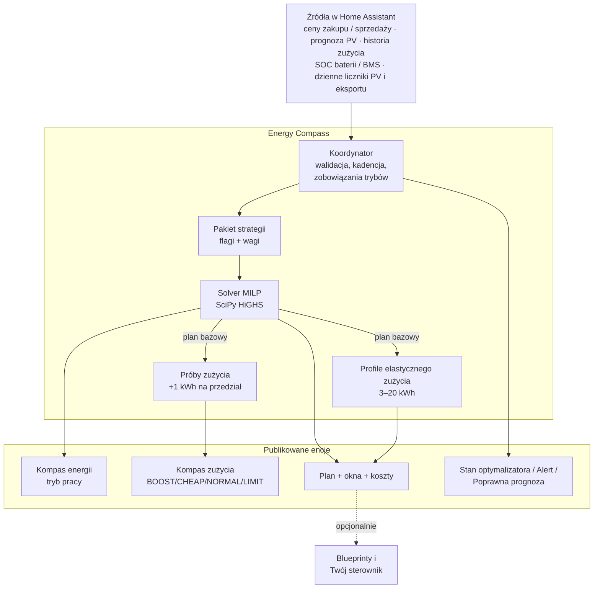

Każde obliczenie przebiega tak:

1. **Migawka i walidacja wejść.** Ceny, prognoza PV, prognoza zużycia (z historii recordera), SOC
   baterii i liczniki dzienne są odczytywane i sprawdzane pod kątem świeżości, jednostek i
   wiarygodności.
2. **Budowa problemu.** Natywne sloty taryfowe (zwykle 15 min) w horyzoncie planowania (domyślnie
   24 h), limity sprzętu, granice SOC, przeniesione zobowiązanie trybu pracy i aktywny pakiet
   **strategii**.
3. **Rozwiązanie planu bazowego.** Mieszany program liniowy minimalizuje koszt (plus wagi
   strategii) przy ograniczeniach bilansu energii, baterii, sieci, minimalnego czasu trybu i
   polityk eksportu/ładowania. Publikowane jest udowodnione optimum; gdy wcześniej skończy się
   `solve_time_limit_s`, publikowane jest najlepsze dotąd znalezione, zwalidowane rozwiązanie
   oznaczone `time_limited` razem z jego `mip_gap`.
4. **Próby zużycia.** Dla każdego przedziału wyświetlania solver liczy plan jeszcze raz z
   dodatkowym 1 kWh obciążenia; różnica kosztu to *koszt krańcowy jednej kWh więcej*, klasyfikowany
   na poziom zużycia.
5. **Profile elastycznego zużycia.** Osobne rozwiązania dla bloków 3, 5, 10, 15 i 20 kWh mierzą, ile
   elastycznej energii można zaplanować, zanim cena się pogorszy.
6. **Publikacja.** Jedna spójna generacja aktualizuje wszystkie encje; niezmienione encje nie są
   zapisywane ponownie.

### Kadencja przeliczeń

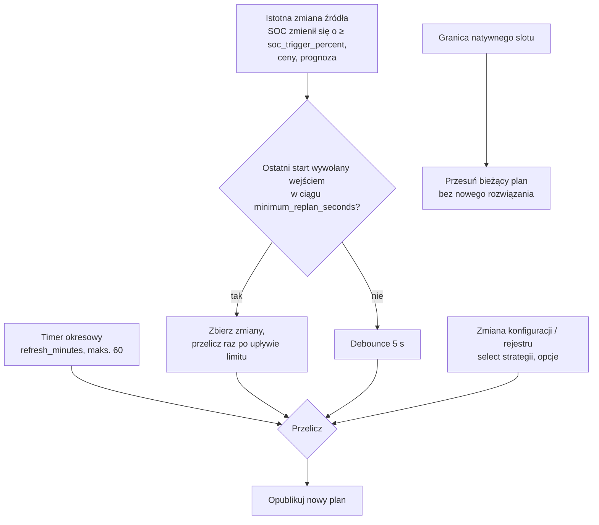

- **Okresowo:** `refresh_minutes` (domyślnie 15, maks. 60), wyrównane do zegara; profil startowy
  Deye hybrydowy wypełnia wartość 60.
- **Na zmianę wejść:** najwyżej raz na `minimum_replan_seconds` (domyślnie 900 s, `0` wyłącza),
  dopóki istnieje ważny plan; SOC liczy się jako zmieniony dopiero po przesunięciu o
  `soc_trigger_percent` (domyślnie 5 %) od wartości, która uruchomiła ostatnie obliczenie.
- **Granice slotów:** na każdej natywnej granicy rozliczeniowej istniejący plan przesuwa się
  (zużyte wiersze znikają, zegary trybów biegną) bez uruchamiania solvera.
- **Ważność planu:** nowy plan jest ważny do `generated_at + 2 × refresh_minutes`, nie dłużej niż
  pokrycie prognozy.

### Prognoza zużycia

Prognoza z historii to średnia godzinowa z pełnych godzin ostatnich `lookback_days`, w lokalnej
strefie czasowej, grupowana na dni robocze i weekendy (`group_weekends`), z wymaganymi
`minimum_samples` godzinami w koszyku. Zwykła średnia nadąża za zmianą poziomu tylko tak szybko, jak
wymienia się okno: przy 28 dniach historii dom, który w tym tygodniu zaczął ogrzewać, nadal jest
prognozowany głównie poziomem z poprzedniego miesiąca, a najwcześniej widać to rano.

`forecast_half_life_days` (**Okres połowicznego zaniku wagi próbek, dni**, domyślnie **0** =
wyłączone, zakres 0-60) waży każdą próbkę przez `0.5^(wiek / okres)`, a wiek liczy się od początku
prognozy. Wynik nadal jest średnią, więc zapasy zostają w logice rezerwy
([Rezerwa na okres szczytu](#zapas-na-drogie-okresy)). `minimum_samples` liczy próbki, nie wagę.
Przy 0 prognoza to zwykła średnia, jak dotąd.

`benchmarks/load_forecast_backtest.py` prognozuje każdy dzień o lokalnej północy z godzin
sprzed niego i podaje MAE oraz błąd systematyczny (prognoza − pomiar, kWh na godzinę) dla poranka
(06-13) i wieczoru (15-22). Przyjmuje rejestrator Home Assistanta (`--recorder-db`,
`--statistic-id`), plik CSV z godzinami albo scenariusz syntetyczny. Pomiar na scenariuszach
syntetycznych (70 dni, historia 28 dni, ocena przez 20 dni po skoku poziomu porannego; **nie** na
historii konkretnego domu):

| Metoda | Zmiana poziomu: MAE poranka / błąd sys. | Zmiana poziomu: MAE wieczoru | Stabilny dom: MAE wieczoru |
| --- | --- | --- | --- |
| zwykła średnia | 0,390 / −0,387 | 0,180 | 0,151 |
| okres 3 dni | 0,214 / −0,148 | −0,4 % | **+7,8 %** |
| okres 5 dni | 0,250 / −0,212 | −3,8 % | +2,8 % |
| okres 7 dni | 0,278 / −0,253 | −3,8 % | +1,2 % |
| zwykła × średnia z 3 dni / okno | 0,233 / −0,197 | **+43 %** | +8,8 % |
| zwykła × średnia z 7 dni / okno | 0,259 / −0,229 | **+17 %** | −0,0 % |

Kolumny wieczorne poza pierwszym wierszem to zmiana względem zwykłej średniej. Okres 5 dni jest
najkrótszy, przy którym wieczór mieści się w 5 % w obu scenariuszach, a ważenie świeżością
zmniejsza błąd poranny o jedną trzecią; jeden współczynnik poziomu na całą dobę (ostatnie N dni /
okno) przesuwa wieczór w złą stronę i nie został zbudowany. Domyślnie opcja jest wyłączona, dopóki
liczby nie zostaną odtworzone na rejestratorze konkretnego domu powyższym poleceniem; ustaw 5, aby
ją włączyć.

### Profile startowe (nowe instalacje)

Trzy osie na pierwszym formularzu (**Użytkownik**), **Rozliczenie prosumenckie**, **Polska taryfa
dystrybucyjna** (`buy_tariff`) i **Falownik**, jednorazowo wypełniają edytowalne strojenie nowej
instalacji. Każda oś jest wybierana raz; wszystkie domyślnie mają wartość **Ogólne** lub **Brak**
(brak przypisań), a wybór profilu od razu stosuje jego przypisania do wersji roboczej. To wersja 4
profili startowych; wpis utworzony we wcześniejszej wersji zachowuje swój zapis i nigdy nie jest
ponownie wyliczany. Wartości przypięte poniżej (0,20, 0,60, 0,13) zostały zmierzone lub wyznaczone
na jednej instalacji — taryfa zakupu G12, sprzedaż RCE w net-billingu i bateria LFP Deye — i są
punktem startowym, nie uniwersalnym domyślnym ustawieniem.

**Oś rozliczenia:**

| Profil | Waluta | Wypełnia | Podstawa |
| --- | --- | --- | --- |
| `generic` | dowolna | brak | — |
| `pl_net_billing` | PLN | `import_penalty_per_kwh` 0,20 · `terminal_mode` `value` · `terminal_value_per_kwh` 0,60 · `sell_multiplier` 1,23 *(tylko z presetem `pse`/`pse_solcast` albo ze źródłem sprzedaży „Cena rynkowa RCE (PSE)”)* | wyznaczone na jednej instalacji |
| `pl_net_metering_80` | PLN | `sell_multiplier` 0,8 | współczynnik opustu, instalacje ≤ 10 kWp |
| `pl_net_metering_70` | PLN | `sell_multiplier` 0,7 | współczynnik opustu, instalacje > 10 kWp |

**Oś polskiej taryfy dystrybucyjnej (`buy_tariff`):** profil tylko wstępnie wybiera **Taryfy → Źródło
ceny zakupu → Taryfa OSD** dla danej taryfy; nie przypisuje żadnego ustawienia ani ceny, a stawki
zostają na 0, dopóki ich nie wpiszesz. Każdy profil katalogowy wymaga waluty PLN.

| Profil | Waluta | Skutek | Podstawa |
| --- | --- | --- | --- |
| `generic` | dowolna | brak; stała cena zakupu | — |
| `g11` | PLN | harmonogram G11, jedna stawka | dowolny operator |
| `pge_g12` | PLN | harmonogram G12 | PGE Dystrybucja |
| `pge_g12w` | PLN | harmonogram G12w | PGE Dystrybucja |
| `tauron_g12` | PLN | harmonogram G12 | Tauron Dystrybucja |
| `tauron_g12w` | PLN | harmonogram G12w | Tauron Dystrybucja |
| `enea_g12` | PLN | harmonogram G12 z domyślnymi godzinami Enea | Enea Operator |
| `enea_g12w` | PLN | harmonogram G12w | Enea Operator |
| `energa_g12` | PLN | harmonogram G12 | Energa-Operator |
| `energa_g12w` | PLN | harmonogram G12w | Energa-Operator |
| `stoen_g12` | PLN | harmonogram G12 | Stoen Operator |
| `stoen_g12w` | PLN | harmonogram G12w | Stoen Operator |
| `tauron_g13` | PLN | harmonogram G13 (trzy strefy) | Tauron Dystrybucja |
| `enea_g13active` | PLN | harmonogram G13active (trzy strefy) | Enea Operator |

**Oś falownika:**

| Profil | Wypełnia | Podstawa |
| --- | --- | --- |
| `generic` | brak | — |
| `deye_hybrid` | `idle_drain_kw` 0,13 · `refresh_minutes` 60 | `idle_drain_kw` zmierzone na instalacji; `refresh_minutes` to kompromis specyficzny dla Deye |

Każda wstępnie wypełniona wartość pozostaje w pełni edytowalna i nigdy nie jest ponownie
zastosowana po utworzeniu instalacji — ani przez Konfiguruj, ani przez Rekonfiguruj. Dopóki nowa
instalacja jest jeszcze konfigurowana, zmiana presetu w kroku Instalacja ponownie wylicza profil
rozliczenia: mnożnik sprzedaży 1,23 jest dodawany lub usuwany zgodnie z presetem (albo ze źródłem „Cena
rynkowa RCE (PSE)” zapisanym w międzyczasie), chyba że został już ręcznie zmieniony. Powiązanie wstępnie wypełnionego klucza z pomocnikiem nadpisuje wartość przy
zapisie; Podgląd oznacza ten klucz jako zmieniony, podając pomocnika i jego efektywną wartość.

Polskie profile rozliczenia i taryf wymagają waluty PLN; wybór takiego profilu z inną walutą jest
odrzucany, przy polu, które go wywołało. Profile startowe nigdy nie ustawiają ceny taryfy
(`buy_rate`, `buy_off_peak_rate`, `buy_distribution_rate`, `buy_distribution_off_peak_rate`, `sell_rate`,
`buy_addition`, `sell_addition`, `monthly_charge`) i nigdy nie dotykają ustawienia należącego do
strategii. Nie włączają też [modelu depozytu](#wartość-depozytu-w-net-billingu): każda instalacja
startuje z nim wyłączonym.

**Sell only PV** (`limit_export_to_pv`, „sprzedawaj tylko PV”) pozostaje włączone przy każdym
profilu rozliczenia — polski prosument może sprzedawać tylko energię z własnej instalacji PV — i
jest wyłączane przez przełączenie na strategię `max_export` albo przez bezpośrednie ustawienie
`limit_export_to_pv` na wył.; jawne ustawienie pozostaje w mocy mimo zmiany strategii.

Mnożnik depozytu 1,23 obowiązuje razem z presetem surowego RCE (`pse`, `pse_solcast`) **albo** ze
źródłem sprzedaży surowego RCE (**Taryfy → Źródło ceny sprzedaży → Cena rynkowa RCE (PSE)**:
prognoza z progiem ceny, w której każde powiązanie ma PLN/MWh). Zapisy nowej instalacji wyliczają to
ponownie do jej utworzenia; Konfiguruj i Rekonfiguruj nigdy tego nie robią. Z
[`examples/rce-sell-price.yaml`](../examples/rce-sell-price.yaml), który sam już stosuje próg i
mnożnik 1,23, zostaw mnożnik sprzedaży na 1 (zob. [pomocnik taryfy](tariff-helper.md)).

Wersja 3 dodaje do tego jedną regułę: gdy źródłem sprzedaży jest encja prognozy, która sama stosuje
swoje rozliczenie (atrybut `settlement` z mnożnikiem, jak w szablonie sprzedaży z
[`examples/rce-sell-price.yaml`](../examples/rce-sell-price.yaml)), mnożnik 1,23 nie jest
przypisywany, nawet z presetem `pse` lub `pse_solcast`, a późniejsze powiązanie takiego źródła usuwa
niezmienione ręcznie 1,23. Powiązanie tego szablonu
przez [Wykryte źródła](#wykryte-źródła-nowe-instalacje) ustawia też mnożnik sprzedaży na 1.

`sell_multiplier` w systemie opustów to jednorazowa kopia współczynnika, a nie odnośnik do ceny
zakupu: to przybliżenie (roczny bilans kWh i niedopasowanie stref G12 nie są modelowane), a
późniejsza zmiana ceny zakupu go nie aktualizuje.

**Instalacja w systemie opustów pracuje z baterią we własnym trybie autokonsumpcji falownika.** Ustaw
falownik na autokonsumpcję (najpierw obciążenie, bez ładowania z sieci i bez eksportu z baterii), zostaw
„Ładowanie z sieci” (`allow_grid_charge`) i „Eksport energii z baterii” (`allow_battery_export`)
wyłączone (domyślnie są wyłączone i te profile tego nie zmieniają) i nie włączaj
[sterownika Deye](#włączenie-sterownika). Opust nie jest rozliczany godzinowo: według ustawy o
odnawialnych źródłach energii (tekst jednolity Dz.U. 2026 poz. 68, art. 4) energia oddana jest
rozliczana z pobraną w stosunku 1 : 0,8 (1 : 0,7 powyżej 10 kW), a nadwyżka jest przenoszona przez 12
miesięcy, więc oddana kWh jest warta `współczynnik` kWh późniejszego importu — nic, gdy roczny kredyt
pokrywa roczny import — a część stała rachunku zmienia się skokowo z rocznym poborem (progi opłaty
mocowej przy 500, 1 200 i 2 800 kWh). Nic z tego nie jest ceną godzinową ani nie mieści się w horyzoncie
24-48 h, więc plan nie obniży rocznego rachunku. Planista się tu wycofuje: bez zmian silnika, strategii
ani profilu, a pokazywane koszty (`expected_net_cost`, `consumption_cost`, karta kosztów,
`tools/replay.py`) pozostają cenami godzinowymi — kWh są dokładne, kwoty są przybliżeniem.

Pomiar na 40 symulowanych domach (G11 i G12, współczynnik 0,8, bateria 10 kWh, rok z przeliczaniem co
godzinę, względem tej samej baterii w czystej autokonsumpcji, wycena rocznym rachunkiem,
[ADR-0008](adr/0008-net-metering-plain-self-consumption.md)): plan domyślny (`cost_min`, jak w profilu)
daje roczny zysk względem autokonsumpcji, rachunek plus zużycie baterii, −93…+70 PLN (średnio −1; + = taniej,
− = drożej), nigdy nie obniża rachunku o więcej niż 10 PLN, a roczny import rośnie o +33…+704 kWh.
Wyceniony godzinowo, tak jak raportuje go Home Assistant, ten sam plan na G12 pokazuje zysk +343 PLN
rocznie, którego rozliczenie nie wypłaca. Z włączonym **Ładowaniem z sieci** (13 domów) roczny zysk
względem autokonsumpcji, rachunek plus zużycie baterii, wynosi −209…+139 PLN (ta sama konwencja znaku),
a import rośnie o +897 kWh (mediana). Ograniczenia: domy symulowane, jeden rozmiar baterii (10 kWh),
jeden rok cen, interwały godzinowe, strefy G12 netowane jako jedna średnia stawka.

Podgląd pokazuje pochodzenie profili startowych dla profilowanej nowej instalacji: które klucze
wypełniła każda oś, źródło zakupu wstępnie wybrane przez profil `buy_tariff`, każdą wartość
zmienioną po wypełnieniu (także klucz powiązany z pomocnikiem, wraz z jego efektywną wartością) oraz
uwagi dotyczące rozliczenia — Sell only PV wyłączone, źródło sprzedaży stosujące już własny
mnożnik rozliczeniowy, surowe ceny RCE bez progu 0 (z poprawką w postaci skrótu „Cena rynkowa RCE”)
albo z progiem, ale bez mnożnika 1,23, lub sprzedaż w systemie opustów, która przestała śledzić
zakup — widoczne tylko dla instalacji, które użyły profilu startowego.
Dla profilu opustu Podgląd zawsze dodaje jeszcze jedną uwagę, a drugą, gdy włączone jest Ładowanie z sieci
lub Eksport energii z baterii (tylko po angielsku):

- „Note: net-metering is settled on yearly kWh (an exported kWh takes back 0.8 kWh within 12 months),
  not on hourly prices: price-driven dispatch does not lower the yearly bill and the costs shown are an
  hourly approximation. Run the battery in the inverter's own self-use mode and do not let a controller
  follow this plan.” (0.7 w profilu 70 %.)
- gdy włączone jest **Ładowanie z sieci** lub **Eksport energii z baterii**: „Note: Allow grid charge is
  on: under net-metering energy sent through the grid comes back at 0.8 and raises the yearly import;
  turn it off.” (z nazwą tego, co jest włączone, albo „Allow grid charge and Allow battery export are
  on”).

Wybór, razem z wersją profili startowych, która go wyliczyła, jest zapisywany we wpisie
konfiguracji (`setup_profiles`) i trafia do diagnostyki.

### Wbudowane taryfy OSD

Dla polskiego gospodarstwa **Taryfy → Źródło ceny zakupu → Taryfa OSD (G11/G12/G12w)** zastępuje YAML
pomocnika taryfy (jego [przykład YAML](tariff-helper.md) zostaje rozwiązaniem zapasowym). Wybierz
jedną z jedenastu pozycji katalogu; strefy pochodzą z taryfy dystrybutora na 2026 rok, a **stawki
wpisujesz sam**: **Taryfy → Stałe stawki i przeliczenia** zawiera *Cena zakupu* (G11 albo stawka
szczytowa) i *Cena zakupu poza szczytem* (G12/G12w). Obie stawki muszą być większe od zera, inaczej
obliczenie kończy się błędem z komunikatem wskazującym te pola. Cena slotu to `stawka × mnożnik ×
współczynnik VAT + dodatek`, tak jak dla stałej stawki. Harmonogram nie wymaga encji i nie ogranicza
horyzontu planowania. Wymaga waluty PLN.

| Klucz | Operator i grupa | Dni robocze, strefa tania (zegar taryfy) | Dni wolne | Źródło |
| --- | --- | --- | --- | --- |
| `g11` | dowolny, G11 | brak, jedna stawka | — | — |
| `pge_g12` | PGE Dystrybucja, G12 | IV–IX 15–17 i 22–6; X–III 13–15 i 22–6 | jak dni robocze | taryfa 2026 §2.2.6/2.2.8/2.2.11 |
| `pge_g12w` | PGE Dystrybucja, G12w | jak `pge_g12` | cała doba | to samo |
| `tauron_g12` | Tauron Dystrybucja, G12 | 13–15 i 22–6 | jak dni robocze | taryfa 2026 §2.2.6/2.2.7/2.2.9 |
| `tauron_g12w` | Tauron Dystrybucja, G12w | 13–15 i 22–6 | cała doba | to samo |
| `enea_g12` | Enea Operator, G12 | domyślnie 13–15 i 22–6; ustala Enea dla licznika | jak dni robocze | wyciąg z taryfy 2026 §2.2.5/2.2.7/2.2.12 |
| `enea_g12w` | Enea Operator, G12w | 21–6 | cała doba | to samo |
| `energa_g12` | Energa-Operator, G12 | 13–15 i 22–6 | jak dni robocze | wyciąg z taryfy 2026 §3.2.5/3.2.6 |
| `energa_g12w` | Energa-Operator, G12w | 13–15 i 22–6 | cała doba | to samo |
| `stoen_g12` | Stoen Operator, G12 | 13–15 i 22–6 | jak dni robocze | taryfa 2026 §2.2.5/2.2.6/2.2.11 |
| `stoen_g12w` | Stoen Operator, G12w | tylko 22–6 | cała doba | to samo |

Dniami wolnymi G12w są soboty, niedziele i święta ustawowe (1 i 6 stycznia, niedziela i poniedziałek
wielkanocny, 1 i 3 maja, Zielone Świątki, Boże Ciało, 15 sierpnia, 1 i 11 listopada, 24 grudnia od
1 lutego 2025, 25 i 26 grudnia); dni zastępczych nie ma. Licznik, który nie został przeprogramowany,
może pomijać nowo dodane święto, np. 24 grudnia; pokrywa to `off_peak_dates` w rozwiązaniu YAML.

**Zegar.** Domyślnie strefy podążają za **czasem lokalnym** (strefa czasowa Home Assistant): licznik
z odczytem zdalnym rozliczany po godzinowym bilansowaniu stosuje strefy w czasie ściennym, więc doba
może mieć 23 lub 25 godzin lokalnych. Stary licznik bez odczytu zdalnego ma stały zegar wewnętrzny
na czasie zimowym (klauzula taryfy w powyższych źródłach); włącz dla niego **Stary licznik bez
odczytu zdalnego na czasie zimowym (stałe UTC+1)**. Aby wybrać, porównaj miesięczne kWh dzień/noc
z faktury z godzinowymi danymi o imporcie podzielonymi według okien, które wypisuje Podgląd; jeśli
miesiące letnie różnią się o około godzinę, włącz zegar zimowy. Sezon i dzień tygodnia są
klasyfikowane według daty wybranego zegara. Podgląd wypisuje zegar, dzisiejsze okna taniej strefy i,
dla G12w, święta ustawowe w horyzoncie.

**Enea G12.** Enea ustala godziny dla licznika: 8 godzin w przedziale 22–7 (start 22 lub 23) i 2
godziny w przedziale 13–17 (start 13, 14 lub 15). Domyślnie 22 i 13 (FAQ Enea); dodatkowy formularz
pyta o obie, więc sprawdź licznik lub fakturę.

**Taryfa dystrybucyjna.** Źródło ceny zakupu, które nie jest harmonogramem taryfy (stała stawka,
encja albo dynamiczna cena energii z prognozy), też może dostać strefy dystrybutora: **Taryfy →
Źródło ceny zakupu → Taryfa dystrybucyjna (strefy stawek dystrybucji)** (waluta PLN) oferuje ten sam
katalog, flagę zegara zimowego i godziny Enea albo *Brak (jedna strefa)*. Strefy dotyczą dwóch stawek
dystrybucji [modelu depozytu](#wartość-depozytu-w-net-billingu) (`buy_distribution_rate`,
`buy_distribution_off_peak_rate`); granice pasm stają się granicami interwałów dla planera, tak jak w
harmonogramie. Nie zmieniają samego źródła ceny zakupu. Źródło-harmonogram zachowuje własne strefy,
więc wybór harmonogramu taryfy usuwa zapisaną taryfę dystrybucyjną. Podgląd pokazuje obie części ceny
zakupu pierwszego interwału: część energetyczną i część dystrybucyjną. Wiersz zakupu w **Źródła danych →
Przeglądaj i edytuj źródła** pokazuje tryb dystrybucji, strefy i stawkę w każdej strefie.

**Cena sprzedaży RCE.** **Taryfy → Źródło ceny sprzedaży → Cena rynkowa RCE (PSE)** zapisuje sensor
integracji `rce_pse` (atrybut `prices`, wartość `rce_pln`, koniec `dtime`, PLN/MWh, 15 minut) jako
źródło prognozy z progiem ceny 0: surowa wartość jest ograniczona od dołu do 0 za kWh **przed**
mnożnikiem, VAT i dodatkiem (`max(RCE, 0) × 1,23` z mnożnikiem net-billingu). Próg widać w Podglądzie
i znika przy przełączeniu źródła z prognozy lub gdy po edycji nie jest już surowym źródłem RCE w PLN/MWh. W nowej instalacji profil PL net-billing przypisuje
potem mnożnik 1,23; w Konfiguruj i Rekonfiguruj ustaw mnożnik sprzedaży samodzielnie. Bez integracji
`rce_pse` użyj [`examples/rce-sell-price.yaml`](../examples/rce-sell-price.yaml).

### Wykryte źródła (nowe instalacje)

Po pierwszym formularzu (**Użytkownik**) **nowej** instalacji krok **Wykryte źródła** szuka źródeł,
których Energy Compass może użyć, wiąże te, które zostawisz, i otwiera Podgląd — to szybka ścieżka
do pierwszego planu. Nigdy nie działa w Konfiguruj ani Rekonfiguruj, nie zmienia presetu ani profilu
startowego i nie dotyka źródła zakupu (jedyną ścieżką zakupu pozostają profil `buy_tariff` i
**Taryfy**). Kandydatów rozpoznaje po tożsamości integracji (integracja, klucz tłumaczenia encji i
ustawienia panelu Energia), nigdy po identyfikatorze ani nazwie encji, więc encje przemianowane lub
spolszczone też zostaną znalezione. Gdy nic nie znaleziono albo nic nie zostawisz, otwiera się menu
główne jak dotąd. Każde powiązane źródło można dalej edytować w **Źródłach danych**.

**Najpierw panel Energia.** Energy Compass ma czytać te same dane co panel Energia. Dla każdej roli,
którą panel obejmuje (liczniki skumulowane, moc PV, sieci i baterii, SOC baterii i prognoza PV),
pierwszeństwo ma wybór z panelu; sygnały integracji poniżej są zapasowe. Dla mocy używany jest
znormalizowany czujnik mocy zapisany w panelu. Gdy istnieją oba i się różnią, oferowane są oba,
wstępnie wybrany jest ten z panelu, a wiersz wymienia oba. Ta sama encja znaleziona dwa razy jest
oferowana raz.

**Kontrolki.** Wiersz z jednym kandydatem to jedno pole wyboru, zaznaczone (SOC z BMS:
niezaznaczone). Wiersz z kilkoma kandydatami to lista rozwijana: wstępnie wybrany kandydat, pozostali
w kolejności pierwszeństwa i na końcu **Nie wiąż**. Remis, którego nie da się rozstrzygnąć, ma
wstępnie wybrane **Nie wiąż**. Wśród równorzędnych kandydatów remis rozstrzyga jedyny wpis
konfiguracji Solarman z falownikiem Deye, np. dwa liczniki sieci z panelu sprowadzają się do licznika
falownika.

| Wiersz | Kandydaci w kolejności pierwszeństwa |
| --- | --- |
| `pv` | prognoza PV z panelu Energia (`solar_forecast`, wszystkie jej integracje sumowane); czujniki sumaryczne Solcast `solcast_solar` na dziś i jutro (`total_kwh_forecast_today`, `total_kwh_forecast_tomorrow`, atrybut `detailedForecast`) |
| `sell` | szablon ceny sprzedaży Energy Compass (`template`: unikalny identyfikator zaczynający się od `energy_compass_`, atrybut `settlement` z mnożnikiem i `prices`); `rce_pse` na dziś i jutro (`rce_pse_today_price`, `rce_pse_tomorrow_price`) |
| `load` | skumulowane zużycie domu z `solarman` (`total_load_consumption`) jako statystyka rejestratora |
| `soc` | SOC baterii z panelu; zewnętrzny szablon SOC (`template`, klasa urządzenia battery, jednostka %); `solarman` `battery` |
| `bms_soc` | `solarman` `battery`, atrybut `BMS SOC`; jedyny włączony czujnik pakietu BMS (`battery_N`); nigdy nie jest wstępnie wybrany |
| `soc_estimator` | jeden wpis Solarman Deye z `total_battery_charge`, `total_battery_discharge`, `battery_voltage` i `battery_current` (oraz `battery_power`, gdy jest); nigdy nie jest wstępnie wybrany; zob. [Estymator SOC z liczników](#estymator-soc-z-liczników) |
| `battery_power` | moc baterii z panelu; `battery_power` |
| `pv_power` | moc PV z panelu; `pv_power` |
| `grid_import_power`, `grid_export_power` | moc sieci z panelu (znak +1 dla importu, −1 dla eksportu); `grid_power` z tymi samymi znakami |
| `pv_energy` | energia PV z panelu; `total_production` |
| `grid_import_energy` | import z sieci z panelu; `total_energy_import` |
| `grid_export_energy` | eksport do sieci z panelu; `total_energy_export` |
| `pv_energy_today` | `today_production` |
| `grid_export_energy_today` | `today_energy_export` |

- **Solarman.** Liczą się tylko wpisy konfiguracji z co najmniej jednym urządzeniem producenta Deye.
  Falownik i jego pakiety BMS to urządzenia jednego wpisu konfiguracji. Przy kilku wpisach Deye każdy
  wiersz Solarman ma kilku kandydatów i brak wartości domyślnej. Konwencje znaków (bateria + to
  rozładowanie, sieć + to import) sprawdzono tylko na jednym profilu Deye; proponowana wartość jest
  pokazana, żeby można ją było zweryfikować.
- **Walidacja.** Każdy kandydat jest sprawdzany tymi samymi parserami co Podgląd, na dokładnie tym
  powiązaniu, które zostałoby zapisane. Prognozy muszą się sparsować (jutro może być jeszcze
  nieopublikowane); liczniki i moce wymagają liczbowego stanu w W, kW, Wh lub kWh; SOC musi być
  skończoną wartością od 0 do 100 (SOC ze stanu wymaga jednostki %); statystyka zużycia wymaga klasy
  stanu skumulowanej i kWh lub Wh. Kandydat nieużywalny nie jest oferowany; uwagi podają go z powodem.
- **Szablon sprzedaży.** Jego powiązanie ustawia mnożnik sprzedaży na 1, bo szablon sam stosuje
  próg i mnożnik. Profile startowe w wersji 3 nie dodają wtedy ponownie 1,23 (zob. [Profile
  startowe](#profile-startowe-nowe-instalacje)). Nieaktualny szablon nie jest oferowany.
- **`rce_pse`.** Czujnik musi podawać PLN/MWh (ustawienie domyślne integracji); opcja jednostki
  `PLN/kWh` jest tu odrzucana, podobnie jak w **Taryfy → Źródło ceny sprzedaży → Cena rynkowa RCE
  (PSE)**, bo wycena byłaby tysiąc razy za niska.
- **Solcast.** `detailedForecast` istnieje tylko przy włączonej opcji **Include detailed forecast
  half-hourly**. Czujniki dni 3–7, szczegół godzinowy i czujniki pojedynczych dachów nie są używane.
- **SOC z BMS.** Jest proponowany bez zaznaczenia. Przy niezbalansowanych ogniwach SOC z BMS i SOC
  baterii mogą się różnić o więcej niż Bateria → Tolerancja różnicy BMS (domyślnie 5 %), a wtedy
  każdy plan jest blokowany. Zaznacz tylko, jeśli oba są zgodne przez całą dobę.
- **Estymator z liczników.** Jest proponowany bez zaznaczenia obok wiersza BMS jako **Estymator z
  liczników (zalecany, gdy SOC z BMS jest niewiarygodny)**, gdy dokładnie jeden wpis Solarman Deye ma
  te cztery źródła. Zaznaczenie zastępuje wiersze `soc` i `bms_soc` (zaznaczony SOC z BMS przechodzi do
  estymatora jako odczyt porównawczy) i przed Podglądem otwiera jego ustawienia (zob. [Estymator SOC z
  liczników](#estymator-soc-z-liczników)). SOC z BMS bywa błędny nawet przy 100 % i na ten przypadek jest
  estymator.
- **Bramki.** `sell` pojawia się tylko przy walucie PLN. Przy wyłączonym PV nie ma wierszy `pv`,
  `pv_power` ani `pv_energy`; przy wyłączonej baterii nie ma `soc`, `bms_soc`, `soc_estimator` ani `battery_power`.
  Dwa liczniki dzienne nie podlegają bramkom.
- **Zapisywane limity wieku** pomiarów: 3600 s dla `battery_power`, `grid_import_power` i
  `grid_export_power`; 86400 s dla `pv_power`, liczników skumulowanych, liczników energii ładowania
  i rozładowania baterii oraz liczników dziennych (stałe 0 W w nocy nigdy nie aktualizuje stanu).
- **Nigdy nie wykrywane:** `buy`; `throughput_today` (aby użyć `daily_cycles`, podaj jedną encję z
  sumą ładowania i rozładowania po stronie AC od północy, zob. [wymagania
  źródeł](source-requirements.md#daily-battery-throughput)); `battery_energy`,
  `battery_charge_power`, `battery_discharge_power`, `battery_charge_energy` i
  `battery_discharge_energy` (opcjonalne liczniki [pomiarów
  kalibracyjnych](#pomiary-kalibracyjne-opcjonalnie)); oraz pomocniki.

Podgląd pokazuje potem zwykłe potwierdzenia nowego wpisu. Jego pole **Wróć do menu głównego** (nic
nie zostanie zapisane) opuszcza Podgląd bez walidacji i zapisu. Tabele pomocnicze są w [wymaganiach
źródeł](source-requirements.md#automatic-detection) (EN).

### Prognoza PV z panelu Energia

**Źródła danych → Dodaj źródło → PV → Prognoza PV z panelu Energia** (tryb `solar_forecast`) czyta tę
samą prognozę PV co panel Energia, z każdej integracji z platformą prognozy słonecznej panelu Energia
(Solcast, Forecast.Solar, Open-Meteo i inne). Wybierz jedną lub kilka załadowanych integracji; ich
prognozy są sumowane, tak jak robi to panel. Formularz domyślnie wskazuje integracje z ustawień
słonecznych panelu. Wykryte źródła oferują ten tryb jako pierwszy, gdy panel ma prognozę.

- **Godzinowa reguła panelu.** Każda wartość to Wh w lokalnej godzinie zawierającej jej klucz;
  wartości z jednej godziny są sumowane. Plan widzi energię godzinową od bieżącej godziny do ostatniej
  godziny z kluczem, do 49 godzin naprzód; klucze starsze niż dwa dni są pomijane.
- **Godziny nocne**, które dostawca pomija, liczą się jako 0 Wh. Luka w środku dnia też to 0, więc
  luka u dostawcy czyni plan ostrożniejszym.
- **Uwagi o dostawcach.** Platforma Solcast używa typu prognozy wybranego w jego opcjach
  (`key_estimate`, np. 10. percentyl) w krokach 30-minutowych, a tryb czujnika Solcast czyta
  `pv_estimate`. Forecast.Solar podaje nieregularne klucze; Energy Compass czyta je tak jak panel.
- **Bez kontroli wieku.** `wh_hours` nie niesie czasu publikacji. Aktualizacja prognozy jest
  uwzględniana przy następnym przeliczeniu (planowym lub wywołanym zdarzeniem), nie sama z siebie.
- **Awarie** działają jak brakująca encja: brakująca, niezaładowana integracja, bez platformy albo bez
  danych unieważnia wejścia, z komunikatem z nazwą domeny.
- **Bez mieszania.** Tablice prognoz z encji i prognozy z panelu Energia nie mogą być łączone (oba
  zwykle pochodzą od tego samego dostawcy, więc energia byłaby policzona dwa razy). Zapis jednego
  usuwa drugie. Wyłączenie PV w **Instalacji** czyści oba.

Podgląd dodaje dla tego trybu wiersz `PV source: Energy dashboard solar forecast …`.

### Estymator SOC z liczników

Niektóre pakiety podają SOC z BMS, który jest błędny nawet przy 100 % (niezbalansowane ogniwa, BMS
kotwiczący się po swojemu). **Estymator SOC z liczników** to drugi sposób na SOC baterii: zamiast
czytać encję SOC, Energy Compass liczy go w integracji z całkowitych liczników energii ładowania i
rozładowania baterii. Wybierasz go w **Konfiguruj → Źródło SOC baterii**
(`sources.soc_mode = counter_estimator`); domyślnie zostaje **Encja**, czyli źródło SOC wskazane w
**Źródłach danych**. Estymator zastępuje wtedy źródła SOC i SOC z BMS dla planera, balansowania LFP i
natywnego [sterownika Deye](#sterownik-falownika-deye-solarman). SOC z BMS nie jest nigdzie uznawany
za wiarygodny: nie ma kotwicy ani rozwiązania zapasowego opartego na BMS, a źródło SOC z BMS, jeśli
dodasz je w ustawieniach eksperckich, jest tylko pokazywane obok estymaty do porównania.

**Arytmetyka.** Estymator niesie *kotwicę*, czyli znaną energię powyżej punktu 0 % pakietu przy znanych
wartościach liczników, i dodaje to, o co liczniki przesunęły się od tamtej pory:

    E = energia kotwicy − (rozładowanie − rozładowanie kotwicy) + eta × (ładowanie − ładowanie kotwicy) + pending

`E` jest obcinane do 0 … pojemność, a SOC to `E / pojemność`. `eta` to sprawność ładowania liczników
(liczniki stoją na zaciskach baterii, sprawności planu są po stronie AC). `pending` całkuje moc baterii
między dwoma skokami liczników, więc wartość zmienia się płynnie, choć liczniki raportują grubymi
krokami (krok jest całkowany najwyżej 120 s, `pending` mieści się w ±2 kWh i zaczyna od zera przy każdej
zmianie licznika). Licznik, który spadł, kotwiczy na bieżącej energii (rodzaj kotwicy `reset`); wzrost
szybszy niż 100 kW od poprzedniego skoku licznika (liczony najwyżej godzinę wstecz) jest ignorowany jako
usterka, chyba że się powtórzy. Estymata nie skacze sama z siebie.

**Zero to napięcie.** 0 % to napięcie pakietu wpisane jako **Napięcie pakietu odpowiadające 0 %**
(`empty_voltage`, w skali napięcia pakietu z czujnika napięcia, na przykład odcięcie falownika). To
cecha Twojego pakietu, więc nie ma wartości domyślnej, a krok nie zapisze się bez niej. Pojemność to
użyteczna energia między tym punktem a pełnym naładowaniem; domyślnie jest równa pojemności baterii z
grupy Bateria (w ustawieniach eksperckich jest nadpisanie), a planer skaluje ułamek estymatora przez pojemność baterii,
więc trzymaj obie równe.

**Pełny pakiet to też napięcie.** Kotwica pełna wymaga, by ładowanie doszło do **Napięcia pakietu,
które ładowanie osiąga przy pełnym** (`full_min_voltage`, w tej samej skali co napięcie 0 %). To cecha
Twojego pakietu, więc nie ma wartości domyślnej, a krok nie zapisze się bez niego (musi też być wyższe
niż napięcie 0 %). Pakiet osiąga to napięcie tylko pod prądem ładowania i po jego zatrzymaniu opada o
kilka woltów (w jednej instalacji: 556 V przy zatrzymaniu, 546 V w spoczynku), dlatego kandydat na pełny
startuje tylko w ciągu 30 minut od odczytu na tym napięciu lub wyżej, a trwający wymaga jedynie, by
pakiet w spoczynku trzymał co najmniej 97 % tego napięcia; poniżej się przerywa (zapis
`below_full_voltage`). To napięcie, a nie liczniki, mówi, że pakiet jest pełny: liczniki, które
uciekły w dół, nie mogą powstrzymać pełnego pakietu przed ich skorygowaniem.

**Kotwice: tylko fizyczne dowody.**

| Kotwica | Kiedy | Skutek |
| --- | --- | --- |
| `full` | Przez `full_hold_seconds` (co najmniej 3600 s, czyli godzinę; domyślnie 3600 s) bez przerwy, ze startem w ciągu 30 minut od napięcia pakietu nie niższego niż `full_min_voltage` i przy napięciu cały czas nie niższym niż 97 % tej wartości, przy czym każde czytane źródło (prąd, napięcie, PV, zużycie, sieć) zgłosiło się w ciągu ostatnich 60 s: pakiet prawie nie przyjmuje ładunku (prąd w granicach max(1 A, 2 % maksymalnego prądu ładowania)); ładowanie było możliwe (limit prądu ładowania co najmniej 2 A, a sterownik Deye nie jest w `HOLD`, `CURTAIL`, `BASE` ani `DISCHARGE_GRID`; w `CHARGE_GRID` tylko z programem `Grid` poniżej 99 % jego napięcia i prądem ładowania z sieci co najmniej 2 A; trwający już kandydat trwa też w `HOLD`, patrz niżej); a przyczyną nie jest brak słońca, co pokazuje **zmierzony eksport do sieci** co najmniej max(300 W, 5 % mocy znamionowej PV), gdy pakiet nie bierze nic (ścieżka `export`). Dopiero tam, gdzie eksport jest niemożliwy lub ograniczony (limit eksportu planera `grid_export_kw` wynosi 0 albo eksport jest w granicach 5 % tego limitu), liczy się wyliczona nadwyżka (ścieżka `surplus`): PV − zużycie − ładunek, który pakiet jeszcze bierze ≥ 300 W + 10 % mocy PV, bo PV po stronie DC minus zużycie po stronie AC zawyża prawdziwą nadwyżkę o straty konwersji falownika. Trzecia ścieżka (`grid`) to żądane ładowanie z sieci 2 A lub więcej poniżej napięcia swojego programu. Liczniki nie są brane pod uwagę: pakiet na pełnym napięciu kotwiczy, nawet gdy liczniki dają go daleko poniżej pojemności, i właśnie do tego służy kotwica. | `E` = pojemność |
| `full_balance` | W wierszu planu będącym oknem balansu LFP (`balance_hold`), z programem `Grid` na jego (pełnym) napięciu: ładowanie, które ustaje na napięciu programu, z tymi samymi warunkami prądu końcówki, limitu, świeżości i napięcia utrzymanymi przez `full_hold_seconds`. Plan zażądał pełnego pakietu, a falownik zatrzymał się na pełnym napięciu, więc samo zatrzymanie jest dowodem; „cel osiągnięty” sterownika nie wyjaśnia go tu inaczej. | `E` = pojemność |
| `empty` | Przez 60 s, z tą samą świeżością 60 s, i tylko gdy napięcie pakietu wynosi co najmniej połowę napięcia 0 % (odczyt 0 V to zanik sygnału) oraz, dla rozładowania, prąd i moc baterii zgadzają się co do rozładowania (inaczej brak kotwicy, a odmowa jest zapisana raz w logu): rozładowanie co najmniej 0,5 A przy najwyżej 0,1 C i napięciu nie wyższym niż napięcie 0 %; albo rozładowanie ustało, choć dom pobiera z sieci co najmniej 300 W, limit prądu rozładowania wynosi co najmniej 2 A, stan sterownika nie jest `HOLD` ani `CURTAIL`, a napięcie jest najwyżej 1 % powyżej napięcia 0 %. | `E` = 0 (skok w dół: jak każda rekalibracja unieważnia plan na około minutę, aż świeże odczyty to potwierdzą); energia od ostatniej kotwicy pełnej jest pokazana jako `measured_capacity_kwh` (nigdy nie jest stosowana) |
| `reset` | Licznik spadł | Kotwiczy na bieżącej energii |
| `initial` / `seed` | Pierwszy start: podany przez Ciebie SOC albo kotwica szablonu SOC, z którego migrujesz | Pokazane jako niekotwiczone do pierwszej fizycznej kotwicy |

Kotwica pełna wymaga limitu prądu ładowania (encja natywnego sterownika albo źródło eksperckie
**Limit prądu ładowania**) oraz mocy sieci z mocą PV (lub mocą zużycia); ścieżka sieciowa wymaga encji
programu i ładowania z sieci natywnego sterownika. Bez nich nigdy się nie uruchamia, a estymata
pozostaje niekotwiczonym wyliczeniem. **Bez natywnego sterownika Deye** (wyłączonego lub z silnikiem
blueprint) estymator nie widzi stanu sterowania ani programu TOU, więc reguła pełna opiera się wyłącznie
na zmierzonym eksporcie do sieci (albo na wyliczonej nadwyżce, gdy eksport jest ograniczony lub
zerowy): ładowanie z sieci nigdy nie kotwiczy, o czym mówi też krok opcji. Przez **pierwsze 14 dni** od
startu estymatora (lub zasiania) kandydaci na kotwicę pełną są tylko *zapisywani* w atrybucie
`full_candidates`, chyba że włączono **Kotwicz na kandydatach od pierwszego dnia**, bo wytrzymanie nigdy
nie było widziane na prawdziwym ogonie ładowania. Kandydat pokazuje początek, wartości, to, która
ścieżka zadziałała (`export`, `surplus`, `grid` lub `balance`) oraz jego `outcome` (`anchored`,
`candidate` dla niezastosowanego) obok `energy_before_kwh`, czyli energii, którą liczniki dawały tuż
przed kotwicą.

**Ładowanie pozostaje dozwolone w trakcie wytrzymania.** Gdy trwa kandydat na pełny (od pierwszego
odczytu do zakwalifikowania lub przerwania), natywny sterownik Deye nie zamyka toru ładowania: tam,
gdzie profil obniżyłby lub wyzerował prąd ładowania baterii (`CHARGE_PV` i `SELF_CONSUME` przy SOC
100 %, `HOLD`, reguła pełnego pakietu i stop `CHARGE_GRID` przy 100 %), utrzymuje prąd ładowania na
pułapie ładowania (ograniczonym przez `max_current`, `max_power_w` / V i histerezę pułapu prądu), a
kierunek programu zostaje taki, jak ustawia go profil: nic nie jest dodawane, ładowanie z sieci nie
jest przez to otwierane, a `HOLD` zachowuje własny program `Grid` i prąd z sieci. Bez tego ogon, który
sterownik sam uciął, kończyłby dowód i wytrzymanie nigdy by się nie skończyło. Kandydat trwa też, gdy
plan przechodzi do `HOLD` (kandydat nigdy nie *startuje* w `HOLD`): obowiązujący limit ładowania, co
najmniej 2 A, pokazuje, że sterownik trzyma tor otwarty, a w `HOLD` liczą się tylko ścieżki `export` i
`surplus`, bo jego program `Grid` jedynie utrzymuje SOC. Przejście do `CURTAIL`, `BASE` lub
`DISCHARGE_GRID`, limit ładowania poniżej 2 A dłużej niż 120 s (sterownik sam na chwilę zapisuje 0 A
przy zmianie kierunku programu, co trwający kandydat przeżywa; limit nigdy go nie startuje) albo napięcie
poniżej napięcia pełnego kończy kandydata, a profil wraca do własnych wartości. **Silnik blueprint** nie jest zmieniany i zamyka tor ładowania
tam, gdzie mówi jego profil, więc wytrzymanie może tam zostać przerwane.

**Nieaktualność.** Estymata dostaje znacznik najnowszego raportu źródeł napięcia, prądu i mocy, ale nigdy
świeższy, niż pozwalają jej liczniki: gdy liczniki są starsze niż ich zaobserwowany krok odświeżania,
liczony jako 1,5 największego z ostatnich pięciu (co najmniej minuta, najwyżej 15; do zaobserwowania kroku
15 minut), estymata jest tak stara jak liczniki,
nawet przy świeżej mocy. Po restarcie pierwszy krok nie całkuje mocy zapisanej przed przestojem.

**Nigdy 100 % na zgadnięcie.** Obcięcie na górze nigdy nie tworzy kotwicy. Wyliczenie, które dochodzi do
pojemności bez kotwicy pełnej, pokazuje **99,9 %** z `unanchored_top: true`; energia powyżej pojemności
jest zachowana (nie jest odrzucana) i pokazana jako `excess_kwh`, a zejście z góry najpierw ją zużywa.
100 % pokazuje się dopiero po kotwicy `full`, aż pakiet spadnie o 0,1 kWh poniżej góry. Dopóki góra jest
potwierdzona, ładunek policzony powyżej pojemności to straty i podtrzymanie, a nie zmagazynowana energia:
kotwica pozostaje kotwicą `full` z pierwotnym czasem i przejmuje bieżące liczniki, więc `excess_kwh`
zostaje 0, a energia nie przenosi fantomowej nadwyżki do następnego rozładowania. Kotwica pełna to
skok w górę i przechodzi przez to samo przesunięcie odniesienia co rekalibracja BMS (zachowany plan do
300 s, gdy świeże odczyty to potwierdzają).

**Kto czyta estymatę.**

- *Planer.* Koordynator czyta estymatę przez tę samą walidację co encję SOC (wiek, zakres, kontrola
  skoku), ze znacznikiem najnowszego raportu źródeł napięcia, prądu i mocy. Między nimi nie ma encji,
  więc przeładowanie szablonów ani restart nie czyni już źródła niedostępnym.
- *Sterownik Deye.* Przy włączonym estymatorze fakt SOC natywnego sterownika to estymata: używają jej
  bramka telemetrii, reguła pełnego pakietu w trybie Voltage i kontrole osiągnięcia celu. Sterownik
  czyta też, czy trwa kandydat na pełny, i wtedy utrzymuje zezwolenie na ładowanie (patrz *Ładowanie
  pozostaje dozwolone w trakcie wytrzymania*). **Tryb Capacity nie jest obsługiwany z estymatorem**: w tym trybie falownik
  porównuje progi SOC swoich programów z własnym SOC z BMS, więc cel w skali estymatora byłby błędny.
  Zapis estymatora jest odrzucany (*falownik jest w trybie Capacity*), gdy włączony jest natywny
  sterownik, a tryb pracy baterii falownika to `Capacity`; najpierw przełącz falownik na `Voltage`. Gdy
  estymator jest źródłem, sterownik traktuje też `Capacity` jako niezatwierdzony, więc późniejsze
  przełączenie falownika na Capacity wstawia go na profil bazowy (`mode_not_commissioned`) zamiast
  zapisywać progi SOC. Tryb Voltage nie jest dotknięty (jego progi to napięcia). Wycofywany silnik
  blueprintu zachowuje własne wejście `soc_entity` i nie jest zmieniany.
- *Balansowanie LFP.* Balans uznaje pakiet za pełny tylko na podstawie fizycznego dowodu, a nie przy
  SOC ≥ progu: kotwicy `full` lub `full_balance` albo trwającego kandydata na pełny (takiego, który
  przetrzymał pełne wytrzymanie, także gdy przez pierwsze 14 dni kandydaci są tylko zapisywani i nie ma kotwicy). Odczyt,
  który arytmetyka dociągnęła do progu, nigdy nie zalicza balansu. Wiersz balansu, którego program Grid
  osiąga swoje napięcie i wchodzi w ogon ładowania, jest takim dowodem, więc ukończony balans jest
  zapisywany i nie jest planowany od nowa każdego dnia. Wytrzymanie balansu (`balance_hold_minutes`)
  zaczyna się liczyć dopiero, gdy ten dowód przetrwał pełne wytrzymanie, więc przy estymatorze planer
  prosi o okno równe wytrzymaniu balansu **plus** pełnemu wytrzymaniu (przy ustawieniach domyślnych
  dwie godziny). W pierwszej godzinie plan pokazuje to okno jako zwykły wiersz balansu (sterownik
  ładuje, tracker jeszcze nie jest w stanie `holding`); gdy kandydat się zakwalifikuje, tracker
  przetrzymuje, a pozostałe minuty wytrzymania balansu są planowane od teraz. Okno równe samemu
  wytrzymaniu balansu kończy się przed zakwalifikowaniem dowodu i niczego nie kończy.

**Diagnostyka.** Diagnostyczny sensor `sensor.<name>_soc_estimator` (**Estymator SOC**, %, klasa
urządzenia battery) istnieje, gdy estymator jest włączony albo działa w cieniu. Jego stan jest
zapisywany; z atrybutów zapisywany jest tylko `anchor_kind`: `energy_kwh`, `anchor_at`, `anchor_age_h`,
`throughput_since_anchor_kwh`, `pending_kwh`, `unanchored_top`, `excess_kwh`, `full_candidate`,
`measured_capacity_kwh`, `eta_charge`, `capacity_kwh`, `mode` (`counter_estimator` lub `shadow`),
`bms_soc` (tylko porównanie), `full_candidates` (ostatnie 20) i `anchors` (ostatnie 20). Gdy przepływ
energii od ostatniej kotwicy przekroczy **Ostrzegaj po tylu pojemnościach bez kotwicy**
(`drift_warn_cycles`, 3) razy pojemność, pojawia się problem *Estymator SOC długo działa bez kotwicy*;
tylko ostrzega, plany nie są blokowane, a znika przy następnej kotwicy. Pobranie diagnostyki ma blok
`soc_estimator` z tym samym szczegółem i bez identyfikatorów encji.

**Ustawienia** (Konfiguruj → Źródło SOC baterii; Ustawienia eksperckie dodają drugą tabelę):

| Pole | Znaczenie | Domyślnie |
| --- | --- | --- |
| `soc_source` | `entity` lub `counter_estimator` | `entity` |
| `charge_counter`, `discharge_counter` | całkowite liczniki energii baterii (kWh lub Wh) | wykrywane na urządzeniu Solarman Deye |
| `voltage`, `current` | napięcie i prąd pakietu (prąd dodatni przy rozładowaniu) | wykrywane na urządzeniu Solarman Deye |
| `empty_voltage` | napięcie pakietu odpowiadające 0 % | wymagane, brak |
| `full_min_voltage` | napięcie pakietu, które ładowanie osiąga przy pełnym; kandydat na pełny startuje tylko w ciągu 30 min od niego i trwa, póki pakiet w spoczynku trzyma co najmniej 97 % tej wartości | wymagane, brak |
| `initial_soc_percent` | SOC, od którego startuje się bez zapisanego stanu ani zasiania | 50 |
| `eta_charge` | sprawność ładowania liczników | zmierzony obieg baterii, gdy [kalibracja](#pomiary-kalibracyjne-opcjonalnie) go ma, inaczej 0,95 |
| `full_hold_seconds` | wytrzymanie przed kotwicą pełną (co najmniej 3600, czyli godzina) | 3600 |
| `drift_warn_cycles` | pojemności przepływu bez kotwicy przed problemem naprawczym | 3 |
| `anchor_on_candidates` | kotwicz na kandydatach pełnych w pierwszych 14 dniach | wyłączone |
| `shadow` | uruchom tylko diagnostycznie obok podpiętej encji SOC | wyłączone |
| `seed_from_template` | start od kotwicy podpiętego szablonu SOC (oferowane tylko, gdy ma atrybuty kotwicy szablonu) | włączone, gdy oferowane |

| Pole eksperckie | Znaczenie |
| --- | --- |
| `capacity_kwh` | nadpisanie pojemności estymatora (domyślnie: pojemność baterii) |
| `power`, `pv_power` | moc baterii (dodatnia przy rozładowaniu) i moc PV; zapasowo pomiary o tych nazwach ze Źródeł danych |
| `grid_power`, `load_power` | moc sieci (dodatnia przy poborze) i zużycie domu; zużycie jest liczone z mocy PV, sieci i baterii, gdy go brak |
| `charge_limit`, `discharge_limit`, `grid_charge_current` | limity prądu falownika; gdy działa natywny sterownik, używane są jego encje |
| `bms_soc` | SOC z BMS, tylko do porównania |
| `power_sign`, `current_sign`, `grid_sign` | `1` lub `-1`, by odwrócić znak czujnika |
| `max_charge_current`, `rated_pv_w` | do progów kotwicy pełnej; domyślnie maksimum encji limitu ładowania i `pv_kwp` z Atlasa |

Każde źródło jest czytane w jednostce bazowej, którą deklaruje jego encja (kWh lub Wh, W lub kW, V, A).

**Konfiguracja i wykrywanie.** W nowej instalacji krok **Wykryte źródła** proponuje niezaznaczony
**Estymator z liczników (zalecany, gdy SOC z BMS jest niewiarygodny)**, gdy jedno urządzenie Solarman
Deye ma liczniki ładowania i rozładowania, napięcie i prąd pakietu. Zaznaczenie zastępuje wiersze SOC i
przed Podglądem otwiera ustawienia estymatora, gdzie wymagane są napięcie pakietu odpowiadające 0 % i najniższe napięcie pakietu pełnego.

**Migracja z estymatora w szablonie.** Instalacja z estymatorem w szablonie YAML może przejść bez
skoku:

1. Otwórz **Konfiguruj → Źródło SOC baterii**, zostaw **Encja**, zaznacz **Uruchomienie cieniowe**, wpisz
   liczniki, napięcie, prąd i napięcie 0 % oraz zaznacz **Start od kotwicy istniejącego szablonu SOC**
   (oferowane, gdy podpięta encja ma atrybuty `anchor_kwh`, `anchor_charge`, `anchor_discharge`,
   `anchor_kind`, `anchor_at`; `pending_kwh` jest opcjonalny). Planer dalej używa szablonu, a obok niego
   działa `sensor.<name>_soc_estimator`.
2. Po co najmniej jednej dobie porównaj je narzędziem `tools/soc_shadow.py` na historii rejestratora obu
   encji (albo na katalogu zrzutów stanów, jak czyta je `tools/shadow_compare.py`). Kryterium: energia
   różni się najwyżej o 0,2 kWh w 95 % minut i żadnej kotwicy pełnej ani pustej jednego nie brakuje w
   drugim.
3. Przełącz **Źródło SOC baterii** na **Estymator z liczników**, potem usuń blok YAML szablonu i
   przeładuj szablony. Przeładowanie szablonów na chwilę czyni SOC szablonu niedostępnym; estymator już
   od niego nie zależy.

**Ograniczenia tej wersji.** Wykrywanie proponuje estymator tylko dla urządzeń Solarman Deye (inne
falowniki: ustaw źródła w grupie eksperckiej); sprawność i pojemność nigdy nie są uczone ani zmieniane
automatycznie; obowiązuje powyższe ograniczenie trybu Capacity.

### Ustawienia eksperckie

Menu główne Konfiguracji, Konfiguruj i Rekonfiguruj zaczyna się tylko od grup podstawowych:
Instalacja, Źródła danych, Bateria, Możliwości sprzętu, Źródło SOC baterii (przy włączonej baterii), Taryfy,
Prognoza zużycia i Ustawienia powiadomień.
**Pokaż ustawienia eksperckie** dodaje cztery grupy eksperckie, **Planowanie**, **Prognoza kosztu
zużycia**, **Wydajność i jakość danych** i **Prezentacja**, oraz **Pomocniki liczbowe**; **Ukryj
ustawienia eksperckie** chowa je z powrotem. Widok dotyczy jednego przepływu i nie jest zapisywany.
Ukryte ustawienia zachowują wartości i dalej działają. Skrypt sterujący przepływem opcji przez REST
musi wysłać `show_expert` przed wybraniem ukrytej grupy, inaczej Home Assistant odrzuci krok.

### Zapis opcji

Zapis w **Konfiguracji** działa na żywo. Integracja przejmuje nowe ustawienia, źródła, pomocniki i
taryfy bez przeładowania wpisu, więc żadna encja nie przechodzi w `unavailable`, a opublikowany plan
dalej działa jako plan zachowany (`plan_retained=true`, `refreshing=true`, optymalizator
`calculating`) do czasu, aż przeliczenie opublikuje następcę. [Sterownik
Deye](#sterownik-falownika-deye-solarman) wykonuje ten plan dalej i przyjmuje nowy po publikacji; nie wraca na
profil bazowy. Powiązania źródeł i pomocników są jednocześnie subskrybowane od nowa. Wpis nadal
**przeładowuje się** (poprzedni plan znika do pierwszego nowego obliczenia, a sterownik w tym czasie dalej wykonuje swój zaakceptowany plan), gdy zapis zmienia zestaw
encji lub ich nazwę: **Okresowe balansowanie LFP** (`lfp_balance`), **Włącz głębokość elastycznego zużycia**
(`flexible_load_enabled`), **Włącz encje kosztów** (`expose_costs`), **Włącz encje okresów**
(`expose_windows`), włączenie lub wyłączenie [estymatora SOC z liczników](#estymator-soc-z-liczników) (albo jego uruchomienia cieniowego), nazwę instalacji lub walutę. Działający
[Energy Atlas](#energy-atlas-opcjonalnie) jest odświeżany w miejscu (śledzenie stanów i atrybuty
witryny), bez restartu jego kolejki wysyłki. **Rekonfiguracja** zawsze przeładowuje.

## Przegląd encji

`<name>` to tytuł wpisu integracji.

| Encja | Nazwa EN | Nazwa PL | Stan |
| --- | --- | --- | --- |
| `sensor.<name>_consumption_compass` | Consumption compass | Kompas zużycia | `BOOST` / `CHEAP` / `NORMAL` / `LIMIT` |
| `sensor.<name>_consumption_cost` | Consumption cost | Koszt zużycia | waluta/kWh za jedną kWh więcej teraz |
| `sensor.<name>_buy_price_now` | Buy price now | Cena zakupu teraz | cena zakupu waluta/kWh z interwału planu obowiązującego teraz; zmienia się na granicy każdego interwału |
| `sensor.<name>_sell_price_now` | Sell price now | Cena sprzedaży teraz | cena sprzedaży waluta/kWh z interwału planu obowiązującego teraz; zmienia się na granicy każdego interwału |
| `sensor.<name>_flexible_energy_depth` | Flexible energy depth | Głębokość elastycznego zużycia | kWh |
| `sensor.<name>_next_change` | Next change | Następna zmiana | znacznik czasu następnej zmiany poziomu |
| `sensor.<name>_next_boost_start` | Next boost start | Początek zwiększonego zużycia | znacznik czasu |
| `sensor.<name>_next_cheap_start` | Next cheap start | Początek taniego okresu | znacznik czasu |
| `sensor.<name>_next_limit_start` | Next limit start | Początek ograniczenia | znacznik czasu |
| `sensor.<name>_energy_compass` | Energy compass | Kompas energii | jeden z sześciu trybów pracy |
| `sensor.<name>_plan` | Plan | Plan | czas generacji + pełne atrybuty planu |
| `sensor.<name>_expected_net_cost` | Expected net cost | Przewidywany koszt netto | waluta w horyzoncie |
| `sensor.<name>_expected_wear_cost` | Expected wear cost | Przewidywany koszt zużycia baterii | waluta w horyzoncie |
| `sensor.<name>_optimizer_status` | Optimizer status | Stan optymalizatora | stan obliczeń (diagnostyczny) |
| `sensor.<name>_battery_balance` | Battery balance | Balansowanie baterii | `ok` / `eligible` / `scheduled` / `holding` / `overdue` (diagnostyczny) |
| `sensor.<name>_soc_estimator` | SOC estimator | Estymator SOC | estymowany SOC w % (diagnostyczny); tylko przy włączonym [estymatorze SOC z liczników](#estymator-soc-z-liczników) lub jego uruchomieniu cieniowym |
| `binary_sensor.<name>_forecast_valid` | Forecast valid | Poprawna prognoza | `on` / `off` |
| `binary_sensor.<name>_alert` | Alert | Alert | `on` / `off` (diagnostyczny, problem) |
| `select.<name>_strategy` | Strategy | Strategia | jedna z sześciu strategii |
| `sensor.<name>_deye_controller` | Deye controller | Sterownik Deye | znacznik czasu następnego przebiegu sterownika; tylko przy włączonym [sterowniku Deye](#sterownik-falownika-deye-solarman) |
| `select.<name>_deye_mode` | Deye mode | Tryb sterownika Deye | `Off` / `Simulation` / `Auto`; tylko przy włączonym sterowniku |
| `sensor.<name>_deye_controller_runtime` | Deye controller runtime | Stan pracy sterownika Deye | kod przebiegu; tylko przy włączonym sterowniku |
| `switch.<name>_deye_pause` | Pause inverter writes | Wstrzymaj zapisy do falownika | `on` / `off`; tylko przy silniku natywnym |

Cena zakupu i sprzedaży teraz to `buy_per_kwh` i `sell_per_kwh` z wiersza `plan.intervals`, którego
[początek, koniec) zawiera bieżący czas, niezależnie od źródła ceny (stała, encja, prognoza jak RCE czy
Pstryk, taryfa czasowa); mają stan `unknown`, gdy żaden wiersz nie zawiera „teraz” albo plan nie jest
ani ważny, ani odświeżany, a granicę interwału śledzą bez nowego planu. Sensory kosztów (także te dwa)
można wyłączyć opcją **Prezentacja → Włącz encje kosztów**, znaczniki okien —
**Włącz encje okresów**, a głębokość elastycznego zużycia — **Prognoza kosztu zużycia → Włącz
głębokość elastycznego zużycia**. Balansowanie baterii jest domyślnie wyłączone i włącza się je
ustawieniem **LFP balance**; jego atrybuty to `last_completed`, `next_due`, `days_overdue`,
`planned_start`, `planned_end`, `planned_mode`, `pv_series`, `hold_progress_minutes`, `hold_required_minutes`
i `threshold_percent`.

### Reguła dostępności

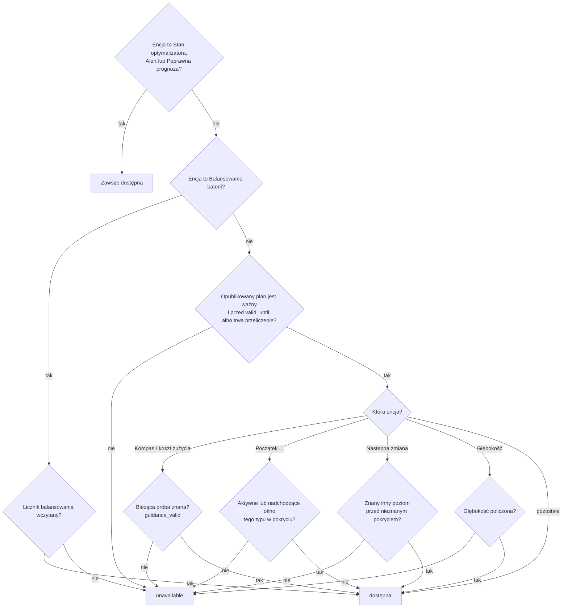

## Stan optymalizatora — cykl obliczeń

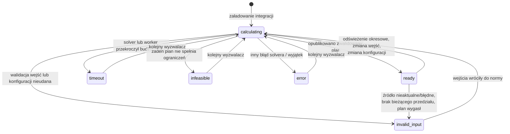

| Stan | Etykieta EN / PL | Kiedy występuje | Co pozostaje opublikowane |
| --- | --- | --- | --- |
| `ready` | Ready / Gotowy | Ostatnie obliczenie dało zwalidowany plan bazowy i zostało opublikowane: udowodnione optimum albo najlepsze rozwiązanie znalezione w `solve_time_limit_s` (`time_limited: true`). | Nowy plan. `ready` nie gwarantuje pełnego pokrycia odniesienia — sprawdź `reason`. |
| `calculating` | Calculating / Obliczanie | Obliczenie czeka w kolejce lub trwa. `reason` mówi dlaczego: `inputs_changed` (zmiana wejść), `interval_boundary` (termin odświeżenia okresowego), `inputs_recovered` (wejścia wróciły), `calculating` (worker wystartował), `soc_rebase_pending` (skok SOC w górę czeka na potwierdzenie). | Poprzedni plan, dopóki pokrywa bieżący czas, z `refreshing: true`. Istniejący alert pozostaje włączony. |
| `invalid_input` | Invalid input / Niepoprawne dane | Brak wymaganego źródła, `unavailable`, dane nieaktualne, zła jednostka, wartość poza zakresem, SOC niezgodny z BMS lub skok SOC, liczniki dzienne z poprzedniego dnia, błędne ustawienia; także `no_current_interval` i `expired_inputs`, gdy zachowany plan już nie pokrywa bieżącego czasu. | Poprzedni plan, dopóki pokrywa bieżący czas (`plan_retained: true`); w przeciwnym razie nic. |
| `timeout` | Timeout / Przekroczony czas | Rozwiązanie bazowe osiągnęło `solve_time_limit_s` (domyślnie 10 s) bez żadnego dopuszczalnego rozwiązania albo worker przekroczył `total_time_limit_s + 1` (powód `worker_deadline`). | Poprzedni plan w jego pokryciu. |
| `infeasible` | Infeasible / Brak rozwiązania | Solver udowodnił, że żaden plan nie spełnia wszystkich twardych ograniczeń (np. rezerwa SOC, reguła końcowa, przeniesione zobowiązanie trybu, deficyt Sell only PV, limity sieci). | Poprzedni plan w jego pokryciu. |
| `error` | Error / Błąd | Każdy inny błąd solvera lub nieoczekiwany wyjątek; `reason` zawiera powód solvera lub klasę wyjątku. | Poprzedni plan w jego pokryciu. |
| `insufficient_data` | Insufficient data / Za mało danych | Zarezerwowany w tłumaczeniach; **nie jest emitowany** przez obecny koordynator — brak danych daje `invalid_input`. | — |

Atrybuty: `last_calculation_started_at`, `calculations_since_load`,
`expired_previous_generated_at` oraz `measured_calibration`, gdy podpięto liczniki kalibracyjne
(zob. [Pomiary kalibracyjne](#pomiary-kalibracyjne-opcjonalnie)). Diagnostyka dodaje
`calculations_last_hour` i `calculations_last_24h`.

### Pomiary kalibracyjne (opcjonalnie)

Plany niosą `calibration` i `capacity_calibration`, które pozostają `unvalidated`, dopóki ich nie
ustawisz, i nie mówią nic o tym, jak daleko ustawione wartości są od rzeczywistości. Dwie
diagnostyki tylko do odczytu porównują je z Twoimi licznikami. Nigdy nie zmieniają planu. Blok
pojawia się tylko, gdy jego źródła są podpięte; bez żadnego źródła `measured_calibration` nie ma ani
w atrybutach Stanu optymalizatora (wyłączonych z rejestratora), ani w diagnostyce integracji.

| Blok | Źródła (Źródła → Dodaj źródło → Pomiar) | Raportuje |
| --- | --- | --- |
| `battery_round_trip` | `battery_charge_energy` i `battery_discharge_energy`: liczniki całkowite energii przechodzącej przez zaciski baterii, kWh lub Wh, bateria włączona | energia rozładowania ÷ energia ładowania z ostatnich 30 dni, obok ustawionego `eta_charge × eta_discharge` |
| `pv_forecast_accuracy` | `pv_energy`: całkowity licznik PV, PV włączone, encja (nie statystyka rejestratora) | rzeczywista ÷ prognozowana energia PV z ostatnich 14 dni, łącznie i dla każdej lokalnej godziny doby |

| Pole | Znaczenie |
| --- | --- |
| `status` | `ok` albo `insufficient_data`, dopóki okno jest za krótkie |
| `window_days`, `covered_hours` | Okno kroczące (30 / 14 dni) i pełne godziny, które miały wszystkie potrzebne wartości |
| `minimum_hours` | Pokryte godziny potrzebne, zanim pojawi się stosunek: 168 dla sprawności cyklu (i co najmniej 1 kWh ładowania), 24 dla PV |
| `charge_kwh`, `discharge_kwh` | Sprawność cyklu: zsumowane przyrosty liczników w pokrytych godzinach |
| `measured`, `configured`, `difference` | Sprawność cyklu: zmierzony stosunek (null do `ok`), `eta_charge × eta_discharge` oraz pierwszy minus drugi |
| `forecast_kwh`, `measured_kwh`, `ratio` | PV: sumy z pokrytych godzin i ich iloraz; `ratio` jest null, gdy suma prognozy jest poniżej 0,05 kWh albo gdy `status` to `insufficient_data` |
| `by_local_hour` | PV: klucze `"00"`–`"23"` (godzina doby w strefie czasowej instalacji), każdy z `ratio`, `hours`, `forecast_kwh` i `measured_kwh` |

Jak to jest mierzone:

- **Granice godzin.** Każdy odczyt licznika dostaje znacznik czasu raportu samego źródła i jest
  sprowadzany do wartości na każdej pełnej godzinie UTC przez interpolację między kolejnymi
  odczytami. Licznik bez zmian jest dokładny przy dowolnej przerwie; licznik rosnący w przerwie
  dłuższej niż 2 godziny nie daje wartości. Energia godziny to różnica jej dwóch granic.
- **Liczniki bezczynne.** Licznik, który zapisuje stan tylko przy zmianie (szablon, utility meter
  lub helper całkujący), nie raportuje w bezczynności. Taki, który nie zmienił się dłużej niż
  2 godziny, jest uznawany za utrzymujący wartość do teraz, dopóki jego ostatni raport nie jest
  starszy niż maksymalny wiek źródła (domyślnie 24 godziny; przy wyłączonej kontroli wieku bez
  limitu), więc jego bezczynne godziny się liczą. Zamrożone źródło od bezczynnego odróżnia wyłącznie
  ten wiek: po jego przekroczeniu godziny wypadają. Godziny bezczynności pojawiają się z
  2-godzinnym opóźnieniem, a źródło utrzymujące stałą niezerową moc bez zapisu stanu jest
  odczytywane jako bezczynne.
- **Brakujące godziny, resety i zakłócenia.** Godzina bez obu granic jest pomijana, nigdy
  uzupełniana. Licznik, który maleje, to reset albo zakłócenie: ani spadek, ani odcinek, który z
  niego wychodzi, nie dają granicy, więc godziny po obu stronach wypadają z obu stosunków (licznik po
  resecie jest używany znów od drugiego odczytu). Wzrost szybszy niż 100 kW (plus 1 kWh) między
  dwoma odczytami jest odrzucany tak samo, podobnie jak przyrost godziny powyżej 101 kWh; pojedynczy
  absurdalny odczyt kosztuje więc kilka godzin i nigdy nie przekłamuje stosunku.
- **Zmiana źródła.** Zapisane wartości licznika należą do encji, atrybutu, mnożnika i jednostki, z
  których je odczytano. Podpięcie roli pod inne źródło czyści historię tego licznika (drugi licznik
  zachowuje swoją), a stosunek wypełnia się od nowa.
- **Prognoza „jak użyta”.** Każdy opublikowany plan zapisuje swoją prognozę PV na bieżącą godzinę
  (przeskalowaną z reszty godziny, gdy plan liczono w jej trakcie). Zostaje najpełniejszy plan danej
  godziny; plan pokrywający mniej niż połowę godziny nie jest zapisywany. Bieżąca, niedokończona
  godzina nie jest porównywana.
- **Przechowywanie.** Jeden mały wiersz na godzinę: około 31 dni wartości liczników i 15 dni
  prognoz, we własnym magazynie integracji (`energy_compass.<entry_id>.calibration`), zapisywany przy
  każdej nowej godzinie i przy wyładowaniu, odczytywany przy starcie. Niepoprawny magazyn jest
  odrzucany z ostrzeżeniem.

### Wyniki wyprzedzone

Jeśli wejścia zmienią się w trakcie obliczeń, gotowy wynik i tak zostanie opublikowany, gdy
zmieniły się tylko wejścia (nie konfiguracja) — jest świeższy niż zachowany plan — a potem rusza
nowe obliczenie. Zmiany konfiguracji, rejestru i błędne wejścia odrzucają wynik w toku.

## Alert i poprawność prognozy

### Poprawna prognoza (`binary_sensor.<name>_forecast_valid`)

| Stan | Warunek |
| --- | --- |
| `on` | Istnieje opublikowany plan i `now < valid_until`. Obowiązuje także w trakcie ponownych prób i gdy zachowany plan wciąż pokrywa bieżący czas. |
| `off` | Brak planu albo skończyło się jego pokrycie/ważność. Rekomendacje stają się niedostępne. |

Atrybut `current_guidance_valid` ma wartość `true` tylko wtedy, gdy próba zużycia dla bieżącego
przedziału dała znany poziom. Pozostałe atrybuty: `coverage_end`, `requested_end`,
`coverage_complete`, `input_ages`, `missing_sources`, `load_quality`.

### Alert (`binary_sensor.<name>_alert`)

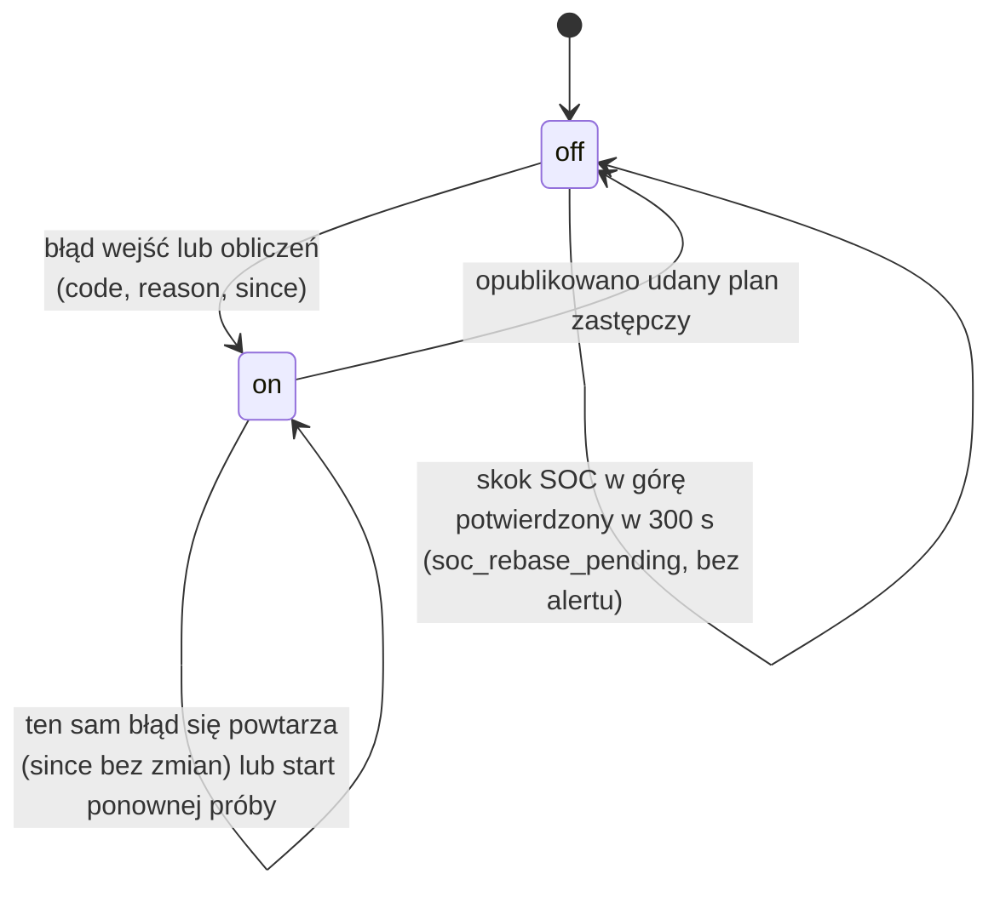

| `code` | EN / PL | Warunek |
| --- | --- | --- |
| `invalid_input` | Invalid input / Nieprawidłowe dane wejściowe | Dowolny błąd walidacji wejść (patrz stan optymalizatora). |
| `soc_measurement_jump` | SOC measurement jump / Skok wskazania SOC | Między dwoma odczytami SOC zmienił się o więcej niż moc baterii × upływ czasu + `soc_jump_percent` (domyślnie 2 %) pojemności. Skok w dół — alert od razu; skok w górę (rekalibracja BMS przy pełnej baterii) najpierw daje `calculating`/`soc_rebase_pending`, a alert tylko gdy nie zostanie potwierdzony w 300 s. Wyjście z alertu wymaga świeżych, wiarygodnych odczytów obejmujących ≥ 60 s. |
| `timeout` | Calculation timeout / Przekroczony czas obliczeń | Przekroczony limit solvera lub workera. |
| `infeasible` | No feasible plan / Brak wykonalnego planu | Żaden plan nie spełnia twardych ograniczeń. |
| `error` | Calculation error / Błąd obliczeń | Inny błąd. |

Atrybuty: `code`, `reason`, `since`, `plan_retained`, `last_successful_plan_at`. Ponowna próba
nie gasi alertu; gasi go dopiero udany nowy plan.

### Zachowanie planu

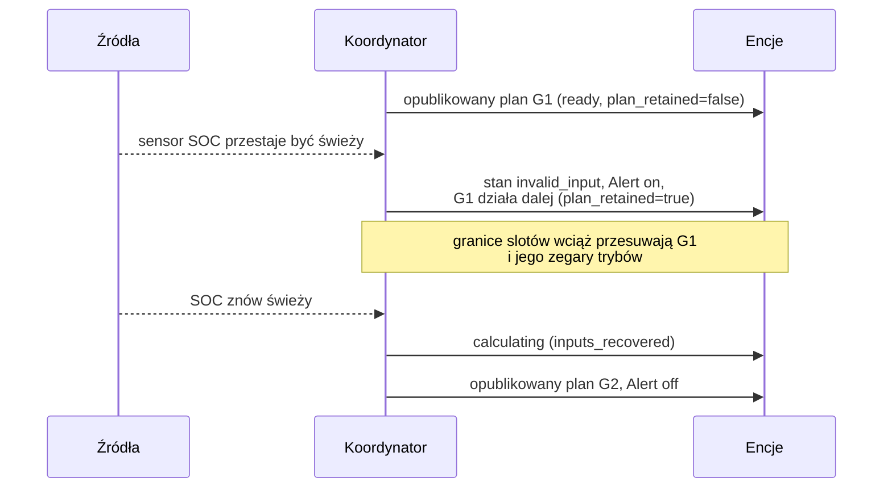

Zachowany plan nigdy nie jest wydłużany poza pierwotne pokrycie i nie przetrwa przeładowania
integracji ani restartu Home Assistant. Zapis w Konfiguracji nie przeładowuje integracji, więc nie
kończy planu: zob. [Zapis opcji](#zapis-opcji). [Sterownik Deye](#sterownik-falownika-deye-solarman)
przechowuje własną kopię zaakceptowanego planu przez przeładowanie wpisu, ale porzuca ją przy restarcie.

## Tryby pracy — planowany stan baterii

Sensor **Kompas energii** pokazuje tryb pracy bieżącego przedziału; każdy wiersz atrybutu
`intervals` planu ma pole `dispatch_mode`. Trybów jest sześć. Dla przedziału o długości `h` godzin:
`activity = minimum_mode_power_kw × h` (domyślnie 0,1 kW) oraz `surplus = max(PV − zużycie, 0)`.

| Tryb | Znaczenie | Występuje, gdy (przepływy fizyczne) | Dozwolony tylko jeśli |
| --- | --- | --- | --- |
| `CHARGE_GRID` | Ładowanie z sieci | Ładowanie ≥ nadwyżka PV + activity — ładuje się więcej, niż daje nadwyżka PV, więc baterię zasila sieć. Bez rozładowania i ograniczania PV. | `allow_grid_charge` włączone; cena ≤ sufit ceny ładowania z sieci, gdy ten limit jest włączony. |
| `CHARGE_PV` | Ładowanie z PV | activity ≤ ładowanie ≤ nadwyżka — ładuje tylko nadwyżka słoneczna. Bez rozładowania i ograniczania PV. Podąża za nadwyżką: eksport do sieci tylko przy ładowaniu na limicie mocy albo gdy bateria jest pełna. | Jest nadwyżka PV. |
| `DISCHARGE_GRID` | Rozładowanie z eksportem | Rozładowanie ≥ activity **i** eksport do sieci ≥ activity — bateria sprzedaje energię. | `allow_battery_export` włączone; moc eksportu > 0; pozwala na to budżet Sell only PV i próg korzyści eksportu. |
| `SELF_CONSUME` | Autokonsumpcja | Rozładowanie ≥ activity, bez ładowania, eksportu i ograniczania — bateria zasila dom. Podąża za obciążeniem: import z sieci tylko przy rozładowaniu na limicie mocy albo gdy bateria jest opróżniona do rezerwy. | SOC powyżej rezerwy operacyjnej. |
| `HOLD` | Wstrzymanie | Brak ładowania, rozładowania i ograniczania — bateria stoi; dom zasila sieć/PV. | Zawsze dostępny. |
| `CURTAIL` | Ograniczanie PV | Ograniczenie produkcji ≥ activity, bez rozładowania; bateria ładuje obok tylko tam, gdzie PV powyżej tego, co instalacja przepuszcza, przekracza to, co przyjmie moc ładowania (niżej). | `allow_curtailment` włączone; bez niego tylko PV, którego nie przepuści limit eksportu ani moc falownika i którego bateria nie przyjmie, ze względu na miejsce lub moc ładowania (wymuszone przycięcie, niżej). |

Przy wyłączonym minimalnym czasie trybu (`minimum_mode_minutes = 0`) stan wyświetlany wynika z
przepływów wg pierwszeństwa: CURTAIL → CHARGE_GRID → CHARGE_PV → DISCHARGE_GRID → SELF_CONSUME →
HOLD.

Zaplanowane [trzymanie balansu LFP](#balansowanie-lfp) nie dodaje osobnego trybu: jego wiersze
korzystają z `CHARGE_PV` lub `CHARGE_GRID` i mają `balance_hold: true` w atrybucie `intervals`
planu.

### Przejścia i minimalny czas trwania

```mermaid
stateDiagram-v2
    direction LR
    state "Grupa podążania za PV, wspólny zegar" as PVF {
        CHARGE_PV --> SELF_CONSUME: PV spada poniżej zużycia
        SELF_CONSUME --> CHARGE_PV: PV przekracza zużycie
    }
    HOLD --> PVF: nowy przebieg ≥ 60 min
    HOLD --> CHARGE_GRID: nowy przebieg ≥ 60 min
    HOLD --> DISCHARGE_GRID: nowy przebieg ≥ 60 min
    HOLD --> CURTAIL
    PVF --> HOLD: po minimalnym czasie
    CHARGE_GRID --> HOLD: po minimalnym czasie
    DISCHARGE_GRID --> HOLD: po minimalnym czasie
    CHARGE_GRID --> HOLD: wyjątek bezpieczeństwa<br/>(SOC max, cena ponad sufit)
    PVF --> HOLD: wyjątek bezpieczeństwa<br/>(CHARGE_PV przy SOC max; SELF_CONSUME na rezerwie tylko gdy jego zwolnienie nie ma planu)
    DISCHARGE_GRID --> HOLD: wyjątek bezpieczeństwa<br/>(SOC na rezerwie)
```

Diagram jest uproszczony — HOLD pokazano jako węzeł centralny: po minimalnym czasie każdy tryb może
przejść bezpośrednio w dowolny inny dostępny tryb.

Zasady (domyślnie 60 min, 0,1 kW):

- **Każdy nowo rozpoczęty tryb — także HOLD i CURTAIL — trwa co najmniej
  `minimum_mode_minutes`.** Tylko końcowy pasywny przebieg HOLD/CURTAIL może być przycięty przez
  pokrycie prognozy. Koordynator zapisuje
  przyjęty tryb i jego start; przeliczenie i restart zachowują zegar.
- **`SELF_CONSUME` podąża za obciążeniem.** Falownik rozładowuje tyle, ile pobiera dom, więc plan
  nigdy nie łączy małego rozładowania z importem z sieci: w przedziale `SELF_CONSUME` bateria
  pokrywa całe zapotrzebowanie, a import pojawia się dopiero, gdy rozładowanie sięga limitu mocy
  w przedziale albo bateria została opróżniona do rezerwy. W przeciwnym razie wiersz to `HOLD`
  z pełnym importem. Reguła obowiązuje też przy `minimum_mode_minutes = 0`: nie ma wtedy trybów,
  a rozładowanie w każdym przedziale, który przepływy oznaczają jako `SELF_CONSUME`, jest związane
  tak samo. Przeniesione zobowiązanie `CHARGE_PV`/`SELF_CONSUME` jest wykonywane tak samo. Jeśli
  bateria wyczerpie się przed jego końcem, reszta zobowiązania to `HOLD` z pełnym importem
  (bez własnego zegara: jedynym zegarem jest termin zobowiązania). Tak samo — w razie potrzeby już od pierwszego przedziału — gdy
  bateria nie może pokryć domu i zarazem zachować poboru czuwania falownika (`idle_drain_kw`)
  z późniejszych przedziałów, a PV ani ładowanie z sieci nie uzupełnią go na czas. `HOLD` zaczyna
  się tylko w przedziale bez nadwyżki PV, którą bateria mogłaby przyjąć, w każdym przedziale
  zobowiązania: przy nadwyżce wiersz zostaje `CHARGE_PV`. Przedział zobowiązania, w którym żaden
  z trybów nie ma za czym podążać (obciążenie netto i nadwyżka PV poniżej
  `minimum_mode_power_kw × h`, np. nocny pobór bazowy poniżej 100 W), to z klasyfikacji `HOLD`
  i nie kończy zobowiązania: plan go przemostkowuje (nie startuje zegar `HOLD`, a zapisane
  zobowiązanie zachowuje tryb i start) albo, gdy bateria jest wyczerpana lub pełna, zaczyna tam
  prawdziwy przebieg `HOLD`, tak jak w każdym innym przedziale
  (`dispatch_policy.carried_idle_starts` wymienia przemostkowane przedziały). Przy pełnej baterii
  w instalacji, która nie może oddać PV, taki przedział może być też `CURTAIL`, jak każdy inny
  przedział zobowiązania; nie jest wtedy przemostkowany. Gdy potem nie da się spełnić reguły końcowej
  (`preserve_initial` bez późniejszego PV lub ładowania z sieci, które uzupełniłyby to, co zużył
  dom), przedział to `HOLD` z pełnym importem, jak przy wyczerpanej baterii, a bateria kończy tam,
  gdzie zaczęła. Plan jest `infeasible` (niewykonalny) do końca zobowiązania, gdy dzienny budżet
  przepustowości nie
  pokryje minimalnej aktywności, której wymaga zobowiązanie; rzadkie pozostałe przypadki (straty postojowe lub wymóg końcowy `preserve_initial`, które pokryłaby tylko nadwyżka PV, której plan nie może zgromadzić) opisuje
  [model i ograniczenia](model.md#operating-mode-duration-and-pv-export-budget) (EN). Kierunek
  zablokowany przez dawną blokadę kierunku (`initial_battery_mode`) nie jest otwarty: bateria,
  która nie może się ładować, nie ma `CHARGE_PV` do naśladowania, a ta, która nie może się
  rozładowywać, nie ma `SELF_CONSUME`, więc przedział z tylko takim kierunkiem też jest
  przemostkowany. Sonda obciążenia elastycznego jest mostkowana tak samo, dopóki zabrane przez nią
  obciążenie zostawia przedział bez aktywności; nadwyżka PV sprowadzona przez sondę poniżej
  minimalnej aktywności nie jest nadwyżką, którą bateria mogłaby przyjąć, więc `HOLD` może się na
  niej zacząć.
- **`CHARGE_PV` podąża za nadwyżką.** Falownik ładuje każdym watem, którego dom nie zużywa, więc plan
  nigdy nie łączy częściowego ładowania z eksportem do sieci: w przedziale `CHARGE_PV` bateria
  przejmuje całą nadwyżkę PV, a eksport pojawia się dopiero, gdy ładowanie jest na limicie mocy
  przedziału albo bateria została napełniona do górnej granicy. W innym wypadku wiersz nie jest
  `CHARGE_PV`. Reguła obowiązuje też przy `minimum_mode_minutes = 0`: nie ma wtedy trybów, a
  ładowanie w każdym przedziale, który przepływy oznaczają jako `CHARGE_PV`, jest związane tak
  samo. Przeniesione zobowiązanie `CHARGE_PV`/`SELF_CONSUME` podlega tej samej regule. Jeśli
  bateria zapełni się przed jego końcem (następny przedział nie przyjąłby nawet minimalnej
  aktywności powyżej górnej granicy), reszta zobowiązania to `HOLD` z eksportem nadwyżki albo
  `CURTAIL` tam, gdzie
  instalacja nie przepuści nadwyżki (powyżej limitu eksportu lub mocy falownika), tak jak robi to
  falownik przy pełnej baterii. Zwolniony `HOLD` nie ma własnego zegara — jedynym zegarem jest
  termin zobowiązania — więc może przejść w `CURTAIL` (który startuje własny zegar) przed tym
  terminem. Zwolniony `HOLD` wraca do `CHARGE_PV`/`SELF_CONSUME` w każdym
  późniejszym przedziale zobowiązania, dopóki bateria jest rozładowana: bateria przyjmuje nadwyżkę,
  a `HOLD` nie przepuściłby PV powyżej limitu eksportu (przy `grid_export_kw = 0` tak jest każdego
  wschodu słońca). `HOLD` zwolniony przy rozładowanej baterii wraca też w przedziale z PV, którego
  instalacja nie przepuści, bo `HOLD` nie ma tam legalnego przepływu: plan wykonany przez jeden
  przedział dotarłby inaczej do następnej granicy z przeniesionym zobowiązaniem i bez planu. `HOLD`
  zwolniony przy pełnej baterii tam nie wraca: przez granicę zachowuje własny zegar, a tam, gdzie
  instalacja nie przepuści PV, jest `CURTAIL` (wyżej). Nie wraca też dlatego, że reguła końcowa
  wyczerpała baterię: to liczy się przy zwolnieniu i przy powrocie `HOLD`, który zaczął się na
  rozładowanej baterii (koordynator przenosi go jako zwolniony), a nie przy tym, który wraca tylko
  wtedy, gdy bateria jest rozładowana sama w sobie.
  Bateria dokładnie na rezerwie (zwykły stan
  pusty falownika) jest rozładowana w tym sensie, a nie wyjątkiem bezpieczeństwa: przeniesione
  `SELF_CONSUME` jest tam zwalniane i ładuje jak 0,01 kWh nad rezerwą. Gdy zwolniony `HOLD` nie ma
  planu (zobowiązanie, którego żaden plan nie utrzyma), dom i tak nigdy nie zostaje bez planu. Planem jest pierwszy z
  poniższych, który ma rozwiązanie, każdy próbowany dopiero wtedy, gdy poprzedni go nie ma, a
  wszystkie w jednym budżecie czasu przeliczenia: zwolnienie; własny `HOLD` zobowiązania z jego
  zegarem, jak wyjątek bezpieczeństwa poniżej, który ucina tam, gdzie ucinanie jest dozwolone; plan
  bez zobowiązania (tylko dla przeniesionego `CHARGE_PV` lub `SELF_CONSUME`, które plan wykonany o
  jeden przedział może zostawić w stanie, który jego własny minimalny czas czyni niewykonalnym). Po
  tym ostatnim planie pierwszy tryb, który nadal jest `CHARGE_PV` lub `SELF_CONSUME`, zachowuje
  zobowiązanie i jego zegar; każdy inny pierwszy tryb startuje własny zegar.
  Powrót to dalszy ciąg zobowiązania, a nie nowy
  przebieg: jedynym zegarem pozostaje termin zobowiązania. Bateria, która opróżni się ponownie w
  tym samym zobowiązaniu, jest znowu zwalniana i znowu wraca, tyle razy, ile trwa zobowiązanie.
  Zwolnienie przechodzi przez granicę przedziału: plan oznacza wiersze takiego `HOLD`
  (`dispatch_policy.released_hold_starts`), a koordynator zachowuje zobowiązanie i jego początek,
  oznaczone jako zwolnione, zamiast zapisywać `HOLD` z własnym zegarem, więc następny plan wraca do
  `CHARGE_PV` tak jak pierwszy opublikowany. Taki `HOLD` może też trwać po terminie zobowiązania
  bez zegara; powrót do `CHARGE_PV`/`SELF_CONSUME` po terminie to osobny przebieg i dostaje
  nowy początek. Pierwszy przedział zobowiązania jest oceniany tak samo
  względem zaobserwowanego stanu naładowania: bateria, która jest już w obrębie obniżonej górnej
  granicy tego przedziału (na przykład po wykonaniu przedziału, który ją napełnił), może od razu
  przejść w `HOLD` lub `CURTAIL`, w obu trybach grupy. Zaobserwowany stan naładowania na górnej
  granicy to wyjątek bezpieczeństwa opisany niżej. Przedział zobowiązania, w którym bateria się napełnia,
  a reszta nadwyżki nadal przekracza limit eksportu lub moc falownika, jest planowany: `CHARGE_PV`
  nie napełni baterii i nie przytnie nadwyżki w tym samym przedziale, więc bateria liczy się jako
  pełna dla następnego przedziału (może to być `HOLD` lub `CURTAIL`), gdy jest od górnej granicy
  nie dalej niż potrzeba przycięcia tego przedziału (PV, które musi trafić do baterii albo zostać
  przycięte, co najmniej minimalna aktywność).
  Przy `minimum_mode_minutes = 0` reguła kosztuje czas obliczeń (tabela w
  [model i ograniczenia](model.md#operating-mode-duration-and-pv-export-budget), EN). Instalacja,
  która nie może ograniczać produkcji PV (`allow_curtailment` wyłączone), z limitem eksportu do
  sieci albo falownikiem o mocy poniżej PV zostałaby z PV bez miejsca, gdy bateria jest pełna.
  W większości przypadków plan powstaje zamiast wyniku „brak planu” (`infeasible`; pomiar
  niżej): PV ponad to, co przepuści limit i
  falownik (potrzeba przycięcia; przy minimalnym czasie trwania co najmniej minimalna aktywność),
  jest tracone w przedziale, w którym bateria nie może go przyjąć, i ma etykietę `CURTAIL`
  (falownik przycina sam; sterownik Deye wykonuje profil ładowania z PV z planowanym prądem w wierszu, który ładuje, a profil `HOLD` w takim, który nie ładuje). Bramką jest wolne miejsce
  w baterii: przedział zaczyna się na poziomie górnej granicy pomniejszonej o to, co bateria
  musiałaby przyjąć, więc bateria z niewielkim wolnym miejscem, która nie przyjmie nadwyżki, też
  ją traci, a bateria, która ją przyjmie, nigdy, bez względu na cenę sprzedaży. Część, której bateria
  nie przyjmie swoją mocą ładowania (potrzeba przycięcia pomniejszona o `charge_kw × h`),
  jest tracona bez względu na wolne miejsce: bateria ładuje z pełną mocą, a falownik przycina resztę
  w tym samym przedziale, więc bateria z wolnym miejscem i mocą ładowania poniżej nadwyżki ma plan.
  Przy minimalnym
  czasie trwania przebieg `CURTAIL` utrzymuje bramkę następnego przedziału otwartą (nie rozładowuje
  baterii, więc ta opada najwyżej o straty postojowe, a rośnie tam, gdzie przedział ładuje), przebieg `CHARGE_PV` lub `SELF_CONSUME` może
  zakończyć się w `CURTAIL`, gdy bateria napełni się w jego trakcie (albo w `HOLD`, gdy skończy
  się też PV, które musiał przyjąć), a wolne miejsce poniżej bramki zostaje puste w przedziale
  `CURTAIL` do następnego przeliczenia, które odczyta rzeczywisty stan naładowania. Przebieg
  `CURTAIL` przeniesiony do następnego planu traci PV dalej, dopóki trwa potrzeba, także gdy
  bateria opadła w tym czasie poniżej pełnej. Instalacja, która przepuści swoje PV, działa jak
  dotąd.
  Pomiar na powtarzalnie losowanych problemach (2400 problemów rozwiązanych raz): z przycięciem
  plan powstaje w 533 z 589 przy minimalnym czasie trwania 0, 565 z 606 przy 15 minutach, 582 z
  620 przy 30 minutach i 503 z 585 przy 60 minutach (bez niego 171, 160, 149 i 97). Dzień o
  dzwonowym przebiegu PV, śledzony przedział po przedziale do końca, zachowuje plan przez cały
  czas w 207 z 214 dni przy 15 minutach, 172 z 189 przy 30 minutach i 158 z 197 przy 60 minutach
  (bez przycięcia 27, 23 i 23); większość pozostałych nie ma planu od pierwszego
  przedziału. Reszta nadal nie ma planu, głównie z powodu, którego plan nie obejmuje: przebieg
  `HOLD`, który plan sam rozpoczyna i który spotyka PV, którego instalacja nie przepuści, gdy
  bateria ma wolne miejsce (przycięcie byłoby wtedy wyborem planu), częściej przy 60 minutach,
  oraz część losowań z próbką elastycznego zużycia. Część wymuszona (T-066) zmniejszyła liczbę z
  2400 problemów rozwiązanych raz bez planu z 226 do 76, a liczbę losowań śledzonych przedział po
  przedziale i niedoprowadzonych do końca z 190 do 57 z 1800, bez nowego problemu „brak planu”
  (`infeasible`) wśród rozwiązanych raz, które main planował; z 3600 dni śledzonych przedział po
  przedziale na czterech ziarnach jeden, który main prowadzi do końca, zatrzymuje się na granicy,
  w której nie ma planu na żadnej instalacji. Przeniesione zobowiązanie `HOLD` lub `CURTAIL`
  częściej zostawia plan (T-082): tam, gdzie instalacja nie przepuści PV, `CURTAIL` przejmuje
  przeniesiony `HOLD` przy wolnym miejscu w baterii, w przedziałach tego przebiegu, w których nic
  nie jest wymuszone, a przebieg `CURTAIL` trwa przez przedział bez nadwyżki, dopóki mieści się w
  swoim minimalnym czasie, do nadwyżki, która wraca mniejsza niż wolne miejsce; to zmniejszyło
  liczbę z 2400 losowań bez planu z 76 do 38, a liczbę losowań śledzonych i niedoprowadzonych do
  końca z 57 do 16 z 1800, bez żadnego nowego „brak planu” (`infeasible`) (liczby, losowania
  lepsze i gorsze oraz commity w dokumencie modelu)
  ([model i ograniczenia](model.md#operating-mode-duration-and-pv-export-budget), EN).
- **`CURTAIL` trwa mimo przerwy w PV.** Przebieg `CURTAIL` trwa minimalny czas, a PV może w tym
  czasie spaść. `HOLD` w przedziale z PV poniżej minimalnej aktywności (`minimum_mode_power_kw × h`)
  w trakcie tego czasu to ten sam przebieg, a nie nowy `HOLD`: falownik nie ma czego przycinać,
  a bateria i sieć robią to, co przy `HOLD`. Liczy się do zegara `CURTAIL`, nie uruchamia zegara
  `HOLD` i kończy się z czasem przebiegu; `HOLD` po nim ma własny zegar. Dotyczy przebiegu
  rozpoczętego przez PV, którego nie przepuści limit eksportu ani falownik, oraz przeniesionego
  `CURTAIL`; `dispatch_policy.carried_idle_starts` wymienia także te wiersze, a zapisane zobowiązanie
  zachowuje tam swój tryb i początek. Działa to także w przeniesionym zobowiązaniu
  `CHARGE_PV`/`SELF_CONSUME` (zwolniony z niego `CURTAIL` trwa mimo przerwy w PV w obrębie czasu
  samego zobowiązania) oraz w przedziale z obciążeniem poniżej minimalnej aktywności.
- **`CURTAIL` przejmuje `HOLD`, który nie przepuści PV.** `HOLD` nie przycina produkcji, więc
  `HOLD`, który musi trwać (przeniesiony `HOLD`, `HOLD`, który wyjątek bezpieczeństwa poniżej
  stawia w miejsce `CHARGE_PV` przy maksymalnym stanie naładowania, albo `HOLD` rozpoczęty wcześniej
  w planie, na przykład po przebiegu `CURTAIL`, który skończył się przerwą w PV), nie ma dozwolonego
  trybu w przedziale, w którym PV po odjęciu zużycia domu przekracza limit eksportu
  (`grid_export_kw`) albo moc falownika. Falownik przycina wtedy sam i przedział to `CURTAIL`:
  przejmuje `HOLD` i od tej chwili jest zwykłym przebiegiem `CURTAIL` z własnym minimalnym czasem
  (dłuższym niż reszta czasu `HOLD`; przerwa w PV w jego trakcie jest pokryta jak wyżej). Tylko tam,
  gdzie instalacja nie przepuści PV: gdziekolwiek indziej `CURTAIL` w czasie `HOLD` byłby etykietą
  do wyjścia z niego i nie jest oferowany. `HOLD` po przebiegu ma własny zegar. `HOLD` zwolniony z
  przeniesionego zobowiązania `CHARGE_PV`/`SELF_CONSUME` nie ma własnego zegara i nie jest
  przejmowany. Próbka elastycznego zużycia się liczy: jej obciążenie jest częścią tego, co
  instalacja przepuszcza, więc przejęcie jest oferowane tylko dla obciążeń próbki, przy których PV
  nadal przekracza limit.
- **`CURTAIL` ładuje tyle, ile bateria przyjmie.** Gdy PV powyżej tego, co instalacja przepuszcza
  (powyżej limitu eksportu po odjęciu domu albo powyżej mocy falownika), przekracza to, co bateria
  przyjmie mocą ładowania w jednym przedziale, ani `CHARGE_PV` (nic nie przycina), ani `CURTAIL`,
  który nic nie ładował, nie pomieściłyby go; falownik ładuje mocą ładowania i przycina resztę, i tak
  samo robi plan: przedział to `CURTAIL`, z ładowaniem od zera do PV zostającego po odjęciu domu.
  Bateria bierze tam wyłącznie PV: przedział `CURTAIL`, który ładuje, nic nie importuje, także na dom.
  Gdy bateria stoi na rezerwie przy przeniesionym zobowiązaniu `CHARGE_PV`/`SELF_CONSUME` (wschód
  słońca przy zerowym eksporcie, baterii 1 kW i 3,6 kW PV), to jest sam plan, a nie plan awaryjny.
  W przeniesionym zobowiązaniu `CURTAIL` jest oferowany w takim przedziale niezależnie od tego, co
  bateria miała wcześniej; przy próbce elastycznego zużycia tylko dla obciążeń próbki, przy których PV
  zostaje poza baterią. `CURTAIL`, który otwiera taki przebieg, trwa przez jego minimalny czas: kolejne
  przedziały zobowiązania oferują `CURTAIL`, dopóki przebieg trwa, także tam, gdzie PV nie przekracza już
  tego, co przyjmie bateria (nie ładuje wtedy, więc bateria na rezerwie czeka do końca przebiegu: do 105
  minut po pierwszym przedziale przy minimalnym czasie 120), bo przebieg nie może zmienić trybu w swoim
  czasie, a `CHARGE_PV` zobowiązania nie jest z niego wyjściem. Przy wyłączonym `allow_curtailment` taki przedział jest planowany tylko jako
  wymuszone przycięcie, czyli gdy bateria ma mniej miejsca niż PV, którego instalacja nie przepuści:
  przedział `CURTAIL` ładuje wtedy tyle, ile bateria przyjmie, i przycina resztę. To samo dotyczy baterii
  z wolnym miejscem: ładuje mocą ładowania i przycina PV ponad nią, bez względu na wolne miejsce.
- **Grupa podążania za PV:** `CHARGE_PV` i `SELF_CONSUME` dzielą jeden zegar — w obu falownik
  ładuje z nadwyżki i pokrywa deficyt z baterii, więc przełączanie między nimi nie jest zmianą
  trybu.
- **Każda inna zmiana** (źródło, cel, HOLD lub CURTAIL) uruchamia nowy zegar, poza `HOLD`
  zwolnionym przy pełnej lub pustej baterii (wyżej), który go nie ma. Bezczynny HOLD nie
  „odlicza” czasu dla aktywnego przebiegu.
- **Pokrycie:** nowy aktywny tryb wymaga pełnego minimalnego czasu pokrycia prognozą.
- **Wyjątek bezpieczeństwa (pauza, nie reset):** w trakcie niewygasłego aktywnego zobowiązania
  bieżący wiersz pokazuje HOLD, gdy obserwowany SOC jest już na górnej granicy (tryby ładowania —
  `observed_soc_maximum`) lub na/poniżej rezerwy (tryby rozładowania — `observed_soc_minimum`; nie przeniesione `SELF_CONSUME`,
  które wyżej jest zwalniane jak rozładowana bateria, chyba że to zwolnienie nie ma planu),
  albo gdy przeniesione `CHARGE_GRID` trafia przed terminem na cenę powyżej sufitu
  (`grid_charge_price_limit`). Przerwany tryb i termin pozostają zapisane; przed tym terminem nie
  może wystartować żaden inny tryb, poza `CURTAIL`, który przejmuje `HOLD` tam, gdzie instalacja
  nie przepuści PV (wyżej). Widoczne w `dispatch_policy.safety_exception`.
- **Zmiana strategii (reset):** zapis nowej strategii zrywa przeniesione zobowiązanie dla
  następnego planu, który startuje bez blokady (patrz [zwolnienie przy zmianie
  strategii](#zwolnienie-przy-zmianie-strategii)).
- `minimum_mode_minutes = 0` wyłącza reguły czasu i minimalnej mocy; reguły podążania
  `SELF_CONSUME` za obciążeniem i `CHARGE_PV` za nadwyżką pozostają włączone.

### Polityki ograniczające tryby

| Polityka | Domyślnie | Efekt |
| --- | --- | --- |
| **Sell only PV** (`limit_export_to_pv`, „sprzedawaj tylko PV”) | włączona | W każdej dobie lokalnej: eksport ≤ produkcja PV (zaobserwowana od północy + prognoza). Wymaga liczników `pv_energy_today` i `grid_export_energy_today`. |
| **Zakres limitu sprzedaży PV** (`export_limit_scope`) | `local_day` (cała doba) | `local_day` sprawdza budżet raz, dla całej doby; `produced` (wyprodukowane do tej chwili) sprawdza go jako sumę bieżącą, więc eksport nigdy nie wyprzedzi produkcji PV z tej doby. Zob. [Sell only PV](model.md#operating-mode-duration-and-pv-export-budget) (EN). |
| **Limit ceny ładowania z sieci** (`limit_grid_charge_price`, `maximum_grid_charge_price`) | wyłączony | CHARGE_GRID tylko przy cenie zakupu ≤ sufit przez cały minimalny czas trybu. |
| **Minimalna korzyść eksportu** (`minimum_export_episode_benefit`) | 1 jednostka waluty | Każdy dodatkowy okres eksportu z baterii musi poprawić koszt całego horyzontu co najmniej o tę kwotę. `0` wyłącza. |
| **Minimalna korzyść epizodu ładowania z sieci** (`minimum_grid_charge_episode_benefit`) | 0 (wył.) | Ten sam próg dla nowych okresów ładowania z sieci; skupia ładowanie w mniej epizodów. |
| **Kara za import** (`import_penalty_per_kwh`) | 0 | Planistyczna cena cienia za każdą importowaną kWh, w każdej strategii. |
| **Opłata za błąd prognozy w HOLD** (wbudowana, nie jest ustawieniem) | 0,5 prognozowanego zużycia | Planistyczna opłata za `HOLD` i `CURTAIL` w przedziale, w którym PV jest większe niż zużycie, a cena zakupu przekracza to, co zmagazynowana kWh może jeszcze zarobić lub zaoszczędzić później: plan magazynuje nadwyżkę (`CHARGE_PV`) zamiast trzymać baterię przez szczyt dla kilku watów eksportu. To nie zakaz: `HOLD` wart więcej nadal jest planowany. Nigdy nie wchodzi do publikowanego kosztu. Zob. [HOLD i CURTAIL w cenie szczytowej](model.md#hold-and-curtail-at-a-peak-price) (EN). |
| **Model depozytu** (`deposit_model`) | `off` | `off` jest ustawieniem dla każdej instalacji. `manual` (eksperymentalny) wycenia eksport i część energetyczną importu podanym przez Ciebie współczynnikiem; w rocznym odtworzeniu nie obniżył rachunku. Wymaga części dystrybucyjnej ceny zakupu. Zob. [Wartość depozytu w net-billingu](#wartość-depozytu-w-net-billingu). |
| **Pobór czuwania falownika** (`idle_drain_kw`) | 0 (wył.) | Stały ubytek energii baterii modelowany w każdym przedziale. |
| **Zapas baterii na drogie okresy** (`peak_reserve_margin_kwh`) | 0 (wył.) | Energia ponad prognozowaną potrzebę na start drogiego okresu. Zob. [Zapas na drogie okresy](#zapas-na-drogie-okresy). |
| **Zapas baterii po sprzedaży z baterii** (`export_reserve_margin_kwh`) | 0 (wył.) | Energia ponad prognozowaną potrzebę po każdym eksporcie z baterii w drogim okresie, do następnego taniego przedziału. Osobne ustawienie (nie idzie za zapasem powyżej); wymaga eksportu z baterii i opcji **Ogranicz cenę ładowania baterii z sieci**. Zob. [Zapas na drogie okresy](#zapas-na-drogie-okresy). |
| **Reguła końcowa** (`terminal_mode`) | `preserve_initial` | SOC na końcu ≥ SOC na starcie, albo `value`: energia na końcu wyceniana po `terminal_value_per_kwh`. |

Profile startowe mogą wstępnie wypełnić karę za import, pobór czuwania i regułę końcową dla nowych
instalacji; zob. [Profile startowe](#profile-startowe-nowe-instalacje).

### Wartość depozytu w net-billingu

W polskim net-billingu wartość wyeksportowanej energii jest księgowana na **depozycie prosumenckim**,
a depozyt pokrywa tylko to, co należy się sprzedawcy za **energię**; opłaty dystrybucyjne płaci się
gotówką. Po 12 miesiącach niewykorzystana część jest zwracana, ale zwrot za miesiąc nie może
przekroczyć **ρ × wartość energii wyeksportowanej w tym miesiącu** (ρ = 30 % przy rozliczeniu
godzinowym RCE, 20 % przy miesięcznym RCEm), gdzie wartość to wartość eksportu bez współczynnika
1,23; reszta przepada. Dopóki depozytu brakuje albo jego
niewykorzystana część mieści się pod limitem, jedna jednostka waluty eksportu lub energetycznej
części importu jest warta dokładnie jedną jednostkę gotówki i planer niczego nie musi poprawiać. Gdy
limit zaczyna wiązać, kolejna jednostka eksportu jest warta tylko ρ/1,23 ceny sprzedaży zawierającej
współczynnik 1,23 (0,244 dla ρ = 30 %, 0,163 dla 20 %), a część energetyczna importu nic
nie kosztuje w gotówce (płaci się nią pieniędzmi, które i tak by przepadły). Model depozytu pozwala
planerowi to zobaczyć, ale **się nie opłaca**: `off` jest ustawieniem dla każdej instalacji, także
gdy depozyt przepada, a `manual` jest **eksperymentalny**. Model `auto` został wycofany; zapisane
`auto` jest czytane jako `off`, bez błędu i bez Alertu. `off` jest domyślne i wtedy plan jest
identyczny bajt w bajt z wersją bez modelu.

Co zmierzono, w rocznym odtworzeniu 40 domów z godzinowym RCE i baterią 10 kWh, rozliczonych wzorem
rocznym i miesięcznym zapisem:

- żaden współczynnik nie obniżył rocznego rachunku o więcej niż 44 PLN, a współczynnik na limicie
  podniósł go we wszystkich 40 domach, o 68–431 PLN (wzór roczny) albo 21–306 PLN (miesięczny zapis);
- przy miesięcznym RCEm współczynnik zmienia rachunek o mniej niż 10 PLN;
- instalacja, której depozyt przepada, niczego nie ustawia: `deposit_model` zostaje `off`. Wyłączenie
  eksportu z baterii z powodu przepadającego depozytu kosztowało 154–662 PLN rocznie we wszystkich 16
  zmierzonych domach (z ładowaniem z sieci i eksportem z baterii dozwolonymi).

**Dwie części ceny zakupu.** Model musi wiedzieć, która część ceny zakupu to energia (pokrywana z
depozytu), a która dystrybucja (płacona gotówką). Cena zakupu interwału jest sumą obu, a podajesz
stawki części dystrybucyjnej, nigdy energetycznej:

```text
included:  buy = cena źródła zakupu                  (źródło to cena all-in, np. harmonogram taryfy)
added:     buy = cena źródła zakupu + dystrybucja    (źródło to sama cena energii)
część energetyczna = clamp(buy − dystrybucja, 0, max(buy, 0))
```

`added` stosuj przy dynamicznej cenie energii (prognoza, np. taryfa oparta na RCE) albo cenniku
wpisanym tak jak na fakturze. Zmienia samą cenę zakupu, dla planera **i** dla raportowanych kosztów, i
działa przy wyłączonym modelu depozytu. Przykład: dynamiczna cena energii 0,25 w południe i 0,95 w
wieczornym szczycie plus stawka dystrybucji G12 0,540 dają ceny zakupu 0,79 i 1,49; w nocy 0,45 +
0,143 daje 0,593. Gdy limit wiąże, planer widzi tylko część dystrybucyjną: 0,540, 0,540 i 0,143.
Ujemna cena energii zostaje rzeczywistą ceną i nie ma części energetycznej do darowania.

| Ustawienie (Taryfy) | Domyślnie | Znaczenie |
| --- | --- | --- |
| `deposit_model` | `off` | `off`: pełne ceny, ustawienie dla każdej instalacji. `manual` (eksperymentalny): sam podajesz `export_value_factor`. Zapisane `auto` (wycofane) jest czytane jako `off`. |
| `deposit_refund_percent` | 30 | ρ, limit zwrotu jako udział wartości eksportu z miesiąca. 20 przy miesięcznym rozliczeniu RCEm. Sprzedawca zwracający udział depozytu (który zawiera współczynnik 1,23) ma tu 36,9 / 24,6. |
| `export_value_factor` | 1,0 | Tylko `manual`: ile jest warta kolejna jednostka eksportu (0–1). |
| `buy_distribution_mode` | `included` | `included` albo `added`, jak wyżej. |
| `buy_distribution_rate`, `buy_distribution_off_peak_rate` | 0 | Wszystko, co dystrybutor nalicza za kWh (stawka sieciowa, opłata jakościowa, OZE i kogeneracyjna), wpisywane jak cena zakupu; pierwsza to strefa szczytowa albo jedyna, druga strefa poza szczytem. VAT obowiązuje, gdy `buy_apply_vat` jest włączone; `buy_multiplier`, `buy_addition` i próg prognozy dotyczą tylko źródła ceny zakupu. Strefy pochodzą z harmonogramu taryfy źródła zakupu albo z [taryfy dystrybucyjnej](#wbudowane-taryfy-osd); bez żadnej z nich albo przy G11 pierwsza stawka obowiązuje całą dobę. Przy dwóch strefach ustaw obie stawki albo żadną: dokładnie jedna stawka równa 0 kończy obliczenie błędem. Opłata miesięczna należy do `monthly_charge`. |

Presja limitu π (0 = depozytu brakuje albo mieści się pod limitem, 1 = limit wiąże) daje dwa
współczynniki, które istnieją tylko wewnątrz optymalizatora:

```text
współczynnik wartości eksportu φx = 1 − π × (1 − ρp)    1 → ρp,  ρp = ρ / 1,23
współczynnik energii importu   φe = 1 − π               1 → 0
cena zakupu w planie  = buy − (1 − φe) × część energetyczna buy
cena sprzedaży w planie = φx × max(sell, 0) + min(sell, 0)
```

- **`manual`** (eksperymentalny): `φx` to Twój `export_value_factor` dokładnie tak, jak go wpisano,
  także poniżej ρp. Z niego wynika tylko π, `π = clamp((1 − φx) / (1 − ρp), 0, 1)`, a `φe = 1 − π`
  idzie za nim (wartość równa ρp lub niższa w pełni wyzerowuje część energetyczną importu). Przy
  limicie (π = 1) `φx` to `ρp = ρ / 1,23`, a nie ρ: 0,244 dla 30 %, 0,163 dla 20 %. Przy
  `deposit_refund_percent` 100 jest to 1/1,23, nie 1; ustawieniem, które niczego nie anuluje, jest
  `deposit_model: off`.
- **Brak części dystrybucyjnej** (stawki dystrybucji równe 0): cała cena zakupu byłaby liczona jako
  pokrywana z depozytu i import wyglądałby na darmowy. Przy π powyżej 0 `φe` jest więc wymuszone na 1,
  a `reason` to `split_missing`; `φx` nadal działa. Aby użyć modelu, ustaw stawki dystrybucji.
- **Ujemne ceny sprzedaży** zostają w całości: współczynnik skaluje tylko część dodatnią, bo ujemna
  cena jest realną opłatą.
- **Raportowane koszty się nie zmieniają.** Koszt netto, `Plan.grid_cost`, czujniki kosztów, poziomy
  zużycia i próg `maximum_grid_charge_price` zostają w cenach z faktury; współczynników używa tylko cel
  planowania, przy każdej strategii i przed wagami strategii.
- **Próg sprzedaży z baterii**, przykład (ceny brutto PGE G12 2026, sprawność cyklu 0,89, zużycie 0,05
  za kWh): sprzedaż z baterii i odkupienie energii w nocy opłaca się powyżej ok. 0,73
  waluty/kWh, gdy limit nie wiąże. Gdy wiąże, próg wynosi ok. 0,88 przy ρ = 30 % i ok. 1,31 przy
  ρ = 20 % (sprzedawca zwracający 36,9 % / 24,6 % depozytu: ok. 0,71 / 1,07). Zmienia się za to
  wykorzystanie nadwyżki PV (warta 0,40 × ρp = 0,10 zamiast 0,40 przy cenie sprzedaży 0,40 i ρ = 30 %,
  więc trafia najpierw do baterii i elastycznego odbioru) oraz nocne ładowanie z sieci, które
  pozostaje opłacalne.

Diagnostyka jest w atrybucie planu `dispatch_policy.settlement`:

| Klucz | Znaczenie |
| --- | --- |
| `model` | `off` lub `manual` |
| `export_value_factor`, `import_energy_factor` | φx i φe użyte przez optymalizator |
| `cap_pressure` | π |
| `refund_percent` | użyte wejście (ρ w procentach) |
| `distribution_mode` | `included` albo `added` |
| `reason` | `ok`, `off` albo `split_missing` (π powyżej 0, ale brak części dystrybucyjnej, `φe` wymuszone na 1) |

### Zapas na drogie okresy

Prognoza zużycia jest średnią, więc plan, który rozładowuje baterię dokładnie do rezerwy na koniec
drogiego okresu, mniej więcej co drugi dzień wypada za krótko. `peak_reserve_margin_kwh` każe
solverowi wchodzić w każdy drogi okres z taką ilością energii ponad prognozowaną potrzebę. Wymaga
opcji **Ogranicz cenę ładowania baterii z sieci**: drogi okres to ciąg przedziałów z ceną zakupu
powyżej `maximum_grid_charge_price`, czyli takich, w których baterii nie da się doładować z sieci.
Cel dotyczy końca taniego przedziału tuż przed takim ciągiem:

```text
cel wejścia = min(pojemność użytkowa, rezerwa + peak_reserve_margin_kwh + deficyt ciągu / η_rozładowania)
```

gdzie deficyt to suma `max(0, zużycie − PV)` w ciągu. Przedziały wewnątrz ciągu nie mają celu: plan
jest przeliczany w trakcie ciągu, a cel w środku kazałby kupować po drogiej cenie, żeby odbudować
zapas, gdy dom już go zużył — odwrotnie niż ma działać zapas. Z tego samego powodu ciąg, który już
trwa w chwili liczenia planu, nie dostaje celu, tak jak ciąg, w którym PV pokrywa dom. Cel jest
**miękki**: niedobór wyceniany jest po medianie drogiej ceny minus sufit i raportowany jako
`peak_reserve_shortfall_kwh`; nie wchodzi do raportowanych kosztów. Wewnątrz ciągu zapas jest zwykłą
energią w baterii, więc plan może go sprzedać, gdy sprzedaż daje więcej niż późniejszy zakup — ale do
prognozowanej potrzeby, plus `export_reserve_margin_kwh`, gdy jest ustawione, nie głębiej (następny
akapit). Działa w każdej
strategii, obok progu autonomii. Ostrzeżenia: `peak_reserve_requires_grid_charge_ceiling` (ustawienie
powyżej 0 przy wyłączonym limicie ceny) i `peak_reserve_inactive` (w horyzoncie brak nadchodzącego
drogiego ciągu z deficytem).

**Zapas pod eksportem.** `export_reserve_margin_kwh` (domyślnie 0 = wył.) to osobne ustawienie: nie idzie
za `peak_reserve_margin_kwh`, a instalacja, która już ma zapas na wejściu, zachowuje swoje plany i czasy
liczenia, dopóki to ustawienie nie zostanie podniesione. Wymaga eksportu z baterii i opcji **Ogranicz
cenę ładowania baterii z sieci** (ostrzeżenia `export_reserve_requires_battery_export` i
`export_reserve_requires_grid_charge_ceiling`). Działa wewnątrz ciągu, ale tylko w przedziale, w którym
plan eksportuje z baterii: po takim przedziale bateria musi zachować
`rezerwa + export_reserve_margin_kwh + deficyt do następnego taniego przedziału / η_rozładowania`.
Przedział bez eksportu nie ma celu, więc przeliczenie w trakcie ciągu nigdy nie kupuje po drogiej cenie,
żeby odbudować zapas; plan po prostu przestaje eksportować. Cel jest miękki, wyceniany po medianie ceny
zakupu tych przedziałów (tyle kosztuje brakująca kWh zapasu, gdy zużycie wyjdzie ponad prognozę) i
wlicza się do `peak_reserve_shortfall_kwh`. Plan zachowuje więc zapas, dopóki eksport zarabia mniej,
niż kosztowałby taki zakup: najtańszy przedział eksportu kurczy się pierwszy. Cel mają tylko przedziały,
w których `cena sprzedaży × η_rozładowania` jest powyżej sufitu ładowania z sieci, a ciąg, po którym w
horyzoncie nie ma taniego przedziału, go nie ma. Koszt: dochodzą wiersze, a liczenie jest wolniejsze tam,
gdzie zapas wiąże. W teście porównawczym (40 dni po 96 i 192 przedziały, tylko dni, w których zapas
wiązał) 0,5 kWh oddało 0,7 z 3,6 kWh eksportu z baterii w dniach z wieczornym oknem sprzedaży, utrzymało
najwolniejsze liczenie na 2,4 do 3,9 s przy 96 przedziałach (5,0 do 6,1 s przy 192) i żadne nie
skończyło na limicie 10 s; od 0,75 kWh liczenie długiego wieczornego ciągu trwało medianowo 4 do 6 razy
dłużej, a część dni dochodziła do limitu (1 z 40 przy 96 przedziałach i 0,75 kWh, 4 z 40 przy 192
przedziałach i 1,0 kWh). Podnoś ustawienie stopniowo i sprawdzaj `time_limited` planu
(szczegóły w [model.md](model.md#reserve-under-a-battery-export)); przy 0 nic się nie zmienia.

Dobór zapasu na wejściu: rozsądny start to 0,25–0,75 kWh. W backteście jednego domu z taryfą dwustrefową 0,5 kWh
zmniejszyło o połowę liczbę poranków, w których bateria kończyła się przed PV (42 % → 21 %), przy
koszcie mniej więcej zerowym: zapas nie przepada, jest zużywany później albo wyceniany na końcu
horyzontu.

## Poziomy zużycia — BOOST, CHEAP, NORMAL, LIMIT

**Kompas zużycia** odpowiada na pytanie: „jak opłacalne jest zużycie jednej kWh więcej w tym
przedziale?”. Dla każdego przedziału wyświetlania (domyślnie 60 min w horyzoncie 24 h) solver
liczy plan z dodatkowym obciążeniem `probe_kwh` (domyślnie 1 kWh). **Koszt zużycia** = (koszt planu
z próbą − koszt planu bazowego) ÷ dodana energia. Bateria i sieć są przy tym optymalizowane od
nowa, więc to prawdziwy koszt krańcowy — może różnić się od ceny taryfowej (np. energia z PV,
którą inaczej by sprzedano, kosztuje utraconą wartość eksportu).

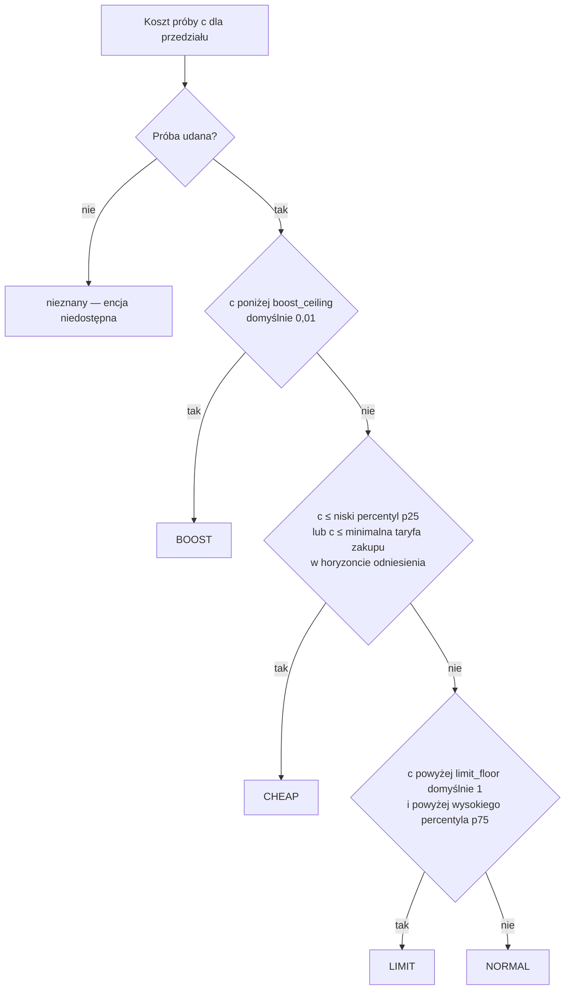

| Poziom | EN / PL | Warunek | Typowa sytuacja |
| --- | --- | --- | --- |
| `BOOST` | Boost / Zwiększone zużycie | Koszt ściśle poniżej `boost_ceiling` (domyślnie 0,01 waluty/kWh). | Energia darmowa lub ujemna: nadwyżka PV, której nie da się zmagazynować ani sprzedać, ujemne ceny. Włączaj, co się da. |
| `CHEAP` | Cheap / Tanio | Nie BOOST, a koszt ≤ `cheap_percentile` (domyślnie 25.) kosztów odniesienia **lub** ≤ minimalna taryfa zakupu w horyzoncie odniesienia. | Jedne z najtańszych godzin okna odniesienia. Dobry czas na odbiorniki elastyczne. |
| `LIMIT` | Limit / Ograniczenie | Koszt ściśle powyżej zarówno `limit_floor` (domyślnie 1 waluty/kWh), jak i `limit_percentile` (domyślnie 75.). | Drogi szczyt — dodatkowe zużycie wymusza drogi import albo traci cenny eksport. Odłóż. |
| `NORMAL` | Normal / Normalnie | Wszystko pozostałe. | Warunki przeciętne. |
| nieznany | — | Próba nieudana lub zabrakło czasu, albo przedział jest poza pokryciem prognozy. | Encja niedostępna; późniejsze okna mogą być znane. |

Percentyle liczone są z udanych prób w całym horyzoncie odniesienia (domyślnie 24 h) z interpolacją
liniową. Gdy nie powiedzie się pełna próba odniesienia, decyduje `short_coverage`:
`absolute_fallback` (domyślnie: zostają bezwzględne reguły BOOST/LIMIT i reguła CHEAP wg minimalnej
taryfy) albo `unavailable`.

**Ograniczenie: próby, które nie kończą się na czas.** Każda próba to pełne, dokładne obliczenie
całego horyzontu planowania i jest znana tylko wtedy, gdy skończy się w `probe_time_limit_s`
(domyślnie 2 s); próby liczone są jedna po drugiej w ramach `total_time_limit_s` (domyślnie 60 s).
Próba, która nie zdąży, pozostaje nieznana — nigdy nie jest zastępowana kosztem przybliżonym. Jedna
nieznana próba pełnego przedziału odniesienia wystarcza do użycia `short_coverage` (`reason` to
`reference_probe_failed`), a przedział, którego własna próba jest nieznana, nie ma poziomu.

Czas jednej próby zależy od strategii i od liczby przedziałów w horyzoncie planowania.
`self_sufficiency` i `backup_ready` utrzymują `SELF_CONSUME` przez całą noc, a reguła podążania za
obciążeniem wielokrotnie wydłuża ich próby. Próby ze znanym kosztem przy domyślnych limitach, cenach
kwadransowych i godzinnym przedziale wyświetlania, zmierzone na szybkim komputerze biurkowym (Apple
M4 Max):

| Horyzont planowania | `cost_min`, `pv_swap`, `max_export`, `grid_friendly` | `self_sufficiency` | `backup_ready` |
| --- | --- | --- | --- |
| 12 h (48 przedziałów), 12 prób | 12 z 12 | 12 z 12 | 12 z 12 |
| 24 h (96 przedziałów, domyślnie), 24 próby | 24 z 24 | 0 z 24 | 2 z 24 |
| 48 h (192 przedziały), 24 próby | 7–23 z 24 | żadna | żadna |

Przy `self_sufficiency` albo `backup_ready` poziomy zużycia są więc nieznane dla prawie każdego
przedziału już na domyślnym horyzoncie 24 h, a na horyzoncie 48 h żadna strategia nie kończy swoich
prób (przy przedziale wyświetlania 15 minut znanych jest 18–67 z 96). Przy 48 h plan bazowy tych
dwóch strategii dochodzi też do `solve_time_limit_s` i jest publikowany jako `time_limited`.
`minimum_mode_minutes = 0` nie znosi ograniczenia: przy 24 h znana jest 1 z 24 (`self_sufficiency`)
i od 8 do 17 z 24 (`backup_ready`) prób, czyli nadal `short_coverage`. Wolniejszy komputer, na przykład
Raspberry Pi, dochodzi do każdego z tych ograniczeń przy krótszym horyzoncie.

[Głębokość elastycznego zużycia](#głębokość-elastycznego-zużycia) podlega tym samym dwóm ustawieniom:
każde z jej pięciu obliczeń dostaje `probe_time_limit_s`, w ramach tego, co próby zostawiły z
`total_time_limit_s`. Przy `self_sufficiency` albo `backup_ready` i 24 h żadne z pięciu nie skończyło
się w domyślnych 2 s, więc głębokość jest nieznana (profile `UNKNOWN`, powód `timeout`); `cost_min`
przy 24 h i `self_sufficiency` przy 12 h dostały wszystkie pięć.

Co według pomiarów pomaga na tym samym komputerze, przy domyślnym horyzoncie 24 h:

- `backup_ready`: `probe_time_limit_s` 10 i `total_time_limit_s` 120 dały wszystkie 24 próby (47 s
  liczenia prób na każde przeliczenie) oraz, przy tym samym limicie próby, wszystkie pięć obliczeń
  głębokości elastycznego zużycia (kolejne 21 s). Przy `probe_time_limit_s` 5 jedna próba nadal się spóźniała
  i poziomy zostawały przy `short_coverage`.
- `self_sufficiency`: dopiero maksimum obu ustawień, `probe_time_limit_s` 30 i
  `total_time_limit_s` 300, dało wszystkie 24 próby, po 199 s liczenia prób na każde przeliczenie, a
  pięć obliczeń głębokości elastycznego zużycia zajęło kolejne 48 s. Nie zostawia to zapasu na
  wolniejszy komputer ani trudniejszy dzień.
- Horyzont planowania 12 h dał wszystkie 12 prób dla obu strategii przy domyślnych limitach, przy
  czym najwolniejsza próba `self_sufficiency` zajęła 1,5 s z limitu 2 s; plan patrzy wtedy tylko
  12 h naprzód.

Tabela, czasy poszczególnych prób i polecenie, które je odtwarza, są w
[`docs/runtime-validation.md`](runtime-validation.md#consumption-probe-limits).

## Okna i głębokość elastycznego zużycia

### Okna

Sąsiednie przedziały tego samego poziomu łączą się w okna. `next_boost_start`, `next_cheap_start`
i `next_limit_start` pokazują początek aktywnego lub następnego okna danego typu; `next_change` —
następny znany, inny poziom.

| Atrybut `status` | Warunek |
| --- | --- |
| `active` | Początek okna ≤ teraz < koniec. |
| `upcoming` | Okno zaczyna się później, w pokryciu prognozy. |
| `none_in_coverage` | Brak takiego okna w prognozie; encja niedostępna. |

`start_basis` ma wartość `forecast` albo `first_observed`, gdy już aktywne okno zachowuje pierwszy
zaobserwowany początek mimo przeliczeń i restartów. `next_change` zatrzymuje się na nieznanym
pokryciu zamiast zgadywać.

### Głębokość elastycznego zużycia

Odpowiada na pytanie: „ile energii odkładalnej mogę tanio zużyć?”. Solver niezależnie rozmieszcza
bloki 3, 5, 10, 15 i 20 kWh z mocą do `flexible_load_max_power_kw` (domyślnie 3 kW).

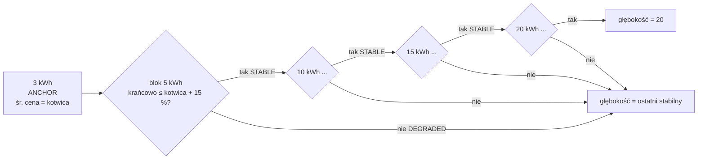

| Status profilu | Warunek |
| --- | --- |
| `ANCHOR` | Profil 3 kWh; jego średni koszt krańcowy to cena kotwicy. |
| `STABLE` | Krańcowy koszt bloku ≤ kotwica + `flexible_price_degradation_percent` (domyślnie 15 %) z \|kotwicy\|. |
| `DEGRADED` | Krańcowy koszt bloku powyżej progu — zatrzymuje publikowaną głębokość. |
| `UNKNOWN` | Nie policzono: `insufficient_time` (blok nie zmieści się przy maks. mocy w horyzoncie), `timeout` lub powód solvera. Zatrzymuje głębokość. |

Grupy: `small` (3/5 kWh), `medium` (10/15 kWh), `large` (20 kWh).

Blok, który nie ma rozwiązania na problemie, dla którego policzono plan, jest liczony ponownie na kolejnych
szczeblach drabiny tego planu (`HOLD` zobowiązania, potem plan bez zobowiązania), każdy względem planu tego
szczebla, więc poziom nigdy nie jest wyceniany względem planu innego problemu. Potrzebuje tego tylko
przeniesione zobowiązanie `CHARGE_PV`/`SELF_CONSUME`, którego plan leży na granicy pełnego akumulatora.
Dwa sąsiednie poziomy policzone na różnych szczeblach nie mają kosztu bloku między sobą, a poziom na innym
szczeblu niż pierwszy (kotwica) nie jest oceniany względem dozwolonej ceny kotwicy: oba mają status
`UNKNOWN`. Poziom jest publikowany z przyczyną, która go zakończyła: `infeasible` tylko wtedy, gdy żaden
z odwiedzonych szczebli nie miał rozwiązania, a przekroczenie czasu lub inny błąd solvera kończy go od razu
jako ten błąd.

## Strategie dyspozycji

`select.<name>_strategy` wybiera pakiet funkcji celu, którego używa solver. Każda strategia
zachowuje wszystkie twarde ograniczenia fizyczne; strategie zmieniają wyłącznie **wagi
planistyczne** i niewielki zestaw **flag polityk**. Raportowane koszty (`expected_net_cost`, koszt
zużycia) zawsze są w prawdziwej walucie — kary strategii nigdy się w nich nie pojawiają.

| Strategia | Etykieta EN / PL | Cel | Typowe użycie |
| --- | --- | --- | --- |
| `cost_min` | Cost minimisation / Minimalizacja kosztów | Najniższy koszt całkowity | Domyślna, na co dzień |
| `self_sufficiency` | Self-sufficiency / Samowystarczalność | Najmniej kWh z sieci | Płaskie ceny, preferencja niezależności, ceny zerowe/ujemne |
| `backup_ready` | Backup ready / Gotowość awaryjna | Duża rezerwa w baterii | Ostrzeżenie burzowe, planowana przerwa, zima |
| `pv_swap` | PV swap / Zamiana energii PV | Kup tanio w nocy, sprzedaj własne PV później | Mała zimowa produkcja PV i wyższa cena wieczorem |
| `max_export` | Maximum export / Maksymalny eksport | Arbitraż bez ograniczeń | Okna wysokich cen sprzedaży |
| `grid_friendly` | Grid friendly / Przyjazna dla sieci | Spłaszczenie szczytów importu/eksportu | Taryfy mocowe, słabe przyłącze |

### Co zmienia każda strategia

Solver minimalizuje

```text
grid     = Σ ( import_weight × buy × import + import_kwh_weight × import
               − export_weight × (sell − pv_export_margin) × export )
           + battery_export_penalty_per_kwh × battery_export
autonomy = soc_target_weight × Σ (najgłębszy niedobór w oknie poniżej progu autonomii)
peak     = peak_import_weight × max(moc importu)
caps     = cap_violation_weight × Σ (import/eksport ponad miękkie limity)
objective = grid + wear + progi epizodów + autonomy + peak + caps − terminal credit
```

| Strategia | Próg autonomii | Sprzedawaj tylko PV | Sufit ceny ładowania z sieci | Próg korzyści eksportu | Wagi |
| --- | --- | --- | --- | --- | --- |
| `cost_min` | wył. | ustawienie użytkownika | ustawienie użytkownika | ustawienie użytkownika | domyślne (tylko `import_penalty_per_kwh`) |
| `self_sufficiency` | **wł.** | ustawienie użytkownika | ustawienie użytkownika | ustawienie użytkownika | `import_kwh_weight` = max(5,0; max \|cena zakupu\| + 0,50; kara za import); kara za eksport z baterii 0,20/kWh |
| `backup_ready` | **wł.**, próg ≥ 80 % pojemności | ustawienie użytkownika | ustawienie użytkownika | ustawienie użytkownika | waga progu ≥ 2,0/kWh |
| `pv_swap` | **wł.** | **wymuszone wł.** | **wymuszone wył.** | ustawienie użytkownika | cena sprzedaży obniżona o marżę 0,05/kWh |
| `max_export` | **wył.** | **wymuszone wył.** | **wymuszone wył.** | **wymuszone 0** | domyślne |
| `grid_friendly` | **wył.** | ustawienie użytkownika | ustawienie użytkownika | ustawienie użytkownika | szczyt importu 0,50/kW, przekroczenie miękkiego limitu 2,0/kWh |

„Ustawienie użytkownika” oznacza, że strategia zostawia opcję tak, jak ją skonfigurowano.
Wartości **wymuszone** działają tylko dla opcji, których użytkownik nie ustawił jawnie: każda
opcja należąca do strategii, która różni się od wartości fabrycznej, trafia do
`explicit_strategy_fields` i pakiet nigdy jej nie nadpisuje.

Wszystkie liczby powyżej to domyślne wartości opcji Planowania:
`self_sufficiency_import_price_per_kwh` (5,0), `self_sufficiency_export_penalty_per_kwh` (0,20),
`backup_target_soc_percent` (80), `backup_shortfall_price_per_kwh` (2,0),
`pv_swap_margin_per_kwh` (0,05), `peak_import_price_per_kw` (0,50),
`cap_violation_price_per_kwh` (2,0), `grid_friendly_import_cap_kw` / `_export_cap_kw` (0 = limit
przyłącza), `autonomy_margin_per_kwh` (0,10).

### Próg autonomii (używany przez `self_sufficiency`, `backup_ready`, `pv_swap`)

Próg pyta: *czy bateria przeprowadzi dom przez następny okres, w którym zużycie przewyższa PV?*
Horyzont dzielony jest na okna wg skumulowanej nadwyżki netto; w każdym oknie cel wynosi

```text
soc_target[t] = min(pojemność użyteczna, rezerwa + (1 / η_rozładowania) × Σ deficytu do końca okna)
```

Najgłębszy niedobór poniżej celu jest liczony **raz na okno** z wagą `soc_target_weight` =
oczekiwana cena nocnego odkupu (mediana nocnych cen zakupu) + `autonomy_margin_per_kwh`. Próg
patrzy 48 h do przodu na prognozy PV/zużycia, nawet zanim zostaną opublikowane jutrzejsze ceny.
Jest **miękki**: naruszenie trafia do `autonomy_shortfall_kwh` planu zamiast dawać brak rozwiązania.
Wymaga źródła PV (inaczej `autonomy_floor_requires_pv`).

### Balansowanie LFP

Pakiety LFP potrzebują okresowego pełnego naładowania i krótkiego przetrzymania na górze, aby BMS
mógł zbalansować cele i ponownie wyzerować odczyt SOC. Przy włączonej opcji **Okresowe
balansowanie LFP** (`lfp_balance`) Energy Compass śledzi ostatnio zakończony balans i planuje
następny. Sam licznik dalej obserwuje SOC i przesuwa swój stan nawet przy wyłączonym
`lfp_balance` — ustawienie włącza tylko publikowanie okien balansu i encji diagnostycznej.

| Ustawienie | Domyślnie | Znaczenie |
| --- | --- | --- |
| `balance_interval_days` | 7 | Dni między zakończonymi balansami |
| `balance_hold_minutes` | 60 | Minuty, które SOC musi utrzymać na/ponad progiem |
| `balance_soc_threshold` | 99 % | SOC uznawany za pełny |
| `balance_value` | 5,0 | Wartość zbalansowania w dniu terminu |

Balans **kończy się**, gdy SOC utrzymuje się na/ponad progiem przez cały czas trzymania. Odczyt
poniżej progu resetuje trzymanie. Liczy się tylko zaobserwowany czas: niedostępny lub nieaktualny
SOC nie daje zaliczenia, a dwa pełne odczyty odległe o więcej niż `soc_max_age_seconds` zaczynają
trzymanie od nowa od późniejszego z nich (trzymanie, którego ostatni pełny odczyt jest starszy,
nie trwa ani się nie kończy). Zakończenie jest oceniane leniwie — dopóki napływają pełne odczyty,
trzymanie kończy się przy najbliższym sprawdzeniu, bez potrzeby zmiany stanu. Fazy: `ok` →
`eligible` (wcześniejsze z: 2 dni lub pół odstępu przed terminem) → `due`; `holding` nakłada się
na aktywną fazę podczas trwania trzymania. Trzymanie, które zaczyna się, gdy balans jest jeszcze
w fazie `ok` (np. SOC znów 100 % dzień po balansie), jest śledzone i się kończy, ale nie jest
planowane: optymalizator nie dostaje dla niego okna ani kosztu pominięcia.

Optymalizator może wybrać jedno okno trzymania wyrównane do pełnej godziny: kandydujące okna
zaczynają się tylko o pełnej godzinie, a w fazie `due` — tylko w ciągu następnych 24 h (faza
`eligible` może szukać w całym horyzoncie). W wybranym oknie SOC utrzymuje się na/ponad progiem, a
bateria się nie rozładowuje. Pominięcie kosztuje 10 % `balance_value` w fazie eligible — mało,
więc planista zwykle balansuje tylko na taniej lub darmowej energii, ale wybierze okno z siecią,
jeśli kosztuje mniej — `balance_value × (1 + dni po terminie)` w fazie due i 10 × `balance_value`
podczas trzymania w fazie eligible lub due. Okno jest publikowane jako **CHARGE_PV** tylko wtedy,
gdy PV pokrywa zużycie w każdym jego przedziale; w przeciwnym razie (okno mieszane PV/sieć albo
czysto sieciowe, np. nocne) jako **CHARGE_GRID**, co dodatkowo wymaga, aby ładowanie z sieci było
dozwolone i (jeśli włączony) sufit ceny ładowania z sieci był zachowany w każdym przedziale — z
`balance_hold: true` w każdym wierszu. Z opcjonalnym
[pesymistycznym źródłem PV](#pesymistyczne-pv-dla-okna-balansu) test PV jest ostrzejszy. Od przedziału przed najwcześniejszym
kandydującym oknem do końca horyzontu energia baterii może wzrosnąć aż do pełnej pojemności, a nie
tylko do skonfigurowanego sufitu SOC, więc trzymanie nie jest blokowane przez `soc_ceiling` poniżej
100 % — to podniesienie ma znaczenie tylko wtedy, gdy sufit jest poniżej 100 %. Próby zużycia
utrzymują wybrane okno bez zmian, aby dodatkowe obciążenie wyceniało zużycie, a nie wybór balansu.

Diagnostyczny sensor **Balansowanie baterii** (`sensor.<name>_battery_balance`) zgłasza `ok`,
`eligible`, `scheduled`, `holding` lub `overdue`, z atrybutami `last_completed`, `next_due`,
`days_overdue`, `planned_start`, `planned_end`, `planned_mode`, `pv_series`, `hold_progress_minutes`,
`hold_required_minutes`, `threshold_percent`.

#### Pesymistyczne PV dla okna balansu

Okno balansu jest wybierane na medianie prognozy PV, więc dzień z niskim PV może zostawić baterię poniżej
progu i balans znów przepada. **Źródła danych → Dodaj źródło → PV pesymistyczna (opcjonalna)** wiąże
drugą, niższą prognozę tej samej instalacji (dla Solcast to `pv_estimate10`; presety Solcast proponują to
pole). Używa tego samego mapowania prognozy przedziałowej co źródło PV; **Przegląd i edycja źródeł**
wyświetla je, edytuje, rozszerza o kontynuację i usuwa. Wymaga włączonego PV. Może towarzyszyć każdemu
rodzajowi źródła PV; prognoza PV z panelu Energia nie ma serii pesymistycznej, więc to źródło wiąże się osobno.

Po skonfigurowaniu okno **CHARGE_PV** jest proponowane tylko wtedy, gdy na serii pesymistycznej spełnione
są oba warunki:

1. Bateria: ładowanie samą nadwyżką PV (`pv − zużycie`, ze sprawnością `eta_charge` i mocą `charge_kw`,
   bez rozładowania) podnosi baterię do progu balansu przed początkiem okna.
2. Okno: PV pokrywa zużycie w każdym przedziale okna.

W przeciwnym razie ten start jest proponowany wyłącznie jako **CHARGE_GRID**, według zwykłych zasad
ładowania z sieci i sufitu ceny, więc solver może wybrać tanie okno sieciowe. Sam plan dyspozycji nadal
używa serii mediany. Bez tego źródła nic się nie zmienia.

Solver wycenia każde okno na serii mediany, gdzie nadwyżka PV może pokryć odrzucone okno
**CHARGE_GRID**, więc kilka startów kosztowałoby tyle samo. Żeby o wyborze nie decydował przypadek
kończący się w drogim przedziale, każde okno **CHARGE_GRID** proponowane przy obecnej serii
pesymistycznej (także takie, które jest **CHARGE_GRID** już na samej serii mediany) ma koszt rankingowy: energia, którą seria
pesymistyczna zostawia sieci, czyli to, czego baterii nadal brakuje do progu na starcie okna, plus
zużycie niepokryte przez PV w obrębie okna, po cenach zakupu z okna. Solver dolicza do kosztu okna 5 %
jego nadwyżki ponad najtańsze okno, które solver może wybrać, więc okno, które seria pesymistyczna nadal wspiera
(**CHARGE_PV**), wygrywa z odrzuconym, a wśród odrzuconych wygrywa najtańsze. Dopłata nie przekracza
połowy kosztu pominięcia balansu. Okno ze startem 0, do którego bateria nie dotrze (zaczyna poniżej
progu), jest pomijane w tym porównaniu, więc nie przesuwa pozostałych okien w stronę pominięcia;
ranking może jednak przeważyć w bliskim przypadku przeciw balansowi. To preferencja, nie ścisły
rozstrzygacz remisów: start tańszy na serii mediany o więcej niż 5 % różnicy kosztu rankingowego nadal
wygrywa. Nie wchodzi do kosztu planu.

Uwaga: test baterii liczy wyłącznie nadwyżkę PV. Start, do którego bateria dotarłaby dopiero po
naładowaniu z sieci przed oknem, jest proponowany tylko jako **CHARGE_GRID** i odpada, gdy sufit ceny
ładowania z sieci blokuje przedział okna — wtedy może pojawić się `balance_no_window_in_horizon` tam, gdzie
bez tego źródła okno istniało.

Atrybut `pv_series` sensora Balansowanie baterii oraz atrybut `balance_pv_series` sensora planu podają,
która seria zdecydowała o oknach kandydujących: `pessimistic`, gdy źródło jest skonfigurowane i
użyteczne, w przeciwnym razie `median` (także bez źródła); `null`, gdy `lfp_balance` jest wyłączone lub
nie ma baterii. Źródło jest wejściem opcjonalnym i nigdy nie unieważnia planu. Gdy jest niedostępne,
nieaktualne, błędne, ujemne lub nie pokrywa horyzontu, okna wracają do serii mediany, a plan niesie
ostrzeżenie `balance_pessimistic_pv_unavailable`. Zestarzenie się źródła nie wywołuje zmiany stanu, więc
powrót do mediany następuje przy najbliższym okresowym przeliczeniu (`refresh_minutes`) lub zmianie
źródła.

### `cost_min` — minimalizacja kosztów

- **Cel:** najniższy prognozowany koszt: zakupy − sprzedaż + zużycie baterii − wartość końcowa.
- **Zmiany:** żadne; bajt w bajt ten sam model co bazowy, gdy `import_penalty_per_kwh = 0`.
- **Zachowanie:** ładuje, gdy energia jest tania (z sieci lub PV), rozładowuje w drogich godzinach,
  eksportuje tylko gdy różnica cen pokrywa straty, zużycie baterii i próg korzyści eksportu.
- **Wybierz, gdy:** normalna praca na co dzień; to strategia domyślna i awaryjna w blueprincie.
- **Uwaga:** bez rezerwy autonomii może zostawić baterię nisko przed pozornie tanią nocą, jeśli
  prognoza się myli.

### `self_sufficiency` — samowystarczalność

- **Cel:** minimalizacja **kWh z sieci**, nie pieniędzy.
- **Zmiany:** każda importowana kWh kosztuje co najmniej `max(5,0; najwyższa |cena zakupu| + 0,50;
  import_penalty_per_kwh)`, więc import zawsze dominuje nad różnicami cen; eksport z baterii
  kosztuje dodatkowo 0,20/kWh; próg autonomii włączony.
- **Zachowanie:** ładuje baterię z PV, unika ładowania z sieci i eksportu z baterii, trzyma energię
  na następne okno deficytu.
- **Wybierz, gdy:** różnica cen dzień/noc jest mała (blueprint wybiera ją przy różnicy poniżej
  0,15 PLN/kWh), ceny są zerowe lub ujemne, albo niezależność jest ważniejsza niż koszt.
- **Uwaga:** raportowane koszty są prawdziwe — ta strategia może kosztować więcej niż `cost_min`.

### `backup_ready` — gotowość awaryjna

- **Cel:** utrzymać dużą rezerwę na wypadek awarii sieci.
- **Zmiany:** próg autonomii włączony i podniesiony do co najmniej `backup_target_soc_percent`
  (80 %) pojemności; jego waga wynosi co najmniej `backup_shortfall_price_per_kwh` (2,0/kWh).
- **Zachowanie:** doładowuje do ok. 80 % i nie schodzi niżej, chyba że niedobór jest wart więcej
  niż 2,0/kWh; próg jest miękki, więc plan zawsze istnieje.
- **Wybierz, gdy:** ostrzeżenia burzowe lub o przerwach w dostawie, planowane prace, mroźne noce.
  Reguła `alert` blueprintu wybiera ją, gdy Twoja encja alertu jest włączona.
- **Uwaga:** połączenie z niskim sufitem ceny ładowania z sieci daje ostrzeżenie
  `grid_charge_ceiling_below_autonomy_weight` — próg mógłby zostać opróżniony, ale nigdy
  uzupełniony.

### `pv_swap` — zamiana energii PV

- **Cel:** w sezonie niskiej produkcji kupić tanio w nocy i sprzedać rzeczywistą dzienną produkcję
  PV później, po wyższej cenie.
- **Zmiany:** od każdej ceny sprzedaży odejmowana jest marża `pv_export_margin` (0,05/kWh) — eksport
  musi pobić nocny zakup co najmniej o nią; **Sell only PV wymuszone** (dzienny eksport ≤
  dzienna produkcja PV); **sufit ceny ładowania z sieci wymuszony wył.** (nocne ładowanie nie
  jest blokowane); próg autonomii włączony.
- **Zachowanie:** ładuje z sieci w nocy, dzienne PV pokrywa dom, wieczorem w szczycie eksportuje do
  wysokości dziennej produkcji PV.
- **Wybierz, gdy:** jutrzejsza prognoza PV jest mniejsza niż dzienne zużycie i `wieczorna cena
  sprzedaży × sprawność cyklu ≥ nocna cena zakupu + marża` (reguła `pv_swap` blueprintu).
- **Uwaga:** Sell only PV liczy energię, nie jej pochodzenie — eksport z baterii jest
  ograniczony łącznie do dziennej produkcji PV, bez śledzenia źródła.

### `max_export` — maksymalny eksport

- **Cel:** czysty arbitraż, maksymalny przychód z eksportu.
- **Zmiany:** **próg korzyści eksportu wymuszony na 0**, **Sell only PV wymuszone
  wył.** (energię z sieci można odsprzedać), **sufit ceny ładowania z sieci wymuszony wył.**, próg
  autonomii wyłączony.
- **Zachowanie:** ładuje, gdy zakup jest tani, rozładowuje do sieci, gdy różnica pokrywa straty i
  zużycie baterii; może robić kilka epizodów eksportu dziennie.
- **Wybierz, gdy:** wyjątkowe ceny sprzedaży, taryfa nagradzająca eksport.
- **Uwaga:** najwięcej cykli baterii; sprawdź, czy umowa pozwala odsprzedawać energię z sieci.
  Nigdy nie jest wybierana automatycznie.

### `grid_friendly` — przyjazna dla sieci

- **Cel:** spłaszczyć profil sieci — unikać wysokich szczytów importu i ograniczyć moc eksportu.
- **Zmiany:** składnik szczytu importu `peak_import_price_per_kw` (0,50/kW najwyższej mocy importu);
  miękkie limity importu/eksportu `grid_friendly_import_cap_kw` / `grid_friendly_export_cap_kw`
  (0 = limit przyłącza), każda kWh ponad nie kosztuje `cap_violation_price_per_kwh` (2,0); próg
  autonomii wyłączony.
- **Zachowanie:** rozkłada ładowanie z sieci na dłuższe okna, ścina szczyty importu baterią,
  utrzymuje eksport poniżej limitu.
- **Wybierz, gdy:** taryfy mocowe, słabe przyłącze lub zabezpieczenie blisko limitu.
- **Uwaga:** limity są miękkie; nadmiar trafia do `cap_violation_kwh` zamiast błędu. Nigdy nie
  jest wybierana automatycznie.

### Atrybuty planu związane ze strategią

| Atrybut | Znaczenie |
| --- | --- |
| `strategy` | Strategia, która wyprodukowała ten plan (może chwilowo różnić się od selecta w trakcie przeliczenia). |
| `autonomy_shortfall_kwh` | Łączny niedobór poniżej progu autonomii; `0` = próg spełniony. |
| `peak_reserve_shortfall_kwh` | Łączny niedobór poniżej [zapasu na drogie okresy](#zapas-na-drogie-okresy), zapasu na wejściu i zapasu pod eksportem razem; `0` = spełniony lub wyłączony. |
| `time_limited` | `true`, gdy rozwiązanie bazowe osiągnęło `solve_time_limit_s` i zamiast udowodnionego optimum opublikowano najlepsze dotąd znalezione, zwalidowane rozwiązanie. |
| `mip_gap` | Względna luka MIP zgłoszona przez solver dla opublikowanego planu: `0` = udowodnione optimum (udowodniony plan zwykle ma `0` albo najwyżej `0.0001`, gdy żaden próg epizodu nie jest aktywny; to nie twarda granica: HiGHS zatrzymuje się też na luce bezwzględnej `1e-6`, której nie da się wyłączyć, więc gdy [cel ważony, który minimalizuje solver](#co-zmienia-każda-strategia), mieści się w granicach około ±0,01 od zera, luka względna może być większa, do około `1e-6 / |cel|`, czyli powyżej 1, gdy cel jest bliżej zera niż `1e-6`; ten cel to koszt planu plus rezerwy epizodów i kary strategii, więc może być bliski zera, gdy koszt planu nie jest, i odwrotnie; udowodniony plan od nieudowodnionego odróżnia `time_limited`, nie `mip_gap == 0`); dla planu `time_limited` górna granica odległości ważonego celu solvera od optimum (np. `0.017` = 1,7 %). Nie ogranicza kosztu planu w walucie, a sam plan może różnić się od udowodnionego w wielu interwałach (zob. [`docs/runtime-validation.md`](runtime-validation.md#how-far-the-time-limit-leaves-the-plan-from-the-proof)). |
| `cap_violation_kwh` | Łączna energia ponad miękkie limity `grid_friendly`; `0` = limity spełnione. |

### Zwolnienie przy zmianie strategii

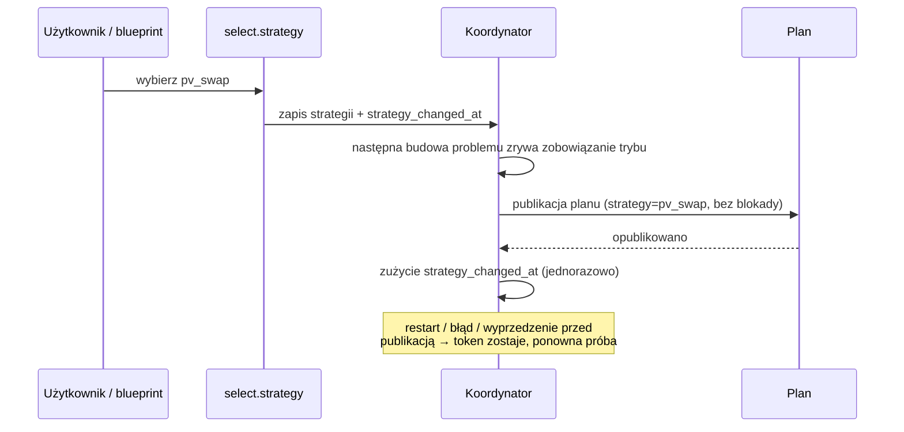

Zmiana strategii to **reset**: przeniesione zobowiązanie trybu jest zwalniane, aby nowa strategia
nie utknęła w minimalnym czasie starego trybu. Trwający epizod eksportu jest zachowany, żeby jego
próg nie został naliczony dwa razy.

## Automatyczne przełączanie strategii

Opcjonalny blueprint [`strategy_switch.yaml`](../blueprints/automation/energy_compass/strategy_switch.yaml)
wybiera jedną strategię na dobę. Działa o **14:05** (po publikacji cen RCE na następny dzień i
Solcast), ponawia co godzinę do **20:00**, jeśli brak cen na jutro, a przy starcie Home Assistant
dokańcza przerwany zapis.

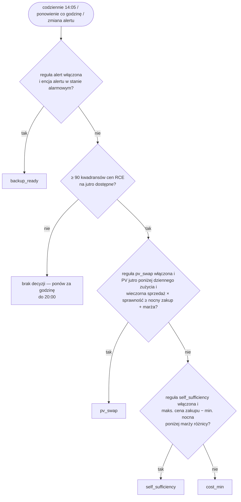

| Parametr | Domyślnie |
| --- | --- |
| Okno nocne | 22:00–06:00 (najniższa cena zakupu w przedziałach planu) |
| Maks. cena zakupu | najwyższa cena zakupu we wszystkich przedziałach planu |
| Okno wieczorne | 17:00–21:00 (najwyższa cena sprzedaży RCE na jutro) |
| Sprawność cyklu (round-trip) | 0,90 |
| Marża różnicy dla samowystarczalności | 0,15 PLN/kWh |
| Marża zamiany PV | 0,05 PLN/kWh |
| Włączone reguły | `alert`, `pv_swap`, `self_sufficiency` (`cost_min` to wartość awaryjna) |

**Ręczna** zmiana selecta blokuje reguły ekonomiczne do następnego udanego uruchomienia
planowego; reguła alertu nigdy nie jest blokowana. `max_export` i `grid_friendly` wybiera się
wyłącznie ręcznie. Konfiguracja: [przewodnik instalacji](installation.md#import-the-strategy-switch-blueprint)
(EN).

## Powiadomienia o oknach

Opcjonalny blueprint [`notifications.yaml`](../blueprints/automation/energy_compass/notifications.yaml)
informuje domowników, kiedy dodatkowe zużycie jest tanie (okno korzystne) albo kiedy zaczyna się
drogie okno `LIMIT`. Sam Energy Compass niczego nie wysyła; głównym przełącznikiem jest
**Włącz powiadomienia** w opcjach integracji. Konfiguracja:
[przewodnik instalacji](installation.md#opt-in-notifications) (EN).

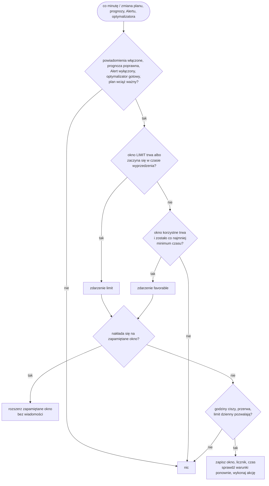

| Wiadomość | Kiedy |
| --- | --- |
| **Wykorzystaj tanią energię** / *Use the cheap energy* | trwa okno korzystne i cała jego reszta to `BOOST` |
| **Dobry moment na domowe urządzenia** / *A good time for household appliances* | trwa okno korzystne, nie w całości `BOOST` |
| **Zaplanuj większe zużycie na później** / *Plan heavy use for later* | okno `LIMIT` zaczyna się w czasie wyprzedzenia albo już trwa |

Treść podaje lokalne godziny okna i proponuje przełożenie prania, zmywarki lub ładowania auta.
Akcja dostaje `notification_title`, `notification_message` i `event_kind`.

| Wejście | Znaczenie |
| --- | --- |
| `compass`, `plan`, `forecast_valid`, `alert`, `optimizer_status` | Kompas zużycia, Plan, Poprawna prognoza, Alert i Stan optymalizatora jednej instalacji |
| `next_boost`, `next_cheap`, `next_limit` | trzy sensory początków okien (ich zmiana uruchamia automatyzację) |
| `last_favorable`, `last_limit` | pomocniki tekstowe (maks. 255) z ostatnim oknem jako `{"s": początek, "e": koniec}` |
| `daily_count`, `daily_date`, `last_sent` | pomocnik liczbowy i dwa pomocniki daty/czasu dla limitu dziennego i przerwy |
| `language` | `en` albo `pl` dla tytułu i treści |
| `use_blueprint_overrides` | wyłączone: preferencje powiadomień z integracji; włączone: wejścia poniżej |
| `enabled_events`, `minimum_hours`, `limit_lead_minutes`, `quiet_start`, `quiet_end`, `cooldown_minutes`, `daily_cap` | nadpisania: zdarzenia, minimalny pozostały czas okna korzystnego, wyprzedzenie LIMIT, godziny ciszy, przerwa, wiadomości na lokalną dobę |
| `notification_actions` | akcja do wykonania, np. powiadomienie aplikacji mobilnej |

## Karta kosztów

Opcjonalna karta `custom:energy-compass-cost-card` ([`cards/cost/`](../cards/cost/)) pokazuje koszt
zakupu energii z sieci, wartość energii oddanej (depozyt prosumencki w polskim net-billingu) i bilans
**zakup − depozyt**: dziś z pomiarów i planu do północy, a miesiąc i rok ze statystyk. Instalacja
i pełny opis: [przewodnik karty kosztów](cost-card.md) (EN).

| Klucz | Znaczenie |
| --- | --- |
| `cost_entity`, `import_entity`, `export_entity` | koszt zakupu (statystyki), energia pobrana i oddana (kWh) — wymagane |
| `plan_entity`, `valid_entity`, `export_prices_entity` | Plan, Poprawna prognoza i prognoza ceny sprzedaży (`prices`) — wymagane |
| `import_price_entity` | cena zakupu do uzupełnienia luki w koszcie po restarcie |
| `deposit_entity`, `deposit_backfill` | sensor wartości eksportu i statystyka historii z backfillu, dla miesiąca i roku |
| `runtime_entity`, `mode_entity` | stan i tryb sterownika Deye, żeby pokazać, czy plan jest wykonywany |
| `currency`, `language`, `tariff_label`, `footnote` | prezentacja |

Depozyt miesięczny i roczny pochodzi z [blueprintu licznika wartości eksportu](../blueprints/automation/energy_compass/export_value_counter.yaml):
dodaje każdy przyrost licznika eksportu (`export_energy`), wyceniony według prognozy ceny
(`export_prices`), do pomocnika liczbowego (`counter`); skoki powyżej `max_step_kwh` są pomijane.

## Sterownik falownika Deye (Solarman)

Energy Compass jest domyślnie doradczy i zapisuje do falownika tylko wtedy, gdy włączysz opcjonalny sterownik
Deye (**Opcje → Sterownik Deye**, domyślnie wyłączony). Sterownik wykonuje plan na hybrydowym falowniku Deye przez
[integrację Solarman](https://github.com/davidrapan/ha-solarman): zapisuje trzy prądy baterii i sześć programów
czasowych (TOU), a każdy zapis sprawdza odczytem rejestrów. **Silnik natywny** działa wewnątrz integracji: nie
trzeba blueprintu, automatyzacji, pakietu, pomocników ani zmian w `configuration.yaml`, zaakceptowany plan
przeżywa przeładowanie wpisu, a Energy Compass prowadzi tryb, zaakceptowany plan, sesję i unieważnienia,
wyznacza czas kolejnego przebiegu i przechowuje stan pracy. Wymaga Energy Compass 0.1.38 lub nowszego. Instalację opisuje
[przewodnik instalacji](installation.md#deye-inverter-controller) (EN). Profil startowy
`deye_hybrid` wypełnia `idle_drain_kw` 0,13 i `refresh_minutes` 60 dla nowej instalacji; zob.
[Profile startowe](#profile-startowe-nowe-instalacje).

Dotychczasowy wykonawca, blueprint
[`deye_solarman_controller.yaml`](../blueprints/automation/energy_compass/deye_solarman_controller.yaml), jest
**przestarzały**. W tym wydaniu nadal działa jako silnik `blueprint` (wartość każdego wpisu utworzonego przed
0.1.38), a zostanie usunięty w wydaniu po następnym, razem ze swoim generatorem `tools/deye_controller/build.py`,
usługami `energy_compass.controller_runtime` i `energy_compass.controller_import_package` oraz opisującymi go
sekcjami poniżej. Przejdź na silnik natywny według sekcji
[Migracja z blueprintu na silnik natywny](#migracja-z-blueprintu-na-silnik-natywny).

### Włączenie sterownika

Otwórz **Opcje → Sterownik Deye**, włącz **Włącz sterownik Deye** i wybierz urządzenie falownika
Solarman (gdy jest tylko jedno, jest wstępnie wybrane). Energy Compass znajduje na tym urządzeniu
sześć programów TOU (czas, moc, napięcie, SOC i ładowanie, razem 30 encji) po kluczach tłumaczeń Solarman
`program_1_time` … `program_6_charging`, wyznacza wspólny prefiks identyfikatorów i je śledzi.
Odrzuca urządzenie, gdy brakuje programu lub jest wyłączony, gdy identyfikatory encji nie mają
wspólnego prefiksu albo gdy inny wpis Energy Compass już steruje tym urządzeniem. Włączenie przeładowuje
wpis raz; przeniesienie sterownika na inne urządzenie działa na żywo. Oba są odrzucane, gdy tryb nie jest `Off` albo oczekuje przywrócenie: najpierw wybierz `Off` i poczekaj, aż `restore_pending` wygaśnie, bo inaczej nic nie przywróci profilu bazowego. Krok jest widoczny bez przełącznika
ustawień eksperckich.

**Silnik.** Krok ma pole **Silnik**. `native` (domyślny przy nowym włączeniu) pozwala Energy Compass samemu
wykonywać plan i zapisywać falownik przez encje Solarman oraz usługę `solarman.read_holding_registers`; blueprint ani
automatyzacja nie są potrzebne. `blueprint` (przestarzały; wartość każdego wpisu utworzonego przed 0.1.38) zostawia
wykonanie blueprintowi sterownika Deye. Zmiana silnika przeładowuje wpis i jest odrzucana, gdy tryb nie jest `Off` albo
oczekuje przywrócenie. Silnik natywny znajduje prądy baterii, tryb pracy, SOC, napięcie i licznik rozładowania na tym samym
urządzeniu po kluczach Solarman `battery_max_charging_current`, `battery_max_discharging_current`,
`battery_grid_charging_current`, `battery_operation_mode`, `battery`, `battery_voltage` i `total_battery_discharge` oraz
wskazuje, czego brakuje. Obsługiwane są tylko pakiety wysokonapięciowe (400–610 V): pakiet zmierzony poniżej 400 V jest odrzucany.

**Limity i przejęcie** (ustawienia eksperckie). Maksymalna moc baterii domyślnie to mniejsza z mocy ładowania
i rozładowania z ustawień Energy Compass; prądy domyślnie wynoszą maksimum encji, ograniczone tą mocą podzieloną przez 400 V.
Można ustawić prądy HOLD, po osiągnięciu celu rozładowania i balansowania, sufit napięcia ładowania z sieci, zatwierdzone tryby
baterii, dawne automatyzacje, na które sterownik czeka, encje telemetrii, licznik rozładowania i nadpisanie każdej encji; puste
pole zachowuje wartość domyślną. Limity działają od następnego przebiegu bez przeładowania. Gdy istnieje jedna automatyzacja
blueprintu, jej wejścia są wczytywane do tych pól do sprawdzenia przed zapisem.

Nie włączaj sterownika w instalacji z opustem: właściwym planem jest tam własny tryb autokonsumpcji
falownika (zob. [Profile startowe](#profile-startowe-nowe-instalacje)).

Instalacja, która używała pakietu 0.1.36, ma jeden wpis Energy Compass i dokładnie jedno urządzenie Solarman
ze wszystkimi sześcioma programami, dostaje sterownik włączony automatycznie przy pierwszym starcie
0.1.37. Tryb zaczyna od `Off`, więc nic się nie zapisuje, dopóki go nie wybierzesz; zob.
[Migracja z pakietu](#migracja-z-pakietu-0136-i-starsze).

### Obsługiwany sprzęt

| Co | Zweryfikowane |
| --- | --- |
| Falownik | trójfazowe hybrydowe falowniki wysokonapięciowe Deye `SG0*HP3`; sensor `device` Solarman podaje typ „HV 3-Phase Hybrid Inverter” |
| Wersja protokołu | 1.4 (atrybut `Protocol Version` tego sensora) |
| Pakiet baterii | wysokonapięciowy pakiet litowy (LFP), 400–610 V |
| Integracja | [ha-solarman](https://github.com/davidrapan/ha-solarman) 25.08.16; encje są znajdowane po kluczach tłumaczeń, a rejestry czytane usługą `solarman.read_holding_registers` |
| Modele Deye 48 V (niskonapięciowe) | **jeszcze nieobsługiwane**: krok opcji odmawia włączenia silnika natywnego poniżej 400 V, a przebieg poza 400–610 V niczego nie zapisuje |

Przetestowany egzemplarz to `SG0*HP3` z oprogramowaniem płyty sterującej `3002-1095-11408`. Wersje oprogramowania
są zapisywane w atrybucie `hardware`, ale nie są porównywane: o różnicach między wersjami nic nie wiadomo.
Urządzenie, którego typ i protokół nie są na liście, nie jest blokowane. Zgłasza problem „Falownik Deye
niezweryfikowany” (ostrzeżenie, które można zamknąć) i ustawia `hardware.verified` na `false`; użyj najpierw
Simulation, jak przy każdej instalacji.

**Kontrola układu rejestrów.** Przed pierwszym zapisem wymuszającym profil w sesji silnik natywny czyta rejestry
108–177 i porównuje je ze stanami 27 encji, które zapisuje (trzy prądy i 24 wartości TOU). Liczby i selecty muszą się
zgadzać; select, którego rejestr ma wartość spoza znanej mapy (`Disabled`, `Grid`, `Sell`), nic nie mówi o układzie
i jest pomijany, bo sterownik i tak go nadpisuje. Każda inna różnica, brakujący rejestr lub niedostępna encja
zatrzymuje przebieg z kodem `blocked` i powodem `layout_mismatch`, który wymienia encje; nic nie jest zapisywane,
a kontrola powtarza się w kolejnym przebiegu, bo encje mogą o jeden odczyt Solarman opóźniać się za ręczną zmianą.
Kontrola działa też w Simulation, więc zły układ widać przed Auto. Zaliczona kontrola obowiązuje dla sesji,
urządzenia i zestawu odczytywanych encji: zmiana urządzenia lub nadpisanie encji uruchamia ją od nowa. Przywrócenie
profilu bazowego nie czeka na kontrolę, bo zapisuje przez własne encje Solarman, a od układu zależy tylko odczyt
potwierdzający; wymuszenie profilu czeka.

### Encje sterownika

Trzy encje istnieją tylko przy włączonym sterowniku, czwarta przy silniku natywnym; należą do urządzenia
Energy Compass. `<name>` to tytuł wpisu.

| Klucz | Encja | Rola |
| --- | --- | --- |
| `deye_controller` | `sensor.<name>_deye_controller` (znacznik czasu) | stan to najbliższa chwila, w której wykonawca musi działać (najwcześniejszy koniec wiersza, `valid_until`, `coverage_end` albo granica programu TOU); atrybuty to poniższy kontrakt |
| `deye_mode` | `select.<name>_deye_mode` | **Off** / **Simulation** / **Auto**; jedyny przełącznik obsługiwany ręcznie; opcje nie są tłumaczone |
| `deye_runtime` | `sensor.<name>_deye_controller_runtime` | kod przebiegu (niżej); atrybut `runtime` zawiera stan, powód, potwierdzone wartości i niepewne rejestry |
| `deye_pause` | `switch.<name>_pause_inverter_writes` | **Wstrzymaj zapisy do falownika**; tylko przy silniku natywnym. Gdy włączony, sterownik liczy i publikuje decyzję, ale nie wysyła żadnego zapisu; `restore_pending` i niepewne rejestry pozostają bez zmian, a kod stanu to `paused`. Przebieg w toku zatrzymuje się przed kolejnym zapisem; wyłączenie przełącznika zleca przebieg. Tryb `Off` zachowuje znaczenie: gdy nie ma czego przywracać, przebieg zgłasza zwolnienie także przy pauzie, a gdy przywrócenie oczekuje, pauza wygrywa i przywrócenie czeka. Flaga jest zapisywana od razu, przeżywa przeładowanie i jest zerowana po przełączeniu silnika na `blueprint` |

Identyfikatory zależą od nazwy wpisu i języka, w którym encje utworzono (instalacja polska dostaje nazwy
w rodzaju `…_sterownik_deye`); odczytaj je ze strony urządzenia. Silnik blueprintowy potrzebuje tylko sensora
sterownika; encję trybu i prefiks TOU znajduje w jego atrybutach.

| Atrybut sterownika | Znaczenie |
| --- | --- |
| `controller_schema` | `1`; blueprint odrzuca sterownik z innym schematem |
| `mode`, `mode_entity` | tryb (odbity z selecta, więc zmiana uruchamia blueprint) i identyfikator encji selecta |
| `restore_pending` | włączony od pierwszego zapisu do ponownego potwierdzenia profilu bazowego |
| `session` | znacznik sesji tego uruchomienia Home Assistant (znacznik czasu, liczba) |
| `plan_reason` | czy zaakceptowany plan wolno wykonać: `ok`, `session`, `revoked` albo `sources` (niżej) |
| `status` | stan optymalizatora ostatniej publikacji |
| `retained` | ostatnia publikacja to zachowany plan (status `calculating`) |
| `generation`, `valid_until`, `coverage_end`, `accepted_at` | zaakceptowany plan: `generated_at`, pierwotny termin, koniec ostatniego przedziału i czas akceptacji |
| `revoked_generation`, `revoked_at`, `revoked_reason` | ostatnie unieważnienie |
| `capacity_kwh`, `eta_charge`, `eta_discharge`, `charge_kw`, `discharge_kw` | parametry baterii zaakceptowanej generacji (bieżące ustawienia, gdy nic nie jest zaakceptowane) |
| `device_id`, `program_prefix`, `tou_problem` | wybrane urządzenie Solarman, prefiks encji TOU i powód niepowodzenia (`tou_incomplete`, `tou_prefix`) |
| `next_tou` | najbliższa lokalna granica programu TOU |
| `accepted` | zaakceptowany plan (wiersze, polityka dyspozycji, bateria); nie jest zapisywany w historii |
| `tou` | stany 30 encji TOU; zmiana uruchamia blueprint ponownie; nie jest zapisywany w historii |
| `hardware` | falownik według sensora `device` Solarman: typ urządzenia, protokół, oprogramowanie płyty sterującej i komunikacyjnej, moc znamionowa, model z rejestru urządzeń oraz `verified` (para typ i protokół jest na [liście przetestowanych](#obsługiwany-sprzęt)); bez numeru seryjnego |

Sensor stanu pracy ma zapisywane atrybuty `restore_pending`, `reason`, `state`, `requested_mode`,
`confirmed_mode`, `since`, `warning`, `takeover_blocked` i `accepted_generation` oraz `runtime`
i `updated_at`, które nie trafiają do historii. Jest zapisywany od razu, gdy zmieni się kod albo któryś
z zapisywanych atrybutów, a inne zmiany najwyżej raz na minutę. Akceptacje, unieważnienia, porzucenia
sesji, zmiany trybu, importy i zmiany urządzenia trafiają do historii 50 wpisów w magazynie i w
diagnostyce integracji (`deye_controller`); zdarzenia nie są wysyłane.

Przy silniku natywnym sensor stanu pracy ma też `last_run` (nie jest zapisywany w historii): co uruchomiło ostatni
przebieg, decyzję, planowane polecenia, każdy zapis z wynikiem (wysłany, nieudany, potwierdzony lub zablokowany), wynik
próby układu rejestrów, gdy była wykonana (`probe`: `passed` lub `failed: <encje>`), i jak przebieg się zakończył.
Ostatnie 50 przebiegów jest przechowywane w pamięci, nie w magazynie, i widnieje w diagnostyce jako `run_history`;
ostatnie 20 przebiegów, które wysłały polecenie lub zakończyły się kodem stanu pracy innym niż `ok`, jest osobno jako
`run_history_notable`, żeby zwykłe przebiegi ich nie wypychały. Silnik działa, gdy zmieni się coś, co czyta (plan,
tryb, pauza, fakty TOU, najbliższa granica wiersza lub TOU), co pełną minutę i gdy zmieni się wartość falownika; nie
działa przy każdym odświeżeniu Energy Compass. Wpis w dzienniku zdarzeń podaje stary i nowy kod stanu pracy oraz potwierdzony tryb, gdy któryś się zmieni.

### Usługi

| Usługa | Przeznaczenie |
| --- | --- |
| `energy_compass.controller_runtime` | odczytuje lub zastępuje zapisany stan pracy i flagę przywrócenia, odpowiada `runtime`, `restore_pending` i `session`. Używa jej blueprint; nieznane klucze, nie-obiekty i ponad 32 768 bajtów są odrzucane |
| `energy_compass.controller_import_package` | tylko administrator; jednorazowo kopiuje tryb, sesję, zaakceptowany plan i stan pracy z pakietu 0.1.36 (zob. Migracja); odmawia z `package_import_refused` po pierwszym udanym imporcie, jeszcze zanim nowy blueprint cokolwiek zapisze, chyba że ustawiono `force` |

### Tryby

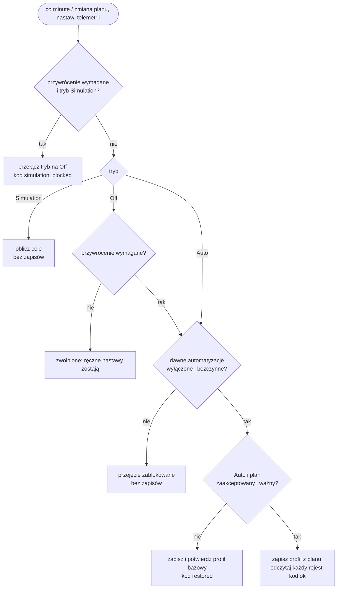

**Auto** zapisuje; **Simulation** oblicza wszystkie cele i zapisuje je w `runtime`, nie dotykając
falownika; **Off** zwalnia sterowanie. Przejście z Auto do Off raz przywraca profil bazowy, potwierdza
go i zostawia późniejsze ręczne nastawy. Wyłączenie samej *automatyzacji* pomija to przywrócenie.
Wybór Simulation przy wymaganym przywróceniu jest odrzucany: tryb wraca na Off, profil bazowy zostaje
przywrócony i dopiero wtedy można ponownie wybrać Simulation.

### Akceptacja planu

Energy Compass akceptuje plan w tym samym wywołaniu, które go publikuje, więc plan, status, ważność
i alert to jeden niepodzielny obraz i nie ma publikacji w częściach. Publikacja zostaje zaakceptowana
tylko wtedy, gdy spełnione są wszystkie warunki: przedziały są ciągłe, każdy wiersz ma znany stan,
logiczne `balance_hold` i skończone nieujemne energie (ceny mogą być ujemne), a jeden wiersz obejmuje
bieżącą chwilę; jest polityka dyspozycji; powstała po początku sesji i nie później niż teraz, jest
nowsza od zaakceptowanego planu i powstała po ostatnim unieważnieniu; Poprawna prognoza ma stan `on`;
nie ma Alertu; status to `ready` bez trwającego odświeżania i zachowania albo `calculating` z
zachowanym pełnym planem; a `valid_until` jest w przyszłości. Tryb nie ma znaczenia: akceptacja działa
także w Off i Simulation.

Status optymalizatora inny niż `ready`/`calculating` albo Alert unieważnia zaakceptowany plan w chwili
publikacji, więc plan policzony przed unieważnieniem nigdy nie zostaje przyjęty. Dopóki błąd trwa,
każda publikacja unieważnia ponownie, ale zachowuje czas pierwszego unieważnienia tego planu.
Zatrzymanie lub przeładowanie wpisu nie jest błędem: zaakceptowany plan zostaje w magazynie integracji
i jest wykonywany, gdy Energy Compass liczy ponownie. Po restarcie Home Assistant sterownik trzyma profil
bazowy do pierwszego planu nowej sesji, bo plan zaakceptowany we wcześniejszym uruchomieniu jest
porzucany przy zmianie sesji. Zapis opcji integracji zwykle nie przeładowuje wpisu
([Zapis opcji](#zapis-opcji)), a gdy przeładowuje, zaakceptowany plan zostaje.

`plan_reason` podsumowuje werdykt; blueprint zamienia go na swoje (polskie) powody w tej kolejności:

| `plan_reason` | Znaczenie |
| --- | --- |
| `session` | w tej sesji nic jeszcze nie zaakceptowano (po restarcie albo przed pierwszym planem) |
| `revoked` | zaakceptowana generacja została unieważniona po błędzie; potrzebny nowy plan |
| `sources` | Alert jest włączony albo ostatnia publikacja nie jest ani zachowanym planem, ani zaakceptowanym planem `ready` |
| `ok` | zaakceptowany plan wolno wykonać |

Sterowanie wymaga też świeżej telemetrii: każda encja z `telemetry_entities` liczbowa i zgłoszona
w ciągu 30 s, napięcie baterii 400–610 V i SOC 0–100 %. Każda automatyzacja z `old_writers` musi być
wyłączona i nieuruchomiona. Plan bez parametrów baterii blokuje sterowanie z powodem `plan: brak
parametrów baterii (pojemność, sprawność) w planie`.

### Profile

| Stan planu | Prąd ładowania / rozładowania | Prąd ładowania z sieci | Kierunek TOU, cel |
| --- | --- | --- | --- |
| `CHARGE_PV`, `SELF_CONSUME` | limit / limit | 0 A | wszystkie Disabled, SOC 10 % |
| `CURTAIL` z `charge_kwh` powyżej 0,000001 kWh | z planu, od `hold_grid_current` do limitu / 0 A | 0 A | wszystkie Disabled, SOC 10 % |
| `HOLD`, `CHARGE_PV`, `SELF_CONSUME` i ładujący `CURTAIL` przy SOC ≥ 100 % w trybie Voltage (`HOLD`: utrzymany do SOC ≤ 99 %) | limit / 0 A w `HOLD` i `CURTAIL`, limit w pozostałych | 0 A | wszystkie Disabled, SOC 10 % |
| `CHARGE_GRID` | limit / 0 A | planowana część sieciowa, ≤ `max_grid_current` | Grid w aktywnym programie, cel SOC z planu; w trybie Voltage napięcie TOU `voltage_grid_charge_ceiling` |
| `DISCHARGE_GRID` | 0 A / z planu, ≤ limit; po osiągnięciu celu `reached_discharge_current`, ≤ limit | 0 A | Sell w aktywnym programie, cel SOC z planu, moc z planu, ≤ `max_power_w`; po osiągnięciu celu Disabled |
| `HOLD`, `CURTAIL` z `charge_kwh` do 0,000001 kWh | `hold_grid_current` / 0 A | `hold_grid_current` | Grid, cel SOC = końcowy SOC planu zaokrąglony w dół |
| bazowy (zwolnienie, nieważny plan) | `relinquish_current` / `relinquish_current` | 0 A | wszystkie Disabled, SOC 10 %, 49,6 (496 V), moc `max_power_w` |

Limit to `min(max_current, max_power_w / V)` przy ładowaniu i `min(max_current, max_power_w × eta_discharge / V)`
przy rozładowaniu. Limit ma histerezę: prąd już ustawiony w falowniku zostaje, dopóki mieści się
w limicie mocy, a wyższy krok o 1 A wchodzi dopiero z 2 % zapasem napięcia (ok. 10 V przy 530 V), więc
napięcie pakietu przechodzące przez granicę kroku nie przepisuje limitu przy każdym spadku i odbiciu.
Limit mocy nigdy nie jest przekroczony. Przy SOC 100 % prąd ładowania w `CHARGE_PV`, `SELF_CONSUME` i `CHARGE_GRID` spada do 0 A; w trybie pracy baterii `Voltage` dotyczy to tylko `CHARGE_GRID`, bo pozostałe dwa stany podlegają regule pełnego pakietu z końca tego akapitu. Prądy z planu przeliczają kWh
przedziału przez `eta_charge` (ładowanie) lub `eta_discharge` (rozładowanie) w pełnej długości przedziału. Cel SOC używa `capacity_kwh` zaakceptowanego planu; cel napięcia wynika
ze stałej krzywej wysokonapięciowej baterii LFP (496–536 V dla 10–90 %, przy 100 % 584 V przy
ładowaniu albo 544 V przy rozładowaniu). Osiągnięty cel w `CHARGE_GRID`/`DISCHARGE_GRID` jest
zatrzaskiwany dla danego przedziału planu. Po osiągnięciu celu `DISCHARGE_GRID` kierunek zmienia się na
Disabled, ale rozładowanie zostaje na `reached_discharge_current` (1 A, ok. 530 W przy 530 V, nigdy
powyżej limitu), więc bateria pokrywa bazowe zużycie domu bez sprzedaży, a większe obciążenia idą z
sieci; 0 A oddałoby całe zużycie domu sieci przy pełnej baterii. Przedział z planowanym `discharge_kwh`
poniżej tolerancji 0,05 kWh (eksport planowany z PV) jest osiągnięty od razu. W wierszu balansowania LFP (`balance_hold: true`) prąd
ładowania zostaje przy 100 %, `CHARGE_GRID` celuje w 100 %, a prąd z sieci wynosi co najmniej
`balance_grid_current`. W trybie `Voltage` falownik kończy ładowanie na napięciu pakietu, a źródło SOC oparte na
liczniku może pokazać 100 % przed pełnym naładowaniem. Dlatego przy SOC ≥ 100 % w `HOLD`, `CHARGE_PV` i
`SELF_CONSUME` sterownik zostawia zwykły limit prądu ładowania (z tą samą histerezą, więc bez zapisów 0 A
wokół granicy) zamiast 0 A (lub `hold_grid_current` w `HOLD`). Prąd sieciowy wynosi 0 A, więc jedynym
źródłem jest PV, rozładowanie wynika z wiersza planu (0 A w `HOLD`), nie jest zapisywany cel SOC ani
zatrzaskiwany stan „osiągnięto”. W `HOLD` przełączenie ma histerezę: profil pełnego pakietu zaczyna się przy SOC ≥ 100 %
i zostaje w kolejnych przebiegach `HOLD`, dopóki SOC nie spadnie do 99 % lub niżej, więc źródło SOC drgające między
99,9 % a 100 % nie przepisuje profilu przy każdym przejściu. Każde przełączenie to jedna transakcja zapisu, która
zaczyna się od ładowania 0 A, i przypada najwyżej jedna na punkt procentowy zmiany SOC; bez PV pakiet opada na
poborze własnym falownika, a `HOLD` doładowuje go z sieci, w cyklu liczonym w godzinach. `CHARGE_PV` i `SELF_CONSUME`
nie potrzebują histerezy, bo poniżej 100 % zapisują te same wartości. `CHARGE_GRID` (zachowuje
`voltage_grid_charge_ceiling` i prąd ładowania 0 A przy 100 %), trzymanie balansu i tryb `Capacity` działają jak dotąd. Wiersz `CURTAIL`, który ładuje (`charge_kwh` powyżej 0,000001 kWh: PV ponad to,
co przepuszcza instalacja, jest większe niż pakiet przyjmuje przy mocy ładowania), działa jak `CHARGE_PV` bez
rozładowania, z prądem z planu: prąd ładowania to `charge_kwh × eta_charge / (h × V)` zaokrąglone w górę do kroku encji
ładowania, nie mniej niż `hold_grid_current` i nie więcej niż limit, prąd z sieci 0 A, prąd rozładowania 0 A, wszystkie
programy Disabled, więc pakiet bierze PV tym prądem, a resztę falownik ogranicza sam. Wiersz, który planuje moc ładowania
przez cały przedział, dostaje cały limit. Wiersz, który planuje mniej (ładowanie takiego wiersza jest dowolne między zerem
a PV po ograniczeniu i po domu, a plan wziął mniej), ładuje mniej, niż pozwala limit, więc pakiet kończy tam, gdzie mówi plan,
a nie powyżej. Sterownik nigdy nie kupuje w takim wierszu energii z sieci. Przy SOC 100 % idzie za `CHARGE_PV` (0 A w trybie
`Capacity`, limit w trybie `Voltage`) i nie zgłasza ostrzeżenia. Próg to 0,000001 kWh, które własny klasyfikator planu czyta
jako zero: plan publikuje przepływy solwera bez zaokrągleń, a wiersz `CURTAIL`, który nie ładuje, może tam nieść do około
5e-13 kWh (około jeden taki wiersz na dwanaście w przeglądzie z ADR-0005), i nie wolno mu ładować. Każdy inny wiersz `CURTAIL`
(`charge_kwh` do 0,000001 kWh) wykonuje profil `HOLD` z ostrzeżeniem `CURTAIL nieobsługiwany: zastosowano HOLD`,
bo sterownik nie ogranicza PV: zapisuje `hold_grid_current` (domyślnie 1 A) jako prąd ładowania i prąd z sieci i trzyma
planowany końcowy stan naładowania.

Sterowane są tylko tryby baterii z listy `commissioned_battery_modes`; każdy inny tryb (np. Voltage
przed potwierdzeniem progów) zostaje na profilu bazowym. Przy dopuszczonym Voltage cel poza zakresem
495–560 V jest odrzucany.

Gdy źródłem SOC jest [estymator SOC z liczników](#estymator-soc-z-liczników), sterownik czyta SOC z
estymatora zamiast z encji baterii Solarman (bramka telemetrii, reguła pełnego pakietu w trybie Voltage
i kontrole osiągnięcia celu), a Capacity jest wyłączone z trybów, którymi steruje, niezależnie od
`commissioned_battery_modes`: w trybie Capacity falownik porównuje progi SOC programów z własnym SOC z
BMS, więc cel planu byłby w złej skali. Po przełączeniu falownika na Capacity zostaje wtedy na profilu
bazowym z `mode_not_commissioned`.

W trybie Voltage napięcie pakietu spada pod obciążeniem rozładowania (ok. 0,7 V przy 7 kW), a krzywa LFP
jest płaska (515–528 V to ok. 30–70 %), więc cel napięciowy `DISCHARGE_GRID` jest osiągany kilka sekund
po starcie. Gdy `discharge_energy_entity` ma wartość liczbową, przedział `DISCHARGE_GRID` w trybie Voltage kończy się, gdy licznik wzrośnie o zaplanowane `discharge_kwh`
(tolerancja 0,05 kWh) od pierwszego przebiegu sterownika w tym przedziale (`runtime.slot_energy`);
napięcie programu TOU wynosi wtedy 49,6 (496 V), więc falownik sam zatrzyma się dopiero na tym progu. Solarman
zgłasza licznik tylko przy zmianie, więc jego świeżość zapewnia heartbeat `telemetry_entities` tego samego
falownika. Bez liczbowej wartości licznika obowiązuje cel napięciowy jak dotąd. Tryb Capacity bez zmian.

Ładowanie podnosi napięcie pakietu w drugą stronę: ok. 2 V przy 4 A w kilka sekund, a falownik kończy
ładowanie z sieci, gdy tylko pakiet dojdzie do napięcia TOU. Cel `CHARGE_GRID` z krzywej (51,4 V dla
27 % przy 512 V w spoczynku) kończył więc ładowanie po kilku sekundach, a napięcie spoczynkowe powyżej
punktu krzywej od razu zatrzaskiwało przedział jako osiągnięty. W trybie Voltage `CHARGE_GRID` (poza
wierszem balansowania) zapisuje zamiast tego jako napięcie TOU `voltage_grid_charge_ceiling` (55,2 V,
552 V); ilość energii w przedziale wyznacza planowany prąd z sieci, a przedział jest osiągnięty dopiero,
gdy pakiet dojdzie do sufitu. Licznik ładowania Solarman odświeża się co ok. 10 minut, za wolno, by
kończyć 15-minutowy przedział, więc nie jest używany. Sufit trzymaj na poziomie limitu napięcia ładowania
BMS albo niżej.

### Zapis i potwierdzenie

Każda zmiana zapisuje jedną encję przez `number.set_value` lub `select.select_option`, a potem
odczytuje rejestry 108–177 z urządzenia Solarman sterownika (`device_id`) i porównuje surową wartość. Rejestr bez potwierdzenia
trafia do `runtime.uncertain` i jest ponawiany; zmiana kierunku lub celu najpierw zeruje prądy, potem
ustawia progi, na końcu włącza kierunek.

| Kod przebiegu | Znaczenie |
| --- | --- |
| `waiting` | pierwszy przebieg nie opublikował jeszcze kodu |
| `ok` | profil z planu obliczony (Simulation) albo zapisany i potwierdzony (Auto) |
| `blocked` | brak ważnego planu albo niespełniony warunek; `reason` i `reason_code` mówią który |
| `restored` | profil bazowy zapisany i potwierdzony (zwolnienie w Off albo brak ważnego planu w Auto) |
| `verification_required` | zapisy zakończone, ale nie każdy rejestr potwierdzony |
| `write_failed` | rejestr nie potwierdził się po ponowieniach; przywrócenie pozostaje wymagane |
| `simulation_blocked` | Simulation odrzucone przy wymaganym przywróceniu |
| `paused` | przełącznik wstrzymania jest włączony (silnik natywny): decyzja jest liczona, nic nie jest zapisywane |
| `error` | sam przebieg się nie powiódł (silnik natywny): wyjątek albo nie dało się odczytać Energy Compass lub encji Solarman; `reason_code` to `run_failed` albo `controller_unavailable`. Po trzech nieudanych przebiegach z rzędu pojawia się problem „Przebiegi sterownika Deye kończą się błędem”; następny udany przebieg usuwa oba |

`runtime.reason_code` to stały kod, a `runtime.reason` jego tekst. Silnik natywny zapisuje tekst w języku Home
Assistant (po polsku dla `pl`, w pozostałych przypadkach po angielsku); teksty silnika blueprintowego są po polsku.

| `reason_code` | Znaczenie |
| --- | --- |
| `ok` | nic nie blokuje planu |
| `telemetry_stale` | encje telemetrii nie są liczbami lub są starsze niż 30 s, napięcie poza 400–610 V albo SOC poza 0–100 % |
| `tou_times` | sześć godzin startu TOU nie jest różnych i rosnących |
| `session_wait` | w tej sesji nie zaakceptowano jeszcze planu |
| `plan_revoked` | zaakceptowana generacja została unieważniona po błędzie |
| `plan_sources` | Alert jest włączony albo publikacja nie jest gotowa |
| `battery_params` | zaakceptowany plan nie ma parametrów baterii |
| `plan_expired` | pierwotny termin ważności minął albo żaden przedział nie obejmuje teraz |
| `plan_malformed` | przedział z brakującymi lub błędnymi wartościami; wymagany nowy plan |
| `operation_mode` | tryb baterii falownika to nie Capacity ani Voltage |
| `mode_not_commissioned` | tryb baterii nie jest w `commissioned_battery_modes` (przy estymatorze SOC z liczników jako źródle SOC Capacity nigdy nie jest) |
| `voltage_range` | cel w trybie Voltage poza 495–560 V |
| `settings_range` | brak zakresu lub kroku encji albo cel poza zakresem |
| `takeover_blocked` | automatyzacja z `old_writers` jest włączona lub działa |
| `blueprint_active` | włączona jest automatyzacja używająca blueprintu Deye (niżej); bez żadnych zapisów (nawet przywrócenia), a problem w Naprawach ją wskazuje |
| `layout_mismatch` | rejestry nie zgadzają się ze stanami encji (zob. [Obsługiwany sprzęt](#obsługiwany-sprzęt)) |
| `paused` | przełącznik wstrzymania jest włączony |
| `verification_required` | zapisy zakończone, ale nie każdy rejestr potwierdzony |
| `write_failed` | rejestr nie potwierdził się po ponowieniach |
| `simulation_blocked` | Simulation odrzucone przy wymaganym przywróceniu |
| `run_failed` | przebieg zgłosił wyjątek; szczegóły w dzienniku Home Assistant |
| `controller_unavailable` | nie dało się odczytać Energy Compass lub encji Solarman; nic nie zapisano |

Każda zmiana stanu pracy silnika blueprintowego przechodzi przez `energy_compass.controller_runtime`; gdy to wywołanie się nie powiedzie, przebieg zatrzymuje się przed zapisem kolejnego rejestru. Silnik natywny odrzuca tę usługę, więc przebieg blueprintu, który się prześlizgnie, zatrzyma się przed pierwszym zapisem.

### Śledzenie przebiegu (silnik natywny)

Blueprint zostawiał ślad automatyzacji na każdy przebieg; silnik natywny zastępują:

- `reason` i `reason_code` sensora stanu pracy oraz jego atrybut `last_run` (nie jest zapisywany w historii): wyzwalacz,
  decyzja, planowane polecenia, każdy zapis z wynikiem (wysłany, nieudany, potwierdzony, zablokowany) i jak przebieg się zakończył;
- diagnostyka integracji (`deye_controller`): `engine`, `hardware`, `run_history`, ostatnie 50 przebiegów, oraz
  `run_history_notable`, ostatnie 20, które zapisały lub zakończyły się kodem innym niż `ok` (oba w pamięci, więc
  restart je czyści);
- wpis w dzienniku zdarzeń sensora stanu pracy za każdym razem, gdy zmieni się kod stanu pracy lub potwierdzony tryb;
- kod `error` oraz problemy w Naprawach „Przebiegi sterownika Deye kończą się błędem” i „Automatyzacja blueprintu
  Deye nadal działa”, więc zatrzymany sterownik widać bez czytania logów.

### Gdy Energy Compass jest niedostępny

Bez Energy Compass nie da się odczytać ani trybu, ani stanu pracy, więc żadnego zapisu nie można uznać
za bezpieczny ani zarejestrować. Blueprint zatrzymuje się więc na pierwszym kroku, bez żadnego zapisu
i wywołania usługi, gdy sensor sterownika nie istnieje lub jest niedostępny, ma inny `controller_schema`
albo nie ma `mode_entity`: ślad mówi `Energy Compass niedostępny: sterowanie wstrzymane bez zapisów`.
Silnik natywny robi to samo bez śladu: przebieg kończy się bez zapisu, kod stanu pracy to `error` z powodem
`controller_unavailable`, a po trzech takich przebiegach pojawia się problem w Naprawach.
Falownik zachowuje ostatni profil; wymuszony kierunek TOU kończy się na najbliższej granicy programu TOU,
a prądy baterii zostają. Jeśli Energy Compass zniknie w środku przebiegu, następne wywołanie stanu pracy
się nie powiedzie i przebieg zatrzyma się przed kolejnym zapisem rejestru. Home Assistant zgłasza
uszkodzony wpis; napraw go albo zwolnij falownik ręcznie.

### Limity i wartości domyślne (silnik natywny)

Ustawia je grupa ekspercka **Limity i przejęcie** w kroku opcji; puste pole zachowuje wartość domyślną,
a zmiana działa od następnego przebiegu bez przeładowania. W kodzie nie ma wpisanych wartości żadnego domu.

| Opcja | Domyślnie |
| --- | --- |
| `max_power_w` | mniejsza z mocy ładowania i rozładowania w ustawieniach Energy Compass, w W |
| `max_current`, `relinquish_current` | atrybut `max` encji prądu ładowania, ograniczony do `max_power_w` / 400 V |
| `max_grid_current` | atrybut `max` encji prądu z sieci, ograniczony tak samo |
| `hold_grid_current`, `reached_discharge_current`, `balance_grid_current` | 1 A, 1 A, 2 A |
| `voltage_grid_charge_ceiling` | 55,2 V |
| `commissioned_battery_modes` | Capacity |
| `old_writers` | brak |
| `telemetry_entities` | sensory SOC i napięcia urządzenia |
| `discharge_energy_entity` | sensor łącznego rozładowania baterii urządzenia, gdy jest dokładnie jeden |
| nadpisania encji | brak; sześć encji jest znajdowanych na urządzeniu po kluczach tłumaczeń Solarman |

Gdy moc lub któryś limit prądu wyszedłby zerowy (na przykład moc ładowania 0 w ustawieniach baterii), krok opcji
go nie zapisze: pokaże grupę i poprosi o wpisanie limitów. Włączenie silnika natywnego wymaga też liczbowego odczytu
napięcia baterii, bo po nim odróżnia pakiet od 48 V.

### Wejścia

To wejścia przestarzałego blueprintu, z jego własnymi wartościami domyślnymi; silnik natywny bierze wartości z
powyższej tabeli.

| Wejście | Domyślnie | Znaczenie |
| --- | --- | --- |
| `controller_entity` | — | sensor *Sterownik Deye* jednej instalacji Energy Compass (Opcje → Sterownik Deye) |
| `charge_entity`, `discharge_entity`, `grid_entity` | — | maks. prąd ładowania (108), rozładowania (109) i ładowania z sieci (128) |
| `operation_entity` | — | select trybu pracy baterii (Capacity / Voltage) |
| `soc_entity`, `voltage_entity` | — | SOC baterii (%) i napięcie pakietu (V) |
| `telemetry_entities` | — | sensory, które muszą być świeże (zgłoszone w ciągu 30 s) |
| `max_power_w` | 8000 W | limit mocy baterii i moc programów TOU |
| `max_current` | 18 A | limit prądu ładowania/rozładowania w stanach wymuszonych |
| `max_grid_current` | 16 A | limit prądu ładowania z sieci |
| `hold_grid_current` | 1 A | prąd ładowania i z sieci w `HOLD` |
| `balance_grid_current` | 2 A | minimalny prąd z sieci w wierszu balansowania LFP |
| `reached_discharge_current` | 1 A | prąd rozładowania po osiągnięciu celu przedziału `DISCHARGE_GRID` (kierunek Disabled, bez sprzedaży) |
| `relinquish_current` | 18 A | prąd ładowania/rozładowania profilu bazowego |
| `commissioned_battery_modes` | Capacity | tryby baterii dopuszczone do sterowania fizycznego |
| `discharge_energy_entity` | brak | licznik energii rozładowania baterii (kWh); w trybie Voltage kończy przedziały `DISCHARGE_GRID` po zaplanowanej energii |
| `voltage_grid_charge_ceiling` | 55,2 V | napięcie TOU dla `CHARGE_GRID` w trybie Voltage (49,5–56,0 V); energię niesie planowany prąd z sieci |
| `old_writers` | brak | automatyzacje, które muszą być wyłączone przed każdym zapisem |

Pojemność i sprawności ładowania i rozładowania nie są już wejściami: blueprint używa wartości, z którymi
policzono zaakceptowany plan (`capacity_kwh`, `eta_charge`, `eta_discharge`), więc zachowany plan nigdy
nie działa z ustawieniami zapisanymi po nim. `max_power_w`, `max_current`, `max_grid_current` i
`relinquish_current` zostają limitami sprzętowymi w blueprincie; utrzymuj `max_power_w` zgodne z mocą
ładowania i rozładowania w Energy Compass, bo oba nie są powiązane.

### Migracja z pakietu (0.1.36 i starsze)

Wydanie 0.1.37 usuwa `packages/energy_compass_deye.yaml`. Energy Compass 0.1.36 i starsze ignorują opcje
i magazyn sterownika, więc sterownik wymaga 0.1.37 razem z nowym blueprintem.

1. **Zainstaluj 0.1.37 i zrestartuj.** Sterownik włącza się automatycznie, gdy istnieją pomocniki pakietu,
   jest jeden wpis Energy Compass i jedno użyteczne urządzenie Solarman; w przeciwnym razie włącz go w
   **Opcje → Sterownik Deye**. Stary blueprint i pakiet dalej sterują do czasu podmiany.
2. **Opcjonalna kontrola w tle.** `generation` sensora sterownika powinno równać się stanowi sensora planu
   pakietu po każdej akceptacji.
3. **Najpierw porównaj sprawność i pojemność.** Stary blueprint używał własnych `eta` (domyślnie 0,9747) i `capacity_kwh` (domyślnie 25); nowy używa `eta_charge`, `eta_discharge` i `capacity_kwh` planu, pochodzących z ustawień baterii w Energy Compass (sprawność 1,0, jeśli nie ustawiono). Ustaw `eta_charge` i `eta_discharge` równe dawnemu `eta` przed podmianą, bo inaczej pierwszy przebieg przepisze prądy ładowania z sieci i rozładowania o ten stosunek; różnica pojemności przesuwa tylko progi SOC, jak niżej.
4. **Podmiana w spokojnym oknie** (wiersz `CHARGE_PV` lub `SELF_CONSUME`, nie przy pełnej godzinie, bez
   innych piszących). Wyłącz starą automatyzację bez zatrzymywania jej akcji, wywołaj
   `energy_compass.controller_import_package` dla sensora sterownika i sprawdź odpowiedź (sesja pakietu,
   zaakceptowana generacja, tryb i flaga przywrócenia). Usługa kopiuje stan, przejmuje sesję pakietu i
   porzuca przestarzałe klucze stanu pracy. Potem wymień blueprint, wybierz w automatyzacji sensor
   sterownika, usuń osiem wejść, których już nie ma (`plan_entity`, `optimizer_entity`, `valid_entity`,
   `alert_entity`, `compass_entity`, `solarman_device`, `capacity_kwh`, `eta`) i włącz ją. Pierwszy
   przebieg niczego nie zmienia na falowniku, jeśli pojemność jest ta sama; zmiana pojemności przesuwa
   tylko próg SOC i napięcia aktywnego programu w wierszu `HOLD` lub z sieci.
5. **Przepnij** dashboardy i własne automatyzacje: pomocnik trybu jest teraz `select`, flaga przywrócenia
   i sesja to atrybuty, a role dashboardów to `deye_controller`, `deye_mode` i `deye_runtime`.
6. **Usuń pakiet** z `configuration.yaml`. Działa to od następnego restartu; w międzyczasie nie przeładowuj
   `template` ani pomocników `input_*`. Potem usuń dziesięć osieroconych wpisów rejestru.

Bez importu i tak wymień blueprint i zaakceptuj jeden okres na profilu bazowym do następnego planu.
Wycofanie przed usunięciem pakietu: wyłącz nową automatyzację, przywróć stary blueprint i wejścia i
włącz ją; import nigdy nie zapisał pomocników pakietu. Powrót do 0.1.36 wymaga wcześniejszego
przywrócenia starego blueprintu i pakietu.

### Migracja z blueprintu na silnik natywny

Oba silniki nigdy nie zapisują razem. Wybranie `native` w **Opcje → Sterownik Deye → Silnik** jest odrzucane,
dopóki tryb nie jest `Off`, a przywrócenie nie zostanie wykonane. Gdy silnikiem jest `native`:

- select trybu odmawia wyjścia z `Off` (błąd wymienia automatyzację), dopóki włączona jest automatyzacja
  używająca blueprintu;
- przebieg, który by zapisywał (tryb `Auto` albo `Off` z oczekującym przywróceniem), zatrzymuje się przy takiej włączonej
  automatyzacji: nic nie jest zapisywane, powód stanu to `blueprint_active` (z nazwą automatyzacji), a problem w
  Naprawach trwa do jej wyłączenia. Nawet przywrócenie BASE nie jest wtedy zapisywane, więc falownik zachowuje ostatni
  nadany profil; po wyłączeniu automatyzacji sterownik kontynuuje (albo przywraca BASE) przy następnym przebiegu. Tryb
  `Off` bez niczego do przywrócenia i `Simulation` działają jak zwykle i nie są blokowane. Dotyczy to też przeładowania
  z trybem `Auto` i blueprintu, który nigdy nie został zaktualizowany;
- `energy_compass.controller_runtime` odrzuca każde wywołanie, więc przebieg blueprintu, który się prześlizgnie,
  zatrzyma się przed pierwszym zapisem.

Gdy dokładnie jedna automatyzacja używa blueprintu na tym samym urządzeniu Solarman (jej encje ładowania,
rozładowania, sieci i trybu należą do tego urządzenia), jej limity i nadpisania encji są wczytywane do grupy
eksperckiej do sprawdzenia; nic nie jest stosowane przed zapisem. Automatyzacja na innym falowniku nie wczytuje niczego.
Wczytanie działa, gdy silnikiem nadal jest `blueprint`.

1. Wybierz tryb `Off` i poczekaj, aż `restore_pending` będzie wyłączone, a kod stanu to `restored` (albo przebieg
   zgłosi zwolnienie).
2. Wyłącz automatyzację blueprintu. Nie zatrzymuj jej wykonań w środku; poczekaj, aż się zakończą.
3. **Opcje → Sterownik Deye:** ustaw silnik na `native`, sprawdź wczytane limity i zapisz. Wpis się przeładuje.
4. Wybierz `Simulation`, przez pewien czas porównuj `runtime.desired` z tym, co zapisywał blueprint, potem wybierz `Auto`
   w wierszu `CHARGE_PV` lub `SELF_CONSUME`.
5. Po tygodniu usuń automatyzację i plik blueprintu.

Wycofanie: wybierz `Off`, poczekaj na `restored`, ustaw silnik na `blueprint`, włącz automatyzację, potem wybierz tryb.
Flaga wstrzymania jest zerowana, gdy silnik wraca na `blueprint`.

### Przykładowe dashboardy

Generuje je `tools/dashboards/build.py` z zastępczymi identyfikatorami encji:

| Sekcja | Co pokazuje |
| --- | --- |
| `controller_panel.yaml` | sterownik w skrócie: ostrzeżenie **Sprawdź sterowanie** (nieaktualna prognoza, Alert, runtime inny niż `ok`, brak świeżego potwierdzenia, niepotwierdzone zapisy), baterię teraz z przełącznikiem trybu i potwierdzonymi nastawami, decyzję Kompasu z celem SOC sterownika, stany planu na 24 h z SOC na koniec, wykres prognozy SOC, wskazówkę i koszt zużycia w domu oraz historię SOC, mocy i sterowania z 24 h |
| `controller_diagnostics.yaml` | stan optymalizatora i sterownika, powód i kod powodu, falownik i czy jest zweryfikowany, ostatni przebieg, potwierdzony tryb, ostatnie potwierdzenie, ważność planu i prognozy, aktywny program TOU, niepotwierdzone zapisy, flagi sesji i przywrócenia oraz odczyt trzech limitów prądu |
| `plan_chart.yaml` | 12 h pomiarów load / grid / PV / SoC i 24 h planu na tle pasm stanów planu; pasma ładowania i sprzedaży do sieci pokazują średnią cenę bloku ważoną energią |
| `consumer_compass_chart.yaml` | poziomy Consumer Compass: 4 h historii i 20 h prognozy |

Panel używa kart natywnych oraz ApexCharts Card do prognozy SOC; oba wykresy wymagają ApexCharts Card. [Generator YAML](builder.html) wypełnia każdą z nich Twoimi encjami, pojemnością
i językiem. Opis: [przewodnik instalacji](installation.md#dashboard-examples) (EN).

Przykłady sterownika używają czterech ról: `deye_controller`, `deye_mode`, `deye_runtime` i `deye_pause` (domyślnie
`sensor.energy_compass_deye_controller`, `select.energy_compass_deye_mode`,
`sensor.energy_compass_deye_controller_runtime` i `switch.energy_compass_pause_inverter_writes`). Panel pokazuje
przełącznik wstrzymania tylko wtedy, gdy encja istnieje, czyli przy silniku natywnym. Gdy Twoje identyfikatory są inne,
przekaż generatorowi `--entity deye_mode=select.moj_tryb` albo wypełnij je w generatorze YAML; sesja, flaga przywrócenia,
najbliższa zmiana TOU i prefiks TOU są czytane z atrybutów sterownika.

## Energy Atlas (opcjonalnie)

Energy Atlas to osobna usługa Datamindz, która agreguje zanonimizowaną telemetrię z wielu instalacji
do celów badawczych i porównawczych. Wysyłanie danych jest **opcjonalne i domyślnie wyłączone**: przy
wyłączonej opcji Compass działa dokładnie tak samo jak bez tej sekcji — bez połączeń sieciowych, bez
nowego wątku w tle, bez nowych plików.

Włącz w **Ustawienia → Urządzenia i usługi → Energy Compass → Konfiguruj → Energy Atlas**:

| Pole | Znaczenie |
| --- | --- |
| Wysyłaj do Energy Atlas | Domyślnie wyłączone. |
| Środowisko | **staging** (`atlas-api-staging.datamindz.io`, do walidacji przepływu danych) lub **produkcja** (`atlas-api.datamindz.io`, kolektor produkcyjny). Staging waliduje przepływ danych; produkcja nie jest jeszcze dostępna w tym wydaniu (brak wbudowanego poświadczenia). |
| Moc instalacji PV (kWp) | Zainstalowana moc PV, wprowadzana raz; nie jest wyliczana z innych ustawień Compass. Bez wartości domyślnej: wymagana, gdy wysyłanie jest włączone. |
| Moc przyłączeniowa (kW) | Opcjonalna, 0,1–1000 kW: limit przyłącza witryny do sieci, jedna wartość dla poboru i oddawania. Puste, dopóki nie zapiszesz wartości — nigdy nie jest podpowiadana z limitów importu/eksportu sieci. Przy pustym polu nic nie jest wysyłane, a mapa liczy witrynę **bez max**. Działa na żywo jak reszta formularza. |

**Nie trzeba wpisywać sekretu.** To wydanie rejestruje się współdzielonym **publicznym**
poświadczeniem wbudowanym w samą integrację — tym samym dla każdej instalacji tej wersji — więc
każdy korzystający z Energy Compass może nim zarejestrować witrynę; witryna jest
**niezweryfikowana**, dopóki nie wyślesz **Energy Atlas: pokaż dowód własności** (niżej) do bota
Energy Atlas. Poświadczenie zmienia się wraz z wydaniem: każda nowa wersja Compass może wysłać
inne, a stare jest w końcu unieważniane (już zarejestrowane witryny nadal działają — uwierzytelniają
się własnym kluczem witryny, nie poświadczeniem rejestracyjnym).

Zapis formularza działa **na żywo**: nie przeładowuje wpisu ani nie dotyka planu, od razu uruchamia
lub zatrzymuje wątek wysyłki. Opis formularza pokazuje **linię statusu**, więc widać z telefonu, że
zadziałało: `wyłączone`, albo `zarejestrowano na <środowisko> · ostatnia dostawa <czas | nigdy> ·
oczekuje <n>` (plus `zablokowane: <rodzaje>`, jeśli wysyłka utknęła).

**Co jest wysyłane**, tylko gdy funkcja jest włączona i tylko dla źródeł powiązanych w sekcji Źródła
danych: moc PV, import/eksport z sieci i moc baterii, moc obciążenia domowego (tylko w trybie
rejestratora), SOC baterii oraz liczniki energii PV/importu/eksportu (tylko liczniki, których
atrybut Home Assistant `state_class` to `total`/`total_increasing`);
plan każdego rozwiązania Compass wraz z wejściami cen/PV/zużycia; kilka atrybutów instalacji (moc PV
w kWp, moc przyłączeniowa w kW, jeśli ją podasz, pojemność baterii nominalna i użyteczna, próg SOC,
wersja Compass) oraz gmina,
w której leży strefa domowa Home Assistant, jako jej 7-cyfrowy identyfikator. Atlas pokazuje gminę
**z nazwy** obok wartości Twojego domu. Compass znajduje gminę wewnątrz Home Assistant: pobiera
publiczne pliki z granicami, które serwuje Atlas (te same dla każdego domu, wskazane przez
`GET /v1/public/geo`), i porównuje je z położeniem Twojego domu na miejscu, więc Twoje
współrzędne zostają w Home Assistant, a żadne żądanie ich nie zawiera. Poza Home Assistant trafiają
tylko dwie rzeczy z nich wynikające: identyfikator województwa w nazwie pobieranego pliku gmin oraz
identyfikator gminy w atrybutach. Dom położony do 50 m od granicy gminy może zostać pokazany
w sąsiedniej gminie, bo granice są uproszczone. Dom poza każdą polską gminą (za granicą, na morzu)
lub bez współrzędnych nie wysyła lokalizacji i jest liczony tylko w sumie floty. Pliki są pobierane
ponownie tylko wtedy, gdy Atlas opublikuje nową wersję albo dom się przeniesie (o wersję Atlas jest
pytany przy starcie i najwyżej raz na 24 h); gdy Atlas jest nieosiągalny, zachowana zostaje ostatnio
znaleziona gmina — także po restarcie Home Assistant, w pamięci integracji obok klucza witryny, razem
ze współrzędnymi i wersją granic, dla których ją znaleziono, nigdy niewysyłana — a wyszukiwanie jest
ponawiane najwyżej raz na godzinę, bez opóźniania telemetrii.
Nic więcej — brak tekstu taryfy czy modelu falownika, a samo poświadczenie rejestracyjne
**nigdy nie jest zapisywane** — przechowywany jest tylko klucz witryny wydany w zamian za nie.

**Jak wysyłane są wartości**: moce w W. Powiąż **Moc baterii** tak, by + oznaczał rozładowanie (jak
w przykładowych dashboardach); Atlas otrzymuje ją jako + = ładowanie. Odczyty spoza zakresów
kolektora są korygowane, a nie wysyłane jako błędy: ujemna moc importu/eksportu z sieci jest
wysyłana jako 0, SOC poniżej 0 % lub powyżej 100 % jako 0 %/100 %, a ujemny licznik energii lub
odczyt nieliczbowy nie jest wysyłany.

**Gdzie przechowywany jest klucz**: `.storage/energy_compass_atlas/<id wpisu>/<środowisko>/` wewnątrz
katalogu konfiguracyjnego Home Assistant, osobny podkatalog na środowisko, więc staging i produkcja
nigdy nie współdzielą klucza, witryny ani kolejki. Jest uwzględniany w kopiach zapasowych Home
Assistant. Usunięcie integracji go kasuje.

**Przełączanie środowiska**: staging i produkcja są niezależne — każde zachowuje własny klucz,
witrynę i zakolejkowane dane. Przełączenie na środowisko już zarejestrowane wznawia je na żywo (bez
przeładowania, bez ponownej rejestracji, bez utraty kolejki); przełączenie na nigdy
niezarejestrowane rejestruje je automatycznie wbudowanym poświadczeniem, bez pytania o cokolwiek.

**Gdy kolektor jest niedostępny**: telemetria i rozwiązania kolejkują się lokalnie (do 30 dni) i są
wysyłane po odzyskaniu łączności; własny plan Compass nie jest tym dotknięty — wysyłka do Atlas
działa na własnym wątku w tle i nigdy nie dzieli harmonogramu z optymalizatorem. Diagnostyka
(**Urządzenia i usługi → Energy Compass → ⋮ → Pobierz diagnostykę**) zawiera sekcję `energy_atlas`:
włączenie, środowisko, stan rejestracji, głębokość kolejki i ewentualnie wstrzymaną wysyłkę.

**Odzyskiwanie: zapomnij witrynę**: jeśli klucz witryny został unieważniony lub koliduje z innym
źródłem, zaznacz **Zapomnij witrynę w tym środowisku** na tym samym formularzu Energy Atlas i
zapisz. Usuwa to klucz i zakolejkowane dane wybranego środowiska tylko na tym urządzeniu — sama
witryna nie jest usuwana po stronie kolektora, operator może ją osobno unieważnić — więc kolejny
zapis z nadal włączoną wysyłką automatycznie rejestruje tam nową witrynę, znowu bez pytania o
cokolwiek.

**Pokaż dowód własności**: gdy witryna jest włączona i zarejestrowana, menu opcji oferuje
dodatkową pozycję, **Energy Atlas: pokaż dowód własności**. Generuje ona krótkotrwały podpisany
dowód (ważny 15 minut, jednorazowy) i wyświetla go do wysłania botowi Energy Atlas, aby powiązać
witrynę z kontem Datamindz. Dowód jest tylko wyświetlany — nigdy nie jest zapisywany i nigdy nie
pojawia się w opcjach, diagnostyce ani logach.

**Uzupełnianie historii**: usługa **Energy Atlas: uzupełnij historię**
(`energy_compass.atlas_backfill`, opcjonalne pole **Dni**, 1–3650, domyślnie: cała dostępna
historia) wysyła historyczną telemetrię z rejestratora Home Assistant dla każdego powiązanego
źródła — statystyki 5-minutowe tam, gdzie rejestrator je jeszcze przechowuje, statystyki godzinowe
dla starszej historii — do każdego wpisu, który obecnie ma włączone wysyłanie i zarejestrowaną
witrynę, stosując te same korekty wartości co wysyłka na żywo. Kończy się błędem, jeśli żaden wpis
obecnie nie kwalifikuje się.

## Narzędzie replay (offline)

`tools/replay.py` odpowiada na pytanie „co ta zmiana ustawienia robi z rzeczywistym kosztem?” bez
Home Assistanta. Importuje optymalizator z `custom_components/energy_compass/engine` i odtwarza
zapisane dni; wymaga tego samego Pythona i SciPy co integracja (uruchom w obrazie testowym albo w
środowisku, gdzie działa `import scipy`) i niczego nie rysuje. Dla każdego dnia i łącznie wypisuje, w
walucie instalacji:

| Kolumna | Koszt |
| --- | --- |
| `plan` | planu Energy Compass **tak, jak został wykonany**: przeliczanego co `refresh_minutes` na prognozie znanej w chwili planowania, z zaplanowanym trybem i energiami zastosowanymi do rzeczywistego PV i zużycia |
| `self_use` | zwykłej autokonsumpcji: bateria podąża za obciążeniem, bez ładowania z sieci i bez eksportu z baterii |
| `hindsight` | jednego rozwiązania tego samego celu na **rzeczywistym** PV i zużyciu — tyle, ile te same ustawienia mogły osiągnąć |

```
python tools/replay.py tools/replay_sample.json --currency PLN
python tools/replay.py tools/replay_sample.json --set allow_grid_charge=false
```

`--set klucz=wartość` (można powtarzać) nadpisuje dowolne ustawienie planera po jego kluczu (klucze
opcji, jak w `settings.py`; flagi należące do strategii ustawione w ten sposób są traktowane jako
jawne). Uruchom dwa razy i porównaj kolumnę `plan`, aby zmierzyć zmianę. `--json` wypisuje liczby
(wraz z `solve_failures`, liczbą nieudanych rozwiązań planu danego dnia) zamiast tabeli; `--timezone`
i `--initial-soc` dotyczą tylko wejścia CSV. Błędny plik, wartość lub nadpisanie kończy się
komunikatem `error: …` ze wskazaniem miejsca i kodem wyjścia 2.

### Format wejścia

Jeden plik JSON (albo CSV, niżej). `tools/replay_sample.json` to kompletny, dwudniowy przykład
syntetyczny.

| Klucz | Znaczenie |
| --- | --- |
| `timezone` | nazwa IANA, np. `Europe/Warsaw` (domyślnie `UTC`) |
| `interval_minutes` | długość interwału, domyślnie `15`; wszystkie dni pliku mają tę samą |
| `settings` | opcjonalne ustawienia planera (`capacity_kwh`, `charge_kw`, `grid_export_kw`, `strategy`, `refresh_minutes`, …); brakujące klucze przyjmują wartości domyślne, więc ustaw co najmniej baterię i limity instalacji |
| `days[].start` | znacznik czasu ISO pierwszego interwału (z przesunięciem albo lokalny w `timezone`) |
| `days[].date` | etykieta w tabeli, domyślnie lokalna data `start` |
| `days[].initial_soc_percent` | SOC baterii w `start` (domyślnie `initial_soc_percent` pliku, w ostateczności 50) |
| `days[].intervals[]` | po jednym obiekcie na interwał, po kolei i bez przerw (niżej) |

Każdy interwał ma sześć liczb: `buy` i `sell` (waluta/kWh, końcowe ceny taryfy), `pv_forecast` i
`load_forecast` (kWh w interwale, **jak znane w chwili planowania**) oraz `pv` i `load` (kWh faktycznie
wyprodukowane i zużyte). Sześć wartości musi być skończonych, a cztery energie nieujemne (obetnij
drobne wartości ujemne, które zaokrąglenia w statystykach mogą zostawić, np. w `pobór + PV − eksport`);
błąd wskazuje miejsce: `days[n][i]` (dzień `n` od 1, interwał `i` od 0) albo `line n` w CSV.

Interwał może mieć też `buy_energy` (także kolumna CSV): część energetyczna `buy`, czyli ta, którą może
pokryć depozyt (reszta `buy` to dystrybucja), w tych samych jednostkach, tak jak na fakturze, więc
może być ujemna (pobór przy ujemnej cenie energii, oferta dynamiczna bez dolnego progu indeksu); nie
większa niż `max(buy, 0)`, a gdy ujemna, nie większa niż `buy`; puste lub brak oznacza 0. Planer używa
`max(buy_energy, 0)` (ograniczonego do `max(buy, 0)`, jak silnik). Ma znaczenie tylko z
[modelem depozytu](#wartość-depozytu-w-net-billingu), który włączasz przez `--set
deposit_model=manual --set export_value_factor=0.3` (eksperymentalny).
`buy` zostaje ceną z faktury, więc `buy_distribution_mode`, `buy_distribution_rate` i
`buy_distribution_off_peak_rate` nie są czytane — ceny pochodzą z pliku — a ostrzeżenie o tym
informuje. Koszty są raportowane w cenach z pliku niezależnie od współczynników.

Dni są niezależne: każdy jest planowany i mierzony osobno i kończy się na ostatnim interwale, nawet
gdy plik zawiera kolejne dni. Horyzont skraca się więc do końca dnia, więc `horizon_hours` poza dobę
i przenoszenie energii przez północ nie są mierzone.

CSV ma jeden wiersz na interwał z kolumnami `start`, `buy`, `sell`, `pv_forecast`, `load_forecast`,
`pv`, `load` i opcjonalnie `buy_energy` oraz `initial_soc_percent` (czytaną z pierwszego wiersza dnia). Wiersze są
grupowane w dni według lokalnej daty `start`; ustawienia podaje się tylko przez `--set`.

### Jak czytać wynik

- **Energia na koniec dnia jest wyceniana**, bo granica doby jest dla baterii dowolna. Każde
  rozwiązanie wycenia końcowy SOC po `terminal_value_per_kwh`, gdy `terminal_mode` to `value`, a w
  przeciwnym razie po średniej cenie zakupu danego dnia, więc plan może zakończyć dzień poniżej
  początkowego SOC. **Raportowany** koszt wycenia różnicę końcowego i początkowego SOC po średniej
  cenie zakupu danego dnia, niezależnie od ustawień, więc `terminal_mode` i `terminal_value_per_kwh`
  zmieniają plan, ale nie miarkę: `self_use` jest w każdym przebiegu identyczny, a dwa przebiegi
  różniące się wartością końcową są porównywalne.
- `wear_per_kwh` wchodzi w raportowany koszt (połowa energii ładowanej i rozładowanej łącznie), więc
  przebiegi z różnym `wear_per_kwh` nie są porównywalne.
- `hindsight` to optimum **ukształtowanego celu** (wraz z wagami strategii, karą za import i wartością
  końcową rozwiązań) wycenione w rzeczywistej walucie. Dla `cost_min` bez kary za import i z wartością
  końcową równą średniej cenie zakupu dnia jest dolnym ograniczeniem `plan`; dla innych strategii to
  najlepszy wynik tej strategii. Przy `terminal_mode` `value` i wartości niższej niż średnia cena
  zakupu `hindsight` może wyczerpać baterię i pokazać więcej niż `plan` — to znak, że wartość końcowa
  zaniża wartość zmagazynowanej energii.
- Wykonany plan podąża za sterownikiem (`tools/deye_controller/build.py`) względem rzeczywistych
  danych. `SELF_CONSUME` i `CHARGE_PV` podążają za obciążeniem: cała nadwyżka PV ładuje baterię, a
  niedobór jest pokrywany z niej. W `CHARGE_GRID` za planem idzie tylko udział sieci — zaplanowane
  ładowanie minus nadwyżka obiecana przez prognozę. Sieć i rzeczywista nadwyżka PV ładują razem aż do
  planowanego końcowego SOC wiersza; potem sieć przestaje, tak jak w sterowniku, a PV ładuje dalej do
  końca slotu. PV powyżej prognozy zmniejsza więc import z sieci (SOC może skończyć powyżej planu, wyłącznie dzięki
  PV), a poniżej prognozy ładuje mniej — niedoboru nie kupuje się z sieci, a startowy SOC poniżej planu
  nie jest nadrabiany. `DISCHARGE_GRID` rozładowuje zaplanowaną energię, `HOLD` zatrzymuje baterię. Eksport ponad
  `grid_export_kw` jest ucinany (curtailment), a zmagazynowana energia nie jest eksportowana ponad
  dotychczasową produkcję PV, gdy włączone jest **Sell only PV** (`limit_export_to_pv`).
- **W pliku z opustem koszty to ceny godzinowe, a nie rozliczenie.** Opust jest rozliczany w rocznych
  kWh ([Profile startowe](#profile-startowe-nowe-instalacje)), więc `plan − self_use` nie jest tam
  oszczędnością; nie porównuj po nim strategii.
- [Zapas na drogie okresy](#zapas-na-drogie-okresy) (`peak_reserve_margin_kwh` i `export_reserve_margin_kwh`) jest odtwarzany jak w integracji: wymaga
  `limit_grid_charge_price` (jego pułap to cena „tania”), w przeciwnym razie ostrzeżenie mówi, że nie
  ma efektu.
- Nie są odtwarzane: okna balansowania LFP, ogon autonomii poza danymi oraz przenoszone zobowiązania
  eksportu i ładowania z sieci. Ostrzeżenie wymienia włączone z nich. Nieudane rozwiązanie planu
  wykonuje dany krok jako autokonsumpcję i jest zgłaszane pod tabelą oraz jako `solve_failures`;
  nieudane rozwiązanie `hindsight` albo niespójne ustawienia przerywają przebieg komunikatem
  `error: <data>: …`.

### Eksport danych z Home Assistanta

Ceny `buy` i `sell` to końcowe ceny, które widzi planer: z Twojej taryfy albo z historii encji cen
czytanych przez Energy Compass. Rzeczywista energia pochodzi ze statystyk długoterminowych: menu
panelu **Energia** oferuje **Pobierz dane** (CSV, godzinowe). Te same godzinowe wartości `change`,
których potrzebuje replay, zwraca polecenie WebSocket `recorder/statistics_during_period` z
`"period": "hour"` i `"types": ["change"]`
(wywołanie pokazuje [`tools/export_value_backfill.py`](../tools/export_value_backfill.py)). `pv`
weź ze statystyki produkcji PV, a `load` ze statystyki zużycia domu (gdy nie ma czujnika zużycia:
pobór z sieci + PV − eksport do sieci). `pv_forecast` i `load_forecast` to to, co mówiły Twoje
encje prognoz **przed** interwałem — atrybut planu Compass `intervals` (albo historia Solcast/prognozy)
zapisany w chwili planowania; użycie wartości rzeczywistej jako prognozy daje wyidealizowany plan
bez błędu prognozy. Dla statystyk godzinowych ustaw `interval_minutes: 60`.

### Roczna wyrocznia rozliczenia

`tools/replay_year.py` to roczny odpowiednik replayu dni, do pytań, na które doba nie odpowie: co
[ustawienie depozytu](#wartość-depozytu-w-net-billingu) robi z **rachunkiem za rok**. Odtwarza kolejne
godziny tak, jak pracuje integracja: kroczące okno `horizon_hours` (24 h), przeplanowywane co
`--refresh-hours` godzin (domyślnie 6) na prognozie, stan naładowania przenoszony przez północ,
dobowe liczniki eksportu PV zerowane o **lokalnej** północy, każdy plan wykonany na szeregu
rzeczywistym, nieudane rozwiązanie wykonane jako autokonsumpcja. Godzinowy pobór i eksport, który z
tego wychodzi, wyceniają dwa rachunki:

| Rachunek | Reguła |
| --- | --- |
| `annual` | depozyt D = 1,23 × V (V = wartość oddanej energii po `max(sell, 0)`) płaci zobowiązanie E⁺ = Σ max(E<sub>t</sub>, 0) z miesięcznych części energetycznych E<sub>t</sub> poboru; zwrot to `min(D − min(D, E⁺), ρ × V)`. Miesiąc z ujemną częścią energetyczną (cena dynamiczna bez podłogi indeksu, ładowanie w godzinach z ujemną ceną) nie tworzy zobowiązania i nigdy nie zasila depozytu: zostaje na rachunku w pełnej wartości, bez zwrotu, limitu i umorzenia (ADR-0031 Amendment T-471). Rachunek = opłaty stałe + Σ pobór × cena zakupu − zaliczone − zwrot, a część energetyczna ze znakiem (także ujemny miesiąc) jest w Σ pobór × cena zakupu |
| `ledger` | depozyt każdego miesiąca to rocznik księgowany w miesiącu następnym, wykorzystywany od najstarszego, ważny 12 miesięcy; po wygaśnięciu wraca `min(niewykorzystane, ρ × V miesiąca)`, reszta przepada. To stan okresowy powtarzanego roku: `D ≤ E⁺` daje wynik roczny, `D > E⁺` rok rozbiegowy od pełnego konta (każdy żywy rocznik z całym depozytem), potem rok mierzony |

```
python tools/replay_year.py site.json --set deposit_model=manual --set export_value_factor=0.3
python tools/replay_year.py site.csv --timezone Europe/Warsaw --rho 0.2 --fixed 310 --self-use
```

Wypisuje (albo z `--json` zwraca) oba rachunki, `wear`, dryf SOC (początkowy minus końcowy SOC po
średniej cenie zakupu), `K` = rachunek roczny + zużycie + dryf SOC (`KL` z księgą), `D`, `V`, `E` (ze znakiem), `E_owed` (E⁺; w wyniku tekstowym podpis `E+ liability`) oraz
zwrot i przepadek każdego rachunku. Dwa przebiegi porównuje różnica `K` (albo `KL`); `--self-use` daje
punkt odniesienia bez planera. Wejście to jeden obiekt JSON (`timezone`, `start`, `rho`, `fixed`,
`initial_soc_percent`, `settings` i `hours[]`) albo CSV, jeden wiersz na **godzinę** z `start`, `buy`,
`sell`, `buy_energy`, `pv_forecast`, `load_forecast`, `pv`, `load` — te same wartości co wyżej; format
opisuje docstring narzędzia, a `--rho`, `--fixed` i `--initial-soc` nadpisują plik. `buy_energy` to
część energetyczna tak jak na fakturze, ze znakiem: rachunki sumują ją w miesiącu (pobór przy ujemnej
cenie energii obniża miesiąc, a miesiąc kończący się poniżej zera zostaje w rachunku w pełnej
wartości i nie dodaje nic do `E_owed`), a planer widzi `max(buy_energy, 0)`, więc plan nie zależy od
wartości ujemnych. Godziny muszą
następować kolejno, jedna rzeczywista godzina na wiersz; wiersz JSON może mieć własny `start`, który
musi wtedy zgadzać się z jego pozycją. `--refresh-hours` nie może przekraczać `horizon_hours`. Liczba
nieudanych rozwiązań planu trafia na stderr w obu formatach wyjścia.

Znaczniki czasu to rzeczywiste chwile, więc rok z obiema zmianami czasu (doba 25-godzinna i
23-godzinna) jest czytany poprawnie; lokalna data i miesiąc (zerowanie liczników, miesiąc księgi)
pochodzą z `timezone`. Znacznik z przesunięciem (`+02:00`, `Z`) jest dokładny. Znacznik bez
przesunięcia jest lokalny dla `timezone`: w powtórzonej jesiennej godzinie to pierwsze wystąpienie,
chyba że poprzedni wiersz jest tym pierwszym wystąpieniem (wtedy to drugie), więc CSV kolejnych
lokalnych znaczników bez przesunięcia czyta się poprawnie — `start` w JSON bez przesunięcia w tej
godzinie to pierwsze wystąpienie; podaj przesunięcie, by oznaczyć drugie.

Ograniczenia: część stała rachunku to jedna liczba z wejścia i nie podąża za przepływem, więc pasmo
opłaty zależne od rocznego poboru nie jest modelowane (`fixed` weź z rachunku bez magazynu i licz się z
niewielkim stałym błędem tam, gdzie pasmo jest inne); odcinek krótszy niż rok jest czytany jak rok z
pustymi miesiącami; okresem rozliczeniowym jest miesiąc kalendarzowy; sprzedawca rozliczający
dłuższy okres netuje między jego miesiącami, czego narzędzie nie modeluje; energia jest wyceniana godzinowo; wynik jest tak dobry,
jak podany szereg prognoz.

## Słownik kodów powodów

### Powody pokrycia / jakości (atrybuty `reason`, `reasons`)

| Kod | Znaczenie |
| --- | --- |
| `complete` | Pełne pokrycie odniesienia, wszystkie próby udane. |
| `available_reference_horizon` | Pokrycie źródeł krótsze niż żądany horyzont odniesienia; percentyle z dostępnych danych. |
| `reference_horizon_uncovered` | Zarezerwowany w tłumaczeniach; nie jest emitowany w 0.1.43. |
| `reference_probe_failed` | Co najmniej jedna próba odniesienia nie powiodła się lub zabrakło czasu. |
| `short_source_coverage` | Pokrycie cen/prognoz kończy się przed żądanym horyzontem planowania. |
| `current_guidance_unavailable` | Próba dla bieżącego przedziału nieznana; późniejsze okna mogą być poprawne. |
| `missing_forecast_continuation` | Skonfigurowane źródło (poza opcjonalnym pesymistycznym źródłem PV) nie opublikowało jeszcze danych dla części horyzontu (np. jutrzejsze ceny przed ok. 14:00). |
| `load_history_fallback` | Część prognozy zużycia używa zapasowego dziennego zużycia, bo historia jest niewystarczająca. |
| `unvalidated_tariff` | Kalibracja taryfy oznaczona jako `unvalidated`. |
| `unvalidated_capacity` | Kalibracja pojemności baterii oznaczona jako `unvalidated`. |

### Ostrzeżenia progu autonomii

| Kod | Znaczenie |
| --- | --- |
| `autonomy_floor_requires_pv` | Brak źródła PV — próg pominięty. |
| `autonomy_tail_coarsened` | Ogon 48 h dłuższy niż 192 przedziały, zgrubiony do godzin. |
| `autonomy_tail_unavailable` | Źródło ogona zawiodło; próg używa tylko horyzontu z cenami. |
| `grid_charge_ceiling_below_autonomy_weight` | Sufit ceny ładowania z sieci poniżej wagi progu − marża; progu nie dałoby się uzupełnić. |
| `peak_reserve_requires_grid_charge_ceiling` | `peak_reserve_margin_kwh` powyżej 0, ale **Ogranicz cenę ładowania baterii z sieci** wyłączone — zapas na drogie okresy pominięty. |
| `peak_reserve_inactive` | W horyzoncie brak nadchodzącego drogiego ciągu z deficytem — zapas nie ma czego chronić. |
| `export_reserve_requires_grid_charge_ceiling` | `export_reserve_margin_kwh` powyżej 0, ale **Ogranicz cenę ładowania baterii z sieci** wyłączone — zapas pod eksportem pominięty. |
| `export_reserve_requires_battery_export` | `export_reserve_margin_kwh` powyżej 0, ale eksport z baterii wyłączony — zapas pod eksportem pominięty. |

### Wyjątki bezpieczeństwa (`dispatch_policy.safety_exception.reason`)

| Kod | Znaczenie |
| --- | --- |
| `observed_soc_maximum` | Aktywne zobowiązanie ładowania, a SOC już na maksimum. |
| `observed_soc_minimum` | Aktywne zobowiązanie rozładowania, a SOC na lub poniżej rezerwy (przeniesione SELF_CONSUME tylko wtedy, gdy jego zwolnienie z pustej baterii nie ma planu). |
| `grid_charge_price_limit` | Przeniesione CHARGE_GRID kontynuowałoby powyżej sufitu ceny ładowania z sieci. |

### Ostrzeżenia balansowania

To są surowe kody, nietłumaczone.

| Kod | Znaczenie |
| --- | --- |
| `balance_overdue` | Faza balansu to `due`, ale w planie nie zmieściło się żadne okno trzymania; balans w tym horyzoncie został pominięty. |
| `balance_pessimistic_pv_unavailable` | Pesymistyczne źródło PV jest skonfigurowane, ale niedostępne, nieaktualne, błędnie sformatowane lub ujemne albo nie pokrywa horyzontu; okna balansu wybrano na serii mediany PV. |
| `balance_no_window_in_horizon` | Faza balansu to `eligible` lub `due`, ale w horyzoncie nie istnieje żadne kandydujące okno trzymania (żaden wyrównany start nie spełnia wymogów PV/ładowania z sieci). |
