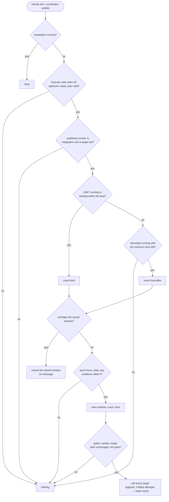

# Native window notifications without blueprint helpers — design

Date: 2026-10-21 · Status: proposed (owner decisions of 2026-10-21 recorded in §3.1) · Task: T-113 ·
Base: `main` at d571703 (release 0.1.44)

This spec moves the window notifications of the blueprint
`blueprints/automation/energy_compass/notifications.yaml` (the "blueprint", "BP") into the
integration. It follows the native Deye controller, which replaced its own blueprint the same way. The
behaviour is the blueprint's contract. The five hand-made helpers and the blueprint itself are no
longer needed.

---

## 0. Summary

The user turns on **Notify enabled** in **Options → Notification preferences**, picks one or more
targets (mobile app services or notify entities) on the same step, and Energy Compass sends the
favorable and `LIMIT` window notifications itself. Nothing else is set up: no blueprint, no helpers,
no automation.

- **Decisions.** A pure decision core (`notifications.py`) is a line-by-line port of the
  blueprint's actions. An HA shell (`notifications_ha.py`) owns the triggers, the storage, the
  notify calls and the repair issue.
- **Triggers.** The sender runs on every coordinator update (plan, forecast, Alert, optimizer) and
  on a tick at second 0 of every minute, like the blueprint's `time_pattern`.
- **State.** The dedup and cap state (last favorable window, last `LIMIT` window, daily count,
  local date, last attempt) lives in `.storage/energy_compass.<entry_id>.notifications`. It
  survives restarts and reloads.
- **One sender.** The plan publishes who sends. Its `notification_preferences.notify_enabled` is
  `true` only while the blueprint is the sender. Every copy of the blueprint ever shipped requires
  that flag, so an installed blueprint automation goes silent the moment native sending is active.
  No user has to update the blueprint.
- **Test.** A new action `energy_compass.send_test_notification` sends one test message to the
  configured targets right away.
- **Deprecation.** The blueprint is deprecated now and removed in the release after next. A repair
  issue tells a blueprint user what to do.

---

## 1. Design

### 1.1 Goal, scope, out of scope

**Goal.** Window notifications without a blueprint and without helpers. They behave exactly like
the blueprint, they are opt-in, and only one sender is active at a time.

**In scope.**
1. Three new settings: `notify_services`, `notify_entities` and `notify_language` (DD-3, DD-4).
2. A published sender flag in the plan's `notification_preferences` (DD-2).
3. The decision core, ported from the blueprint (DD-6), with EN/PL texts (§1.6).
4. The HA shell: triggers (DD-5), storage (DD-8), the notify call, failure handling and logbook
   (DD-9), live options (DD-12) and diagnostics (DD-13).
5. The test action `energy_compass.send_test_notification` (DD-10).
6. Blueprint deprecation: a description note, two repair issues and the migration steps (DD-11,
   §1.9).
7. The EN+PL doc sweep per AGENTS.md (Task 5).

**Out of scope (owner).**
- New event types.
- Actionable notifications (buttons, `data` payloads, tags).
- Sirens, plug control or any action other than a notify call.
- Any release or version bump. The blueprint's removal is a follow-up for the release after next.

**Ambiguities resolved here.**

- A1 — *"Behaviour = the blueprint's contract exactly", but the blueprint also has
  `use_blueprint_overrides` and its own `language` input.* Overrides are blueprint-only: the native
  sender always uses the integration's preferences, and the overrides have no native counterpart.
  The language becomes the setting `notify_language` (DD-4). A blueprint test that sets overrides
  is ported by setting the same values as integration preferences (§6).
- A2 — *The blueprint fails closed on unknown or unavailable helpers* (BP:334-345). The store
  cannot be unknown: it is loaded once at start. A missing, unreadable or invalid store starts from
  fresh state (count 0, no windows) with one warning in the log (DD-8). Blocking every
  notification forever on a corrupt file would be worse than one possible repeat.
- A3 — *The blueprint runs only on state changes and the minute tick, never on attribute-only
  updates* (BP:229-254). The native sender also runs on every coordinator update (DD-5). A
  decision can therefore come up to 59 s earlier than the blueprint's next tick. It never comes
  later, and it never decides differently for the same data and clock. This is the only timing
  difference, and it is stated in the guide.
- A4 — *`notify_actions`* is a legacy stored key that no form shows. It feeds
  `actions_configured` in the published preferences (`runtime.py:1504`), which nothing reads.
  Both stay unchanged. The native targets are new keys, so the old key never gets a new meaning.

### 1.2 Decisions

**DD-1 — When the integration sends.**

```text
native_active(values) = values["notify_enabled"]
                        and (values["notify_services"] or values["notify_entities"])
```

- `notify_enabled` stays the master switch, default `False` (`settings.py:151`).
- With **Notify enabled** on and no target, the integration sends nothing and the blueprint (if
  installed) works as in 0.1.44. This is the deprecation window for existing blueprint users.
- The first target the user saves makes the integration the sender (DD-2).

**DD-2 — One sender, published in the plan.**

`runtime.compute` (`runtime.py:1490-1505`) publishes, in `notification_preferences`:

| Key | Value |
| --- | --- |
| `notify_sender` (new) | `"integration"` if `native_active`, else `"blueprint"` if `notify_enabled`, else `"off"` |
| `notify_enabled` | `notify_enabled and not native_active`: "the blueprint may send" |
| other keys | unchanged (`notify_events`, `notify_minimum_hours`, …, `actions_configured`) |

- **Blueprint side.** Every copy of the blueprint since the first commit (93e95d6, 2026-09-17)
  sends only if `preferences.get('notify_enabled') == true`. It checks this before the
  bookkeeping, again before an extension, and again just before the action (BP:264-275, 392-401,
  506-519), and overrides do not bypass it (BP:110-114). With `notify_sender == "integration"`
  the flag is `false`, so every installed blueprint is silent without being re-imported.
- **Native side.** The sender requires `notify_sender == "integration"` in the **published**
  preferences, and in the live configuration a non-empty target list (DD-12).
- **Exclusivity.** One published dict cannot carry both `notify_enabled == true` and
  `notify_sender == "integration"`. So at any instant at most one of the two senders passes its
  gate, including while a recalculation after an options save is still running and the old plan is
  retained.
- **Meaning change.** The attribute `notify_enabled` no longer mirrors the setting. It means "the
  blueprint may send". The guide's plan-attribute table says so, and `notify_sender` carries the
  full truth.

**DD-3 — Targets: legacy services first, notify entities too.**

Two list settings, both default `[]`:

| Key | Holds | Call per target |
| --- | --- | --- |
| `notify_services` | legacy notify service names without the domain, e.g. `mobile_app_pixel_8` | `notify.<name>` with `{"title": t, "message": m}` |
| `notify_entities` | notify entity ids, e.g. `notify.kitchen_display` | `notify.send_message` with `{"title": t, "message": m}`, target `entity_id: <id>` |

- **Why two keys.** A legacy service `notify.x` and an entity `notify.x` can have the same name, so
  one list could not tell them apart.
- **Why legacy first.** The mobile app, the main target, still registers legacy
  `notify.mobile_app_<device>` services. The options step lists services first.
- **Form.**
  - `notify_services` is a multi-select. Its options are the notify services registered at form
    time, sorted, without `send_message`, plus every saved value even when the service is missing
    now. `custom_value: true`, because the mobile app registers its service only after the phone
    connects.
  - `notify_entities` is an entity selector, domain `notify`, `multiple: true`.
- **Validation** (`validate_configuration`, error `invalid_notify_target`):
  - each service matches `^[a-z0-9_]+$` and is not `send_message`;
  - each entity id has domain `notify`;
  - no duplicates.

  Existence is not validated, because services appear late. A missing service fails at send time
  (DD-9).
- **Call.** One call per target, so one bad target cannot hide the others. Only title and message
  are sent: no `data` (out of scope).

**DD-4 — Language: `notify_language`.**
- `CHOICES` row: `("notifications", ["auto", "en", "pl"])`, default `auto`.
- `auto` means `pl` when `hass.config.language` starts with `pl`, and `en` otherwise. It is read
  at send time.
- The blueprint's `language` input (default `en`) does not carry over. A migrating user who wants
  the blueprint's language picks it once (§1.9 step 3).

**DD-5 — Triggers: coordinator update + minute tick, single-flight.**
- `coordinator.async_add_listener(self._schedule_evaluation)` covers what the blueprint watched as
  entity states: plan generation, forecast validity, Alert, optimizer status and the three
  next-window sensors. All of them are derived from `coordinator.data`.
- `async_track_time_change(hass, self._tick, second=0)` is the blueprint's `time_pattern minutes:
  "/1"` (BP:253-254). It covers windows that start, quiet hours that end, cooldowns that expire,
  the local date change and `valid_until` passing.
- **Single-flight.** An evaluation that starts while another is still awaiting its save or send is
  dropped. This is the blueprint's `mode: single` + `max_exceeded: silent` (BP:199-200). The next
  tick catches whatever was dropped.
- The tick runs whenever the entry is loaded. When the sender is not active it returns at its first
  gate. The cost is one dict read per minute.
- An exact boundary schedule was rejected (§2).

**DD-6 — Decision core = the blueprint's actions, in order.**

`notifications.evaluate(data, state, now, tz) -> Decision` is pure: no `hass`, the clock is an
argument. "Rows" are the published row dicts. A start or end that does not parse counts as 0, as
`as_timestamp(x, 0)` does in the blueprint.

| Step | Blueprint | Native rule | Result code when it stops |
| --- | --- | --- | --- |
| 1 | 257-263 | `data["valid"]`, `not data.get("alert")`, `data["status"] == "ready"`, `data.get("generated_at")` present, `valid_until > now` | `gated` |
| 2 | 264-275 | `notification_preferences` is a mapping, `notify_sender == "integration"`, and all 7 preference keys are present | `disabled` |
| 3 | 276-277 | target list non-empty (passed in by the shell from the live config) | `no_target` |
| 4 | 298-311 | favorable candidate: the first row of `favorable_windows` with `start > 0`, `start <= now`, `end - now >= minimum_hours·3600` | — |
| 5 | 312-333 | `LIMIT` candidate from `windows["limit"]`: rows with `start > 0`, `end > now`, `start <= now + lead·60`; the first row that does **not** overlap `state.limit`, otherwise the first that does | — |
| 6 | 346-376 | `limit` if `"limit" in events` and a `LIMIT` candidate; else `favorable` if `"favorable" in events` and a favorable candidate | `no_window` |
| 7 | 377-409 | window `s`, `e` = int epoch seconds. If it overlaps the stored span of its kind (`s < old.e and e > old.s`), store `{s: min, e: max}` and stop | `extended` |
| 8 | 410-415 | quiet hours on local wall time: `start == end` never quiet; `start < end` quiet if `start <= t < end`; else quiet if `t >= start or t < end` | `quiet` |
| 9 | 416-424 | `today = state.count if state.day == local_date else 0`; `today < daily_max` | `cap` |
| 10 | 421-424 | `state.last_sent is None or now - last_sent >= cooldown·60` | `cooldown` |
| 11 | 425-477 | all-`BOOST` rest (below), window label, title and message (§1.6) | — |
| 12 | 485-505 | new state: the kind's span = `{s, e}`, `count = today + 1`, `day = local_date`, `last_sent = now` | `send` |

- **All-`BOOST` rest** (BP:426-443): over the `outlook` rows that overlap `[now, e)`, clipped to it
  and in published order, every row is `BOOST`, each starts no later than 1 s after the previous
  clipped end (the first no later than `now + 1 s`), at least one row is seen, and the clipped
  coverage reaches `e - 1 s`.
- **Local date and wall time** come from `now.astimezone(tz)`, where `tz` is
  `dt_util.get_default_time_zone()`.
- Steps 9 and 10 report `cap` before `cooldown` when both block. That makes the code
  deterministic; the blueprint has a single condition.
- **Preference sources.** Preferences (events, minimum hours, lead, cap, cooldown, quiet hours)
  come from the published `notification_preferences`, the dict the blueprint reads without
  overrides. Targets and language come from the live configuration (DD-12).

**DD-7 — Save, re-check, then send (at most once).**

The blueprint writes the helpers **before** its final gate and its action (BP:485-519). If the
gate fails or the action errors, the window identity, the count and the attempt time are already
spent. The native shell keeps that order:

1. `decision = evaluate(...)`. Any code other than `extended` or `send` changes nothing.
2. `extended`: save the new state if the span changed, then stop.
3. `send`: `await store.async_save(state)` (immediate, not delayed). If the save raises, nothing is
   sent: the failure is logged and counted (DD-9).
4. **Re-check** on the current `coordinator.data` and the live config. All must hold:
   - step-1 gates;
   - `notify_sender == "integration"`;
   - targets non-empty;
   - `generated_at` unchanged since step 1 (the blueprint's `plan_generation`);
   - not in quiet hours at the current time.

   If the re-check fails, stop with code `rechecked`: the state stays spent, as in the blueprint.
5. Call every target (DD-9).

After a crash between 3 and 5, a restart does not resend the window (at most once). The other order
would risk a duplicate push (§2).

**DD-8 — Storage.**
- `Store(hass, 1, f"{DOMAIN}.{entry.entry_id}.notifications")`.
- It is loaded in `async_start` before any listener is attached, and removed in
  `async_remove_entry`, next to the controller store.
- Format version 1 (§1.4).
- There is nothing to migrate: the blueprint's helpers are not imported. A blueprint user starts
  from fresh state, and §1.9 says what that means.
- A file that is missing, not a dict, has an unknown `format`, or whose fields fail the types in
  §1.4 starts from fresh state, with one `WARNING` "Invalid stored notification state; starting
  fresh" when the file existed.

**DD-9 — Notify call, failures, logbook, repair.**

*The call.*
- All targets are called concurrently with `asyncio.gather`.
- Each call is `hass.services.async_call(..., blocking=True)` inside `asyncio.timeout(30)`.
- A target **fails** on any exception: `ServiceNotFound`, `HomeAssistantError`, `vol.Invalid`,
  `TimeoutError`, or anything else, which is caught and logged with its traceback.
- An attempt **fails** when at least one target failed, or when the save in DD-7 step 3 raised.

*No retry.*
- A failed attempt has already spent its window, count and cooldown (DD-7), so the next attempt
  needs a new window and the cooldown.
- Attempts are therefore bounded by the daily cap (default 3 per local day), and a failing target
  cannot cause a storm.

*Log.*
- Per failed target, one `WARNING` "Window notification to <target> failed: <error>".
- No traceback for the expected exception types.

*Logbook.* One entry per attempt that reached step 5:
- `async_log_entry(hass, "Energy Compass notification", "<kind> <label>: sent to <n> of <m> targets", domain=DOMAIN, entity_id=<plan sensor>)`;
- `<kind>` is `favorable` or `LIMIT`;
- the plan sensor is looked up with `er.async_get_entity_id("sensor", DOMAIN, f"{entry_id}_plan")`.

*Repair issue.*
- `self._failures` counts consecutive failed attempts. At 3, `notify_send_failed_<entry_id>` is
  raised: severity `ERROR`, not fixable, placeholders `targets` (the failed ones, comma-separated)
  and `error` (the last message, cut to 200 characters).
- It is deleted, and the count reset to 0, on an attempt where every target succeeded, on a
  successful test send (DD-10), and when the target lists change (DD-12).
- The count is kept in the store (§1.4), so a restart does not hide a broken target.

**DD-10 — `energy_compass.send_test_notification`.**

A service is chosen over an options-step button. An options flow can only act on submit, and a
"send" step there would mix an action into a settings form. A service can be called from Developer
tools, a script or a dashboard button, it returns a response, and it is easy to test.

*Fields:* `config_entry_id`, optional, with a `config_entry: {integration: energy_compass}`
selector. It is required when more than one entry is loaded; otherwise
`ServiceValidationError(translation_key="notify_entry_required")` is raised.

*Behaviour.*
- Sends title and message from §1.6 "test" in the entry's `notify_language` to the configured
  targets.
- Ignores `notify_enabled`, the gates, quiet hours, cooldown and cap, so a user can try a target
  before turning notifications on.
- Never reads or writes the window, count, day or last-attempt state.
- No targets: `ServiceValidationError(translation_key="notify_no_target")`.
- Every target failed: the response still lists every target. The service raises nothing, because
  the response is the result. A logbook entry is written as in DD-9, with kind `test`.
- Every target succeeded: the failure issue is cleared (DD-9).

*Response* (`SupportsResponse.OPTIONAL`):

```text
{"results": [{"target": "notify.mobile_app_pixel_8", "ok": true},
             {"target": "notify.kitchen_display", "ok": false, "error": "Service not found"}]}
```

- Registered once in `async_setup` (domain-wide, like `controller_runtime`).
- Not an admin service: it sends a fixed text only to the targets that are already configured.

**DD-11 — Blueprint deprecation.**
- `notifications.yaml` changes only its `description`: it gets a first sentence "Deprecated:
  Energy Compass now sends these notifications itself (Options → Notification preferences). This
  blueprint will be removed in a future release." The PL guide says the same.
  - No logic change, so the old and the new copy behave the same, and the existing 33 blueprint
    test items stay green unchanged.
  - The `source_url` is unchanged, so a re-import overwrites the file.
- **Detection.** A blueprint automation is an `automation` entity whose `referenced_blueprint`
  - equals `energy_compass/notifications.yaml`, or
  - ends with `/notifications.yaml` and whose loaded blueprint metadata `source_url` ends with
    `ha-energy-compass/blob/main/blueprints/automation/energy_compass/notifications.yaml`.

  The second rule catches the my.home-assistant import, which stores the file under the GitHub
  owner's folder. The helper `notification_blueprint_automations(hass)` sits next to
  `active_blueprint_automations` (`controller_ha.py:131`). Only automations whose state is `on`
  count.
- **Issues.** The shell checks once a minute (on the tick), only while the entry has
  `notify_enabled` on:

  | Issue id | When | Severity | Text (EN, short) |
  | --- | --- | --- | --- |
  | `notify_blueprint_deprecated_<entry_id>` | a blueprint automation is on and the sender is `blueprint` | `WARNING` | "{automation} uses the deprecated notification blueprint. Select a target in Notification preferences and Energy Compass sends the notifications itself; then delete the automation." |
  | `notify_blueprint_suppressed_<entry_id>` | a blueprint automation is on and the sender is `integration` | `WARNING` | "Energy Compass sends the notifications now, so {automation} sends nothing. Delete it and its five helpers." |

  Both are deleted when no automation matches or `notify_enabled` is off.
- **Removal (not this spec).** In the release after next, the blueprint file, its tests, its
  helper paragraphs and the `notify_enabled` alias in the attribute are removed. The attribute
  then mirrors the setting again. The follow-up task is filed at that release.

**DD-12 — Live options, no reload.**
- The options flow already applies without reload (`config_flow.py:1614-1621`,
  `coordinator.async_apply_configuration`, `coordinator.py:210`).
- The sender reads `coordinator.configuration["settings"]` at every evaluation, for
  `notify_services`, `notify_entities` and `notify_language`, so a saved change is used from the
  next evaluation on.
- Clearing every target stops sending at once: step 3 and the re-check.
- Turning the sender on, or changing a preference, waits for the recalculation that the save
  starts. That is the blueprint's latency today, because preferences come from the published plan.
- The shell remembers the last target tuple. When it changes, it resets `_failures` and deletes the
  failure issue.

**DD-13 — No new entities; diagnostics instead.**
- The state is internal (owner decision 3). `diagnostics.py` adds `notifications`:
  - the stored state (§1.4);
  - the last decision code and its time;
  - the configured targets.
- Targets are service names and entity ids, not personal data, so nothing is redacted.

### 1.3 Data model (code)

```text
# custom_components/energy_compass/notifications.py (new, pure: no homeassistant import)

EVENTS = ("favorable", "limit")
PREFERENCE_KEYS = ("notify_events", "notify_minimum_hours", "notify_limit_lead_minutes",
                   "notify_daily_max", "notify_cooldown_minutes", "quiet_start", "quiet_end")
FAILED_ATTEMPTS_FOR_ISSUE = 3
SEND_TIMEOUT_S = 30

@dataclass(frozen=True)
class Span:            # BP helper value {"s": int, "e": int}
    s: int
    e: int
    def overlaps(self, s: int, e: int) -> bool: return s < self.e and e > self.s

@dataclass(frozen=True)
class SenderState:
    favorable: Span | None = None
    limit: Span | None = None
    day: str | None = None          # local ISO date the count belongs to
    count: int = 0
    last_sent: float | None = None  # epoch s of the last attempt
    failures: int = 0               # consecutive failed attempts (DD-9)

@dataclass(frozen=True)
class Preferences:
    events: frozenset[str]
    minimum_hours: float
    limit_lead_minutes: float
    daily_max: int
    cooldown_minutes: float
    quiet_start: time
    quiet_end: time

@dataclass(frozen=True)
class Decision:
    code: str                    # gated|disabled|no_target|no_window|extended|quiet|cap|cooldown|send
    state: SenderState           # the state to keep (changed only by extended and send)
    kind: str | None = None      # "favorable" | "limit"
    window: Span | None = None
    title: str | None = None
    message: str | None = None

def gates_open(data: Mapping, now: datetime) -> bool                 # step 1, also the re-check
def preferences(data: Mapping) -> Preferences | None                  # step 2; None = disabled
def in_quiet_hours(prefs: Preferences, local: time) -> bool           # step 8
def all_boost_rest(outlook: list, now: datetime, end: int) -> bool    # step 11
def window_label(s: int, e: int, tz) -> str                           # "HH:MM–HH:MM" | "dd.mm HH:MM–dd.mm HH:MM"
def texts(kind: str, ongoing: bool, all_boost: bool, label: str, language: str) -> tuple[str, str]
def test_texts(language: str) -> tuple[str, str]
def evaluate(data: Mapping, state: SenderState, now: datetime, tz, *,
             has_target: bool, language: str) -> Decision
def resolve_language(setting: str, ha_language: str) -> str           # DD-4
def load_state(raw) -> tuple[SenderState, bool]                       # (state, valid) §1.4
def dump_state(state: SenderState) -> dict
```

```text
# custom_components/energy_compass/notifications_ha.py (new)

STORE_KEY = "{domain}.{entry_id}.notifications"
BLUEPRINT_PATH = "energy_compass/notifications.yaml"
BLUEPRINT_SOURCE = "ha-energy-compass/blob/main/blueprints/automation/energy_compass/notifications.yaml"
SERVICE_TEST = "send_test_notification"

def notification_blueprint_automations(hass) -> list[str]      # DD-11, state "on" only
def targets(settings: Mapping) -> tuple[str, ...]              # ("notify.<svc>", ..., "notify.<entity>")
async def async_send(hass, settings, title, message) -> list[dict]   # DD-9 per-target results
def async_register_services(hass) -> None                      # DD-10

class WindowNotifier:
    def __init__(self, hass, entry, coordinator): ...
    async def async_start(self) -> None     # load store, add listener, track tick
    async def async_stop(self) -> None      # unsubscribe; no pending timers
    async def async_evaluate(self) -> None  # single-flight DD-5, DD-7
    @property
    def diagnostics(self) -> dict           # DD-13
```

Wiring (`__init__.py`):
- `async_setup_entry` creates `coordinator.notifier = WindowNotifier(...)` after the controller
  and before `coordinator.async_start()`, and awaits `notifier.async_start()`.
- `async_unload_entry` and the setup `except` path await `notifier.async_stop()`.
- `async_remove_entry` removes the store.
- `async_setup` calls `notifications_ha.async_register_services(hass)`.
- `EnergyCompassCoordinator.__init__` sets `self.notifier = None`.

### 1.4 Storage format (format 1)

```json
{
  "format": 1,
  "favorable": {"s": 1789639200, "e": 1789650000},
  "limit": null,
  "day": "2026-09-17",
  "count": 1,
  "last_sent": 1789639200.0,
  "failures": 0
}
```

- `favorable`, `limit`: `null` or `{"s": int, "e": int}` with `s < e`.
- `day`: `null` or an ISO date. `count`: int ≥ 0. `last_sent`: `null` or a number.
  `failures`: int ≥ 0.
- `count > 0` with `day` `null` is invalid. This is the blueprint's "date known once the count is
  above 0" (BP:344).
- `load_state` returns `(SenderState(), False)` for any violation, and `(state, True)` otherwise.
  `failures` may be missing (it defaults to 0) so that a later format-1 writer that omits it still
  loads.

### 1.5 Flow



This diagram replaces the one in guide § Window notifications. The blueprint's diagram moves to the
deprecated subsection unchanged.

### 1.6 Texts (exact; ported from BP:451-477)

The label uses U+2013 (–) between the times. It is `HH:MM–HH:MM` when both ends fall on the same
local date, and `dd.mm HH:MM–dd.mm HH:MM` otherwise. "Ongoing" means `s <= now`.

| Case | EN title | PL title |
| --- | --- | --- |
| limit | Plan heavy use for later | Zaplanuj większe zużycie na później |
| favorable, all-`BOOST` rest | Use the cheap energy | Wykorzystaj tanią energię |
| favorable, otherwise | A good time for household appliances | Dobry moment na domowe urządzenia |
| test (new) | Energy Compass test | Test Energy Compass |

| Case | EN message | PL message |
| --- | --- | --- |
| limit, ongoing | According to the forecast, extra use is already more expensive — period {label}. If you can, move laundry, the dishwasher or car charging to later. | Według prognozy dodatkowe zużycie jest już droższe — okres {label}. Jeśli możesz, przełóż pranie, zmywarkę lub ładowanie auta na później. |
| limit, ahead | According to the forecast, the more expensive period is {label}. If you can, run laundry, the dishwasher or car charging before or after it. | Według prognozy droższy okres to {label}. Jeśli możesz, zaplanuj pranie, zmywarkę lub ładowanie auta przed nim albo później. |
| favorable, all-`BOOST` rest | According to the forecast, a very favorable period {label} is on now. A good time for laundry, the dishwasher or car charging. | Według prognozy bardzo korzystny okres {label} trwa teraz. To dobry moment na pranie, zmywarkę lub ładowanie auta. |
| favorable, otherwise | According to the forecast, a favorable period {label} is on now. A good time for laundry, the dishwasher or car charging. | Według prognozy korzystny okres {label} trwa teraz. To dobry moment na pranie, zmywarkę lub ładowanie auta. |
| test (new) | Notifications from Energy Compass reach this device. | Powiadomienia z Energy Compass docierają na to urządzenie. |

- The blueprint's messages are YAML folded blocks inside Jinja `if` branches, so the rendered
  string can carry leading or trailing whitespace. The native text is the stripped sentence.
- The texts live in `notifications.py`, like `controller_texts.py`: a notification has no
  translation context. HA translations hold only the UI strings (§1.7).

### 1.7 Translations of the new UI strings

`strings.json` = `translations/en.json`; `translations/pl.json`. The config step `notifications`
and the options step `notifications` both get the same `data` keys.

| Key | EN | PL |
| --- | --- | --- |
| `data.notify_services` | Notification services (mobile app) | Usługi powiadomień (aplikacja mobilna) |
| `data.notify_entities` | Notification entities | Encje powiadomień |
| `data.notify_language` | Notification language | Język powiadomień |
| `data_description.notify_services` | Legacy notify services, e.g. mobile_app_<phone>. Energy Compass calls each one. | Starsze usługi notify, np. mobile_app_<telefon>. Energy Compass wywołuje każdą z nich. |
| `data_description.notify_entities` | Notify entities, sent with notify.send_message. | Encje notify, wysyłane przez notify.send_message. |
| step `description` | Energy Compass sends window notifications itself when Notify enabled is on and at least one target is selected. Try a target with the action energy_compass.send_test_notification. {detail} | Energy Compass sam wysyła powiadomienia o oknach, gdy Włącz powiadomienia jest włączone i wybrano co najmniej jeden cel. Sprawdź cel akcją energy_compass.send_test_notification. {detail} |
| `selector.notify_language.options` | auto: Home Assistant language · en: English · pl: Polski | auto: Język Home Assistant · en: English · pl: Polski |
| `error.invalid_notify_target` | A notification target is not a valid notify service name or notify entity. | Cel powiadomień nie jest poprawną nazwą usługi notify ani encją notify. |
| `issues.notify_send_failed` | title "Window notifications are failing"; description "The last {count} window notifications could not be sent to {targets}: {error}. Check the target in Notification preferences and try it with energy_compass.send_test_notification. This clears after the next successful notification." | title "Powiadomienia o oknach nie są wysyłane"; description "Ostatnich {count} powiadomień o oknach nie udało się wysłać do {targets}: {error}. Sprawdź cel w Ustawieniach powiadomień i wypróbuj go akcją energy_compass.send_test_notification. Zgłoszenie zniknie po następnym udanym powiadomieniu." |
| `issues.notify_blueprint_deprecated` | (DD-11 text) | „Automatyzacja {automation} używa wycofywanego blueprintu powiadomień. Wybierz cel w Ustawieniach powiadomień, a Energy Compass będzie sam wysyłać powiadomienia; potem usuń automatyzację.” |
| `issues.notify_blueprint_suppressed` | (DD-11 text) | „Powiadomienia wysyła teraz Energy Compass, więc {automation} niczego nie wysyła. Usuń ją razem z pięcioma pomocnikami.” |
| `services.send_test_notification` | name "Send test notification"; description "Send one test message to the notification targets of an Energy Compass entry now, ignoring quiet hours, cooldown and the daily cap."; field `config_entry_id` "Entry" / "The Energy Compass entry. Needed only when there is more than one." | name „Wyślij powiadomienie testowe”; opis „Wysyła teraz jedną wiadomość testową do celów powiadomień wpisu Energy Compass, z pominięciem godzin ciszy, przerwy i dziennego limitu.”; pole „Wpis” / „Wpis Energy Compass. Potrzebny tylko, gdy jest więcej niż jeden.” |
| `exceptions.notify_no_target` | No notification target is selected; choose one in Options → Notification preferences. | Nie wybrano celu powiadomień; wybierz go w Opcje → Ustawienia powiadomień. |
| `exceptions.notify_entry_required` | Several Energy Compass entries are loaded; choose the entry. | Wczytano kilka wpisów Energy Compass; wybierz wpis. |

The PL menu label of the step is „Ustawienia powiadomień” (`translations/pl.json:320`, options menu
l.891 area); PL texts that name the step use it, inflected.

### 1.8 Failure modes

| Situation | Behaviour | Test |
| --- | --- | --- |
| HA restarts during a notified window | store loaded before listeners; overlap → `extended`, no resend | `test_restart_keeps_window_identity` |
| Entry reload (options with reload, e.g. sources) | same as restart | `test_reload_keeps_window_identity` |
| Crash after save, before the call | window spent, nothing resent (at most once, DD-7) | `test_save_happens_before_call` |
| Store unreadable or invalid | fresh state, one warning | `test_corrupt_store_starts_fresh` |
| Store save raises | no call; attempt counted as failed | `test_save_failure_sends_nothing` |
| Target service missing (phone removed) | that target fails; others sent; 3 such attempts → `notify_send_failed` | `test_one_failed_target_others_sent`, `test_three_failed_attempts_raise_issue_and_success_clears` |
| Target hangs | 30 s timeout → failed; other targets unaffected | `test_target_timeout_counts_as_failure` |
| Repeated failures | no retry; each attempt spends window and cooldown; at most `notify_daily_max` per day | `test_failure_does_not_retry_same_window` |
| Alert turns on between save and call | re-check stops the call; state stays spent | `test_gates_rechecked_after_save_before_send` |
| New plan published between save and call | re-check sees another `generated_at` and stops | `test_new_plan_between_save_and_send_stops` |
| Two triggers at once | second dropped (single-flight) | `test_single_flight_drops_overlapping_evaluation` |
| Blueprint automation still on | silent via `notify_enabled` false; WARNING issue | `test_blueprint_suppressed_when_native_active`, `test_blueprint_automation_suppressed_issue` |
| Options saved while a plan is retained | old prefs say `blueprint` → native waits; blueprint still sends until the new plan; never both | `test_sender_switch_waits_for_published_plan` |
| Targets cleared | stops at once (live config) | `test_clearing_targets_stops_immediately` |
| Several entries | one store, one tick and one issue set per entry; test service needs `config_entry_id` | `test_send_test_notification_requires_entry_when_several` |
| DST change | quiet hours and the local date on wall time; spans in epoch seconds | `test_quiet_hours_on_dst_day` |

### 1.9 Migrating from the blueprint (guide subsection, EN+PL)

New subsection "Migrating from the blueprint" (PL "Migracja z blueprintu") at the end of guide
§ Window notifications. Steps:

1. Update Energy Compass. Nothing changes yet: with no target selected the blueprint keeps sending,
   and a repair issue says it is deprecated.
2. Options → **Notification preferences**: select your phone's `mobile_app_…` service (the one the
   blueprint's action called) or a notify entity. Save.
3. Set **Notification language** if the blueprint's `language` differed from Home Assistant's.
4. Run **energy_compass.send_test_notification** in Developer tools → Actions. Check the phone.
5. From the next plan on, Energy Compass sends and the blueprint goes silent. The repair issue now
   says "suppressed".
6. Delete the automation and the five helpers (two Text, one Number, two Date/time).

The integration starts with no remembered window. If a favorable or `LIMIT` window is running at
the moment of the switch and the blueprint already announced it, it is announced once more. This
happens at most once per running window, and only within the cap and cooldown, which also start
fresh. Blueprint overrides (`use_blueprint_overrides`) have no native counterpart: copy their
values into Notification preferences before step 2.

---

## 2. Rejected alternatives

| Alternative | Why not |
| --- | --- |
| Exact boundary schedule (`async_track_point_in_utc_time` at the next window start, lead edge, quiet end, cooldown end, midnight, `valid_until`) instead of the minute tick | Seven edge sources, each a chance to miss one, and every new rule adds another. The contract is defined at minute resolution (BP:253), and the tick costs one dict read per minute. |
| Read the plan entity's state and attributes like the blueprint | Goes through string state round-trips (`as_timestamp`, `from_json`), depends on entity ids the user can rename, and runs only after the entity writes. `coordinator.data` is the same data, one hop earlier. |
| A new flag the blueprint reads (`native_sender`) to silence it | Installed blueprint copies are user files. They only read what they already read, so a new key would silence nobody until each user re-imports. `notify_enabled` is read by every shipped copy. |
| Omit `notification_preferences` while native is active | Also silences the blueprint, but removes the preferences from the plan for dashboards and templates, and it gives no "who sends" answer. |
| One mixed target list | `notify.x` service and `notify.x` entity can coexist with the same name, and the list cannot say which to call. |
| Only `notify.*` entities (`notify.send_message`) | The mobile app, the main target, still uses legacy services. Users would need a second integration to reach their phone. |
| Only legacy services | Excludes entity-only notifiers (newer integrations) and the path Home Assistant moves to. |
| Store the state in helpers created by the integration | Owner decision 3: no helpers. User-visible entities that a user can edit would break the dedup. |
| Store the state in the config entry options | Every write would trigger the entry update listener and rewrite `core.config_entries`, once a minute during extensions. |
| Send first, then save | A crash or restart between the two resends the same window. The blueprint saves first, so at-most-once is its contract. |
| Retry a failed target | The blueprint does not retry, and a retry loop is exactly the storm the task forbids. The next window is the retry. |
| Test button in the options step | An options flow acts only on submit. A "send" step there mixes an action into a settings form, cannot return per-target results, and cannot be scripted. |
| A `button` entity for the test | A new user-visible entity (owner decision 3 prefers none). The service covers it, and a dashboard can call the service. |
| Keep the blueprint as the sender and only remove the helpers (store the state through a service) | Still needs the blueprint and an automation, which the goal removes. |
| Notify texts in HA translations | A notification has no translation context, and the language is a setting, not the UI language. `controller_texts.py` already sets the pattern. |
| Config-entry `VERSION` bump | Nothing to migrate. Every new key is optional with a safe default. |

---

## 3. Decisions

### 3.1 Human-confirmed (owner, 2026-10-21)

- O-1 **The integration sends** when the user turns it on. `notify_enabled` stays the master switch,
  default off. "Sends no messages by itself" becomes "sends notifications only when you turn them
  on" (README, README.pl, guide, `docs/index.html`). → DD-1.
- O-2 **Targets** are selected in Options → Notification preferences. Both legacy services and notify
  entities are supported, legacy first. → DD-3.
- O-3 **State** lives in `.storage`, survives restart and reload, and needs no helpers and no new
  entities. → DD-8, DD-13.
- O-4 **Behaviour** = the blueprint's contract exactly. The blueprint tests are ported. → DD-6,
  DD-7, §6.
- O-5 **The blueprint is deprecated** and removed in the release after next. There are never two
  senders, and the guide gets a migration section. → DD-2, DD-11, §1.9.
- O-6 **A way to test the target** without a window. → DD-10 (a service).

### 3.2 Open decisions (defaults applied in this spec)

| Id | Question | Default | Cost to flip |
| --- | --- | --- | --- |
| Q1 | Default notification language | `auto` (follows HA) | Change the `CHOICES` order; 1 test |
| Q2 | Silence the blueprint by publishing `notify_enabled: false` (changes the attribute's meaning) | Yes, plus `notify_sender` | Omit `notification_preferences` instead; DD-2 table + 2 tests |
| Q3 | Retry a failed notify call | No (at most once, like the blueprint) | A single retry after 60 s inside the same attempt; DD-9 + 2 tests |
| Q4 | Test action works with Notify enabled off | Yes | One extra check in the service; 1 test |
| Q5 | Re-announce a window running at the switch (§1.9) | Accepted (at most once) | Import the helper values once through a migration service; a new task |
| Q6 | Repair issue threshold | 3 consecutive failed attempts (the controller's `FAILED_RUNS_FOR_ISSUE`) | One constant |

---

## 4. Implementation plan

> **For agentic workers:** one task = one session = one commit on the task branch. TDD: write the
> failing tests named in the task, run them red, implement, run them green, then the full gate.
> Do not edit generated files by hand (AGENTS.md). Never weaken an existing test. In particular,
> `tests/test_notification_blueprint.py` stays unchanged except for the one test added in Task 2.

**Goal.** §0. **Architecture.**
- `notifications.py`: the pure core, DD-6 and §1.6;
- `settings.py`, `flow_schema.py`, `config_flow.py` and `runtime.py`: keys, form and the published
  sender;
- `notifications_ha.py`: the shell, DD-5, DD-7 to DD-13;
- `__init__.py`: wiring;
- `services.yaml` and the translations.

**Tech stack.** Python 3.13 and the HA test image (pytest, `pytest-homeassistant-custom-component`
0.13.364 with `freezer`, ruff). No new dependency.

Every command runs through `shq test '<command>'`. The full gate:

```bash
docker build --file Dockerfile.test --tag ha-energy-compass-test:2026.9.1 .
docker run --rm -v "$PWD:/workspace:ro" ha-energy-compass-test:2026.9.1 -m pytest -p no:cacheprovider -q
docker run --rm -v "$PWD:/workspace:ro" ha-energy-compass-test:2026.9.1 -m ruff check --no-cache .
docker run --rm -v "$PWD:/workspace:ro" ha-energy-compass-test:2026.9.1 -m ruff format --check --no-cache .
docker run --rm -v "$PWD:/workspace:ro" ha-energy-compass-test:2026.9.1 tools/deye_controller/build.py --check
docker run --rm -v "$PWD:/workspace:ro" ha-energy-compass-test:2026.9.1 tools/dashboards/build.py --check
docker run --rm -v "$PWD:/workspace:ro" ha-energy-compass-test:2026.9.1 tools/build_builder.py --check
docker run --rm -v "$PWD:/workspace:ro" ha-energy-compass-test:2026.9.1 tools/build_guides.py --check
docker run --rm -v "$PWD:/workspace:ro" ha-energy-compass-test:2026.9.1 tools/build_tariff_rates.py --check
```

Narrow runs use the same image with `-m pytest -p no:cacheprovider -q tests/<file>.py`.

**Step 0 (every task).** Read the task log, `LESSONS.md` and this spec's DD rows for the task.
Build the image once.

**Order and dependencies.**

```text
T1 ─┐
    ├─ T3 ── T4 ── T5
T2 ─┘
```

T1 and T2 touch disjoint files and can run in parallel. T3 needs both. T4 needs T3, because it
shares `notifications_ha.py` and `__init__.py`. T5 needs T4, because the docs describe all of it.

### Task 1 — Pure decision core and texts

**Implements:** DD-6, §1.3 (`notifications.py`), §1.4 (`load_state`/`dump_state`), §1.6. **Deps:** none.

**Files:** `custom_components/energy_compass/notifications.py` (new),
`tests/test_notification_core.py` (new).

**Test harness.**
- `tz = ZoneInfo("Europe/Warsaw")`; all instants are `datetime(2026, 9, 17, …, tzinfo=UTC)`, as
  in the blueprint tests.
- `data(**overrides)` builds a published dict: `valid=True`, `status="ready"`, `alert=None`,
  `generated_at=now.isoformat()`, `valid_until=now+12h`, `favorable_windows`,
  `windows={"limit": [...]}`, `outlook`, and `notification_preferences` = the blueprint test's
  `DEFAULT_PREFERENCES` (`tests/test_notification_blueprint.py:35-45`) with
  `notify_sender="integration"`.
- `window()` and `row()` have the same shapes as `tests/test_notification_blueprint.py:80-94`.
- Sequences carry `decision.state` into the next call. Default language `pl`, as the blueprint
  tests use.

**Steps:**
- [ ] Step 1: Write the failing tests. The numbers in brackets are the blueprint test items of §6.
  - `test_favorable_polish_copy_and_local_times` [1]: exact title; message contains `12:00–15:00`,
    `trwa teraz`, `pranie`, `zmywarkę`, `ładowanie auta`; no `darm`.
  - `test_boost_title_requires_whole_rest_boost[boost-boost|cheap-boost]` [2a, 2b].
  - `test_future_limit_local_times` [3].
  - `test_ongoing_limit_says_already_expensive` [4].
  - `test_overnight_window_names_both_local_dates` [5]: quiet `00:00:00`/`00:00:00`; exact label
    `17.09 23:30–18.09 01:30`.
  - `test_quiet_hours_suppress_until_local_end` [6, core part]: code `quiet` at 20:00Z; `send` at
    06:00Z the next day.
  - `test_favorable_minimum_applies_to_remaining_time[120-send|119-no_window]` [7a, 7b].
  - `test_daily_cap_resets_on_next_local_date` [8]: cap 1, cooldown 60, no quiet hours; codes
    `send`, `cap`, `send`; final `count == 1`, `day == "2026-09-18"`.
  - `test_cooldown_blocks_independent_window_until_boundary` [9]: `send`, `cooldown` at 10:30,
    `send` at 11:00.
  - `test_recalculation_and_boost_cheap_transition_keep_one_identity` [10]: `extended`, `s`
    unchanged, `e == 14:15` epoch, `count` and `last_sent` unchanged.
  - `test_overlapping_recalculations_extend_identity` [11].
  - `test_limit_selection_skips_ended_row` [13].
  - `test_notified_active_limit_does_not_hide_independent_window` [14].
  - `test_overlapping_limit_recalculations_extend_identity` [15].
  - `test_non_overlapping_later_window_is_independent` [16].
  - `test_limit_wins_when_both_qualify` [17].
  - `test_gates_stop_before_bookkeeping[forecast|alert|optimizer|expired]` [18a-d]: code `gated`;
    state unchanged. `forecast` sets `valid=False`; `alert` sets
    `alert={"code": "x", "reason": "y", "since": now}`; `optimizer` sets `status="failed"`;
    `expired` sets `valid_until=09:59:59Z`.
  - `test_empty_windows_and_unknown_plan_fail_closed[empty|no_generation]` [19a, 19b]:
    `no_window` / `gated`.
  - `test_no_target_skips_bookkeeping` [24]: `has_target=False` gives `no_target` and state
    unchanged.
  - `test_english_copy` [25]: exact title; message contains
    `the more expensive period is 12:30–14:00`.
  - `test_integration_preferences_are_not_clamped` [26]: lead 60, `LIMIT` 10:50Z at 10:00Z gives
    `send`, kind `limit`.
  - New:
    - `test_disabled_unless_published_sender_is_integration[blueprint|off|missing_key|not_mapping]`;
    - `test_cap_zero_never_sends`;
    - `test_quiet_equal_start_end_never_quiet`;
    - `test_quiet_hours_on_dst_day` (2026-10-25: 21:59 and 22:00 local, 07:59 and 08:00 local);
    - `test_cap_reported_before_cooldown`;
    - `test_all_texts_exact` (all 13 strings of §1.6 in EN and PL, `==`);
    - `test_window_label_uses_en_dash`;
    - `test_unparsable_row_times_are_skipped`;
    - `test_load_state_roundtrip` and
      `test_load_state_rejects[not_dict|format_2|bad_span|count_without_day|negative_count]`;
    - `test_load_state_defaults_missing_failures`;
    - `test_resolve_language[auto-pl|auto-pl-PL|auto-en-GB|en|pl]`;
    - `test_core_imports_no_homeassistant` (AST check of the module's imports).
- [ ] Step 2: Run; expect FAIL:
  `shq test 'docker run --rm -v "$PWD:/workspace:ro" ha-energy-compass-test:2026.9.1 -m pytest -p no:cacheprovider -q tests/test_notification_core.py'`.
- [ ] Step 3: Implement §1.3 `notifications.py`, following DD-6's table row by row.
- [ ] Step 4: Narrow run PASS, then the full gate.
- [ ] Step 5: Commit `feat(T-xxx): pure window notification core ported from the blueprint`.

### Task 2 — Settings, form, published sender

**Implements:** DD-1, DD-2, DD-3 (keys, form, validation), DD-4 (setting), §1.7 (form strings).
**Deps:** none.

**Files:**
- `custom_components/energy_compass/settings.py`:
  - `CHOICES["notify_language"]`;
  - `notify_services` and `notify_entities` in `default_configuration` (`[]`);
  - validation in `validate_configuration`;
  - helper `native_notifications_active(values)`.
- `custom_components/energy_compass/flow_schema.py`: the two target fields in the
  `notifications` group. Service options are passed in by the caller.
- `custom_components/energy_compass/config_flow.py`: pass the registered notify services
  (`hass.services.async_services_for_domain("notify")`, minus `send_message`) into the schema;
  map `invalid_notify_target`.
- `custom_components/energy_compass/runtime.py`: `notify_sender` and the `notify_enabled` rule
  (DD-2).
- `strings.json`, `translations/en.json`, `translations/pl.json`: §1.7 rows `data.*`,
  `data_description.*`, step `description`, `selector.notify_language`, `error.invalid_notify_target`.
- Tests:
  - `tests/test_notification_settings.py` (new);
  - `tests/test_options_flow.py`;
  - `tests/test_entities.py`;
  - `tests/test_notification_blueprint.py` (one new test only).

**Steps:**
- [ ] Step 1: Write the failing tests:
  - `test_new_keys_default_empty_and_auto`;
  - `test_entry_without_new_keys_loads_and_publishes_off` (a 0.1.44 configuration without the new
    keys);
  - `test_validation_rejects_bad_targets[upper_case|send_message|wrong_domain|duplicate]`;
  - `test_published_sender_matrix` (`notify_enabled` × targets → `notify_sender`, attribute
    `notify_enabled`: off/none → `off`/False; on/none → `blueprint`/True; on/service →
    `integration`/False; on/entity → `integration`/False; off/service → `off`/False);
  - in `tests/test_entities.py`: extend the existing assertion at :183 with
    `notify_sender == "off"`;
  - in `tests/test_options_flow.py`:
    - `test_notification_step_lists_registered_notify_services` (registered `notify.mobile_app_a`
      and `notify.send_message` → options `["mobile_app_a"]`; a saved missing name stays listed);
    - `test_notification_targets_apply_live_without_reload`;
  - in `tests/test_notification_blueprint.py`:
    `test_blueprint_suppressed_when_native_sending_is_active`. The blueprint is set up with
    `notification_preferences` = `runtime.compute`'s output for notify on + one service; it is
    triggered with an eligible favorable window, with and without `use_blueprint_overrides`.
    Expect `received == []`, `daily_count == "0.0"`, `last_favorable` unchanged.
  - `test_new_notification_strings_in_every_translation_file[strings|en|pl]` (new, in
    `tests/test_notification_settings.py`): every §1.7 form key exists in all three files;
    `tests/test_native_controller_docs.py::test_english_translations_are_level_with_the_strings`
    keeps `en.json` equal to `strings.json`.
- [ ] Step 2: Run; expect FAIL:
  `shq test 'docker run --rm -v "$PWD:/workspace:ro" ha-energy-compass-test:2026.9.1 -m pytest -p no:cacheprovider -q tests/test_notification_settings.py tests/test_options_flow.py tests/test_entities.py tests/test_notification_blueprint.py'`.
- [ ] Step 3: Implement.
- [ ] Step 4: Narrow run PASS, then the full gate.
- [ ] Step 5: Commit `feat(T-xxx): notification targets and language settings; plan publishes the sender`.

### Task 3 — The sender in Home Assistant

**Implements:** DD-5, DD-7, DD-8, DD-9, DD-12, DD-13; §1.8 rows except the blueprint ones.
**Deps:** T1, T2.

**Files:**
- `custom_components/energy_compass/notifications_ha.py` (new): `WindowNotifier`, `targets`,
  `async_send`.
- `custom_components/energy_compass/__init__.py`: wiring (§1.3), store removal.
- `custom_components/energy_compass/coordinator.py`: `self.notifier = None` only.
- `custom_components/energy_compass/diagnostics.py`: `notifications` block.
- `strings.json`, `translations/en.json`, `translations/pl.json`: `issues.notify_send_failed`.
- Tests: `tests/test_notifier.py` (new; also holds the diagnostics test, as there is no
  `tests/test_diagnostics.py`).

**Test harness.**
- Like `tests/controller_support.py:95-130`: `freezer.move_to(...)`, the entry set up with
  `EnergyCompassCoordinator.async_recalculate` patched, and `publish(data)` =
  `entry.runtime_data.async_set_updated_data(data)`.
- `tick` = `freezer.tick` + `async_fire_time_changed` + `async_block_till_done`.
- Fake legacy services `notify.mobile_app_a` / `notify.mobile_app_b` and a fake
  `notify.send_message` record their calls. Register them **after** setting up the `notify`
  domain (LESSONS 2026-10-13, fake service overwritten by platform load).

**Steps:**
- [ ] Step 1: Write the failing tests (all in `tests/test_notifier.py` unless named otherwise):
  - `test_coordinator_update_sends_once`: one publish with an eligible favorable window → one call
    per target with exact title/message; a second publish of the same data → none.
  - `test_minute_tick_sends_at_quiet_end` [6]: published at 20:00Z, nothing; `freezer.move_to`
    06:00Z + `async_fire_time_changed` → one call.
  - `test_gates_rechecked_after_save_before_send` [12]: the patched `Store.async_save` publishes
    data with an Alert before returning → no call; the store holds the spent window and count 1.
  - `test_new_plan_between_save_and_send_stops`: the same with another `generated_at`.
  - `test_save_happens_before_call`: call order recorded: save, then service.
  - `test_save_failure_sends_nothing`: save raises `OSError` → no call, `failures == 1`.
  - `test_restart_keeps_window_identity` [20]: send, unload + set up the entry again (same
    `hass`), publish an overlapping recalculated window at +1 h → no call; store `s` unchanged.
  - `test_reload_keeps_window_identity` [20]: the same via `hass.config_entries.async_reload`.
  - `test_corrupt_store_starts_fresh`: store file `{"format": 2}` → one warning, sends normally.
  - `test_store_removed_with_entry`.
  - `test_legacy_and_entity_targets_called`: `notify.mobile_app_a` gets
    `{"title", "message"}`; `notify.send_message` gets the same with
    `entity_id: notify.kitchen`.
  - `test_one_failed_target_others_sent`: `mobile_app_b` missing → `mobile_app_a` called;
    `failures == 1`; logbook "sent to 1 of 2 targets".
  - `test_target_timeout_counts_as_failure`: the fake service sleeps; patch `SEND_TIMEOUT_S` to
    0.01.
  - `test_three_failed_attempts_raise_issue_and_success_clears` (three windows, cooldown 0; issue
    `notify_send_failed_<entry_id>` after the third; a successful fourth deletes it).
  - `test_failure_does_not_retry_same_window`: a failed attempt, then 10 ticks → still one
    attempt.
  - `test_failures_survive_restart`.
  - `test_targets_change_resets_failures_and_issue`.
  - `test_clearing_targets_stops_immediately` (live config, no publish).
  - `test_sender_switch_waits_for_published_plan`: targets saved, published prefs still say
    `blueprint` → no call; after a publish with `integration` → call.
  - `test_language_auto_follows_ha` (`hass.config.language = "pl"` → PL title).
  - `test_logbook_entry_on_send` (`logbook` set up; one entry, name "Energy Compass
    notification", entity = the plan sensor).
  - `test_no_target_calls_no_service` [21, 24]: notify on, no targets → no call, store unchanged.
  - `test_send_logs_no_warning` [22]: `caplog` has no WARNING record during a successful send.
  - `test_single_flight_drops_overlapping_evaluation`: a blocking fake service; a second publish
    during the call → one attempt.
  - `test_unload_stops_tick` (after unload, `async_fire_time_changed` triggers nothing).
  - `test_diagnostics_include_notification_state`.
- [ ] Step 2: Run; expect FAIL:
  `shq test 'docker run --rm -v "$PWD:/workspace:ro" ha-energy-compass-test:2026.9.1 -m pytest -p no:cacheprovider -q tests/test_notifier.py'`.
- [ ] Step 3: Implement.
- [ ] Step 4: Narrow run PASS, then the full gate.
- [ ] Step 5: Commit `feat(T-xxx): integration sends window notifications with persistent dedup state`.

### Task 4 — Test action, blueprint deprecation and issues

**Implements:** DD-10, DD-11; §1.7 service, exception and issue rows. **Deps:** T3.

**Files:**
- `custom_components/energy_compass/notifications_ha.py`: `async_register_services`,
  `notification_blueprint_automations`, the issue check on the tick.
- `custom_components/energy_compass/__init__.py`: register the service in `async_setup`.
- `custom_components/energy_compass/services.yaml`: `send_test_notification`.
- `strings.json`, `translations/en.json`, `translations/pl.json`:
  - `services.send_test_notification`;
  - `exceptions.notify_no_target` and `exceptions.notify_entry_required`;
  - `issues.notify_blueprint_deprecated` and `issues.notify_blueprint_suppressed`.
- `blueprints/automation/energy_compass/notifications.yaml`: description only (DD-11).
- Tests: `tests/test_notification_service.py` (new), `tests/test_notification_blueprint_issues.py`
  (new).

**Steps:**
- [ ] Step 1: Write the failing tests:
  - `test_send_test_notification_ignores_gates_quiet_and_state`: Alert on, quiet hours, cap reached
    → sent; store unchanged.
  - `test_send_test_notification_works_with_notify_disabled`.
  - `test_send_test_notification_no_targets_raises` (`notify_no_target`).
  - `test_send_test_notification_returns_per_target_result` (one ok, one missing → `ok: false`
    with an error).
  - `test_send_test_notification_requires_entry_when_several` (`notify_entry_required`; with
    `config_entry_id` → sent).
  - `test_send_test_notification_success_clears_failure_issue`.
  - `test_send_test_notification_language` (`notify_language = "en"` → `Energy Compass test`).
  - `test_blueprint_automation_deprecated_issue`: an automation from the blueprint, on; sender
    `blueprint` → issue `notify_blueprint_deprecated_<id>` with the automation id.
  - `test_blueprint_automation_suppressed_issue`: sender `integration` → `…_suppressed_…`; the
    deprecated issue deleted.
  - `test_blueprint_issue_detects_imported_path`: `referenced_blueprint` =
    `datamindzio/notifications.yaml` with our `source_url`.
  - `test_blueprint_issue_ignores_foreign_notifications_blueprint`: the same path, another
    `source_url`.
  - `test_blueprint_issues_cleared_when_automation_off_or_notify_disabled`.
  - `test_blueprint_description_says_deprecated`.
- [ ] Step 2: Run; expect FAIL:
  `shq test 'docker run --rm -v "$PWD:/workspace:ro" ha-energy-compass-test:2026.9.1 -m pytest -p no:cacheprovider -q tests/test_notification_service.py tests/test_notification_blueprint_issues.py tests/test_notification_blueprint.py'`.
- [ ] Step 3: Implement.
- [ ] Step 4: Narrow run PASS, then the full gate.
- [ ] Step 5: Commit `feat(T-xxx): send_test_notification action and notification blueprint deprecation`.

### Task 5 — EN+PL doc sweep

**Implements:** O-1 wording, §1.5 diagram, §1.9, AGENTS.md map. **Deps:** T4.

**Files:**
- `README.md`, `README.pl.md`: intro (line 10 area) and the notification paragraph (:53 / :44).
- `docs/guide.en.md`, `docs/guide.pl.md`:
  - intro (:11-14 / :10);
  - § Window notifications rewritten: native first, targets, language, the test action,
    the §1.5 diagram, the messages table, preferences, the failure issue;
  - new subsection "Migrating from the blueprint" (§1.9);
  - a "Blueprint (deprecated)" subsection keeping the blueprint diagram and the **inputs table**.
    `tests/test_deye_controller_docs.py` requires every blueprint input in both guides until the
    blueprint is removed.
  - the plan attribute table: `notification_preferences.notify_enabled` meaning and
    `notify_sender`.
- `docs/installation.md` § Opt-in notifications:
  - native setup first;
  - the blueprint + helpers text moves under "Blueprint (deprecated)";
  - the migration steps link to the guide.
- `docs/index.html`:
  - `notification_preferences` row (:408);
  - every "sends no messages" statement;
  - the service and the issues in the entity/article index where the controller's are listed.
- `AGENTS.md`: the change → docs map row "Notification blueprint" becomes "Window notifications
  (native sender or deprecated blueprint): setting, target, text, issue, service, blueprint input"
  with the same docs plus `translations/*.json` + `strings.json`.
- Generated: `docs/guide.*.html`, `docs/assets/diagrams/*.svg` (`python tools/build_guides.py`,
  Node required), `docs/builder.html` and `docs/assets/builder/templates.js`
  (`python tools/build_builder.py`, because `docs/index.html` changed).
- Tests: `tests/test_notification_docs.py` (new).

**Steps:**
- [ ] Step 1: Write the failing test `tests/test_notification_docs.py`:
  - `test_native_notification_terms_in_both_guides`: `notify_services`, `notify_entities`,
    `notify_language`, `send_test_notification`, `notify_sender`, `notify_send_failed`,
    `notify_blueprint_deprecated`, `notify_blueprint_suppressed` occur in `docs/guide.en.md` and
    `docs/guide.pl.md`.
  - `test_migration_section_in_both_guides`.
  - `test_no_sends_no_messages_claim`: none of "sends no messages", "never sends", "Sam nie
    wysyła", "niczego nie wysyła" in README*.md, guides, `docs/installation.md` or
    `docs/index.html` in the notification context.
  - `test_installation_names_the_test_action`.
- [ ] Step 2: Run; expect FAIL:
  `shq test 'docker run --rm -v "$PWD:/workspace:ro" ha-energy-compass-test:2026.9.1 -m pytest -p no:cacheprovider -q tests/test_notification_docs.py tests/test_deye_controller_docs.py'`.
- [ ] Step 3: Grep each changed identifier and the old wording per AGENTS.md step 1:

  ```bash
  grep -rn 'notify_enabled\|notification_preferences\|notifications.yaml\|sends no messages\|nie wysyła\|Opt-in notifications\|helpers' README*.md docs/*.md docs/index.html
  ```

  Update every hit, EN and PL together, with numbers and tables mirrored. Verify each claim
  against the code of T1-T4, not against this spec.
- [ ] Step 4: Rebuild with `python tools/build_guides.py` and `python tools/build_builder.py`.
  Check every relative link and anchor (the new anchors `#migrating-from-the-blueprint` and
  `#migracja-z-blueprintu`; the Deye section already has "Migrating from the blueprint to the
  native engine", whose slug differs).
- [ ] Step 5: Narrow run PASS, then the full gate (all builders `--check`).
- [ ] Step 6: Commit `docs(T-xxx): native window notifications, test action and blueprint migration (EN+PL)`.

---

## 5. Risks

| Risk | Mitigation |
| --- | --- |
| The mobile app moves to notify entities and later drops its legacy services | Both kinds are supported (DD-3). The guide tells users to pick the entity once their phone has one. |
| A user keeps the blueprint **and** relies on `use_blueprint_overrides` | Overrides do not bypass `notify_enabled` (BP:110-114), so the blueprint is still silenced. The suppressed issue and §1.9 tell the user to copy the values. |
| Templates or dashboards of users read `notification_preferences.notify_enabled` as the setting | Documented change (DD-2, guide attribute table). `notify_sender` gives the full answer. The alias is removed together with the blueprint. |
| A coordinator update storm (fast SOC changes) runs many evaluations | Each is one dict pass over a few rows, with single-flight; no I/O unless `extended` (span changed) or `send`. |
| A slow notify service blocks the loop | Calls are awaited, not blocking the loop; 30 s timeout per target; concurrent. |
| Text drift from the blueprint during the deprecation period | `test_all_texts_exact` pins the native strings. The blueprint is frozen except for its description. |
| `async_services_for_domain("notify")` lists non-notification legacy services (e.g. `persistent_notification`) | Allowed on purpose: `persistent_notification` is a useful test target. |

---

## 6. Verification matrix — blueprint tests → native tests

The numbers are the 33 items (26 functions, parametrized cases split) of
`tests/test_notification_blueprint.py`. "Core" = `tests/test_notification_core.py` (T1),
"HA" = `tests/test_notifier.py` (T3).

| # | Blueprint test (line) | Native test | Notes |
| --- | --- | --- | --- |
| 1 | `test_favorable_message_uses_polish_copy_and_local_current_times` (205) | Core `test_favorable_polish_copy_and_local_times` | |
| 2a, 2b | `test_boost_copy_requires_whole_remaining_window_boost` (236) | Core `test_boost_title_requires_whole_rest_boost[…]` | |
| 3 | `test_future_limit_message_uses_local_times` (255) | Core `test_future_limit_local_times` | |
| 4 | `test_ongoing_limit_says_energy_is_already_expensive` (274) | Core `test_ongoing_limit_says_already_expensive` | |
| 5 | `test_overnight_window_includes_both_local_dates` (294) | Core `test_overnight_window_names_both_local_dates` | overrides → preferences (A1); asserts a send first |
| 6 | `test_quiet_hours_suppress_until_local_end` (315) | Core `test_quiet_hours_suppress_until_local_end` + HA `test_minute_tick_sends_at_quiet_end` | |
| 7a, 7b | `test_favorable_minimum_applies_to_remaining_time` (337) | Core `…[120-send|119-no_window]` | |
| 8 | `test_daily_cap_resets_on_next_local_date` (354) | Core `test_daily_cap_resets_on_next_local_date` | step 2 asserted as `cap` |
| 9 | `test_cooldown_blocks_independent_window_until_boundary` (404) | Core `test_cooldown_blocks_independent_window_until_boundary` | |
| 10 | `test_recalculation_and_boost_cheap_transition_keep_one_identity` (437) | Core `test_recalculation_and_boost_cheap_transition_keep_one_identity` | |
| 11 | `test_overlapping_recalculations_extend_persistent_window_identity` (475) | Core `test_overlapping_recalculations_extend_identity` | |
| 12 | `test_safety_is_rechecked_after_helper_writes_before_dispatch` (520) | HA `test_gates_rechecked_after_save_before_send` | the save plays the helper write |
| 13 | `test_limit_selection_skips_ended_row_for_later_eligible_window` (542) | Core `test_limit_selection_skips_ended_row` | |
| 14 | `test_notified_active_limit_does_not_hide_independent_approaching_window` (554) | Core `test_notified_active_limit_does_not_hide_independent_window` | |
| 15 | `test_overlapping_limit_recalculations_extend_persistent_identity` (576) | Core `test_overlapping_limit_recalculations_extend_identity` | |
| 16 | `test_non_overlapping_later_window_is_independent` (616) | Core `test_non_overlapping_later_window_is_independent` | |
| 17 | `test_limit_wins_when_both_groups_qualify` (643) | Core `test_limit_wins_when_both_qualify` | |
| 18a-d | `test_runtime_failures_stop_before_bookkeeping` (660) | Core `test_gates_stop_before_bookkeeping[…]` | |
| 19a, 19b | `test_empty_and_unknown_inputs_fail_closed` (683) empty, unknown_plan | Core `test_empty_windows_and_unknown_plan_fail_closed[…]` | |
| 19c | same, unknown_helper | HA `test_corrupt_store_starts_fresh` | behaviour differs by design (A2) |
| 20 | `test_persistent_helper_identity_survives_automation_reload` (707) | HA `test_restart_keeps_window_identity`, `test_reload_keeps_window_identity` | |
| 21 | `test_native_test_action_never_invokes_phone_service` (759) | HA `test_no_target_calls_no_service` | the blueprint's "native" meant a local Event action |
| 22 | `test_run_logs_no_undefined_template_variable_warnings` (775) | HA `test_send_logs_no_warning` | |
| 23 | `test_attribute_only_updates_do_not_start_runs` (794) | HA `test_single_flight_drops_overlapping_evaluation`, `test_coordinator_update_sends_once` | by design the native sender evaluates on every update (A3); the guarantee kept is "no duplicate send" |
| 24 | `test_no_configured_actions_skips_bookkeeping` (818) | Core `test_no_target_skips_bookkeeping` + HA `test_no_target_calls_no_service` | |
| 25 | `test_english_copy` (835) | Core `test_english_copy` | |
| 26 | `test_integration_preferences_are_not_clamped` (854) | Core `test_integration_preferences_are_not_clamped` | |

Task-level acceptance (from T-113):

| Requirement | Test |
| --- | --- |
| Every blueprint case reproduced with a frozen clock | the table above (T1, T3) |
| Restart keeps dedup state | `test_restart_keeps_window_identity`, `test_failures_survive_restart` |
| Quiet hours, cooldown, cap | items 6, 8, 9; `test_cap_zero_never_sends`, `test_quiet_hours_on_dst_day` |
| Blueprint suppressed when native sending is on | `test_blueprint_suppressed_when_native_sending_is_active` (T2) |
| Full suite + ruff + builders `--check` in `ha-energy-compass-test:2026.9.1` | the full gate, every task |
